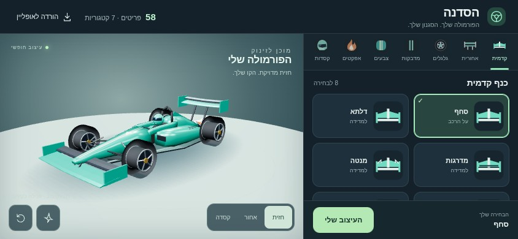

# חנות שדרוגי פורמולה — דוח מסירה

הושלמה חבילת 58 פריטי עיצוב לרכב הפורמולה הקיים, עם תצוגת חנות אינטראקטיבית, התקנה על הרכב, שתי שכבות צבע, שמירה מקומית והורדה לאופליין.

תאריך מסירה: 17.11.2026. ענף: `codex/racing-customize-v1`. בסיס העבודה: `43b27dc235387e3cb737aee9558cdf9d5fd5a262`.

כל הקבצים חדשים ורק בתוך `workout/island/design/racing-customize-v1/`. לא נערכו קובצי משחק, שמירה, גרסה או חדר בקרה קיימים. ההנחיה במשימה להגבלת התיקייה גוברת כאן על נוהל עדכון קובץ חדר הבקרה. קריטריון הסיום: כל 58 הפריטים, חיבור מדויק לרכב, אייקונים, תצוגה מקומית, רישיונות, נפח מתחת ל־8MB, אימות נקי ודחיפת הענף.

## פתיחה ובדיקה

1. פתחו את [preview.html](preview.html), שמכיל את כל משאבי התצוגה. בחרו קטגוריה ופריט; השינוי נראה מייד על הרכב. גרירה מסובבת את המבט; גלילה מקרבת.
2. בקטגוריית הצבעים בחרו גוף או פסים. כל אחת מעשר הדוגמיות זמינה לכל שכבה, ובסך הכול 100 שילובים עצמאיים.
3. לחצו על ״שמור עיצוב״ לשמירת הבחירה במכשיר, או על ״הורדה לאופליין״ לקבלת קובץ תצוגה עצמאי אחד.

תוצאה רצויה: החלפת פריט אחד אינה מכפילה חלקים, הפס נשאר עצמאי מצבע הגוף, והקובץ שהורד ממשיך לפעול ללא רשת. זו חנות קטלוג מבודדת; חיבור לרכישת פריטים בכסף המשחק נותר לשלב החיבור, בלי מחירים או חיובים מומצאים.

## מה נמסר

| קטגוריה | כמות | תוצר |
| --- | ---: | --- |
| כנפיים קדמיות | 8 | דגמי GLB בעלי פרופילי כנף, שכבות, הטיות ולוחות קצה שונים |
| כנפיים אחוריות | 8 | כנף נמוכה, גבוהה, מסגרת, תמיכות ברבור, כנף חצויה ועוד |
| גלגלים | 6 | חמישה חישורים, טורבינה, רשת, דיסק אוויר, חישורים כפולים, מסלול רטוב |
| מדבקות | 12 | 4 פסים, 4 כוכבים, 4 להבות; SVG שקוף 512×512, בלי כיתוב |
| צבעי רכב | 10 | גוף ופסים נפרדים; דוגמיות צבע וערכי חומר במניפסט |
| אביזרי אפקט | 6 | שני סוגי להבה, שני סוגי ניצוצות ושני סוגי עשן צבעוני; GLB עם שני פולטים ונתוני אפקט |
| קסדות | 8 | מעטפת ומשקף, עם הבדלי צבע, סנפיר, רכס, אוורור וצורה |

לכל פריט קובץ SVG נפרד בגודל 96×96 ושיוך קטגוריה במניפסט; בנוסף שבעה אייקוני קטגוריות. בסך הכול 37 קובצי GLB: ‏36 שדרוגים והעתק רכב בסיס מקומי עם ארבעה צמתי חיבור נוספים. המקור נשאר ללא שינוי. טווח השדרוגים: 188–2,128 משולשים לדגם; הרכב המקורי עצמו כולל 11,868 משולשים.

## נפח ותלויות

| רכיב | בתים |
| --- | ---: |
| כל החבילה, כולל מקור, בדיקות וצילומים | **4,805,212** |
| תצוגה עצמאית יחידה | 2,445,122 |
| כל 37 קובצי ה־GLB | 1,249,660 |
| GLB שדרוג הגדול ביותר | 74,608 |
| רכב הבסיס עם צמתי חיבור | 337,184 |

המגבלה היא 8,000,000 בתים, לפי MB עשרוני. אין WASM, ‏Draco, ‏meshopt, ‏KTX2, שרת נכסים, CDN, גופנים חיצוניים או שירות ענן. כל גאומטריית ה־GLB בלתי דחוסה; הצבעים הם חומרי PBR. רישיון Three המלא משובץ גם בקובץ התצוגה שמורידים. מדיניות התצוגה חוסמת תקשורת רשת.

## התאמה לרכב

התאימות נבדקה מול רכב השחקן המקורי שבענף הראשי, באמצעות חתימת מקור ומיקומי הצמתים. [manifest.json](manifest.json) מגדיר את החיבורים, ההחלפות, צירי הגלגלים, הגדלת הגלגלים האחוריים והקרנת המדבקות. [INTEGRATION.md](INTEGRATION.md) כולל דוגמה מעשית עם המודולים המקומיים.

יש להשתמש בסצנה המקורית לפני `mergeFormula` במשחק: המיזוג הקיים מאחד חלקים סטטיים, מוחק את שמות הכנפיים והקסדה ועובר גם על חלקים מוסתרים. בעת החיבור יש לדלג עליו עבור הרכב המותאם, או להחריג ממנו חלקים מתחלפים ומקורות מוסתרים. מתאם החבילה מזהה את הסצנה המקורית, מסתיר רק את החלק המוחלף ומשחזר אותו בסיום. המודלים הקלים של היריבים, הקופה והרכב החלופי אינם מסומנים כתואמים. אין שינוי בפיזיקה, בסרנים, במטבעות או בשמירות המשחק.

## אימות

| בדיקה | תוצאה | ראיות |
| --- | --- | --- |
| מאמת Khronos | 37 דגמים, **0 שגיאות, 0 אזהרות** | [assets.json](verification/assets.json) |
| בדיקות נכסים | 172 בדיקות: ספירות, חתימות, SVG, גבולות, נורמלים, משולשים וצמתים | אותו דוח |
| טעינה וחיבור | 116 בדיקות, כולל GLTFLoader רגיל ללא מפענחים | [runtime.json](verification/runtime.json) |
| ממשק ודפדפן | 89 בדיקות ועוד 100 שילובי צבעים | [browser.json](verification/browser.json) |
| רשת | 0 בקשות נכסים, 0 בקשות חיצוניות; 0 בקשות HTTP בהעתק שהורד | אותו דוח |
| החלפות חוזרות | 60 החלפות נוספות; שמונה מופעי שדרוג מחוברים לאורך כל הבדיקה | אותו דוח |
| בדיקות המאגר | 4,238 בדיקות; 4,174 עברו, 0 נכשלו, 64 דולגו | [repository-tests.json](verification/repository-tests.json) |
| היקף Git | כל השינויים הם הוספות בתיקייה החדשה בלבד | [delivery.json](verification/delivery.json) |

הודעות המידע היחידות של Khronos הן `NODE_EMPTY`: צמתי חיבור ופליטה ריקים במכוון. אין חומר לא בשימוש. טעינה בפועל נבדקה גם עם GLTFLoader של Three, ללא התקנת מפענח כלשהו.

בדיקות הממשק כוללות כל פריט, שתי שכבות הצבע, שמירה וטעינה מחדש, התאוששות משמירה פגומה, ניווט מקלדת, סיבוב מבט, כיבוי אפקטים, תנועה מופחתת, שתי אוריינטציות והורדה. מסמך ההורדה נפתח מחדש בהקשר אופליין נקי עם שבע קטגוריות ובלי שכפול ממשק.

## ביקורת חזותית

התצוגה נבדקה במידות 844×390 ו־390×844. לוחות ההשוואה מציגים כל דגם מורכב על הרכב בפועל; לא רק את האייקונים. נבדקו חזית, אחור, צמיגים, קסדות ואביזרי אפקט. הלהבה כוללת ליבה רציפה ושכבה חיצונית, הניצוצות הם קווים קצרים, והעשן משתמש בחלקיקים רכים וצבעוניים. הגימור האחרון נבדק שוב בדפדפן.

- [8 כנפיים קדמיות](verification/sheet-front-wings.jpg)
- [8 כנפיים אחוריות](verification/sheet-rear-wings.jpg)
- [6 גלגלים](verification/sheet-wheels.jpg)
- [8 קסדות](verification/sheet-helmets.jpg)
- [6 אביזרי אפקט](verification/sheet-effects.jpg)
- [מדבקות](verification/category-decals.jpg), [צבעים](verification/category-paints.jpg), [תצוגת אורך](verification/preview-390x844.jpg)

## גבולות האימות

סביבת הבדיקה היא Chromium עם SwiftShader במחשב Linux, ולא טלפון פיזי; אין הצהרת קצב פריימים לטלפון. מדיניות הדפדפן במכונה חוסמת ניווט ישיר לכתובות `file://`. לכן נבדקו התוכן המדויק של הקובץ העצמאי והקובץ שהורד במסמך מבודד כשכל הרשת מנותקת; ניווט קובץ ישיר לא מסומן כבדיקה שעברה.

רישיונות ומקורות ב־[LICENSES.md](LICENSES.md); הוראות שחזור ב־[source/README.md](source/README.md). מלאי SHA-256 ב־[verification/files.csv](verification/files.csv), למעט קובץ המלאי עצמו ודוח המסירה שמכיל את חתימתו.
