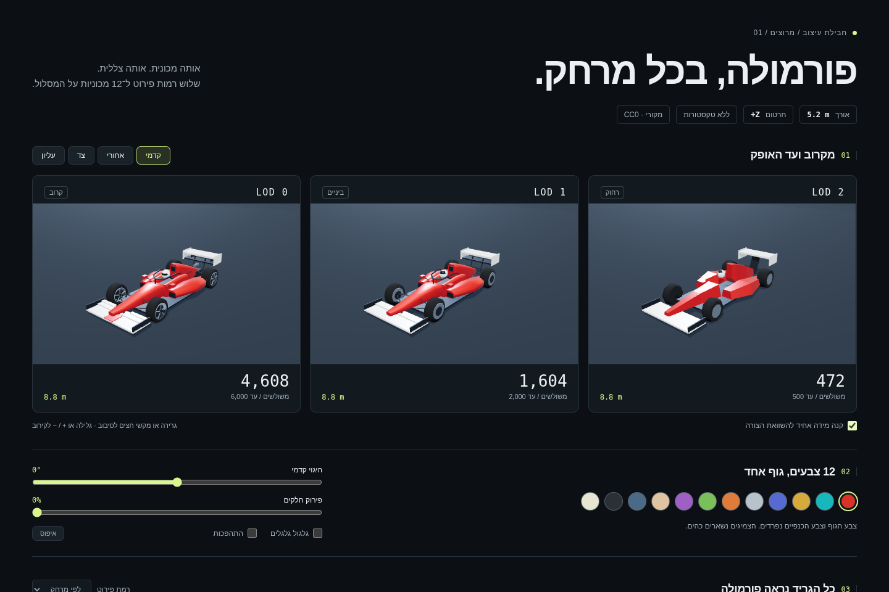
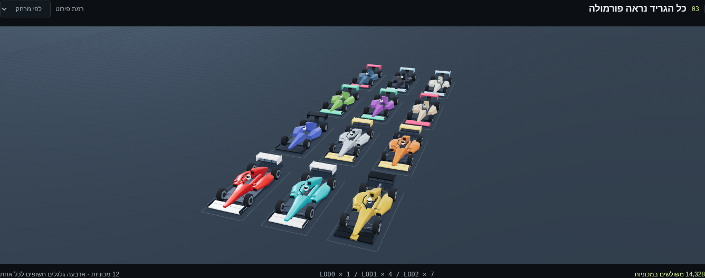
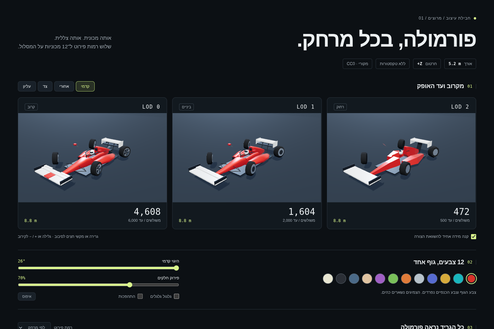

# פורמולה בשלוש רמות פירוט

נוצר ב־14 בנובמבר 2026, בענף `codex/racing-formula-cars-v1`, מתוך `main`:
`d759582c171600dd7c7df7906c2fb38ae7f8b88a`.

החבילה מספקת מכונית פורמולה מקורית אחת בשלוש רמות פירוט. גם הרמה הרחוקה
שומרת על חרטום ארוך, תא טייס פתוח עם קסדה, סיידפודים, מכסה מנוע מוגבה,
כנף קדמית ואחורית וארבעה גלגלים חשופים. חומרי הגוף, הכנפיים והחלקים
המשניים נפרדים וניתנים לצביעה בקוד.

כל התוספות נמצאות בתיקייה זו. קוד המשחק הפעיל, קובצי גרסה, תגי משאבים,
`CLAUDE.md`, תיקיית `ops` וקובצי הבדיקות הקיימים לא שונו.
זו חבילת נכסים ותצוגת סקירה; חיבור המכוניות למרוץ הפעיל הוא שלב נפרד.

## תוצאה ומגבלות

| רמה | משולשים בפועל | תקרה | גודל GLB ללא דחיסה | פרימיטיבים |
|---|---:|---:|---:|---:|
| LOD0 | 4,608 | 6,000 | 265,892 בתים / 259.7 KiB | 30 |
| LOD1 | 1,604 | 2,000 | 104,744 בתים / 102.3 KiB | 28 |
| LOD2 | 472 | 500 | 39,512 בתים / 38.6 KiB | 18 |

שלושת המודלים יחד: 410,148 בתים. המונים חושבו גם מהאינדקסים בקובצי
הייצוא וגם מהגאומטריה שנטענה בדפדפן. הם כוללים את כל חלקי המכונית,
לרבות קסדה, צמיגים, חישוקים, כנפיים ומראות. רצפת התצוגה והצללים אינם
חלק מספירת הנכס. מספר הפרימיטיבים רלוונטי גם לעלות קריאות הציור;
זו אינה מכונית עם קריאת ציור אחת.

בשלושת הייצואים: glTF 2.0 בינארי תקין, ללא Draco, ללא הרחבות, ללא תמונות,
ללא טקסטורות וללא קובצי חיץ חיצוניים. אין על הגאומטריה טקסט, מספרים,
מדבקות או מותגים. כל הקבצים החדשים מקוריים וברישיון CC0-1.0;
המקורות והתלויות הקיימות מפורטים ב־[LICENSES.md](LICENSES.md).

## צפייה

1. משורש המאגר מפעילים שרת קבצים:

   ```sh
   python3 -m http.server 8765
   ```

2. פותחים את [דף הסקירה בשרת המקומי](http://localhost:8765/workout/island/design/racing-formula-cars-v1/preview.html).
3. שלוש הרמות מוצגות זו לצד זו, ממרחקי מצלמה של 8.8, 15 ו־24 מטר.
   המונים נקראים מהמודלים שנטענו. אפשר לסמן קנה מידה אחיד כדי להשוות
   את שלושתן ממרחק 8.8 מטר. הרמות בכרטיסים קבועות בכוונה.
4. בוחרים אחד מ־12 צבעים, מחליפים מבט קדמי/אחורי/צד/עליון, גוררים לסיבוב,
   ומשתמשים בהיגוי, בגלגול, בפירוק ובהתהפכות. הכפתור איפוס משחזר את מצב המנוחה.
5. בתחתית הדף מופיעות 12 מכוניות ב־12 צבעים. אפשר לבחור רמה לפי מרחק,
   או לכפות כל אחת משלוש הרמות על כל המכוניות. כך אפשר לראות במפורש
   שגם 12 מכוניות ברמה הנמוכה שומרות על צורת פורמולה.

הדף משתמש בקובצי Three.js הקיימים במאגר, ללא בקשות רשת חיצוניות.
הפעלת הקובץ ישירות דרך `file://` אינה נתמכת בגלל טעינת מודולים ונכסים.
בתצוגת הסטודיו בלבד נוצרת מפת סביבה בזיכרון, ונוצרות מפות צל; הן אינן
מרקמים הכלולים ב־GLB. התצוגה משתמשת בהקשר WebGL אחד ובארבעה אזורי ציור,
ואינה מציירת שוב כל עוד אין שינוי או גלגול פעיל.





## מידות ומבנה משותף

היחידות הן מטרים; ציר Y חיובי כלפי מעלה, החרטום ב־Z חיובי ושמאל הנהג
ב־X חיובי. השורש במרכז המכונית, בגובה מישור המגע של הצמיגים.
בכל הרמות גבולות Z הם בדיוק ‎−2.6 עד ‎+2.6 מטר, כלומר אורך 5.2 מטר.
הגבולות הכוללים זהים: X בין ‎−1.04 ל־‎+1.04, ו־Y בין 0 ל־1.07 מטר.

| חלק | מרכז במטרים, לפי X/Y/Z | ציר תנועה |
|---|---|---|
| גלגל קדמי שמאלי | 0.845 / 0.355 / 1.50 | גלגול סביב X, רדיוס 0.355 |
| גלגל קדמי ימני | ‎−0.845 / 0.355 / 1.50 | גלגול סביב X, רדיוס 0.355 |
| גלגל אחורי שמאלי | 0.825 / 0.375 / ‎−1.55 | גלגול סביב X, רדיוס 0.375 |
| גלגל אחורי ימני | ‎−0.825 / 0.375 / ‎−1.55 | גלגול סביב X, רדיוס 0.375 |

אותם 15 שמות צמתים ואותם יחסי הורות קיימים בכל הרמות:

```text
formula_car
├── chassis
├── wing_front
├── wing_rear
├── engine
├── helmet
├── steer_front
│   ├── steer_fl
│   │   └── wheel_fl
│   └── steer_fr
│       └── wheel_fr
├── mirror_l
├── mirror_r
├── wheel_rl
└── wheel_rr
```

`steer_front` הוא ענף ההיגוי. מסובבים את שני ילדיו, `steer_fl` ו־`steer_fr`,
סביב Y המקומי שלהם, ואז את צמתי `wheel_*` סביב X המקומי. את ההורה
המשותף משאירים ללא סיבוב, כדי שכל גלגל יפנה סביב המרכז שלו ולא יקיף
את מרכז הסרן. הפעולה `motion` במתאם המצורף מבצעת זאת, וכיוון הגלגול
קדימה הוא זווית חיובית: המרחק במטרים חלקי רדיוס הגלגל.

הירידה ברמת הפירוט מפחיתה חתכים, מקטעי צמיגים ופרטי חישוקים; היא אינה
משנה את נקודות החיבור. ברמה הנמוכה הושמטו ההילה סביב תא הטייס, פרטי
המנוע הקטנים והלהבים הנוספים של הכנפיים. שתי הכנפיים הראשיות,
לוחות הקצה, המנוע, תא הטייס, הקסדה, המראות והגלגלים נשמרו.

## חומרים וצביעת קבוצות

| שם חומר | תפקיד |
|---|---|
| `body_team` | חרטום, מרכב, סיידפודים, מכסה מנוע ובתי מראות; צבע המכונית |
| `wing_team` | כנפיים ולוחות קצה אחוריים; צבע משלים עצמאי |
| `secondary` | רצפה, מתלים, הילה, תמיכות ופרטים כהים; ניתן לצביעה בנפרד |
| `tire` | גומי כהה ומחוספס |
| `alloy` | חישוקים ומראות |
| `helmet` | קליפת קסדה ללא סימונים |
| `visor` | משקף כהה |

ב־`main` קיימות שש קבוצות בליגה ו־12 צבעי מכוניות. התצוגה משתמשת ב־12
צבעי הגוף הקיימים ומדגימה צבעי כנפיים נפרדים. היא אינה משנה את נתוני
הקבוצות. אפשר להעביר למתאם אובייקט עם `color` מתוך `TEAMS`, ובמידת
הצורך לציין גם `accent` ו־`secondary`.

דוגמת חיבור עתידית מתוך מודול שתיקיית הבסיס שלו היא `workout/island`:

```js
import {
  loadFormulaTemplates, createFormulaCar,
} from './design/racing-formula-cars-v1/model.mjs';

const templates = await loadFormulaTemplates();
const car = createFormulaCar(templates[1], TEAMS[teamIndex]);
scene.add(car.root);
car.paint({accent: '#f4f5f2', secondary: '#202730'});
car.motion(metresTravelled, steeringRadians);
// בעת הסרת מופע: משחרר רק את החומרים שלו; הגאומטריה משותפת לתבניות.
car.dispose();
```

כל מופע מקבל עותקים משלו לשבעת החומרים. גאומטריה משותפת בין מופעים
של אותה רמה. מומלץ להתחיל מעברים ב־18 וב־42 מטר מהמצלמה ולהוסיף
היסטרזיס לפי צורכי המשחק. המתאם מייצא את המרחקים, אך אינו מחבר לוגיקת
בחירה למשחק. במצב הגריד של הסקירה המעברים הם 23 ו־31 מטר כדי להציג
תערובת רמות במסגרת מצלמת הסטודיו. במצב נייד המצלמה רחוקה יותר.

## חלקים להתהפכות

השלד הוא היררכיית חלקים קשיחים, ללא skin או עצמות עיוות. הכנף הקדמית,
כל אחד מארבעת הגלגלים ושתי המראות הם ענפים עצמאיים עם ציון
`detachable`, תפקיד ומסת המחשה במטא־נתונים. בתי המראות כוללים גם את
הגבעולים שלהם. פירוק אינו דורש פיצול משולשים בזמן הריצה.

```js
car.explode(0.7); // הדגמת הפרדה בין 0 ל־1
car.explode(0);   // חזרה מדויקת לנקודות החיבור

// לשילוב עם פיזיקה קיימת, שומר על מיקום העולם של החלק:
car.root.updateMatrixWorld(true);
const wheel = car.root.getObjectByName('wheel_fl');
scene.attach(wheel);
```

המתאם מדגים גלגול והפרדת חלקים באופן הפיך. הוא אינו מנוע התנגשות או
סימולציית נזק. המסות הן נקודת התחלה לכוונון, ולא נתונים הנדסיים.



## אימות שבוצע

האימותים בוצעו על הקבצים החדשים ובדפדפן מקומי; סקריפטי הסקירה וחבילות
האימות נשארו מחוץ למאגר. לא נוספו או נערכו קובצי בדיקה במאגר.

- שלושת הקבצים עברו glTF Validator: אפס שגיאות, אפס אזהרות ואפס הערות.
- סריקת המשולשים לא מצאה משולשים מנוונים או נורמלי הצללה בכיוון מנוגד.
- נבדקו מידות, חתימות, שמות הצמתים, ההיררכיה, החומרים והיעדר מרקמים ודחיסה.
- 12 בחירות הצבע משנות את שלושת הדגמים; בגריד נמדדו 12 צבעים שונים תואמים.
- בהיגוי של 26 מעלות שני הסרנים הקדמיים פונים וכל מרכזי הגלגלים נשארים במקומם.
- הגלגול שומר על יחס הרדיוסים הקדמי והאחורי; פירוק והתהפכות חוזרים למנוחה באיפוס.
- כל שלוש בחירות הרמה לגריד פועלות; מספרי המשולשים ל־12 מכוניות הם 55,296 / 19,248 / 5,664.
- במצלמת המחשב בברירת המחדל: רמה גבוהה אחת, ארבע בינוניות ושבע נמוכות — 14,328 משולשים במכוניות.
- לאחר תשעה מעברים נוספים בין הרמות, מספר הגאומטריות בזיכרון נשאר קבוע.
- נבדקו תצוגות 390×844, ‏844×390, ‏768×1024 ו־1440×960 ללא גלילה אופקית.
- לא נרשמו שגיאות דפדפן או בקשות רשת מחוץ לשרת הקבצים המקומי.

חפיפת צלליות מול הרמה הגבוהה נמדדה בחמש זוויות, עם מצלמה אורתוגרפית
ומסכה בינארית בגודל 320×320. המדד הוא שטח החיתוך חלקי שטח האיחוד,
כולל חללים בין החלקים; הוא מסייע לזהות שינויי צורה ואינו ציון איכות חזותית.

| מבט | LOD1 מול LOD0 | LOD2 מול LOD0 |
|---|---:|---:|
| קדמי | 98.0% | 81.4% |
| אחורי | 98.0% | 80.1% |
| צד | 96.3% | 87.5% |
| עליון | 99.1% | 95.2% |
| אלכסוני | 95.7% | 89.6% |

הנתונים המפורטים ב־[evidence/review.json](evidence/review.json).
הצילומים נבדקו במחשב ובמידות נייד, לרבות
[שלוש הרמות בנייד](evidence/mobile.png) ו־[12 מכוניות ברמה הנמוכה בנייד](evidence/mobile-field.png).
הדפדפן השתמש ב־ANGLE/SwiftShader על השרת; לא נמדדו ביצועים או חום
בטלפון פיזי ואין כאן טענת קצב פריימים למכשיר כזה.

## שחזור

```sh
python3 workout/island/design/racing-formula-cars-v1/source/build.py
```

המחולל משתמש רק בספרייה התקנית של Python וכותב מחדש את שלושת קובצי
ה־GLB ואת המניפסט שבתיקייה זו. הייצוא דטרמיניסטי; אין הורדות או חותמת
זמן משתנה בתוך הנכסים. [manifest.json](manifest.json) מכיל חתימות SHA-256,
ספירה לפי חלק, גבולות גאומטריים ושמות צמתים לכל רמה.
