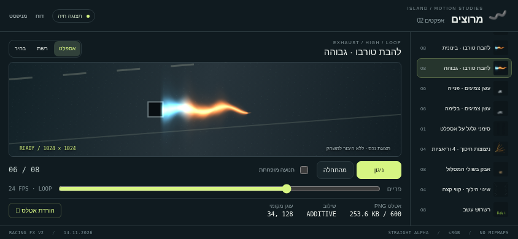

# מרוצים — אפקטים v2

מסירה: 14.11.2026. ענף: `codex/racing-fx-v2`. בסיס: `f5f2b40814fc0e2186daed1ac100a8d806dd3a7d`.

חבילת אפקטים מקורית למשחק המרוצים: **61 פריימי PNG שקופים בגודל 256×256 ו־10 אטלסי PNG שקופים בגודל 1024×1024**. כל אטלס קטן מ־600,000 בתים, גם לפי ההגדרה המחמירה של KB עשרוני. האטלס הגדול ביותר: **253,590 בתים**. סך האטלסים: **1,334,776 בתים**; הפריימים הנפרדים: **1,311,582 בתים**. קובצי הפריימים מיועדים לעריכה/עיון; בריצה טוענים את האטלסים בלבד.

כל השינויים מוגבלים לתיקייה החדשה `workout/island/design/racing-fx-v2/`. לא שונו קבצים קיימים, לוגיקת משחק, תגי גרסה או `ops/CONTROL.md`. פרטי המסירה נרשמו כאן בהתאם להגבלת התיקייה שבבקשה. החבילה אינה מופעלת עדיין במשחק.

## תוצרים ומשקלים

| אפקט / מזהה | פריימים | ניגון | משקל אטלס, בתים | מקום ושילוב |
|---|---:|---|---:|---|
| `turbo-low` | 8 | לולאה, 24 fps | 131,332 | עוגן אגזוז, additive |
| `turbo-medium` | 8 | לולאה, 24 fps | 192,810 | עוגן אגזוז, additive |
| `turbo-high` | 8 | לולאה, 24 fps | 253,590 | עוגן אגזוז, additive |
| `tire-drift` | 6 | פנייה, 15 fps, ‏400ms | 107,474 | מאחורי הצמיג, normal |
| `tire-brake` | 6 | בלימה, 18 fps, ‏333ms | 127,073 | מאחורי הצמיג, normal |
| `skid-marks` | 1 | טקסטורה סטטית | 40,496 | זוג עקבות על האספלט, normal |
| `wall-sparks` | 4 וריאציות | לבחור אחת למגע, ‏180ms | 143,552 | נקודת חיכוך בקיר, additive |
| `road-dust` | 8 | 16 fps, ‏500ms | 149,120 | מגע בשוליים, normal |
| `gear-shift` | 4 | 30 fps, ‏133ms | 45,697 | קווי מסך קצרים בשוליים, additive |
| `grass-rustle` | 8 | 20 fps, ‏400ms | 143,632 | עשב נע וגזירים קטנים ליד הקרקע, normal |

השפה החזותית נשענת על כיוון המרוצים הקיים בריפו: להבה חמה עם ליבה תכולה, עשן אפור בהיר, ניצוצות ענבר, אבק חול ועשב ירוק. לא סופק רפרנס חיצוני ולא נעשתה העתקה מתמונה או מנכס קיים. שלוש עוצמות הטורבו שונות באורך, ברוחב ובשטח הזוהר, ונבדק שסך ה־alpha עולה מעוצמה לעוצמה. הפאזות מחזוריות; אין שכפול של אותו פריים שמונה פעמים.

## תצוגה

1. פותחים את [preview.html](preview.html) בשרת מקומי. משורש הריפו:

   ```sh
   python -m http.server 8765 --bind 127.0.0.1
   ```

2. נכנסים לכתובת:

   ```text
   http://127.0.0.1:8765/workout/island/design/racing-fx-v2/preview.html
   ```

3. בוחרים אפקט, מחליפים בין אספלט/רשת שקיפות/רקע בהיר, משהים ומזיזים את בורר הפריים. בוחרים תקציב נייד כדי להציג את תת־הקבוצה המתאימה. אפשר להפעיל תנועה מופחתת ולהוריד את האטלס.

התוצאה הצפויה: כל עשרת האפקטים נטענים, אין רקע אטום בספרייט, ההשהיה מקפיאה את השעון, מרכז קווי ההילוך נשאר פנוי, והעמוד נכנס בשלמותו ל־**844×390**. רשימת האפקטים גוללת בתוך העמוד; אפשר להגיע גם לאבק ולעשב. במחשב מופיעה גם רצועת פריימים. נבדקו בנוסף 390×844 ו־1440×960.

אפשר לפתוח אפקט ישירות באמצעות `?effect=wall-sparks` או כל מזהה אחר במניפסט. התצוגה משתמשת באטלס של האפקט הנבחר ובפריימים קטנים עבור התמונות המקדימות; אינה טוענת את כל עשרת האטלסים יחד. משטח האספלט ופתח האגזוז הם אביזרי בדיקה בלבד. אין בתצוגה סימולציה של המרוץ או טענה לצילום מהמשחק.



דפדפן Chromium המנוהל בסביבה חסם ניווט `file://` באמצעות `ERR_BLOCKED_BY_ADMINISTRATOR`. הבדיקה בוצעה דרך HTTP מקומי. אין בתצוגה תלות ברשת חיצונית, ב־CDN, בספרייה או בגופן להורדה. `manifest.js` הוא עותק נתונים שנוצר אוטומטית מאותו מקור של `manifest.json`; בדיקת הנכסים מוודאת שהם זהים.

## חוזה לחיבור עתידי

[manifest.json](manifest.json) הוא מקור הנתונים. כל נתיב יחסי לתיקייה זו; בכל אפקט רשומים קצב, משך, עוגן בפיקסלים, מצב ניגון, שיטת שילוב ו־SHA-256. כל פריים כולל קובץ נפרד ומלבן מקור `[x,y,w,h]` באטלס. הספירה מ־0, משמאל לימין ומלמעלה למטה, ארבעה תאים בשורה. התאים שאינם בשימוש שקופים לגמרי. אין להנפיש אותם.

| עניין | הנחיה |
|---|---|
| צבע ושקיפות | PNG RGBA8, צבע sRGB, ‏straight alpha. Normal: ‏`SRC_ALPHA / ONE_MINUS_SRC_ALPHA`; additive: ‏`SRC_ALPHA / ONE`. לא להכפיל alpha פעמיים. |
| סינון | Linear, ‏clamp-to-edge, ללא mipmaps; שמונה פיקסלים שקופים בכל קצה תא. UV inset של חצי פיקסל. |
| UV | מלבנים נמדדים מהפינה השמאלית העליונה. ל־UV שמתחיל למטה: `u0=(x+0.5)/1024`, ‏`v0=1-(y+255.5)/1024`, ‏`du=dv=255/1024`. יש להתחשב ב־flipY של המנוע. |
| עוגן | `pivotPx` נמדד בפריים 256. מציבים את נקודת האירוע במקום העוגן, לא בהכרח במרכז המלבן. |
| כיוון | טורבו וניצוצות פונים מקומית ל־+X; מסובבים את המופע לכיוון הפליטה/ההתזה הרצוי. עשן ואבק מתפתחים למעלה מהעוגן. |
| עומק | באפקטי עולם: depth-test פעיל, depth-write כבוי; סימני גלגל כ־decal עם הסטה קטנה מהכביש למניעת הבהוב. באפקט הילוך: שכבת מסך, depth-test כבוי. |
| תזמון | זמן האפקט מקומי. מקפיאים בהשהיה, מאפסים בחידוש משחק ומנקים ביציאה. חד־פעמיים נעצרים בסוף משכם. בתצוגה בלבד הם חוזרים לאחר הפסקה לביקורת. |
| מעטפת | מחילים `opacityEnvelope` עם אינטרפולציה ליניארית. בעת כניסה/יציאה מטורבו מחילים fade של 90ms. |
| ניצוצות | בוחרים וריאציה אחת מתוך ארבע לכל מגע מאומת. **אלו ארבע חלופות, לא רצף אנימציה**. דועכים במשך 180ms לפי המעטפת. |
| סימני גלגל | טקסטורת זוג עקבות עם קצוות דועכים; אינה אריח רציף. דועכת עד 12 שניות; opacity חיצוני עד 0.65. מסובבים לאורך כיוון ההחלקה. |
| שינוי הילוך | אירוע הילוך מאומת בלבד, פרץ של 133ms. ‏36% המרכזיים ברוחב הפריים שקופים לכל גובהו. opacity חיצוני עד 0.55; מסכה נוספת לפי מקום ה־HUD. |
| עשב | הצבה על שולי הדשא, ספרייט זקוף מעוגן בקרקע. הרשרוש הוא משוב חולף, לא החלפה של מודל הסביבה. |

טריגרים מוצעים: טורבו רק כשמצב טורבו פעיל; עשן פנייה בעת החלקה במהירות; עשן בלימה בבלימה חזקה; עקבות רק כשהצמיג מחליק; ניצוץ רק במגע מתמשך עם קיר, עם cooldown; אבק רק על שוליים יבשים; עשב רק במעבר באזור עשב. יש לחבר לאירועי המשחק האמיתיים, בלי לשנות פיזיקה או להתיז ניצוצות אקראיים בזמן פנייה רגילה.

## תקציב נייד

כל אטלס PNG מתפענח ל־**4 MiB ב־RGBA8**, ללא mipmaps. משקל ההורדה אינו זיכרון GPU. אין צורך לטעון את שלוש עוצמות הטורבו יחד. שלוש הדרגות הן הצעות תכנון לחיבור; הבורר בתצוגה מסנן נכסים ואינו מדמה ביצועי חומרה.

| דרגה | תת־קבוצה תושבת | הורדה, בתים | זיכרון RGBA8 | תקרת מופעים / ציורים ללא איגוד |
|---|---|---:|---:|---:|
| חלש | טורבו נמוך, עשן בלימה, עקבות | 298,901 | 12 MiB, ‏3 אטלסים | 12 |
| מאוזן | טורבו בינוני, שני סוגי עשן, עקבות, ניצוצות, אבק | 760,525 | 24 MiB, ‏6 אטלסים | 20 |
| חזק | טורבו גבוה, שני סוגי עשן, עקבות, ניצוצות, אבק, קווי הילוך, עשב | 1,010,634 | 32 MiB, ‏8 אטלסים | 28 |

התקרה היא משותפת; `instanceCaps` במניפסט מגדיר חלוקה. לכל מופע quad שני משולשים. מומלץ איגוד מופעים באותו חומר, מאגרים קבועים ללא הקצאות בפריים, ביטול מופעים רחוקים והגבלת סכום שטחי מלבני אפקטי העולם על המסך ל־20%/32%/45%, כולל האזורים השקופים שבתוכם. בדרגה הגבוהה בלבד מותר מלבן מסך נוסף של 100% לקווי ההילוך, למשך 133ms; עלותו אינה נכללת בתקרת אפקטי העולם. שיעורי ההנפקה המינימליים: 160/100/70ms. אין צורך ב־bloom, תאורה דינמית, טשטוש מסך או render target נוסף.

בנייד חלש משתמשים בעשן הבלימה הכללי גם לפנייה, ומשמיטים אבק, ניצוצות, קווי הילוך ועשב. בתנועה מופחתת מכבים קווי הילוך ועשב, מקפיאים את הטורבו לפריים 0, מגבילים לעשן אחד וניצוץ אחד ומשמיטים רעידת מצלמה. אין כאן הבטחת FPS; נדרש לבדוק עומס מילוי ופענוח לאחר החיבור, בטלפון פיזי.

## בדיקות ושחזור

- [verification/assets.json](verification/assets.json): עבר. בדיקת PNG/RGBA8 ומידות; משקלים וחתימות; התאמה פיקסל־מול־פיקסל בין כל פריים לתא באטלס; שוליים שקופים ותאים ריקים; שונות הפריימים; שקיפות מרכז קווי ההילוך; התפוגגות עשן ואבק; סדר עוצמות הטורבו ורציפות התפר המחזורי; התאמת שתי גרסאות המניפסט; תקציבי הדרגות.
- [verification/browser.json](verification/browser.json): בדיקת Chromium אמיתית: כל עשרת האטלסים, בחירת אפקט ופריים, עצירה/המשך, שלושה רקעים, שלוש דרגות איכות, תנועה מופחתת ידנית ומערכתית, כפתורי הורדה והתאמה למידות המסך. צילומי כל האפקטים נשמרו ב־`verification/`. ללא שגיאות דף או בקשות חיצוניות.
- בדיקות תחביר JavaScript: `preview.js` ו־`manifest.js`.
- [verification/repository-tests.json](verification/repository-tests.json): ההרצה הראשונית של `npm test` סיימה עם 3,277 שעברו, 56 שדולגו וכישלון אחד ב־`tests/workout-royiki.test.mjs`. הסיבה: קובץ `chromium_headless_shell-1234` אינו מותקן; השרת של הבדיקה נשאר פתוח לאחר כשל ההפעלה, ולכן הופסק תהליך הבדיקה לאחר 492 שניות כדי לקבל דוח. הורצה שוב הבדיקה הזו בלבד עם מתאם Chromium המערכת הקיים בריפו: **5/5 עברו, 0 נכשלו**, בתוך כ־25 שניות. ההרצה הכללית המקורית אינה מוצגת כהרצה ירוקה; התקלה הסביבתית אומתה ותוקנה בהרצה הממוקדת, ללא שינוי קבצים קיימים.

שחזור הנכסים, מתוך תיקיית החבילה, עם Python 3.12, ‏numpy ו־Pillow:

```sh
python tools/build_assets.py
python tools/validate_assets.py
```

בדיקת הדפדפן דורשת Playwright ו־Chromium, כשהשרת המקומי פועל:

```sh
python tools/verify_preview.py
```

ההרצה החוזרת של בדיקת הריפו בוצעה משורש הריפו:

```sh
ISLAND_PLAYWRIGHT="$PWD/workout/island/design/racing-v7/source/playwright-system.mjs" node --test tests/workout-royiki.test.mjs
```

אפשר לקבוע `CHROMIUM_PATH` ו־`RACING_FX_BASE_URL` בסביבה. כל כלי היצירה והאימות כותבים רק לתיקייה זו. גרסאות היצירה שנבדקו: Python 3.12, ‏numpy 2.3.5, ‏Pillow 12.3.0. הפיקסלים נוצרים באופן דטרמיניסטי; גרסת דחיסת PNG אחרת עשויה לשנות בתים/חתימות ולכן יש ליצור מחדש גם את המניפסט.

## מקור ורישיון

כל האפקטים נוצרו במיוחד למשימה באמצעות [tools/build_assets.py](tools/build_assets.py), ללא נכסי קלט. אין תמונות חיצוניות, קובצי מקור קיימים שעברו שינוי, סמלי משחק/יצרן או מותגים. רישיון MIT מלא ב־[LICENSE.txt](LICENSE.txt), החל רק על התיקייה החדשה. התצוגה משתמשת ב־Canvas 2D ובגופני מערכת; כלי היצירה והבדיקה אינם נדרשים בזמן ריצה.
