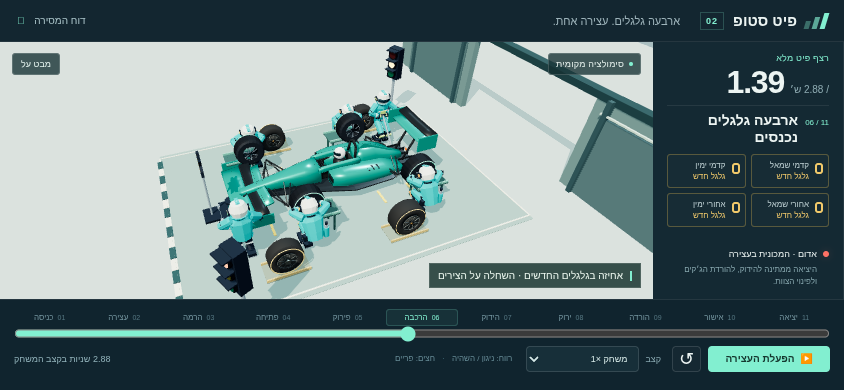

# רצף פיט אמיתי בשלבים — v2

מסירה בענף `codex/racing-pit-sequence-v2`, על בסיס
`codex/racing-pit-v1` בקומיט `13f387931b2f54e48dfab3d5b02258ef535dfc77`.
כל השינויים הם **קבצים חדשים בתיקייה זו בלבד**. קוד המשחק וקבצים קיימים
לא נערכו. קראתי את דוח v1, חוזה הקליפים והשלד הקנוני לפני העבודה.

[תצוגה אינטראקטיבית](preview.html) · [לוח הזמנים](sequence.json) ·
[חוזה API](API.md) · [רישיונות](LICENSES.md)



## מה השתנה ביחס לחבילת v1

v1 כלל תצוגת נכסים של 21.8 שניות וג׳ק יחיד. כאן יש רצף של **2.88 שניות
בקצב המשחק**, כולל הכניסה והיציאה, ארבעה מכונאי גלגלים ושני מפעילי ג׳ק.
לכל תחנה גלגל ישן וחדש בעלי זהויות שונות: הגלגל הישן יוצא מהציר, מוחזק,
משתחרר למגש נפרד; החדש נלקח מהמגש שלו, מוכנס לציר ומהודק באקדח.
האקדח עובר לבסיס בזמן העבודה בגלגל. אין החלפת צבע בלבד או העלמת גלגלים
כדי לייצג את הפעולה.

הזמנים הם כוראוגרפיה קצרה בקצב המשחק, ולא תזמון תפעול של צוות אנושי
בן שישה אנשים בעולם האמיתי. אין הכפלת מהירות גורפת של קליפ v1 ארוך.
פעולות חדשות וקומפוזיציות שלהן נכתבו במפורש ונמדדו במשך האמיתי שנמסר.
הרמת היד הוקצתה ל־0.20 שניות אחרי ש־0.12 שניות נכשלו בבדיקת התנועה;
משך הרצף נשאר בטווח 2–3 שניות שהתבקש.

## לוח זמנים בקצב 1×

| שלב | התחלה | סוף | מבצע ותוצאה |
|---|---:|---:|---|
| כניסה לתא | 0.00 | 0.38 | המכונית מתקדמת אל הסימון |
| עצירה | 0.38 | 0.46 | המכונית מיושרת ונעצרת לפני תחילת השירות |
| הרמה | 0.46 | 0.66 | הג׳ק הקדמי והאחורי מרימים 0.16 מ׳ |
| פתיחת האומים | 0.66 | 0.88 | ארבעת המכונאים מפעילים אקדח בכל תחנה |
| הוצאת ישנים | 0.88 | 1.24 | ארבעה גלגלים יוצאים, נאחזים ומשתחררים למגש |
| הכנסת חדשים | 1.24 | 1.62 | ארבעה גלגלים אחרים נאחזים ומורכבים על הצירים |
| הידוק | 1.62 | 1.88 | ארבעה אקדחים מהדקים; אישור נפרד לכל אום |
| ירוק | 1.88 | 1.96 | סיום השירות; המכונית עדיין עומדת |
| הורדה ופינוי | 1.96 | 2.10 | שני הג׳קים יורדים ומתפנים; ידיים נסוגות |
| הרמת יד | 2.10 | 2.30 | מפעיל הג׳ק הקדמי מרים יד |
| יציאה | 2.30 | 2.88 | המכונית יוצאת לאחר שכל התנאים מתקיימים |

ארבעת מכונאי הגלגלים עובדים במקביל; שלבים תלויים אינם חופפים.
המכונית עומדת על הסימון מ־0.38 עד 2.30. שירות הגלגלים עצמו נמשך
1.22 שניות. התצוגה כוללת ¼× ו־⅒×, גרירה בזמן, ניגון חוזר ומבט על לבדיקה.

## שיוך דמויות וחיבורי אביזרים

| דמות | תחנה ואחריות |
|---|---|
| `wheel_front_left` | קדמי שמאל: אקדח, גלגל ישן וחדש משלו |
| `wheel_front_right` | קדמי ימין: אקדח, גלגל ישן וחדש משלו |
| `wheel_rear_left` | אחורי שמאל: אקדח, גלגל ישן וחדש משלו |
| `wheel_rear_right` | אחורי ימין: אקדח, גלגל ישן וחדש משלו |
| `jack_front` | ג׳ק קדמי ואות היד בסיום |
| `jack_rear` | ג׳ק אחורי |

`sequence.json` מפרט לכל דמות את הקליפ, הקובץ, טווח הזמן בקובץ וטווח הזמן
ברצף. הוא כולל תלויות, אירועי גלגלים, נקודות ציר, מגשי גלגלים וחלונות
בעלות על אביזרים. `clips/contracts.json` מתעד את הקליפים והשלד.

השלד זהה ל־v1: **18 עצמות**, כולל `Root`, עם שמות, הורות ותרגומי מנוחה
זהים. היחידות מטרים, ‎+Y מעלה, ‎+Z קדימה, קוואטרניונים מקומיים `xyzw`.
תנועת השורש של הצעד הקצר אפויה ומוחלת פעם אחת בלבד. הגלגל המוחזק מחובר
ל־`LeftHand` בהיסט אחיזה קבוע; היד השנייה מגיעה לשפה בעזרת IK של שתי
עצמות, ללא הארכת גפיים. האקדח מחובר ל־`RightHand` בעבודה ולבסיס בזמן
החלפת הגלגל. גוף המכונית מקבל את ההרמה פעם אחת בלבד.

בסיסי מכונאי הגלגלים נמצאים ב־‎±1.40 מ׳, עם התאמת רכינת גו קבועה המתועדת
ב־JSON. כך הברכיים נשארות מחוץ לצמיגים והידיים מגיעות לשפה החיצונית.
מפעילי הג׳קים עומדים בצד הנתיב ומחזיקים ידיות מוארכות; פדי ההרמה נוגעים
בתחתית המכונית שנמדדה מהמשולשים של המודל. שחרור השסתום ב־2.00 מאפשר
לידיים לסגת בזמן שהבוכנות משלימות הורדה עד 2.04, לפני הפינוי הצידה.
קישור ההרמה בתצוגה מותאם בגאומטריה חדשה; קובץ הג׳ק המקורי לא נערך.

ה־preview מחבר את הנכסים ומתקן את הגעת הידיים לכלי ולגלגל בעולם. לכן
נבדקים גם קובצי ה־GLB בפני עצמם וגם הפוזות שנמדדו מתוך הסצנה בפועל.
מדידות המגע נגזרות מהטרנספורמציות של האובייקטים המרונדרים.

## מכונת מצבים וחיבור עתידי

`src/pit-sequence.mjs` הוא מודול JavaScript טהור עם API בגרסה `1.0.0`.
הוא תומך ב־`start`, `pause`, `update`, `seek`, `reset`, snapshot קפוא,
אירועים, אישור ארבעת האומים ובקרת נתיב יציאה. [החוזה המלא ודוגמה](API.md).
אין טיימר פנימי, תלות ב־DOM או צורך ב־Three.js מצד המנוע.

הירוק מציין סיום שירות לפני הורדת הג׳קים, כפי שהתבקש. `canExit` מחכה
גם להורדה ולפינוי של שני הג׳קים, לפינוי הידיים, להשלמת אות היד ולנתיב
פנוי. במצב `autoConfirm:false` הרצף נעצר ב־1.88 באדום עד קבלת ארבעה
אישורים. דילוג פריים אינו עוקף את השער; זמן חסום אינו נצבר כחוב.
בדמו המקומי האישורים אוטומטיים; בחיבור למשחק הם צריכים להגיע מאימות
הפעולה במשחק. זו מסירת נכסים ומנוע רצף לבדיקה, ללא חיבור למשחק הקיים.

## תוצאות אימות

- **בדיקות המנוע:** 19 מתוך 19 עברו. כוללות משך כולל, סדר ותלויות, שמונה
  זהויות גלגל שונות, בעלות רציפה, ארבע החלפות ואישורי אום, דילוגי פריימים,
  חסימת נתיב בזמן יציאה, seek/reset, אי־שינוי snapshots, ולידציה של
  תחנות, מסלולים ואירועים. אירועי ההידוק נשלחים לפני שער האישור כדי לא
  ליצור קיפאון אצל מאזין חיצוני.
- **GLB:** ביקורת מבנית ב־JavaScript עברה על כל 13 קובצי הדמויות, המכונית,
  האנימציה והאביזרים שבתצוגה. נבדקו 18 מפרקים קנוניים בדיוק, מפתחות סופיים,
  קוואטרניונים מנורמלים, טווחי כל הקליפים והיעדר באפרים חיצוניים ודחיסה
  אסורה. זו ביקורת מבנית, לא טענה להרצת Khronos Validator.
  [פלט](verification/assets.json).
- **Motion QA לקליפים:** 16 קליפים, מינימום **89.0**, כיסוי 100% מהמדדים
  החלים וללא מדדים אדומים. הרף הוא גדול מ־88. כולל הפעולות הקצרות,
  פוזות החזקה ושני רצפים מורכבים.
  [ציונים](verification/motion-qa.json) ·
  [מקור וטביעות אצבע](verification/motion-qa-provenance.json).
- **תנועה בסצנה בפועל:** 185 דגימות ב־60Hz ובזמני האירועים המדויקים,
  לכל ששת אנשי הצוות. נבדקו גם כל הרצף וגם חלון השירות — 12 בדיקות,
  מינימום **89.7**, כיסוי מלא וללא מדדים אדומים או מידע חסר. נתוני
  המפרקים, הסיבובים ונקודות הסוליה נלקחו מהסצנה לאחר IK והתאמת התנוחה.
  [ציונים](verification/runtime-motion-qa.json) ·
  [מקור וטביעות אצבע](verification/runtime-motion-qa-provenance.json).
- **מגע ורציפות:** אחיזות שתי הידיים בשפת הגלגל כשנדרשות, שקע האקדח,
  ידיות הג׳קים ופדי ההרמה עברו בדיקת מיקום מתוך הסצנה. מעברי בעלות על
  הגלגלים נבדקו גם 10 מיקרושניות לפני ואחרי האירועים; לא נמצאה קפיצת
  מיקום. הפרש המיקום הגדול במרווח דגימה כזה היה 0.048 מ״מ. נבדק גם
  שחזרה לאותו זמן מסדרי seek שונים נותנת אותה פוזה.
  [דגימות המגע](verification/contacts.json).
- **תמיכה ופינוי:** בדיקת ray–triangle ישירה על משולשי מכונית הפורמולה
  אישרה שפני הפדים נוגעים בתחתית המודל בתוך רף 1 מ״מ. הג׳ק האחורי
  משתמש בפד צר כדי להימנע מהסנפיר המרכזי. המפעילים והג׳קים לאחר פינוי
  נמצאים מחוץ למסדרון רוחב המכונית; שולי הג׳ק האחורי כ־4.3 ס״מ.
  [נתונים ושיטת הדגימה](verification/supports.json).
- **דפדפן:** Chromium במידות 844×390 ו־390×844; כל 11 השלבים, ארבע החלפות,
  האטה, ניגון חוזר, בחירת שלב, מקלדת ושינוי זווית עברו. במידת היעד אין
  גלישה מחוץ למסך. WebAssembly נחסם במפורש; אפס שגיאות JavaScript,
  אפס בקשות חיצוניות ואפס טעינות שנכשלו.
  [פלט](verification/browser.json).
- **בדיקות המאגר הקיימות:** בהרצה הכללית עברו 4,017 בדיקות ו־64 דולגו.
  בדיקת דפדפן אחת נתקלה בנתיב Playwright שאינו מותקן; הקובץ הורץ מחדש
  מול Chromium המותקן וכל חמש בדיקותיו עברו. אין כשל קוד שנותר פתוח.
  [פרטי הריצות](verification/repository-checks.json).

כלי Motion QA הוא המקור מענף `codex/motion-qa-v1`, קומיט
`5eb4f093bc22523ee417a7f2345c3b813bffba24`. ששת המודולים צורפו כמות שהם,
עם SHA-256 שנבדק לפני ואחרי הרצה. המדדים, הספים, המשקלים וחישוב הציונים
לא שונו. המתאמים קוראים GLB או דגימות סצנה; הם אינם משנים פוזות לצורך
קבלת ציון. חלונות תמיכת הרגליים שומרים על בדיקת החלקה גם בזמן הצעד.

לא בוצעה בדיקה בטלפון פיזי ואין טענת FPS למכשיר. QA של שלד ונקודות
סוליה אינו הוכחת היעדר חיתוכים בכל משטחי הסקין. האישור הלוגי אינו מדידה
פיזיקלית של מומנט האום.

## פתיחה ושחזור

משורש המאגר, ללא התקנה או בנייה:

```sh
node workout/island/design/racing-pit-sequence-v2/source/serve.mjs
```

פותחים את הכתובת שהשרת מדפיס, עם הנתיב
`/workout/island/design/racing-pit-sequence-v2/preview.html`.
יש ללחוץ על ניגון חוזר לצפייה מלאה ב־1×; לבחור ⅒× ולגרור בזמן לבדיקת
האחיזות. בסיום ארבעת כרטיסי הגלגלים צריכים להראות „חדש · מהודק”.

```sh
node --test workout/island/design/racing-pit-sequence-v2/tests/*.mjs
node workout/island/design/racing-pit-sequence-v2/source/verify-assets.mjs
node workout/island/design/racing-pit-sequence-v2/source/verify-supports.mjs
node workout/island/design/racing-pit-sequence-v2/source/run-motion-qa.mjs
```

להפקת הקליפים מחדש:

```sh
node workout/island/design/racing-pit-sequence-v2/source/build-clips.mjs
```

לביקורת הדפדפן נדרשים Playwright ו־Chromium ככלי אימות בלבד. ניתן להעביר
נתיב ל־`playwright/index.mjs` במשתנה `ISLAND_PLAYWRIGHT`, ונתיב ל־Chromium
ב־`CHROMIUM_PATH`. סקריפט הבדיקה מפעיל שרת מקומי זמני בעצמו:

```sh
node workout/island/design/racing-pit-sequence-v2/source/verify-browser.mjs
node workout/island/design/racing-pit-sequence-v2/source/run-runtime-qa.mjs
```

כל קוד ההפקה, המנוע והאימות החדשים הוא JavaScript. כל תלויות הניגון
מקומיות במאגר: אין CDN, WebAssembly, Draco, meshopt או KTX2. גם ה־QA
פועל מקומית מעותק הכלי המצורף; אין צורך למשוך את ענף הכלי כדי להריצו.
`ops/CONTROL.md`, קובצי גרסה, service worker והנכסים הקודמים לא נערכו,
בהתאם לאילוץ המפורש שלא לשנות קבצים קיימים.
