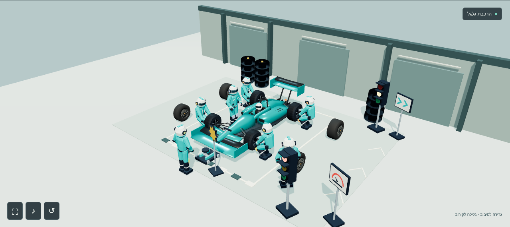
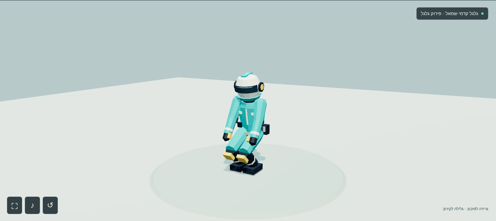

# חבילת הפיטס — racing-pit-v1

נכסים מקוריים לפורמולה בילדים: צוות פיטס, החלפת ארבעה גלגלים, ציוד,
רמזים חזותיים וצלילי תפעול. כל הקבצים החדשים נמצאים בתיקייה זו בלבד.
בסיס הענף: `main`, קומיט `19d9cdc5e3718236df5a2fc4d8b8c26c72007575`.
ענף המסירה: `codex/racing-pit-v1`.

[תצוגה אינטראקטיבית](preview.html) · [מניפסט עם SHA-256](manifest.json) · [רישיון ומקור](LICENSES.md)



## מה נמסר

| רכיב | תכולה | מגבלות שנבדקו |
|---|---|---|
| צוות | ארבעה מחליפי גלגל, מפעיל ג׳ק, מנקה שמשה ואחראי אור | שבעה GLB, שלד קנוני בן 18 עצמות בכל דמות, 1,180–1,208 משולשים לדמות |
| תנועה | שמונת הקליפים המבוקשים בכל דמות; בנוסף `wipe_screen` ו־`signal_release` | 70 קליפים מוטמעים, מהם 56 קליפים נדרשים; מפתחות ב־30Hz, מדידה ב־60Hz ובזמנים המדויקים |
| ציוד | ערימת ארבעה צמיגים, גלגל חלופי, אקדח גלגל, ג׳ק מונפש, כוכבית עצירה ומטלית | שישה GLB; נקודות אחיזה, צירי גלגל ותחום הרמה מפורטים במניפסט |
| סימנים ואור | רמזור כניסה ורמזור יציאה, שלט חצים ושלט מהירות מוגבלת כסמל מד מהירות | ארבעה GLB, שלוש נורות נפרדות בכל רמזור; ללא מספרים או אותיות |
| ממשק | ארבע דרגות בלאי, כניסה לפיטס, החלפה ומד בלאי | שבעה SVG שקופים, 96×96; אין טקסט, תמונות מוטמעות, סקריפטים או הפניות חיצוניות |
| צליל | פתיחת אקדח, סגירת אקדח, ג׳ק, גלגל נופל, צוות מריע, חיבור גלגל ומנוע יוצא | שבעה צלילים בשני קידודים: 14 קבצים, ‎48kHz, סטריאו, OGG/Vorbis ו־MP3 |
| מסירה | תצוגה, מניפסט, דוח, רישיון, מקורות יצירה וראיות | 41 קובצי נכסים במלאי, עם גודל וטביעת אצבע לכל קובץ |

הגאומטריה, הקליפים, האייקונים והצלילים מקוריים ומשוחררים לפי CC0-1.0.
אין מותגים או טקסט נראה בנכסים. כל GLB מכיל את הנתונים שלו ואינו דורש
מרקם, מפענח, Draco או WebAssembly. כיתובי דף הביקורת הם HTML בלבד.

## התאמה למשחק

המפרט נענה לבקשה: במסלולים ארוכים כל המתחרים נכנסים אחרי השלמת הסיבוב
השני להחלפת ארבעת הצמיגים. [הצעת החיבור](motions/pit-sequence.json)
מגדירה את הבקשה לכל שחקן ולכל מתחרה ממוחשב, החלפה אחת מלאה, תנאי עצירה
ותנאי שחרור. ההגדרה של מסלול ארוך, הניתוב, הבלאי, המהירות והעונשים נשארים
החלטה של מנוע המשחק. החבילה אינה משנה את קוד המרוץ.

הרמזור נשאר אדום עד שאושרו ארבעת הגלגלים והחיבורים, הג׳ק הורד ופונה,
הצוות נסוג והיציאה פנויה. אין לשחרר מכונית במשחק על סמך טיימר בלבד.
התצוגה משתמשת בתסריט קבוע של 21.8 שניות כדי לאפשר ביקורת נכסים.

כל דמות פונה ל־‎+Z, הציר למעלה הוא ‎+Y, שמאל אנטומי הוא ‎+X, והיחידות הן מטרים.
[rig.json](rig.json) תואם בשמות, בהיררכיה ובהיסטי המנוחה לשלד של
`racing-v7/assets/crowd/rig.json`. הסקין מורכב ממקטעי חליפה קשיחים, עם
משקל עצם מנורמל לכל קודקוד; זהו עיצוב נמוך־פוליגונים עם כפפות שלמות.

צבעי הקבוצה נמצאים ב־`COLOR_0` במרחב RGB לינארי. המאפיין `_TEAM_MASK`
מסמן את קודקודי הסרבל ופס הקסדה לצביעה מחדש. ששת צבעי הקבוצות תואמים
למפרט `racing-league`; אין שימוש בסמלים או בכיתוב על הדמויות.

רק `idle_wait` מיועד ללולאה. תנועת השורש אפויה: `rush_in` מתקדם 0.96 מ׳
ו־`step_back` נסוג 0.64 מ׳. במעבר לקליפ נייח מעבירים את ההיסט לטרנספורמציית
המופע פעם אחת; אין להוסיף תנועה נוספת למסלול האפוי. זמן ערבול מוצע: 0.18 שניות.
אירועי החיבור, הפירוק, ההרמה והאישור וחלונות התמיכה נמצאים
ב־[חוזה הקליפים](motions/clips.json) וגם ב־`extras` של האנימציות.

## תוצאות Motion QA

**כל 70 הקליפים עברו: מינימום 94.6, ממוצע 97.49, כיסוי 100% מהמדדים החלים,
אפס מדדים אדומים ואפס מדדים חסרי מידע.** רף הבקשה היה 88.

| קליפ | הציון הנמוך בין שבע הדמויות |
|---|---:|
| `idle_wait` | 100 |
| `rush_in` | 94.6 |
| `remove_wheel` | 98.2 |
| `mount_wheel` | 98.4 |
| `jack_up` | 98.3 |
| `jack_down` | 98.3 |
| `thumbs_up` | 95.3 |
| `step_back` | 94.6 |
| `wipe_screen` | 96.5 |
| `signal_release` | 96.4 |

הכלי המבוקש אינו ב־`main` של בסיס העבודה. נעשה שימוש ב־`run.mjs` המקורי
מענף `codex/motion-qa-v1`, קומיט `5eb4f093bc22523ee417a7f2345c3b813bffba24`,
בעותק זמני מחוץ למאגר. ה־CLI הקיים מוגבל לרשימת ספריות מובנית; מתאם
הקלט החדש `source/qa-sources.mjs` מאפשר לו לקרוא את שבעת ה־GLB שנמסרו.
קוד המדדים, הספים, המשקלים, קורא ה־GLB וחישוב הציונים לא שונו.

המתאם משתמש בדגימות ה־GLB המקוריות ומוסיף ארבע נקודות סוליה אמיתיות לכל
נעל. הוא אינו משנה מיקומי מפרקים, סיבובים, שורש או חלונות תמיכה.
קובצי המקור של הכלי נבדקים מול SHA-256 לפני ההרצה ואחריה.

ראיות: [הפלט המקורי](verification/motion-qa.json),
[מקור הכלי וטביעות האצבע](verification/motion-qa-provenance.json).
20 מדדים צהובים נובעים מהשוואת סימטריה בין תפקידי שמאל וימין עבור מחוות
ועבודת צוות שאינן מראה מושלמת. 126 ערכי „לא חל” הם מגע בכדור ונסיעת גוף
בפעולות נייחות; הם אינם מידע חסר. הציון הוא מדד אבחוני של השלד, ואינו
מחליף ביקורת חזותית או אימות של ערבול ותנועה במנוע המשחק.

## אימות נוסף

- **GLB:** כל 17 הקבצים עברו Khronos glTF Validator ללא שגיאות וללא אזהרות.
  נבדקו גם מספרי משולשים, 18 מפרקים, צבעי קודקודים, היעדר מרקמים, דחיסה
  ובאפרים חיצוניים. [תוצאות](verification/glb-validator.json).
- **גאומטריה בתנועה:** כל קודקודי הדמויות הותמרו באמצעות הסקין של Three.js
  ב־25 זמנים בכל אחד מ־70 הקליפים, כולל הקצוות. לא נמצאו קודקודים מתחת
  ל־‎−2 מ״מ; עומק הדגימה הגדול ביותר היה כ־0.48 מ״מ. זו בדיקה מדוגמת,
  ולא הוכחה רציפה להיעדר חיתוכים. [נתונים ושיטה](verification/geometry.json).
- **צלילים:** כל אחד מ־14 הקבצים פוענח ונמדד מחדש ב־FFmpeg/EBU R128.
  התוצאות הן ‎−16.04 עד ‎−15.97 LUFS; השיא הגבוה ביותר ‎−3.40 dBTP.
  שאגת הצוות היא סינתזה ללא מילים של שבעה קולות ומחיאות כפיים, ללא הקלטות.
  [מדידות לכל קובץ](verification/audio.json).
- **דפדפן:** Chromium עם ANGLE/SwiftShader, במידות 1440×1100, ‏390×844
  ו־844×390. נבדקו ניגון וגרירה, בחירת עשר תנועות ועשרה פריטי ציוד,
  ששת צבעי הקבוצה, שלושת מצבי הרמזור, החלפת ארבעת הגלגלים ופענוח שני
  קידודי הצליל. לא היו שגיאות JavaScript, בקשות שנכשלו, בקשות חיצוניות
  או גלישה אופקית בנייד. [תוצאות](verification/browser.json).
- **ביצועי מכשיר:** לא בוצעה בדיקה בטלפון פיזי. אין טענת FPS על מכשיר.



## פתיחה ושחזור

משורש המאגר:

```sh
python3 -m http.server 8765
```

פותחים `http://localhost:8765/workout/island/design/racing-pit-v1/preview.html`.
„העצירה” מדגימה את הרצף, „הצוות” מאפשר בחירת דמות וקליפ, ו„הציוד” מאפשר
בדיקת כל פריט ואת צבעי הרמזור. שורת הצבעים משנה קודקודים; הצלילים זמינים
בנפרד, וצלילי הרצף מופעלים בלחיצה על כפתור הצליל. אין תלות ב־CDN.
התצוגה טוענת את three.js ואת מכונית הפורמולה הקיימים דרך נתיבים מקומיים;
הם אינם חלק מ־41 נכסי החבילה ולא שונו.

מתוך תיקיית החבילה:

```sh
python3 source/build_models.py
python3 source/build_icons.py
python3 source/build_audio.py
node source/run-qa.mjs
python3 source/build_manifest.py
```

נדרשים Python 3 עם NumPy ו־SciPy, ‏FFmpeg עם libvorbis/libmp3lame,
Node.js 22 ומעלה ו־Git. ריצת ה־QA משיגה את הקומיט הנעול אם אינו זמין
מקומית, מעתיקה את מודולי הכלי לתיקייה זמנית, ומריצה את ה־CLI המקורי עם
מתאם הספרייה. פלט JSON ונתוני מקור נשמרים כאן; קובצי הכלי הזמניים מנוקים.
מניפסט הנכסים משתמש גם בדוחות האימות המסופקים בתיקיית `verification`.

## גבולות השינוי

קבצים חדשים בלבד תחת `workout/island/design/racing-pit-v1/`.
קוד משחק קיים, `release.json`, תגי גרסה, `CLAUDE.md`, ‏`ops` ובדיקות המאגר
לא נערכו. המסירה היא חבילת נכסים וטיוטת חיבור לבדיקה לפני הטמעה.
