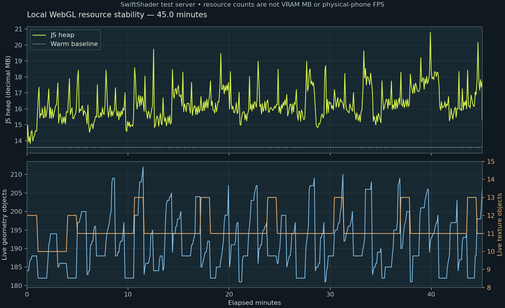

# מרוצים v7 — דוח מסירה

נוצרו חמישה רכבי ספורט, שלושה מסלולים, תצוגה אינטראקטיבית עצמית וחבילת מקור לשחזור. הקבצים החדשים נמצאים רק ב-workout/island/design/racing-v7/.

חלון העבודה: 4.11.2026, 22:10:43 עד 5.11.2026, 3:09:54 (Asia/Jerusalem), כ-4.99 שעות כולל רינדורים ובדיקות שהייה. ענף המסירה: `codex/racing-v7-20261105`; יעד PR כטיוטה מול main. מיזוג אינו חלק מהמסירה.

הכיוון שנבחר בידי המשתמש: **מרוצי ארקייד מלוטשים בתלת־ממד**. לא התקבלה תמונת רפרנס חיצונית. נבדקו נכס המכונית הקיים והמקור המפורט שלו, והביקורת נעשתה מול הכיוון הנבחר ו-REFERENCE.md.

## לפתוח ולראות

1. פתחו את [offline.html](offline.html): מודולים, מודלים, מרקמים ומפענח משובצים בקובץ. אין צורך בשרת, התקנה או build.
2. בחרו סביבה, רכב וצבע; ״מבט רכב״ מאפשר גרירה וצביטה. ״נסיעה״ היא סיור אוטומטי. המפה מציגה את כל הנתיב.
3. השוו את [גלריית הסבבים](review.html) ובדקו את [צילומי הסבב האחרון](iterations/17/index.html). שתי המידות נשמרו בפיקסלים מלאים.

המסמך העצמי הוא 2.624 MB. בדפדפן המנוהל ניווט file:// חסום במדיניות; התוכן העצמי נבדק במסמך ריק במצב Offline, ללא בקשות HTTP. זהו תיעוד מגבלת הבדיקה, לא תלות של הקובץ בשרת.

## ציונים ובסיס לבדיקה

| פריט | ציון / 10 | ראיה או מה חסר |
|---|---:|---|
| חמישה דגמי ספורט מובחנים | 8.5 | קופה, GT, טריז, רודסטר ודגם מסלול; פרופורציות, קבינות, חישוקים ותוספות שונים |
| זכוכית משתקפת וצבע מבריק | 9 | חומרי Glass/Paint נפרדים, PMREM מקומי והיילייטים בשלוש סביבות |
| פנסים קדמיים ואחוריים | 9 | גאומטריית פנסים וחומר מאיר; כתם אור מקדים בלילה |
| גלגלים מסתובבים והיגוי | 9 | ארבעה צירים בכל קובץ; גלגול X והיגוי קדמי; 60 בדיקות מגע |
| בחירת צבעים | 9 | חמש דוגמיות פעילות; בדיקת צבע חומר מול הבחירה עברה |
| עיר בלילה | 8.5 | בניינים, חלונות מאירים, שילוט, מעקות ותאורה חמה/קרה |
| מסלול חוף | 8.5 | ים, רצועת חוף, דקלים ומגדלור עם נתיב סגור |
| מסלול הר | 8.5 | עליות/ירידות, עצי מחט, סלעים ושכבות פסגות |
| אספלט עם נורמל | 9 | מפות צבע/נורמל/ORM מקומיות, UV במטרים |
| קווים וסגירת מסלול | 9 | סימוני שוליים/מרכז ורציפות קשת בכל שלושת הנתיבים |
| גדרות ומעקות | 9 | מופעים משותפים; שוליים רחבים מספיק לתמיכת העמודים |
| שלטים ותמיכות | 9 | שלטי נתיב ופנייה, גשרי שילוט ועמודי תמיכה |
| תאורה ומגע קרקע | 8.5 | שמש/מילוי, תאורת לילה, פנסים וצל מגע מקומי |
| עשן צמיגים | 8.5 | 42 חלקיקים קבועים; שובל מצטבר בזמן תנועת הרכב |
| ניצוצות | 8.5 | 46 ניצוצות במאגר; רגע מגע קריא בשתי האוריינטציות |
| אפקט מהירות | 8.5 | קווי מהירות וטשטוש קצוות בבוסט; מרכז חד |
| LOD לרכבים | 9 | שלושה קבצים לכל דגם, היסטרזיס וצילומי LOD2 מחמירים מקרוב |
| קהל במופעים | 9 | 72 צופים בדיוניים בשלוש קבוצות, בלי שלד נפרד שרץ לכל מופע |
| שלד קנוני 18 עצמות | 9.5 | שמות, הורות, תרגומי מנוחה וסיבובי זהות נבדקו מול motion2 |
| Draco וגודל GLB | 10 | כל 20 הקבצים דורשים Draco; המרבי 0.0974 MB |
| טקסטורות ואטלס | 10 | כל קובץ עד 1024; אטלס אחד 256×256 לדמות הקהל |
| Three.js r160 מקומי | 10 | מודול, loaders ומפענח כלולים, ללא CDN |
| HTML מקומי ללא build ורשת | 9 | קובץ עצמי עם מודולים/מודלים/מרקמים/מפענח; 0 בקשות HTTP בבדיקה; מגבלת file:// של סביבת הבדיקה מתועדת |
| מסגור 390×844 ו-844×390 | 9 | 840 צירופים, כולל 14 זוויות בכל סביבה, בלי חיתוך, חפיפה ללוחות או חסימת מרכז הרכב |
| בדיקת כל הדרך | 9.5 | 9,615 נקודות על כביש מול קרקע מפוענחת; אין חדירה |
| לולאות ביקורת | 10 | 17 סבבים ו-898 צילומים, עם ביקורת בכל תיקייה |
| אינטראקציה והתאוששות | 9 | 34 בדיקות, כולל גרירה, צביטה, השהיה ורענון מוצלח אחרי אובדן WebGL |
| יציבות משאבים | 9 | 45.0 דקות, 48 החלפות; בדיקת זיכרון עברה |
| כללי ריפו ומקור | 10 | קבצים חדשים בתיקייה המאושרת; מקור מורשה; ללא סמלי יצרן, נתוני לקוחות או מפתחות |
| 30fps על טלפון בינוני | 7 | חסרה מדידת טלפון פיזי. סביבת הבדיקה היא SwiftShader; אין בסיס להצהיר שהיעד הושג במכשיר |

סעיף הביצועים קיבל 7 משום שלא נמדד טלפון פיזי. הוא נשאר פער אימות מפורש, ולא סומן 8 כדי לעמוד בסף ללא ראיה. בפריטים האחרים הציונים הם הערכת גימור עצמית המגובה בצילומים ובבדיקות המפורטות, ולא דירוג של בודק חיצוני.

## צילומים לבדיקה ישירה

| בדיקה | צילום מקומי מהסבב האחרון |
|---|---|
| מרכב, זכוכית וגלגלים מקרוב — 390×844 | [לפתיחת המקור](iterations/17/coast-garage-prism-near-390x844.jpg) |
| הרודסטר מקרוב — 844×390 | [לפתיחת המקור](iterations/17/coast-garage-solis-near-844x390.jpg) |
| חוף מרחוק וקהל — 844×390 | [לפתיחת המקור](iterations/17/coast-drive-apex-far-844x390.jpg) |
| הדרך בהר, מקטע שלישי — 844×390 | [לפתיחת המקור](iterations/17/ridge-drive-apex-near-path-3-844x390.jpg) |
| דריפט, ניצוצות ובוסט בלילה — 390×844 | [לפתיחת המקור](iterations/17/neon-drive-vector-near-fx-390x844.jpg) |
| דריפט, ניצוצות ובוסט בלילה — 844×390 | [לפתיחת המקור](iterations/17/neon-drive-vector-near-fx-844x390.jpg) |
| הלולאה במבט על — 390×844 | [לפתיחת המקור](iterations/17/ridge-overview-apex-far-390x844.jpg) |

## משקלים

MB = 1,000,000 bytes. [WEIGHTS.md](WEIGHTS.md) כולל כל GLB וכל טקסטורה בנפרד; [verification/files.csv](verification/files.csv) כולל מלאי קבצים ו-SHA-256.

| דגם | LOD0: משולשים / MB | LOD1: משולשים / MB | LOD2: משולשים / MB |
|---|---:|---:|---:|
| apex | 21,171 / 0.0935 | 11,214 / 0.0577 | 4,064 / 0.0289 |
| velour | 20,973 / 0.0935 | 11,016 / 0.0576 | 4,345 / 0.0296 |
| prism | 20,962 / 0.0946 | 11,004 / 0.0581 | 4,334 / 0.0296 |
| solis | 18,418 / 0.0805 | 10,398 / 0.0522 | 4,596 / 0.0294 |
| vector | 22,209 / 0.0974 | 12,251 / 0.0611 | 4,670 / 0.0308 |

מספרי המשולשים בטבלת הדגמים הם למופע רכב שלם, כולל כל ארבעת הגלגלים. WEIGHTS.md מציג גם את סכום המשולשים ברשתות המאוחסנות בקובץ, כדי להבחין בין גאומטריה משותפת לעלות מופעים.

סך 20 ה-GLB: 1.034 MB. הגדול ביותר: assets/cars/vector-lod0.glb, ‏97,428 bytes. טקסטורות: צבע 1024², נורמל 512², ORM ‏1024², אטלס קהל 256² ועשן 64². מפת ההשתקפות משותפת ונוצרת מקומית.

| מסלול | אורך מ׳ | רוחב מ׳ | שיפוע מרבי | בדיקות קרקע |
|---|---:|---:|---:|---:|
| coast | 1105.6 | 11.8 | 5.8% | 3205 |
| neon | 1187.1 | 11.5 | 0.9% | 3205 |
| ridge | 1213.5 | 10.8 | 12.3% | 3205 |

## מה נבדק

- **מסגור נקי:** 840 צירופי סביבה/דגם/זווית/מרחק/אוריינטציה מול קודקודי המודל המצוירים, בלי יציאה מהמסך, חפיפה לממשק או חסימת מרכז הרכב. ארבע בדיקות מעבר מאשרות ניקוי היסט המצלמה ושחזור התפאורה והצופים. נתוני הכשל נשמרו בנפרד.
- **קבצים:** 489 בדיקות נכסים; 20 GLB עם Draco, אפס שגיאות ואפס אזהרות במאמת Khronos; מיקומי מנוחה וסיבובים קנוניים מול motion2.
- **מגע:** 60 צירופי גלגל/דגם/LOD מול המישור המשיק האידיאלי; כ-0.75 מ״מ. זו אינה מדידת מתלה או פותר התנגשות.
- **נתיב שלם:** 9,615 נקודות מול משולשי הקרקע המפוענחים, בלי קרקע שחודרת לכביש.
- **דפדפן:** 34 בדיקות אינטראקציה; שש סצנות Offline ועוד החלפת כל חמשת הרכבים; אפס שגיאות ובקשות HTTP בגרסה העצמית.
- **ריפו:** 3,135 בדיקות: 3,084 עברו, 0 נכשלו, 51 דולגו. נבחר Chromium המותקן דרך hook קיים; קובצי הבדיקות לא נערכו.
- **סבבים:** 17 תיקיות עם 898 צילומים וביקורות. סבבי הכשל נשמרו, לרבות חסימת WASM ראשונה, שמות צירים, קרקע ודריפט.

## בדיקת שהייה וביצועים

הבדיקה הסופית רצה 45.0 דקות, מ-2026-11-04T23:52:46.905Z עד 2026-11-05T00:37:48.805Z, עם 48 החלפות רכב/מסלול/אוריינטציה. כל קובצי הקוד והנכסים תואמים ל-SHA-256 שנרשם לפני הבדיקה. מחזורי בוסט באיכות גבוהה הפעילו גם HDR/עשן; מצבים חסכוניים נבדקו בנפרד.

| מדד | בסיס אחרי חימום | סוף אחרי GC |
|---|---:|---:|
| JS heap, MB | 13.59 | 15.31 |
| גאומטריות GPU חיות | 184 | 206 |
| טקסטורות GPU חיות | 12 | 11 |

הספירות הן אובייקטי משאבים, לא מדידת VRAM ב-MB. החלפת סביבה משחררת גם shadow maps ו-PMREM. בדיקות הביניים שנעצרו לצורך תיקוני גימור נשמרו בקבצי soak-preliminary, ואינן נספרות כבדיקה הסופית.

במהלך השהייה רונדרו 10,040 פריימים. בדיקות מחבר אחרות פעלו במקביל בחלק מהריצה; היא מיועדת ליציבות משאבים. מדידת התנועה המבודדת בהמשך בוצעה בנפרד.

בדיקת 45 דקות נוספת, שקדמה לתיקון מסגור הממשק, עברה ונשמרה ב-verification/soak-before-ui-polish.json. ריצה חלקית נוספת של 28.71 דקות נשמרה ב-soak-before-orbit-fix.json לפני תיקון מקרי הקצה של הסיבוב. התוצאה בטבלה לעיל היא מהבדיקה שחודשה אחרי כל התיקונים. שישה מקרי ביצועים שנקטעו לצורך תיקון מוקדם נשמרו כסיכומי ביניים ב-performance-before-ui-polish.json, ואינם חלק מהמדידה הסופית.

מדידת התנועה המבודדת האחרונה בשרת: 1.67–3.46 fps ב-SwiftShader, לפי סביבה ואיכות. הנתונים אינם מדידת GPU של טלפון. [PERFORMANCE.md](PERFORMANCE.md) ו-verification/performance-final.json כוללים את כל המקרים.

לסגירת פער 30fps יש להריץ את הקובץ העצמי בטלפון בינוני בשתי האוריינטציות, לפחות דקה בכל סביבה, עם בוסט ודריפט; לתעד fps, חום ואיכות אוטומטית.

## מקור וגבולות חיבור

גופי הרכב נגזרים מ-Car Concept ברישיון CC-BY-4.0, עם ייחוס מלא ב-[LICENSES.md](LICENSES.md). החישוקים, תוספות המרכב, הסביבות, המרקמים, הקהל והממשק נוצרו למשימה. כל טקסטורות וסמלי המקור הוסרו.

זו חבילת נכסים ותצוגה. [INTEGRATION.md](INTEGRATION.md) מפרט צירים, מופעים, LOD ומשאבים. קוד המשחק הפעיל, מנגנון השחרור, תגי גרסה, CLAUDE.md והבדיקות הקיימות לא נערכו. הכל נועד למסירת טיוטת PR; אין כאן מיזוג או פריסה.
