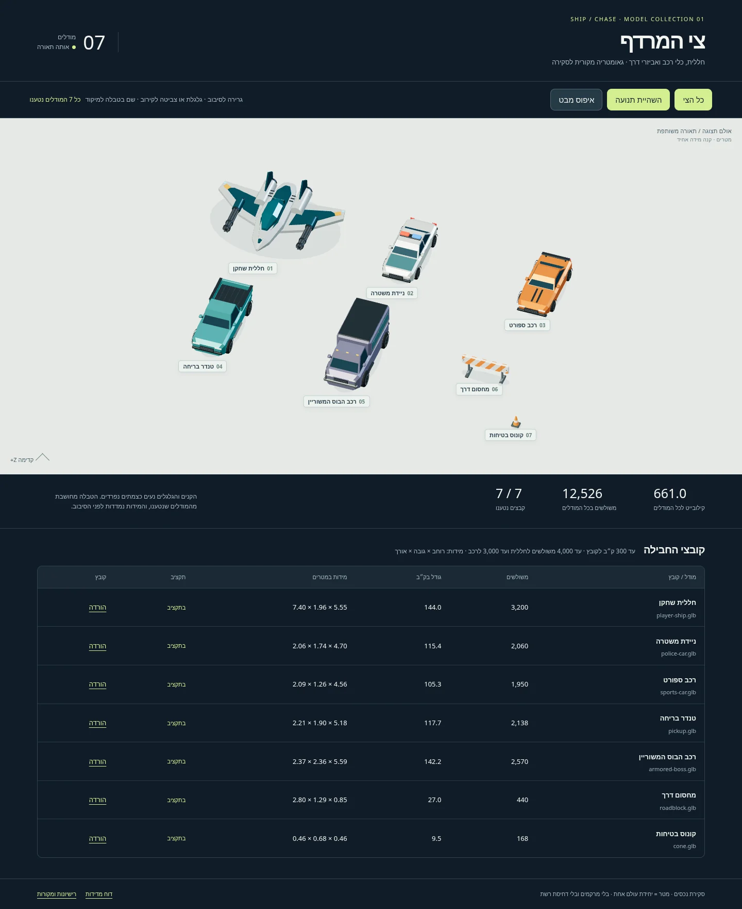

# חבילת חללית ומרדף — גרסה 1

כל שבעת המודלים מוכנים לסקירת נכסים. כולם מקוריים, ברישיון CC0-1.0,
במטרים, עם ‎+Y למעלה ו־‎+Z קדימה. אין מרקמים, מותגים, סמלי רשויות או אנשים.
כל קובצי המסירה נמצאים ב־`runtime/`, ללא Draco, ללא meshopt וללא משאבים חיצוניים.

התאריך: 07/11/2026. ענף: `codex/ship-chase-models-v1`.
נקודת הבסיס ב־`main`: `e8145727d343adfa6bfa06f0c1a3287ab2ac6c1b`.
המסירה מוסיפה קבצים רק בתיקיית החבילה. אין שינוי בקוד המשחק, בשחרור, בתגי גרסה,
ב־CLAUDE.md, ב־ops או בבדיקות הקיימות.

## מדידות הקבצים הסופיים

המידות הן X × Y × Z, במצב מנוחה. KB ו־MB נמדדים עשרונית: 1 KB = 1,000 בתים.
ספירת המשולשים כוללת כל רשת נראית של המודל, גם בגלגלים ובקנים.
קריאות הציור הן מספר הפרימיטיבים לאחר טעינה ב־GLTFLoader, ללא רצפת התצוגה וצללי העזר.

| קובץ | בתים | משולשים | קריאות ציור | רוחב × גובה × אורך, מ׳ |
|---|---:|---:|---:|---|
| [player-ship.glb](runtime/player-ship.glb) | 143,956 | 3,200 | 13 | 7.400 × 1.960 × 5.550 |
| [police-car.glb](runtime/police-car.glb) | 115,388 | 2,060 | 21 | 2.060 × 1.740 × 4.701 |
| [sports-car.glb](runtime/sports-car.glb) | 105,308 | 1,950 | 18 | 2.088 × 1.260 × 4.561 |
| [pickup.glb](runtime/pickup.glb) | 117,716 | 2,138 | 19 | 2.208 × 1.900 × 5.181 |
| [armored-boss.glb](runtime/armored-boss.glb) | 142,216 | 2,570 | 20 | 2.368 × 2.360 × 5.590 |
| [roadblock.glb](runtime/roadblock.glb) | 26,992 | 440 | 4 | 2.800 × 1.290 × 0.850 |
| [cone.glb](runtime/cone.glb) | 9,468 | 168 | 3 | 0.460 × 0.680 × 0.460 |
| **סך הכול** | **661,044** | **12,526** | **98** | **0.661 MB** |

הקובץ הגדול ביותר הוא החללית, 143,956 בתים, מתחת ל־300,000.
החללית מתחת ל־4,000 משולשים; כל ארבעת כלי הרכב מתחת ל־3,000.
החבילה משתמשת באפס מרקמים, ולכן אינה דורשת פענוח תמונות או העלאת מרקם ל־GPU.
מידות מדויקות, גבולות, שמות צמתים ו־SHA-256 לכל GLB נמצאים
ב־[asset-results.json](verification/asset-results.json).

## מבנה המודלים והנפשה

לכל מודל שורש ללא סיבוב או שינוי קנה מידה. נקודת האפס במרכז הרוחב, על מישור הקרקע;
הגאומטריה במנוחה נחה ב־Y=0. השמאל והימין מסומנים במפורש לפי צירי החבילה:
L הוא ‎-X, ו־R הוא ‎+X.

| מודל | צמתים | שימוש |
|---|---|---|
| חללית | `Barrel_L`, `Barrel_R` | סיבוב סביב Z המקומי; בכל כנף קבוצה של שישה צינורות חלולים |
| חללית | `Muzzle_L`, `Muzzle_R` | נקודות ירי ללא גאומטריה, כיוון ‎+Z, בגובה ציר הקנה |
| כל רכב | `Wheel_FL`, `Wheel_FR`, `Wheel_RL`, `Wheel_RR` | צמתים נפרדים במרכזי הסרנים; סיבוב סביב X המקומי |
| ניידת | `Light_R`, `Light_B` | שני צמתים נפרדים על הגג, לכל אחד רשת עדשה וחומר פולט אור בצבע המתאים |

מרכזי הקנים בחללית: ‎(±2.17, 0.63, 0.34) מ׳.
נקודות הלוע: ‎(±2.17, 0.63, 2.18) מ׳, 2 ס״מ לפני קצה הצינורות.
נקודות הלוע הן אחיות קבועות של צמתי הקנה, כך שסיבוב הקנה משאיר את ציר הירי יציב.
האורות בניידת נגישים דרך רשת העדשה שמתחת לכל צומת;
אפשר לשנות את חומר ה־emissive שלה בזמן ריצה.

התנועה מודגמת ב־[preview.js](preview.js), ואינה אפויה כקליפים בתוך ה־GLB.
הגלגלים מסתובבים ב־2.2 רדיאנים לשנייה והקנים ב־6.4 רדיאנים לשנייה, לצורך הסקירה.
המודלים נשארים נייחים באולם כדי שאפשר יהיה להשוות את פרטי התנועה.

## תצוגה ובדיקות

[preview.html](preview.html) מציג את שבעת המודלים יחד בקנה מידה אחיד,
באותה סצנה ותחת אותה תאורה. הטבלה מחושבת מקובצי ה־GLB שנטענו בפועל.
אפשר למקד מודל דרך שמו בטבלה, לחזור לכל הצי, להשהות את התנועה,
לסובב את המבט ולאפס אותו. הפריסה מותאמת גם לטלפון.

| בדיקה | תוצאה / ראיה |
|---|---|
| טעינת כל שבעת הקבצים ב־GLTFLoader הקיים במאגר | עבר; [check-assets.mjs](verification/check-assets.mjs) ו־[תוצאות](verification/asset-results.json) |
| מבנה GLB, גבולות buffers, אינדקסים, נורמלים וקואורדינטות סופיות | עבר |
| תקציבי גודל ומשולשים; צמתים ייחודיים; צירים ומרכזי גלגלים | עבר |
| בדיקת תקן Khronos glTF Validator ‏2.0.0-dev.3.10 | 7/7; אפס שגיאות, אפס אזהרות; [תוצאות](verification/gltf-results.json) |
| טעינה ורינדור בדפדפן לכל מודל בנפרד ולכל הצי יחד | עבר; [browser-check.mjs](verification/browser-check.mjs) ו־[תוצאות](verification/browser-results.json) |
| סיבוב גאומטריה בפועל של 16 גלגלים ושני קנים; לוע יציב | עבר |
| CSP חוסם WebAssembly | קומפילציה של מודול WASM תקין נחסמה בפועל; כל שבעת המודלים נטענו בכל זאת |
| משאבים חיצוניים או בקשות Draco / meshopt / WASM | אפס |
| השהיה והפעלה, מיקוד, גרירת מצלמה ואיפוס | עבר |
| מחשב 1440×1100 וטלפון מדומה 390×844 | עבר; ללא גלישה אופקית של הדף; הטבלה נגללת בתוכה |

התצוגה והבדיקה אוכפות `script-src 'self'` ללא `unsafe-eval` או
`wasm-unsafe-eval`, וכן `worker-src 'none'`. לא מוגדר מפענח דחיסה.
הוכחת חסימת WASM והחריגה הצפויה שמוחזרת ממנה מתועדות בתוצאות הדפדפן;
זו אינה שגיאת טעינה של מודל.

צילומי הדפדפן הופקו באמצעות Chromium ‏156.0.8078.79 ו־SwiftShader.
הם מאמתים טעינה, מראה ותנועה; לא בוצעה מדידת FPS, זיכרון GPU או ביצועים בטלפון פיזי.
הדגמים בעלי מספר משולשים נמוך וחומרים שטוחים; אלה מודלים תלת־ממדיים מפושטים
עם פרופורציות רכב מזוהות, ללא טקסטורות פוטוריאליסטיות.

[צילום הטלפון](verification/mobile.webp)

[תקריב החללית](verification/detail-player-ship.webp) · [תקריב הניידת](verification/detail-police-car.webp)

## שחזור ורישוי

מקורות Blender המקוריים נמסרים ב־`source/`. הוראות יצירה, התקנת כלי בדיקה
ופתיחת שרת מקומי נמצאות ב־[source/README.md](source/README.md).
רישיון ומקור לכל קובץ בחבילה מפורטים ב־[LICENSES.md](LICENSES.md).
ספריות Three.js הקיימות משמשות כמות שהן מחוץ לחבילה; לא נוסף עותק שלהן.
