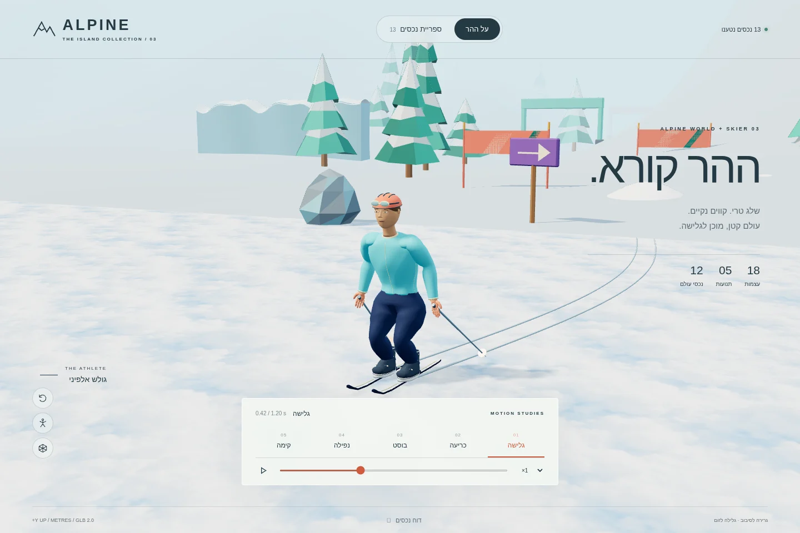
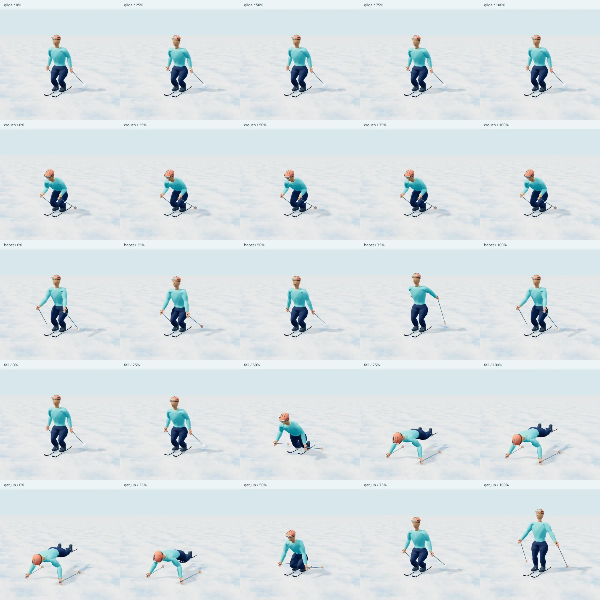

# סקיאר ועולם אלפיני · דוח מסירה

תוצאה: **PASS**. הדוח נוצר מהקבצים הסופיים, לאחר התאמת SHA-256 בין ה־GLB, ה־manifest, הפענוח העצמאי, טעינת הדפדפן וצילומי המסך.

| דרישה | תוצאה |
| --- | --- |
| סקיאר עם 18 עצמות קנוניות | 18 שמות, סדר והיררכיה תואמים; skin ומשקלים תקינים |
| חמש תנועות מוטמעות | glide, crouch, boost, fall, get_up |
| Draco עד 1.5MB לקובץ | כל 13 הקבצים; הגדול 424,676 bytes |
| טקסטורות עד 1024 | מרבי 384×384; סקיאר עם צבעי קודקודים וללא טקסטורות |
| רכיבי עולם | 3 עצים, 2 סלעים, שלט, 3 שערים, מוגול, קיר קרח ואבקת שלג מונפשת |
| טעינה והצגה בדפדפן | 85 בדיקות; 1440×960, 390×844 ו־844×390 |
| קונסול ורשת | אפס שגיאות ואזהרות; אפס בקשות חיצוניות או טעינות שנכשלו |
| glTF Validator | אפס שגיאות ואזהרות, בקבצים הדחוסים וגם לאחר פענוח Draco עצמאי |
| בדיקות המאגר | 3,123 עברו; 0 נכשלו; 43 דולגו |

## ספירת משולשים

| קובץ | משולשים | bytes |
| --- | ---: | ---: |
| [skier3/skier.glb](../../skier3/skier.glb) | 24,918 | 424,676 |
| [alpine-world/models/finish-gate.glb](../../alpine-world/models/finish-gate.glb) | 256 | 2,648 |
| [alpine-world/models/fir-a.glb](../../alpine-world/models/fir-a.glb) | 87 | 3,232 |
| [alpine-world/models/fir-b.glb](../../alpine-world/models/fir-b.glb) | 96 | 3,336 |
| [alpine-world/models/fir-c.glb](../../alpine-world/models/fir-c.glb) | 96 | 3,308 |
| [alpine-world/models/ice-wall.glb](../../alpine-world/models/ice-wall.glb) | 3,696 | 22,480 |
| [alpine-world/models/mogul.glb](../../alpine-world/models/mogul.glb) | 384 | 5,152 |
| [alpine-world/models/rock-large.glb](../../alpine-world/models/rock-large.glb) | 54 | 1,980 |
| [alpine-world/models/rock-small.glb](../../alpine-world/models/rock-small.glb) | 54 | 1,988 |
| [alpine-world/models/slalom-gate.glb](../../alpine-world/models/slalom-gate.glb) | 220 | 5,132 |
| [alpine-world/models/snow-powder.glb](../../alpine-world/models/snow-powder.glb) | 96 | 39,684 |
| [alpine-world/models/snow-sign.glb](../../alpine-world/models/snow-sign.glb) | 69 | 1,828 |
| [alpine-world/models/start-gate.glb](../../alpine-world/models/start-gate.glb) | 256 | 2,632 |
| **סה״כ** | **30,282** | **518,076** |

הספירה כוללת את כל מופעי הרשת: שני המקלות נספרים פעמיים אף שהם חולקים גאומטריה. באבקה נשמרים 96 משולשים ל־16 פריימים; 6 פעילים בכל רגע. תוספות התפאורה של הצופה אינן חלק מתקציב הנכסים.

## ניגון ועיוות רשת

נבדקו 33 נקודות זמן בכל אחד מחמשת הקליפים דרך AnimationMixer של Three.js וה־GLB הסופי. כל הקודקודים לאחר skinning נמדדו; מינימום Y שנמצא הוא -0.0002612 מטר, בתוך סבילות של 1 מ״מ למשטח השלג. שלוש הלולאות סגורות. סוף הנפילה ותחילת הקימה תואמים; התאמת המטריצות והערוצים נבדקה גם בפענוח העצמאי.

ה־bind מכויל לפרופורציות הדמות. להוספת נתוני motion2 יש להשתמש בבסיסי הכיול שב־[rig.json](../rig.json); שמות והורות תואמים לבדם אינם מחליפים כיול צירים. חמשת הקליפים המוטמעים מוכנים לניגון ישיר ללא מתאם.

## צפייה והוכחות

1. משורש המאגר הפעילו:

   ```sh
   node workout/island/design/skier3/tools/verify-browser.mjs --serve
   ```

2. פתחו את [הצופה המקומי](http://127.0.0.1:8766/design/skier3/viewer.html), בחרו תנועה או עברו לספריית הנכסים. כל הקבצים והמפענח מקומיים.
3. התוצאה הרצויה: 13 נכסים נטענו, חמש הפעולות נראות, ציר הזמן והשלד פועלים, וקונסול הדפדפן נקי.





[דפדפן · JSON](browser-report.json) · [פענוח ו־glTF · JSON](assets-report.json) · [בדיקות מאגר · JSON](repository-tests.json) · [טלפון](scene-390x844.webp) · [טלפון לרוחב](scene-844x390.webp) · [ספריית נכסים](library-1440x960.webp)

מדידות הדפדפן בוצעו ב־Chromium עם WebGL / ANGLE SwiftShader. הן מאמתות טעינה, תצוגה ו־skinning; לא נמדדו ביצועים במכשיר טלפון פיזי. המסירה היא שתי תיקיות עיצוב חדשות; אין בה חיבור למשחק, שינוי לוגיקה או שינוי גרסה.
