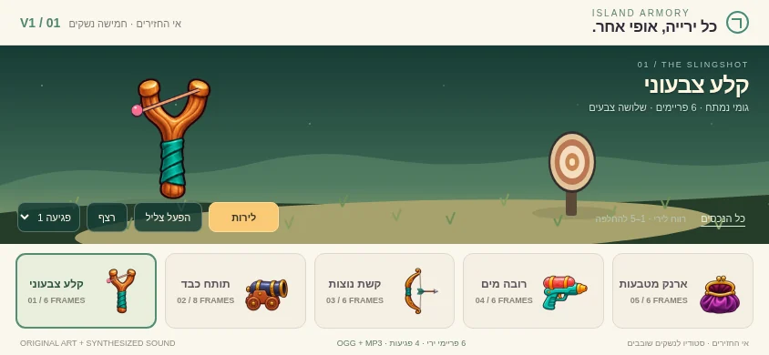

# אי החזירים — חבילת נשקים v1

נוצר ב־16/11/2026 בענף `codex/slingshot-cannon-v1`, מתוך `main` בקומיט `43b27dc235387e3cb737aee9558cdf9d5fd5a262`.

חמש משפחות נשק, עם מראה, קליע וחתימת צליל שונים. **כל הקבצים נוספו בתוך `workout/island/design/slingshot-cannon-v1/` בלבד.** זו חבילת נכסים מוכנה לחיבור; המשחק הפעיל, הלוגיקה, גרסת האתר וקבצים קיימים לא שונו. בהתאם להגבלת התיקייה המפורשת, גם `ops/CONTROL.md` לא שונה.



## מה כלול

| נשק / מזהה | ירי | קליע ושובל | ארבע פגיעות | צליל |
|---|---|---|---|---|
| קלע צבעוני / `slingshot` | 6 פריימים, מתיחת גומי וכיס עור | כדורים ורוד, טורקיז וסגול; נקודות צבע וקו תנועה | התזה צבעונית, טבעת, פיזור וכיוון צד | פריטת גומי ופגיעה קופצנית |
| תותח כבד / `cannon` | 8 פריימים, רתע, הבזק ועשן | פגז פלדה כבד עם טבעות פליז; שובל עשן | ארבע צלליות פיצוץ, אבק וגיצים | בום נמוך ופיצוץ עם זנב אבק |
| קשת נוצות / `bow` | 6 פריימים, מתיחת מיתר ושחרור חץ | חץ עץ עם ראש פלדה ונוצות טורקיז; שובל אוויר | רסיסי עץ, הדף, טבעת ופיזור | פריטת מיתר, נשיפה ונקישת עץ |
| רובה מים / `water` | 6 פריימים, לחיצה ונתז מהקנה | טיפה ראשית וטיפות לוויין; בועות | ארבע התזות מים | סילון, בועות וטפיחה רטובה |
| ארנק מטבעות / `purse` | 6 פריימים, כיווץ, קפיצה ופליטת מטבע | מטבע זהב; מטבעות מסתובבים וניצוצות | ארבע התפזרויות מטבעות | צלצולי מתכת ורפרוף צליל משעשע |

- **69 PNG שקופים בגודל 256×256**: 32 פריימי נשק, 7 קליעים, 5 שובלים, 20 פגיעות ו־5 אפקטי יציאה מהנשק.
- **5 אטלסי PNG שקופים בגודל 1024×1024**, תאים של 256×256, ללא חיתוך או סיבוב. אותה תמונה בדיוק בקובץ הבודד ובתא האטלס.
- **25 צלילים מקוריים ב־50 קבצים**: ירי אחד וארבע פגיעות לכל נשק, כל אחד גם OGG וגם MP3. ארבעת צלילי הפגיעה תואמים לארבע וריאציות האיור.
- `manifest.json`: מפת תאים, קובץ נפרד לכל ספרייט, עוגן, גבולות תוכן, כיוון, רצף פריימים, משך כל פריים, זמן שחרור, מיקום יציאת הקליע, נתיבי צליל, גדלים ו־SHA-256.
- `preview.html`: תצוגה של 844×390, בחירת נשק, ירי, רצף, השתקה, בחירת פגיעה וגלריית פריימים על לוח שקיפות. מקשים 1–5 מחליפים נשק ורווח יורה. במצב רצף וריאציות הפגיעה מתחלפות. שלושת צבעי כדור הקלע מתחלפים בין יריות.
- `synthesize.py`: בנייה חוזרת ובדיקות. איור הרכיבים המקורי נשמר ב־`source/components.webp`; את יתר הנכסים והצלילים מייצרים מקומית, ללא רשת.

## מידות ומשקל

המגבלות נבדקות בבתים עשרוניים, כלומר מעט מחמירות מ־KiB.

| קובץ אטלס | גודל | בתים | מגבלה |
|---|---|---:|---:|
| `atlases/slingshot.png` | 1024×1024 RGBA | 208,835 | 600,000 |
| `atlases/cannon.png` | 1024×1024 RGBA | 583,377 | 600,000 |
| `atlases/bow.png` | 1024×1024 RGBA | 189,964 | 600,000 |
| `atlases/water.png` | 1024×1024 RGBA | 391,010 | 600,000 |
| `atlases/purse.png` | 1024×1024 RGBA | 470,040 | 600,000 |

כל ה־PNG, לרבות הספרייטים הבודדים, קטנים מ־600,000 בתים. קובץ הצליל הגדול ביותר הוא **10,839 בתים**, מתוך מגבלה של 60,000 לכל קובץ. כל הצלילים הם מונו ב־44,100 Hz; מקור ה־PCM מכוון לשיא ‎−3.10 dBFS עם כניסה ויציאה מדורגות. עוצמה ומאפייני פענוח לכל קובץ נמצאים ב־[`verification/assets.json`](verification/assets.json).

סך המדיה למסירה, כולל מקור האיור, הספרייטים הבודדים, האטלסים ושני פורמטי האודיו, הוא **4,553,490 בתים**, ללא צילומי הבדיקה. במשחק מומלץ לטעון אטלס אחד ואת חמשת צליליו בפורמט נתמך אחד; אין צורך לטעון גם את הספרייטים הנפרדים. תצוגת ההשוואה טוענת את חמשת האטלסים כדי לאפשר החלפה מיידית.

## פתיחה ושחזור

משורש הריפו:

```sh
python3 -m http.server 8765
```

1. פותחים את [התצוגה המקומית](http://localhost:8765/workout/island/design/slingshot-cannon-v1/preview.html).
2. בוחרים נשק, לוחצים **הפעל צליל**, ואז **לירות**. בוחרים פגיעה 1–4 או מפעילים **רצף**. **כל הנכסים** מציג את הפריימים בגודל אחיד ועל רקע שקיפות.
3. התוצאה הרצויה: לכל נשק ספרייט וקליע שונים, שובל מתאים, פגיעה שונה וצליל שמתחיל בזמן השחרור ובזמן הפגיעה. בקלע רואים את הגומי נמתח; בתותח רואים עשן ופיצוץ.

לבנייה מחדש נדרשים Python 3.10 ומעלה, Pillow, NumPy ו־FFmpeg עם `libvorbis` ו־`libmp3lame`. גרסאות Python של כלי הבנייה נעולות ב־`source/requirements.txt`; Playwright נדרש רק לבדיקת הדפדפן. נבדק עם Pillow 12.3.0, NumPy 2.3.5, Playwright 1.62.0 ו־FFmpeg 7.1.5.

```sh
python3 workout/island/design/slingshot-cannon-v1/synthesize.py
```

בדיקת המסירה הקיימת, כולל פענוח כל הצלילים, בלי יצירה מחדש:

```sh
python3 workout/island/design/slingshot-cannon-v1/synthesize.py --check
```

בדיקת הדפדפן מפעילה שרת loopback בעצמה ומשתמשת ב־Chromium שב־`/usr/bin/chromium`:

```sh
python3 workout/island/design/slingshot-cannon-v1/verification/verify_preview.py
```

## מיפוי לחיבור

| נשק | משך רצף ירי | שחרור הקליע והצליל | פריים שחרור, בסיס 0 |
|---|---:|---:|---:|
| `slingshot` | 550 מ״ש | 330 מ״ש | 3 |
| `cannon` | 660 מ״ש | 240 מ״ש | 3 |
| `bow` | 550 מ״ש | 330 מ״ש | 3 |
| `water` | 440 מ״ש | 230 מ״ש | 3 |
| `purse` | 550 מ״ש | 300 מ״ש | 3 |

1. טוענים `weapons[].atlas`. כל מזהה ב־`fire.frames`, ב־`projectiles`, ב־`trail`, ב־`muzzle.frame` וב־`impacts[].frame` מפנה ל־`frames[id]`, שמכיל `rect` בפיקסלים ונתיב PNG בודד חלופי.
2. העוגן לכל תא הוא `(128,128)`; הכיוון הוא ‎+X, הראשית בפינה העליונה השמאלית. את הקליע והשובל מסובבים למשיק למסלול. `muzzle.position` הוא מיקום היציאה המקומי בתא הנשק בזמן השחרור. מקצים קליע ומפעילים צליל פעם אחת כשחוצים את `releaseAtMs`, גם אם פריים התצוגה דולג.
3. בוחרים את וריאציית הפגיעה לפני הירי, ומפעילים יחד את `impacts[i].frame` ואת `impacts[i].audio`. ארבעת ה־PNG הם ארבע וריאציות נפרדות; התצוגה מניעה כל אחת בהגדלה ודהייה. הקלע כולל שלושה קליעים חלופיים.
4. תאי האטלס כוללים לפחות 8 פיקסלי שקיפות סביב התוכן הנראה. האותיות RGBA הן sRGB עם alpha רגיל, לא premultiplied. בחיבור ל־WebGL דוגמים מרכזי texel עם clamp-to-edge וללא mipmaps, כדי למנוע זליגת תאים. אין לסמן alpha רגיל כ־premultiplied.
5. בוחרים OGG, ובמקרה של כשל תמיכה או פענוח עוברים ל־MP3. טוענים ומפענחים לפני ירי, מפעילים AudioContext בעקבות מחוות משתמש, מכבדים השתקה ומפסיקים צלילים ביציאה. בדפדפן תיתכן המרה אוטומטית לקצב הדגימה של התקן השמע.

הקשת והקלע כוללים גוף מאויר מקורי וגומי/מיתר שמורכב בנפרד בכל פריים. הפגז שונה מכדור הקלע בצורה ובחומר. עשן ירי התותח נשמר גם כתמונה נפרדת וגם בפריימי הרתע. ערכי המסלול ב־`preview` מיועדים להדגמת נכסים בלבד; בחיבור המשחק משתמשים בפיזיקה ובקצב הירי שלו.

## אימות ומקור

- בדיקות הנכסים עברו: מידות, RGBA ושקיפות, שוליים, גדלים, התאמה מלאה בין PNG לתא אטלס, כל הקישורים, מספרי פריימים, ייחודיות פריימים וצלילים, SHA-256 ופענוח כל 50 קובצי הצליל עם בדיקת שיא, שקט והיסט DC. ראו [`verification/assets.json`](verification/assets.json).
- שתי בניות רצופות עם גרסאות הכלים המתועדות הפיקו את אותם **125 קובצי מדיה בדיוק ברמת הבתים**, לפי SHA-256. מקודד OGG פועל עם `+bitexact` כדי לקבע גם את מזהה הזרם במעטפת. ראו [`verification/reproducibility.json`](verification/reproducibility.json).
- בדיקת הדפדפן, צילומי המסך ותוצאות בדיקות הריפו מתועדים ב־[`verification/RESULTS.md`](verification/RESULTS.md).
- בדיקות הריפו הושלמו: **4,262 עברו, 0 נכשלו, 64 דולגו**, עם הפניה זמנית ל־Chromium המותקן בסביבה וללא שינוי קבצים קיימים.
- שישה רכיבי איור נוצרו במקור בעזרת `image_gen`, כולל מעבר ניקוי שקיפות. אלו רכיבי מקור מחויבים למסירה; בנייתם מחדש באמצעות מודל אינה חלק מסקריפט הסינתזה. פירוט מקור האיור והמודלים לצליל ב־[`source/PROVENANCE.json`](source/PROVENANCE.json).
- כל הצלילים מסונתזים בקוד מרעש בעל seed קבוע וממתנדים; אין דגימות או הקלטות מיובאות. שינוי גרסת מקודד עשוי לשנות בתים דחוסים אף שהסינתזה זהה.
- רישיון הנכסים **CC0-1.0**, והקוד והתיעוד **MIT**; ראו [`LICENSE.txt`](LICENSE.txt).
- בדיקת טלפון אמיתי וחיבור למשחק אינם חלק מהמסירה הזו.
