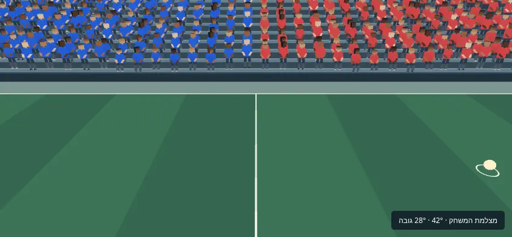
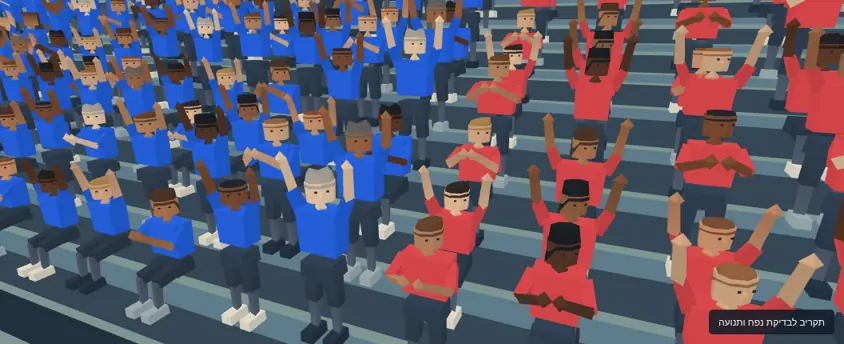

# קהל תלת־ממדי לכדורגל · v1

13 בנובמבר 2026. בסיס: `main`, קומיט `d759582c171600dd7c7df7906c2fb38ae7f8b88a`. ענף: `codex/soccer-crowd-3d-v1`. כל התוספות נמצאות ב־`workout/island/design/soccer-crowd-3d-v1/`.

נמסרו 12 וריאציות בדיוניות, כל אחת בשלוש רמות פירוט: **36 GLB, במשקל 395,572 בתים**. שש וריאציות יושבות ושש עומדות; לכל קובץ ידיים למטה, morph להרמת ידיים ו־morph למחיאת כפיים. המתאם מצייר 1,200 אוהדים עם InstancedMesh, חולצות בצבעי בית/חוץ, ראש שעוקב אחרי הכדור וקפיצת שער. תקציב הקהל הוא 80,000 משולשים, ובבדיקת 3,201 מצלמות המקסימום שנרשם היה **79,998**.

כל הקבצים חדשים בלבד. החבילה מיועדת לביקורת וחיבור עתידי; המשחק הפעיל והאטלס שלו נשארים כפי שהם בענף הבסיס. לא שונו קוד קיים, `release.json`, תגי גרסה, `CLAUDE.md`, `ops` או בדיקות.

## צפייה ושחזור

מגישים את שורש המאגר:

```sh
python3 -m http.server 8765
```

1. פותחים את [preview.html](http://127.0.0.1:8765/workout/island/design/soccer-crowd-3d-v1/preview.html).
2. במצלמת הכדורגל בוחרים ״אחרי״ ו״לפני״. מונה הקהל נשאר 1,200. מונה המשולשים מתייחס לכל הקהל, כולל מופעים מחוץ לתמונה.
3. מחליפים ל״כל האצטדיון״ כדי לראות את פריסת ארבעת היציעים, ול״תקריב יציע״ ו״גב היציע״ כדי לבדוק נפח. בוחרים למטה / למעלה / מחיאה, משנים צבע בית וחוץ ולוחצים על חגיגת שער. הכדור נע והראשים עוקבים אחריו.
4. בגלריה בוחרים 1–12, מסובבים ובודקים את שלוש הרמות יחד. בתצוגת הגלריה ה־morphs הם morphs תקניים של glTF, ללא מתאם הקהל.
5. לוחצים על ״מדידת FPS מקומית״. ארבעת סבבי ABBA נמדדים באותה סצנה ובאותה מצלמה; התוצאות והפרשי הפריימים ניתנים להורדה. התוצאות המצורפות להלן נמדדו בנפרד ב־SwiftShader.

התוצאה הרצויה: קהל מלא של 1,200, עד 80K משולשי קהל, שתי קבוצות בצבעי חולצה נפרדים, שלושה מצבי ידיים וקפיצה בחגיגה.





## נכסים, רישוי ומשקל

| רמה | משולשים לאוהד | מספר GLB | מבנה |
|---|---:|---:|---|
| LOD0 | 210, מתחת לתקרת 220 | 12 | גוף וגפיים בעלי נפח, ראש מתומן, תסרוקות ופרטי פנים קטנים |
| LOD1 | 90 | 12 | גוף וראש בעלי נפח וגפיים מופחתות; פרטי פנים מופשטים |
| LOD2 | 24 | 12 | גוף טריז וראש אוקטהדרלי, גפיים דו־צדדיות דקות |

כל קובץ מכיל primitive וחומר יחידים, צבעי קודקודים RGBA8 ליניאריים ו־`KHR_materials_unlit`. מסכות `_SHIRT` ו־`_HEAD` נפרדות מהצבע. בחולצות נאפה גוון לבן עם הצללה, המוכפל בשיידר בצבע הראשי של הקבוצה; גוני עור, שיער ומכנסיים נשארים נפרדים. צבעי ברירת המחדל הם `#2868ee` לבית ו־`#e94d51` לחוץ, מההגדרות הקיימות. הגוון הסופי כולל את ההצללה האפויה.

שני morph targets דלילים תקניים חוסכים נתוני אפס: `arms-up` ו־`clap`. קיימים גם שני קליפי glTF באותם שמות; קליפ המחיאה מזיז את הידיים מפתיחה למגע וחזרה. במתאם המופעים תנועת הידיים, הראש והקפיצה מחושבת ב־GPU באמצעות attributes ו־uniforms, ללא AnimationMixer לכל אוהד. הראשים מסתובבים סביב ציר הצוואר עד ±0.87 רדיאן, והקפיצה מוסיפה עד 0.12 מטר לפני סקאלת המופע.

אין Draco, meshopt, WASM, שלד, טקסטורות או buffers חיצוניים בנכסי הריצה. אין דמויות אמיתיות, מותגים או סמלי קבוצות. קהל הטניס CC0 שימש מקור לגאומטריה ולפלטות. פירוט לכל קובץ וקבוצת קבצים נמצא ב־[LICENSES.md](LICENSES.md); נפחים ו־SHA-256 לכל GLB נמצאים ב־[assets.json](assets.json).

משקל כל הקבצים בתיקייה, לרבות מקור, תיעוד, מדידות וצילומים: **587,050 בתים**, מתחת לתקרה המחמירה של 600,000 בתים. המודלים לבדם הם 395,572 בתים. three.js ו־GLTFLoader נטענים מעותקי המאגר הקיימים ואינם כפולים בחבילה. מרקם האטלס הישן, 98,080 בתים, נטען רק לצורך קו הבסיס של התצוגה.

## LOD ותקציב

[lod-config.json](lod-config.json) קובע שלוש רמות 210/90/24 וספי מרחק של 24/42 מטר במערכת המקומית של שורש הקהל. מקדם מרחק משותף מקטין את הספים לפי התקציב: כל אוהד עולה באופן מונוטוני 24 → 90 → 210 משולשים כשהספים מתרחבים. המתאם עוצר לפני קידום שאי אפשר לממן. קבוצות במרחק זהה מטופלות יחד, כולל מיקום מצלמה בדיוק במושב.

לכל אוהד נשלחת רמה שלמה ואטומה אחת. אין כפילות גאומטריה בחפיפה, ערבוב שקיפויות או מסכת נקודות על פני הדמויות. ההחלפה עשויה להיראות בקפיצת איכות בזמן תנועת מצלמה; זו פשרה מכוונת לטובת יציע אטום וברור. LOD2 מיועד למרחק, והגפיים הדקות שלו נראות פחות טוב במבט צד חד.

פריסת הביקורת כוללת 1,200 מושבים: 100 מכל וריאציה ו־600 לכל קבוצה. שני היציעים הארוכים מכילים 400 כל אחד, ושני יציעי הקצה 200 כל אחד. `frustumCulled=false` על batches הקהל, כך שהספירה כוללת גם יציע מאחורי המצלמה. מופעים אינם מוסרים כדי לעמוד בתקציב. בגלריה יש שלושה מודלים נוספים, ברנדרר נפרד שנעצר בזמן מדידה; הם אינם חלק מסצנת 1,200 האוהדים.

| מצלמה | LOD0 / LOD1 / LOD2 | משולשי קהל | קריאות קהל | מקדם מרחק |
|---|---:|---:|---:|---:|
| כדורגל · רוחב | 0 / 774 / 426 | 79,884 | 24 | 0.7129 |
| כדורגל · גובה | 0 / 774 / 426 | 79,884 | 24 | 0.7656 |
| מבט כללי | 0 / 0 / 1200 | 28,800 | 12 | 1.0000 |
| תקריב | 212 / 178 / 810 | 79,980 | 36 | 0.6006 |
| גב היציע | 213 / 175 / 812 | 79,968 | 36 | 0.6568 |

החלוקה נמדדת מחדש כשהמצלמה זזה. שינויי צבע, מחיאות, תנועת ראש וחגיגה מעדכנים uniforms; לא נוצרים geometry או skeletons בזמן פריים. עד 36 קריאות ציור לקהל, אחת לכל וריאציה ורמה פעילה. תקציב 80K מתייחס לקהל; שילוב במשחק חייב לכלול גם את שאר הסצנה בחשבון התקציב הכללי שלו.

## מצלמה ומדידות בתוכנה

מצלמת ״כדורגל״ משחזרת את מצב המנוחה של `soccerCamera` ואת מיקום המצלמה של `soccer-view.mjs`: FOV אנכי 42°, מרחק 15 מטר וגובה 28° ברוחב; 21 מטר ו־40° בגובה. הכדור והשחקן הנשלט ממוקדים יחד סמוך לקו הרחוק, במטרה `[0,0,-12]`, ללא מהירות או הובלת מצלמה. מצלמות התקריב, הגב והמבט הכללי הן מצלמות ביקורת נכסים.

״לפני״ הוא האטלס הפעיל של הכדורגל, ברינדור camera-facing עם alpha test ומופעים, מותאם לאותם 1,200 מושבים של החבילה. ״אחרי״ הוא הקהל התלת־ממדי החדש. זהו ניסוי מבוקר בתצוגת נכסים; מספר המושבים, מבנה היציעים ומספר קריאות האטלס שונים מהאצטדיון המלא במשחק הפעיל.

Chromium 151.0.7922.173, ‏ANGLE / SwiftShader (Vulkan), ללא GPU חומרתי. שמונה סבבים ו־720 הפרשי RAF נמדדו בסך הכול.

| קנבס | מצב | משולשי קהל | קריאות קהל | משולשי סצנה | קריאות סצנה | FPS משוקלל | FPS בסבבים | p95 פריים |
|---|---|---:|---:|---:|---:|---:|---:|---:|
| 844×390 | לפני · אטלס | 2,400 | 4 | 3,084 | 61 | 28.35 | 28.42 / 28.27 | 50.1 ms |
| 844×390 | אחרי · 3D | 79,884 | 24 | 80,568 | 81 | 18.65 | 18.62 / 18.69 | 66.8 ms |
| 390×844 | לפני · אטלס | 2,400 | 4 | 3,036 | 57 | 34.29 | 34.18 / 34.40 | 50.0 ms |
| 390×844 | אחרי · 3D | 79,884 | 24 | 80,520 | 77 | 22.50 | 22.32 / 22.69 | 66.7 ms |

נתוני הפריימים המצורפים מעוגלים ל־0.001 מילישנייה. כל מדדי המשולשים והקריאות נלקחו מהרנדרר בפועל; חלוקת LOD אומתה גם ברינדור הקהל לבדו.

לכל כיוון: לפני → אחרי → אחרי → לפני, 20 פריימים לחימום ו־90 הפרשי RAF בכל סבב, DPR=1 וחגיגה בעוצמה 0.75. הסצנה, מסלול הכדור ושעון האנימציה זהים בכל סבב. המצלמה קבועה וממשק הגלריה נעצר בזמן המדידה. FPS משוקלל הוא סך הפריימים חלקי סך הזמן לשני הסבבים של אותו מצב; p95 מחושב מכל הפרשי הפריימים באותו מצב. ב־[measurements.json](measurements.json) שמורים כל ההפרשים, זמני CPU של update+render, גרסת הדפדפן ושם renderer התוכנה.

הוספת גוף, גפיים וראש בעלי נפח עולה יותר משני משולשי אטלס לאוהד; אין כאן טענה לשיפור FPS על פני אטלס שטוח. המספרים הם תוצאות SwiftShader עם vsync ועומס סביבת הענן, ולא תוצאות GPU חומרתי או טלפון. זמן submit הוא זמן CPU ולא מדידת GPU. ביצועי המשחק המלא יימדדו בשלב החיבור.

## חיבור עתידי

```js
const fans = await createSoccerCrowd({T, GLTFLoader, seats, base: packageURL});
scene.add(fans.root);
fans.setTeamColors(config.team.colors[0], config.opponent.colors[0]);
fans.update({
  seconds: elapsed,
  celebration: state.phase === 'goal' ? 1 : 0,
  ballPosition: [ball.x, ball.y, ball.z],
  cameraPosition: camera.position.toArray(),
  pose: -1
});
// בעת סגירת הסצנה:
fans.dispose();
```

`packageURL` הוא URL של תיקיית החבילה, עם `/` בסוף. `seats` מכיל 1–1,200 רשומות `{id,variant,team,x,y,z,yaw,scale?}`: מזהה מספרי ייחודי, וריאציה 0–11, קבוצה 0/1, מטרים, Y למעלה ו־Z קדימה. `scale` חייב להיות חיובי וסופי. `pose` הוא ‎-1 לקהל מעורב, 0 למטה, 1 למעלה ו־2 למחיאה. `celebration` הוא 0–1 ומניע את קפיצת השער; בדוגמה כל הקהל משתתף בחגיגה.

מיקומי הכדור, המצלמה והמושבים נמסרים **במערכת המקומית של `fans.root`**. כאשר השורש מוזז או מסובב, יש להמיר אליו את הקואורדינטות. סקאלת שורש שאינה 1 משנה גם את משמעות ספי המרחק במטרים. `fans.metrics` מדווח על משולשים שנשלחים בפועל, חלוקה לרמות, מספר אוהדים ומקדם המרחק. `dispose()` משחרר geometry, materials ומשאבי InstancedMesh, ומנתק את הקהל מהסצנה.

## אימות

- 36/36 קובצי GLB עברו Khronos glTF Validator, ללא שגיאות וללא אזהרות: [gltf-validation.json](gltf-validation.json).
- כל 36 נטענו ב־GLTFLoader. נבדקו 210/90/24 משולשים, מסכות הראש והחולצה, נקודת הציר, שני morphs בחמש דרגות משקל וניגון שני הקליפים ב־AnimationMixer תקני.
- נבדקו 108 מצבי גלריה: 12 וריאציות × שלוש זוויות × שלוש פוזות, ובכל מצב שלוש רמות. צילום של דמות יושבת ושל דמות עומדת נכלל בחבילה.
- בארבע מצלמות ובשני מצבי חגיגה הושוו מדדי המתאם לספירה בפועל של `renderer.info.render` כאשר הקהל מצויר לבדו. כל 1,200 המופעים נשמרו.
- נבדקו מעקב ראש, מסכה בינארית לראש, חגיגה, וצפייה ברוחב ובגובה ללא גלילה אופקית. CSP מקומי חוסם WASM; אין בקשות חיצוניות, טעינות שנכשלו או שגיאות WebGL/JavaScript. העדות המלאה: [verification.json](verification.json).
- 3,201 מיקומי מצלמה: מרכז, כל 1,200 המושבים ו־2,000 מיקומים אקראיים בזרע קבוע. בכל מיקום נשמרו 1,200 אוהדים, עם שיא של 79,998 משולשים.
- `git diff --check` עבר. סקירת ה־diff מאשרת תוספות בתיקייה זו בלבד.

`npm test`: מתוך 3,970 בדיקות, 3,905 עברו, 64 דולגו ואחת נכשלה: `tests/workout-royiki.test.mjs:91`. Playwright חיפש Chromium headless shell שאינו מותקן. הבדיקה השאירה שרת פתוח אחרי כשל ההפעלה, ולכן תהליך הבדיקה שלה הופסק לאחר רישום הכישלון. אותה בדיקה הורצה מחדש באמצעות `ISLAND_PLAYWRIGHT` ומתאם זמני מחוץ למאגר אל `/usr/bin/chromium`: כל 5 הבדיקות בקובץ עברו, כולל בדיקת הדפדפן. ההרצה הכללית המקורית נשארת מתועדת ככישלון סביבתי; לא שונה קובץ בדיקה או עזר במאגר.

שחזור הנכסים והאימות, משורש המאגר:

```sh
python3 workout/island/design/soccer-crowd-3d-v1/source/build.py
node workout/island/design/soccer-crowd-3d-v1/source/validate-glb.mjs /tmp/soccer-crowd-tools/node_modules/gltf-validator
python3 workout/island/design/soccer-crowd-3d-v1/source/measure.py
```

המחולל דורש Python בלבד ומחוללי טניס CC0 הקיימים בענף הבסיס. המאמת דורש התקנת gltf-validator בסביבת פיתוח מחוץ למאגר. כלי המדידה דורש שרת שורש פעיל, Playwright, Pillow ו־`/usr/bin/chromium`. הרצה חוזרת מחליפה רק פלטים בתיקייה החדשה הזאת. לא הותקנו תלויות פיתוח במאגר ולא השתנו קובצי package או lock.
