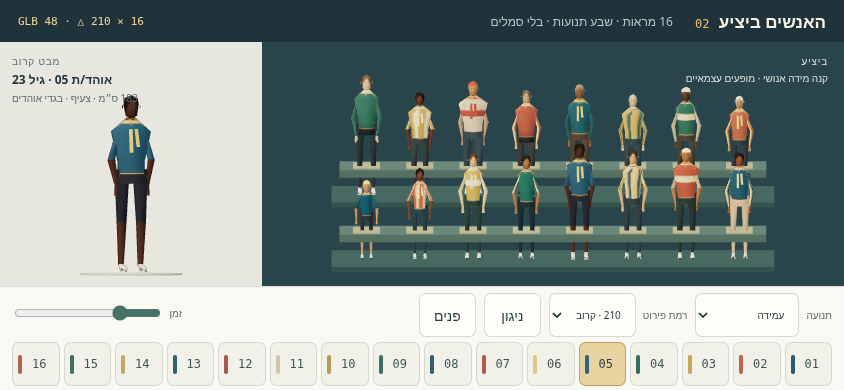
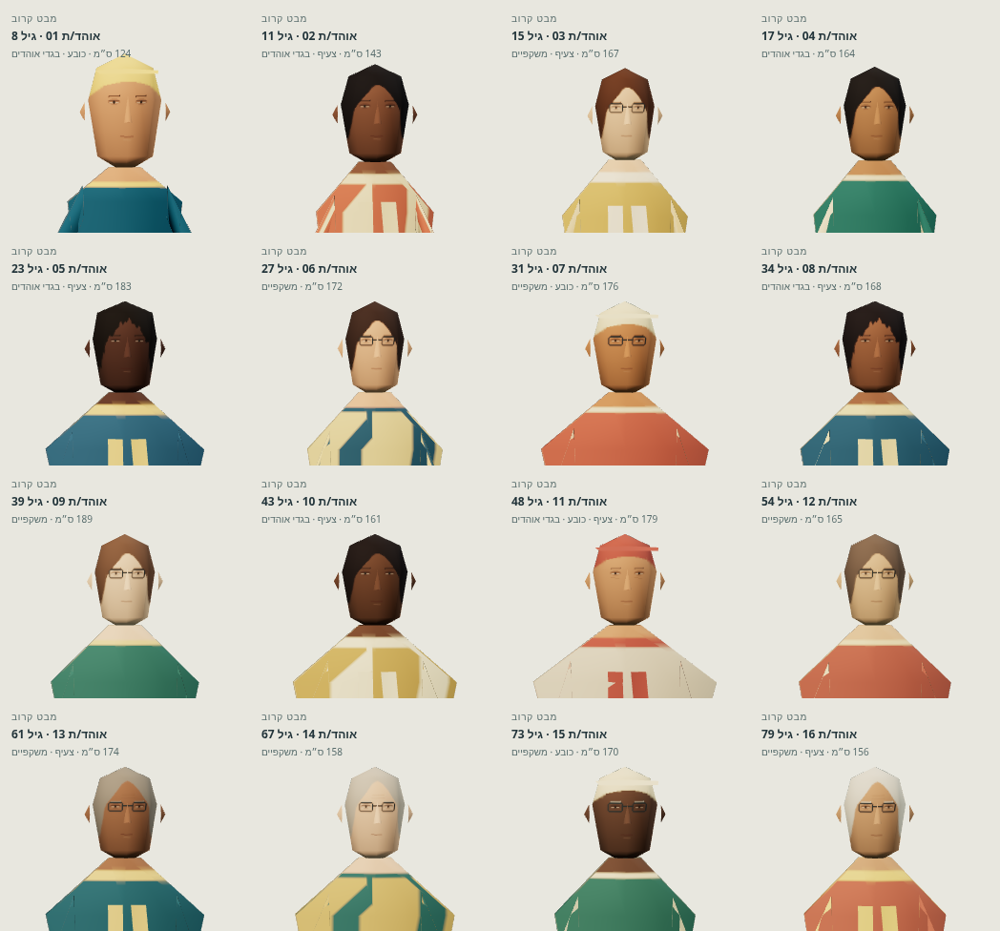

# מסירת קהל כדורגל אנושי v2

17.11.2026 · ענף `codex/soccer-crowd-people-v2` · בסיס `43b27dc235387e3cb737aee9558cdf9d5fd5a262`.

16 אוהדים בעלי פרופורציות אנושיות, בשלוש רמות פירוט ובשבע תנועות מחזוריות. המסירה נמצאת כולה ב־`workout/island/design/soccer-crowd-people-v2/`. כל השינויים הם הוספת קבצים בתיקייה החדשה בלבד, בהתאם לבקשה; רישום המסירה נמצא בדוח זה.



| דרישה | תוצאה |
|---|---|
| 16 דגמי אוהדים | 16 מראות, 48 קובצי GLB עצמאיים |
| 200–400 משולשים ברמה הקרובה | בדיוק 210 לכל אוהד, כולל שיער ואביזרים |
| שלוש רמות LOD | בדיוק 210 / 90 / 24 משולשים; כל קובץ כולל את אותו שלד ואת כל התנועות |
| משקל GLB כולל | 2,447,312 בתים (2.447 MB) |
| משקל החבילה כולה | **5,230,890 בתים (5.231 MB)**, כולל מקור, ספריות, דוח, צילומים ותוצאות בדיקה; 85 קבצים; מתחת ל־6,000,000 בתים |
| Khronos | 48/48 נקיים: 0 שגיאות, 0 אזהרות, 0 הערות מידע |
| תצוגה | `preview.html`, נבדקה ב־844×390 וגם ב־390×844; כל התלויות מקומיות |
| רישוי | גאומטריה, אטלסים ותנועות CC0-1.0; ספריות התצוגה MIT; פירוט ב־[LICENSES.md](LICENSES.md) |

## המראה האנושי

הגילים הבדויים הם 8–79 והגבהים 1.24–1.89 מטר. היחס בין הגובה לגובה הראש הוא כ־6.05 אצל הילד הצעיר ועד 7.45 אצל מבוגרים. יש הבדלים ברוחב הפנים, האף, הכתפיים, המותן והגפיים; גוני עור בהירים עד כהים; שיער כהה, חום, מתולתל, אסוף ואפור; שמונה הצגות נשיות ושמונה גבריות. תכנון המראות כולל מגוון רקעים חזותיים אפריקאיים, אסייתיים, אירופיים, מערב־אסייתיים ולטינו־אמריקאיים, ללא דיוקן של אדם אמיתי.

הראש נדגם ממשטחי לסת, לחיים וגולגולת קיימים ברישיון CC0; הגוף משתמש בחתכי האנטומיה הקיימים של המאגר. הגפיים מתחדדות אל המרפק, שורש כף היד והקרסול. יש אף, אוזניים, פרטי פנים באטלס, נעליים, חולצות חלקות/פסים/פס חזה/שרוול מנוגד, מכנסיים קצרים וארוכים, כובעים, משקפיים וצעיפים. כל אוהד משתמש באטלס PNG מוטמע בגודל 256×256 ובחומר PBR יחיד. אין סמלים או מותגים.

זהו מראה אנושי מפושט לקהל במשחק. הפאות נשארות נראות במבט קרוב. ברמת 24 משולשים הגוף והראש נפחיים והגפיים משתמשות בצלליות דו־צדדיות; רמה זו מיועדת לדמויות שגובהן פחות מ־16 פיקסלים, ללא פרטי פנים. היא אינה מיועדת לבחינה מקרוב או למבט צד דק.



## תנועות

הבקשה מציינת „6 קליפים” אך מונה שבע פעולות. כל שבע הפעולות סופקו, כדי לכסות את הרשימה במלואה.

| מזהה | פעולה | משך לולאה |
|---|---|---|
| `sit` | ישיבה | 4.0 שניות |
| `stand` | עמידה | 4.0 שניות |
| `clap` | מחיאות כפיים | 1.2 שניות |
| `jump_cheer` | קפיצה בשמחה | 1.8 שניות |
| `disappointed` | אכזבה | 3.2 שניות |
| `shout` | צעקה | 2.4 שניות |
| `wave_clap` | מחיאה בגל | 3.2 שניות |

כל קליפ מוטמע בכל GLB, ללא תנועת שורש אופקית. העצמות הן `CrowdCanonical18`, עם שמות והורים תואמי השלד הקנוני הקיים, אך אורך גוף ו־inverse binds עצמאיים לכל אוהד. סיבובים הם quaternions בסדר XYZW במרחב ההורה. קצות הלולאה זהים; תנועות הנשימה, הכפיפה והקפיצה מחזוריות. מחיאת כף משתמשת ב־IK לשתי זרועות ובכיוון כפות הידיים זו אל זו.

לגל: להפעיל `wave_clap` ולהוסיף 0.12 שניות פאזה בין מושבים סמוכים. במעבר LOD משמרים את הזמן המנורמל באותו קליפ. בישיבה גובה המושב למבוגר הוא בערך 0.44–0.48 מטר; בתצוגה כלולים מושבי המחשה. כל התנועות מניחות שמישור הרצפה המקומי הוא Y=0.

## ראיות בדיקה

| בדיקה | תוצאה |
|---|---|
| Khronos glTF Validator 2.0.0-dev.3.10 | 48/48 נקיים, כולל אנימציות, סקינים, תמונות ומבנה GLB |
| בדיקות מבנה נוספות | ספירת משולשים, SHA-256, אזורי זיכרון, נורמלים באורך יחידה, משקלים שסכומם 1, אינדקסי עצמות, שטחי משולשים חיוביים, קצוות לולאה וללא משאבים חיצוניים |
| Chromium עם WebGL וטעינה במצב offline | 78/78 בדיקות עברו; כל 48 הנכסים נטענו |
| דגימות של גאומטריה לאחר skinning בפועל | 3,024: 16 אנשים × 3 רמות × 7 קליפים × 9 זמנים |
| סטייה מרבית של תחתית הנעל מהרצפה מחוץ לקפיצה | 0.000000047 מטר |
| מרחק מרבי בין מרכזי כפות הידיים ברגעי המחיאה | 0.02835 מטר; כפות הידיים עצמן בעלות עובי ונוגעות זו בזו |
| גובה ריחוף מרבי שנמדד בקפיצה | 0.2835 מטר |
| אינטראקציות | בחירת כל 16 האנשים, 7 תנועות, 3 רמות, עצירה/ניגון, ציר זמן, סיבוב במגע ובמקלדת, מבט פנים, תנועה מופחתת ושחזור WebGL |
| תקשורת ושגיאות דפדפן | 0 בקשות חיצוניות ו־0 שגיאות דפדפן |
| `npm test` של המאגר | 4,262 עברו, 0 נכשלו, 64 דולגו; 4,326 בדיקות בסך הכול |

ראיות מלאות: [assets.json](verification/assets.json), [browser.json](verification/browser.json), [poses.json](verification/poses.json), [repo-tests.json](verification/repo-tests.json). צילומי שבע התנועות ורמות הפירוט נמצאים ב־`verification/`.

בדיקות הדפדפן בוצעו ב־Chromium/SwiftShader בסביבת Linux. לא נמדד FPS בטלפון פיזי או במגרש המשחק המחובר. מספר המשולשים לקהל של 16 אנשים הוא 3,360 / 1,440 / 384 בהתאמה, וקריאת ציור אחת לכל אדם. אלה מדדי הנכסים, ולא הבטחת ביצועים למכשיר.

לבדיקות המאגר הוגדר `PLAYWRIGHT_BROWSERS_PATH` למטמון זמני ב־`/tmp`, המפנה ל־Chromium 151 המותקן בסביבה. קובצי המאגר והבדיקות הקיימים נשארו כפי שהם. בדיקת 50 תרגילי האימון עברה גם בנפרד עם אותו דפדפן.

## שימוש ושחזור

1. פותחים את [preview.html](preview.html) באמצעות שרת HTTP מקומי, כשהחלון 844×390. בוחרים מספר אוהד, תנועה ורמת פירוט; גרירה מסובבת את הדמות ו„פנים” מתקרב לראש. התוצאה הצפויה: דמות נבחרת משמאל וכל 16 האנשים ביציע מימין.

מתוך תיקיית החבילה:

```sh
python3 -m http.server 8765 --bind 127.0.0.1
```

ואז פותחים בדפדפן:

```text
http://127.0.0.1:8765/preview.html
```

2. לחיבור, קוראים את [manifest.json](manifest.json) וטוענים קובץ אחד בלבד לכל אוהד. המלצת הבחירה לפי גובה דמות במסך: 48 פיקסלים ומעלה → LOD0; ‏16–47 → LOD1; פחות מ־16 → LOD2. משתמשים ב־inverse binds ובקליפים של אותו קובץ ושומרים את זמן הקליפ במעבר.
3. יצירה חוזרת דורשת Python 3, ‏NumPy ו־Pillow. מתוך תיקיית החבילה:

```sh
PYTHONDONTWRITEBYTECODE=1 python3 source/build.py
```

4. אימות Khronos, עם התקנת כלי הבדיקה בתיקייה זמנית:

```sh
npm install --prefix /tmp/crowd-v2-checks gltf-validator@2.0.0-dev.3.10
CROWD_TOOLS=/tmp/crowd-v2-checks node source/validate-assets.mjs
```

5. בדיקת התצוגה דורשת Playwright ו־Chromium. אין צורך בשרת או ברשת, משום שהבדיקה מגישה רק את קובצי החבילה דרך route מקומי:

```sh
PYTHONDONTWRITEBYTECODE=1 python3 source/check-browser.py
```

המקורות, ה־manifest והבדיקות ניתנים לשחזור מקומי. גודל החבילה נמדד לפי סכום תוכן הקבצים, ללא תקורת מערכת קבצים או ספריית Git. כל קובצי ה־GLB אינם משתמשים בדחיסה או בהרחבות, ונטענים ישירות ב־GLTFLoader רגיל.
