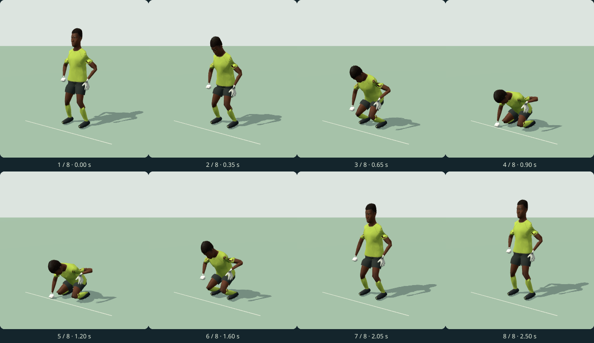
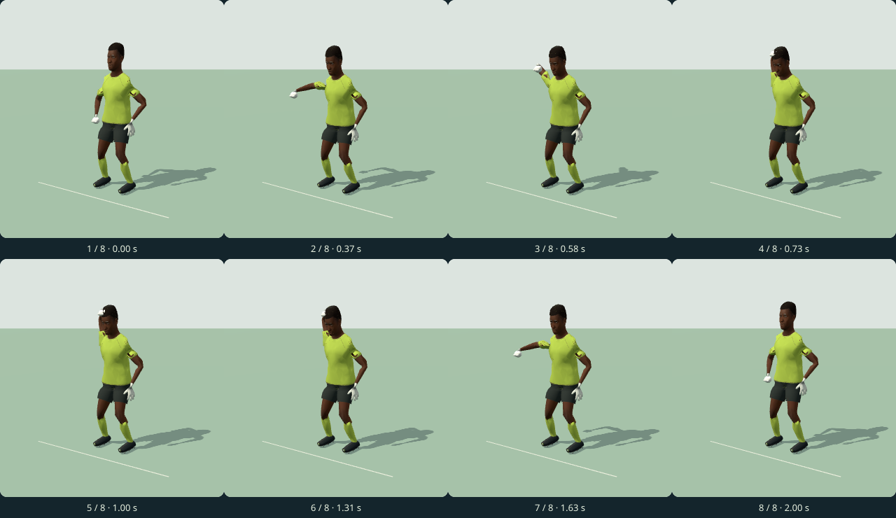
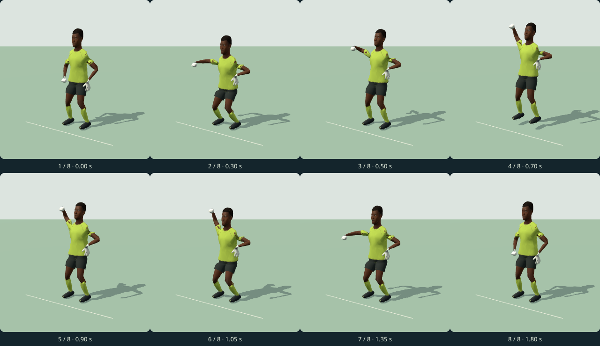

# שוער וקהל — דוח מסירה

ענף `codex/soccer-keeper-crowd-v1`, נוצר מ־main בקומיט `51f4faab518c695672efaf6323a8b72f239a2b84`. כל התוצרים תחת תיקייה זו. [תצוגה](preview.html) · [קטלוג ריצה](runtime/catalog.json) · [מניפסט](manifest.json) · [מקורות ורישיונות](LICENSES.md).

## קליפים ומדידות

18 עצמות קנוניות, דגימות 30 הרץ כולל שתי נקודות הקצה. כל ערוץ GLB משתנה שומר את כל הדגימות. אין Draco, דחיסת רשת או מפענח. המודל המצורף משמר את שלד ה־bind של motion-fix-v12 ומוסיף כפפה ימנית סגורה, קבועה, בגאומטריה מקורית של 488 משולשים. גודל המודל 800,224 בתים; SHA-256: `56ccc07410c485d5cc99fa4ce4303c9a2621b1da643e5c16055f62fe2778d33b`.

| קליפ | שניות | דגימות ב־30Hz | GLB, בתים | ציון QA | החלקת סוליה מרבית, מ״מ | חדירת רצפה מרבית, מ״מ |
|---|---:|---:|---:|---:|---:|---:|
| keeper_after_goal | 2.5 | 76 | 27,756 | 96.7 | 0.539 | 0.461 |
| disappointed | 2 | 61 | 23,532 | 96 | 0.004 | 0.010 |
| keeper_celebrate | 1.8 | 55 | 23,076 | 96.1 | 0.129 | 0.505 |

כל שלושת הקליפים מעל 88; כיסוי המדדים הרלוונטיים 100%, ללא מדד אדום או צהוב. התנועות אינן כוללות כדור ואינן תנועות התקדמות, לכן מדדי מגע בכדור ומהירות הליכה מסומנים במפורש כלא רלוונטיים. עמידת הייחוס נמדדת כרשומה רביעית בדוח הכלי ואינה אחת משלוש התגובות.

- **keeper_after_goal**: הראש נשמט ב־0.35 ש׳, הגוף יורד, כפפה ימין נשענת על הקרקע ב־0.90–1.20 ש׳, ואז קימה איטית עד 2.50 ש׳. שתי הסוליות תומכות בכל הקליפ. שגיאת עוגן הכפפה המרבית קטנה מ־0.001 מ״מ ב־19 דגימות בחלון התמיכה. זהו דיוק מספרי של נקודת מדידה, לא מדידת משטח הכפפה כולו.
- **disappointed**: כתפיים וגו נשמטים, הכפפה נוגעת באזור המצח/הראש והראש מהנהן קלות. לולאה מלאה 0–2 ש׳, שתי סוליות תומכות לאורך כל הקליפ. הפער בין מפרקי הפריים הראשון והאחרון הוא 0.000000 מ״מ; פער מהירות הקצה הנמדד בהפרשים סופיים הוא 0.00000 מ׳/ש׳. עקומות היצירה בעלות משיק אפס בקצוות; ב־GLB הניגון הוא LINEAR בין דגימות.
- **keeper_celebrate**: הכפפה הסגורה עולה כאגרוף; ניתוק מהרצפה ב־0.50 ש׳, שיא קפיצה של 10 ס״מ ב־0.70 ש׳, נחיתה בשתי רגליים ב־0.90 ש׳, ספיגה וחזרה לעמידה עד 1.80 ש׳. חלונות התמיכה הם 0–0.50 ו־0.90–1.80 ש׳ לכל רגל. הרמת Root אפויה בקובץ פעם אחת.

[כל חלונות התמיכה, העוגנים ומדידות הסריאליזציה](qa/measurements.json) · [כל אירועי הקליפים](runtime/catalog.json).

## גיליונות של שמונה פריימים

כל גיליון צולם מה־GLB המיוצא כשהוא מנוגן על מודל השוער המצורף באמצעות GLTFLoader ו־AnimationMixer. סדר הקריאה משמאל לימין, שורה עליונה ואז תחתונה; בכל תא מספר וזמן. הגיליונות מציגים גאומטריה מלאה, וניתן לבחור חזית/צד בתצוגה האינטראקטיבית.

### keeper_after_goal

### disappointed

### keeper_celebrate

## אטלס הקהל

האטלס החדש הוא PNG שקוף ללא אובדן, 1024×2048 פיקסלים, 690,148 בתים. 32 תאים של 256×256: כל 16 הווריאציות המקוריות ו־16 גרסאות תואמות עם שתי ידיים למעלה לכל שלושת האוהדים. הצבעים, גובה הראש, מיקום הדמויות, הבגדים וסדר הווריאציות נגזרים מפרמטרי היצירה המקוריים של v8. תוספת הפוזה נכתבה כאיור וקטורי מקורי ב־[crowd-raised.svg](source/crowd-raised.svg).

כל פיקסלי RGBA של החצי המקורי זהים לפענוח מקור v8. בתאים החדשים 48 אוהדים ו־96 ידיים מורמות; שוליים שקופים של לפחות 5 פיקסלים מכל קצה. [מניפסט התאים](runtime/crowd-manifest.json) כולל מלבני פיקסלים ושני כיווני UV. השוואת 16 הזוגות מוצגת ב־preview.html ובצילומי הדפדפן. זיכרון RGBA בסיסי: 8 MiB, לעומת 4 MiB במקור; עם שרשרת mip מלאה, בקירוב 10.67 MiB.

הכפלת גובה האטלס מחייבת שימוש ב־UV החדש בעת חיבורו: רוחב תא 0.25 וגובה תא 0.125. אין החלפה אוטומטית של האטלס במשחק.

## אימות ושחזור

כלי QA: קומיט `5eb4f093bc22523ee417a7f2345c3b813bffba24` מענף codex/motion-qa-v1. מבנה ושלד הייחוס: קומיט `5d71491ea9a3b44b5fe6139e516c1d2e5577e9ad` מענף codex/motion-fix-v12. שני הענפים טרם נכללו ב־main בנקודת הבסיס, ולכן הם נקראו כמקורות מוצמדים בלבד.

הורץ `node workout/island/design/motion-qa-v1/run.mjs` מתוך עותק חיצוני ב־/tmp, עם מתאם קלט לספרייה החדשה. קובצי run.mjs, glb.mjs, metrics.mjs, report.mjs ו־sheets.mjs זהים למקור; נוסחאות, ספים ושקלול נשמרו. [פקודה מדויקת, SHA-256 ותוצאות](qa/summary.json), [דוח הכלי](qa/report.html), [JSON מלא](qa/report.json). הדגימה למדידה היא 60 הרץ, בתוספת זמני האירועים והתמיכה המדויקים.

Chromium עבר ב־844×390 וב־390×844: כל שלושת הקליפים בחמש נקודות זמן בכל גודל, 18 עצמות עם מטריצות סופיות, 16 זוגות תאי קהל וללא גלילה אופקית. אין שגיאות JavaScript, שגיאות HTTP, בקשות חיצוניות או טעינת Draco/WASM. WebAssembly.instantiate ו־WebAssembly.compile הוגדרו לזריקת שגיאה במהלך האימות. [תוצאות הדפדפן](qa/browser.json) · [תצוגה לרוחב](sheets/preview-844x390.png) · [תצוגה לאורך](sheets/preview-390x844.png).

[הוראות שחזור וחיבור](README.md). קובצי אנימציה, כל 54 accessors במודל וכל קובצי JSON פוענחו בהצלחה. ה־18 bones ונתוני ה־bind נשמרו. לא שונו קוד קיים, release.json, תגי גרסה, CLAUDE.md, ops או בדיקות. לא בוצע חיבור למשחק או בדיקת טלפון פיזי.

הציון הוא מדד אבחוני משוקלל. מדידות הרצפה מתייחסות למפרקים ולנקודות סוליה/כפפה מוצהרות; הן אינן בדיקת התנגשות של כל קודקודי המודל. המעבר מעמידת הסיום אל עמידת השמירה במשחק נשאר לשלב החיבור.
