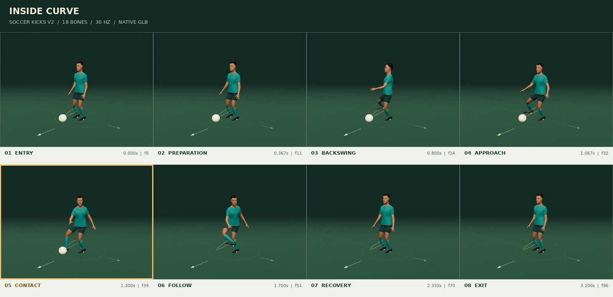
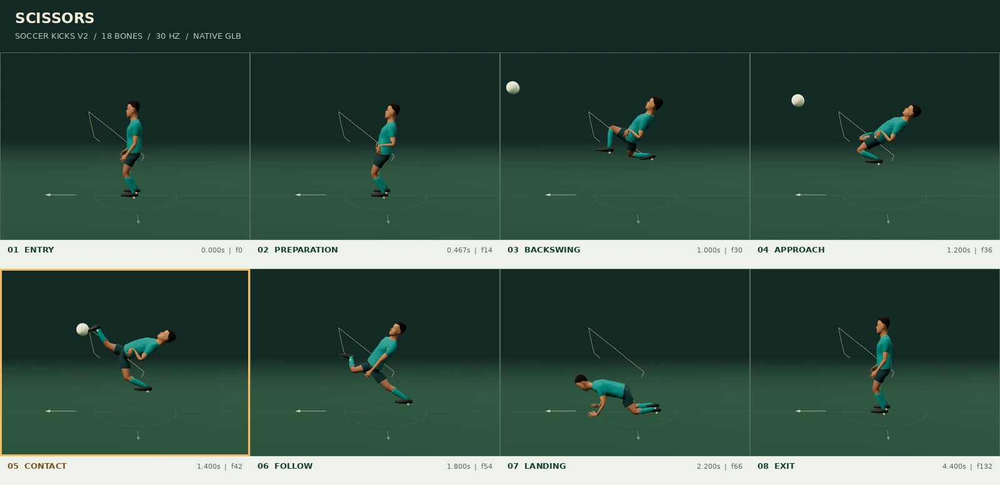

# דוח מסירה · בעיטות ומסירות כדורגל v2

נוספו **14 קליפים**, על שלד קנוני של **18 עצמות**, בקצב מקור **30Hz**, עם אירועי **back** ו־**contact**. כל הקליפים עברו motion-qa-v1 בציון **91.6 ומעלה**, עם **0 מדדים אדומים** וכיסוי מלא של המדדים החלים. החלקת סוליה תלת־ממדית מרבית בחלונות התמיכה: **6.376 מ״מ**, מול רף 20 מ״מ.

[תצוגת תלת־ממד](preview.html) · [לוח QA](verification/qa/report.html) · [אימות דרישות](verification/requirements.json) · [רישיונות](LICENSES.md)

## הקליפים

back הוא שיא ההכנה לאחור, לפני contact. סיבוב גוף הוא המרחק הזוויתי המרבי של האגן מפוזת הכניסה; הטבלה אינה מציגה סכום של סיבובי אגן וחזה. כל הזמנים בשניות, וכל החלקות הרגליים במ״מ.

| קליפ GLB | פעולה | QA | משך | back / contact | סיבוב אגן | החלקה מרבית | גיליון |
|---|---|---:|---:|---|---:|---:|---|
| [power_landing](runtime/clips/power_landing.glb) | בעיטה חזקה בנחיתה | 95.9 | 3.200 | 0.800 / 1.300 | 26.6° | 0.062 | [8 פריימים](sheets/power_landing.webp) |
| [inside_curve](runtime/clips/inside_curve.glb) | בעיטת קשת מבפנים | 96.5 | 3.200 | 0.800 / 1.300 | 40.6° | 0.081 | [8 פריימים](sheets/inside_curve.webp) |
| [outside_kick](runtime/clips/outside_kick.glb) | בעיטה מבחוץ | 98 | 3.000 | 0.700 / 1.200 | 36.2° | 0.063 | [8 פריימים](sheets/outside_kick.webp) |
| [placed_kick](runtime/clips/placed_kick.glb) | בעיטה בהנחה | 98.1 | 2.800 | 0.800 / 1.200 | 17.3° | 0.052 | [8 פריימים](sheets/placed_kick.webp) |
| [weak_foot](runtime/clips/weak_foot.glb) | בעיטה ברגל חלשה | 98.3 | 3.100 | 0.800 / 1.300 | 21.6° | 0.045 | [8 פריימים](sheets/weak_foot.webp) |
| [volley](runtime/clips/volley.glb) | בעיטת יעף · volley | 95.1 | 3.200 | 0.900 / 1.400 | 40.2° | 0.073 | [8 פריימים](sheets/volley.webp) |
| [scissors](runtime/clips/scissors.glb) | בעיטת מספריים | 91.8 | 4.400 | 1.000 / 1.400 | 77.3° | 0.019 | [8 פריימים](sheets/scissors.webp) |
| [chip](runtime/clips/chip.glb) | הקפצה מעל היריב · chip | 97.7 | 2.900 | 0.800 / 1.200 | 15.2° | 0.036 | [8 פריימים](sheets/chip.webp) |
| [running_kick](runtime/clips/running_kick.glb) | בעיטה בריצה ללא עצירה | 91.6 | 1.600 | 0.500 / 0.700 | 18.0° | 6.376 | [8 פריימים](sheets/running_kick.webp) |
| [short_inside_pass](runtime/clips/short_inside_pass.glb) | מסירה קצרה בפנים הרגל | 97.8 | 2.400 | 0.667 / 1.000 | 16.1° | 0.089 | [8 פריימים](sheets/short_inside_pass.webp) |
| [long_pass](runtime/clips/long_pass.glb) | מסירה ארוכה | 96.8 | 3.300 | 0.900 / 1.400 | 37.6° | 0.072 | [8 פריימים](sheets/long_pass.webp) |
| [through_pass](runtime/clips/through_pass.glb) | מסירת עומק | 98.1 | 2.700 | 0.700 / 1.100 | 28.3° | 0.090 | [8 פריימים](sheets/through_pass.webp) |
| [lift_pass](runtime/clips/lift_pass.glb) | מסירה גבוהה · lift_pass | 97.3 | 3.000 | 0.867 / 1.300 | 25.0° | 0.069 | [8 פריימים](sheets/lift_pass.webp) |
| [wing_cross](runtime/clips/wing_cross.glb) | הגבהה מהאגף | 96.2 | 3.500 | 0.967 / 1.500 | 52.4° | 0.090 | [8 פריימים](sheets/wing_cross.webp) |

## טיפול בהערה של רועי

לכל קליפ כוריאוגרפיה עצמאית: הכנה, סיבוב ירך, פיתול גו, כיוון ברך, זווית קרסול, מסלול רגל, ידיים מאזנות והתאוששות. בעיטות הקרקע משתמשות בקשת מרחבית קובית עם משיק רציף דרך המגע; אין הקטנה של אותה בעיטה לכל המסירות. מסירות קצרות משתמשות בפנים פתוחות ובתנועה נמוכה, מסירה ארוכה בטעינת ירך ובהמשך גבוה, מסירת עומק בהטעיית כתף, lift_pass בהרמה אלכסונית, והגבהה מהאגף בסיבוב ובסחיפה רחבים במיוחד. רגל חלשה נכתבה בנפרד, עם תמיכה נגדית וטווחים משלה.

volley פוגש כדור באוויר בעוד רגל התמיכה נשארת נטועה. מספריים מצלב את הרגליים באוויר, מאריך את הרגל הפוגעת מעל הראש, מטה ומסובב את הגו, יורד לנחיתת כפות ידיים וקם. power_landing נוחת על רגל התמיכה לפני פריקת הירך. running_kick שומר על מחזור ריצה ועל מהירות תנועה חיצונית קבועה **4.5 מ׳/שנייה**, פוגש כדור נייח בעולם, וממשיך בריצה ללא עצירה; פאזת היציאה היא run ב־0.4 שנ׳.

נבדקו כל **91 זוגות הקליפים**: מרחק RMS המזערי בין קשתות המגע הוא **10.10 ס״מ**, ובין סיבובי האגן **2.20°**. ההשוואה מנרמלת את שלב ההכנה עד המשך התנועה ומשווה נקודת מגע יחסית לאגן; היא ראיה להבדלי נתונים, לצד סקירת גיליונות הפריימים.

## רציפות, רצפה ותמיכות

**112/112 גשרים** מול run ו־idle עברו בדיקת C0/C1 ב־240Hz, בשני הכיוונים ובפאזות הקטלוג ובפאזות פנימיות. כל גשר נמשך לפי הקטלוג; פאזת היעד מוחזקת במהלכו ומתחדשת בסופו. הגשר מתחיל מהפוזה המוצגת ומהמהירות שלה, כך שאפשר להפסיק ריצה גם בפאזה פנימית.

runtime/player.mjs מוסיף תיקון רצפה מקומי ב־IK תוך שמירת כיוון כף הרגל ומישור הברך. התיקון נכנס ויוצא במשקל בעל ערך ונגזרת אפס בקצותיו. סטיית מהירות זוויתית מרבית בקצות הגשרים: **1.209e-5 רד׳/שנייה**. החלקת תמיכות idle משותפות: **0.235 מ״מ**; חדירת סוליה מרבית בגשר: **1.917 מ״מ**. [המדידות והספים](verification/transitions.json).

Root נשאר קבוע; Hips נושא את התנועה החזותית המקומית. מסלול referenceRootMotion בבעיטת הריצה מתאר תרגום שחקן חיצוני ואינו מוזרק ל־GLB כ־root motion. צרכן במשחק מיישם אותו, או את תנועת הפיזיקה שלו, פעם אחת בלבד. נעילת עוגני תמיכה תחת טרנספורמציית השחקן המלאה באחריות הצרכן; הגשרים בחבילה מודדים רציפות ופינוי רצפה מקומי. אירועים והכדור אינם משוגרים בידי גשר הפוזות.

## כלי QA ושחזור

בסיס הענף הוא main בקומיט **d759582c171600dd7c7df7906c2fb38ae7f8b88a**. motion-qa-v1 אינו ב־main הזה; הקורא המקורי נלקח מקומיט **5eb4f093bc22523ee417a7f2345c3b813bffba24**, מתוך [PR #371](https://github.com/roynaor-work/Bakasun/pull/371). measure.mjs מחלץ את קובצי הכלי ל־/tmp ומפעיל את run.mjs המקורי עם --fps 120. ה־hook מחליף רק את טוען הספריות, ומציג את הנכסים החדשים בלי לשנות נוסחאות, משקלים או ספים. SHA-256 לכל קובצי הכלי שמור בדוח הדרישות. קובצי REPORT/LICENSE זמניים שה־CLI כותב נשארים ב־/tmp.

ה־CLI מחפש שורת idle לפי שם ו־profile; לכן שורת idle_run_reference מכילה במפורש את run.glb האמיתי ואת התמיכות/מסלול התנועה שלו. שתי שורות הייחוס מוצגות בדוח ומופרדות מ־14 קליפי המסירה. metadata של מקור ה־QA מציין working-tree עם קומיט הבסיס; זהות קובצי המסירה נקבעת לפי חתימות התוכן, ללא ייחוס מטעה לקומיט הבסיס.

נמדדו ה־GLB הסופיים, כולל ערכי FLOAT ואינטרפולציה ביניהם, ונבדקה התאמה לפוזות המקור, היררכיית ומידות 18 העצמות, ערוצי 30Hz, אירועי back/contact, נקודות מגע כדור ורצפה, כל חלונות התמיכה והמשך הריצה. קיימים מדדים צהובים בלבד ב־**volley: posePops; scissors: posePops; running_kick: posePops**; אלו תנועות מהירות יותר ביחס למדד posePops המקורי, וכולן מעל רף 88. המדד בודק מפרקי שלד ונקודות סוליה מוצהרות, ואינו בדיקת התנגשות של כל משטח הרשת או אישור תפיסתי לאנימציה.

צילום תלת־ממד אמיתי הניב 14 גיליונות × 8 פריימים, עם SHA של ה־GLB ושל הגיליון. בדיקת דפדפן עברית במסכים 1280×900 ו־390×844: ללא שגיאות, ללא גלילה אופקית, ללא בקשות חיצוניות ל־Draco/WASM, עם WebAssembly חסום במכוון. [ראיות דפדפן](verification/browser.json).

בדיקות המאגר הקיימות: **בדיקות המאגר הושלמו; כשל הדפדפן הסביבתי עבר בהרצה חוזרת**. בסוויטת npm test: 3,905 עברו, 64 דולגו, ואחת נכשלה משום שדפדפן Playwright אינו מותקן בנתיב ברירת המחדל. אותה בדיקת workout-royiki.test.mjs הורצה שוב ללא שינוי קוד הבדיקה, עם Chromium המותקן דרך ISLAND_PLAYWRIGHT: כל 5 הבדיקות עברו, כולל בדיקת הדפדפן. הסוויטה המלאה לא הורצה שוב. בדיקת הנכסים העצמאית עברה עם /usr/bin/chromium.

~~~sh
node workout/island/design/soccer-kicks-v2/source/author.mjs
node workout/island/design/soccer-kicks-v2/source/bake.mjs
node workout/island/design/soccer-kicks-v2/measure.mjs
node workout/island/design/soccer-kicks-v2/source/measure-transitions.mjs
node workout/island/design/soccer-kicks-v2/source/capture.mjs
node workout/island/design/soccer-kicks-v2/source/report.mjs
~~~

כל הקבצים החדשים נמצאים רק ב־workout/island/design/soccer-kicks-v2/. קוד המשחק, release.json, תגי גרסה, CLAUDE.md, ops וקובצי בדיקות נשארו ללא שינוי. לא בוצע חיבור למשחק או פרסום ל־main.
