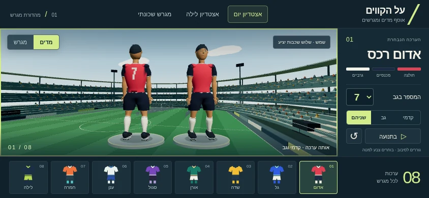

# ערכות כדורגל ומגרשים · מסירה ראשונה

נמסרו **8 ערכות** עם חולצה, מכנסיים וגרביים, **ספרות גב 1–11**, ושלוש סביבות: אצטדיון יום, אצטדיון לילה עם זרקורים ומגרש שכונתי. המדים והספרות משתמשים בצבעי קודקודים; אין תמונות מרקם. בכל סביבה יש שמיים, שלוש שכבות יציעים, שלטי מגרש ריקים ותאורה.

ענף: [codex/soccer-kits-venues-v1](https://github.com/roynaor-work/Bakasun/tree/codex/soccer-kits-venues-v1). בסיס: `43b27dc235387e3cb737aee9558cdf9d5fd5a262`. תאריך: 17/11/2026.

**נפח סופי: 3,738,339 בתים מתוך 4,000,000 (3.738MB), 62 קבצים.** המדידה כוללת את כל הקבצים בתיקייה: מודלים, ספריות, מקורות, דוח וצילומי בדיקה. פרטי המדידה ב־[verification/package.json](verification/package.json).



## צפייה

1. משורש המאגר מפעילים שרת לתיקייה בלבד:

   ```sh
   python3 -m http.server 8765 --bind 127.0.0.1 --directory workout/island/design/soccer-kits-venues-v1
   ```

2. פותחים את [התצוגה המקומית](http://127.0.0.1:8765/preview.html) בחלון 844×390. כל התלויות נמצאות בתיקייה; אין צורך בחיבור לאינטרנט בזמן הצפייה. פתיחת קובץ ישירה אינה תחליף לשרת מקומי, בגלל הגבלות מודולים ובקשות מקומיות בדפדפן.
3. בוחרים ערכה ומגרש, מחליפים מספר בין 1 ל־11, עוברים בין קדמי/גב/שניהם ולוחצים על תנועה. בכפתור ״מגרש״ רואים את הזירה המלאה. גוררים לסיבוב; חצים ורווח פועלים כשהקנבס ממוקד, ו־Home מאפס. התוצאה הצפויה: ביגוד מובחן, מספר קריא ונצמד לגב בזמן ריצה, יציעים מדורגים, וארבעה מקורות אור בזירת הלילה.

השרת יכול לפעול גם על עותק של התיקייה הזו לבדה. בדיקת הדפדפן הוגשה בפועל מתיקייה זו, בלי גישה לקובצי המאגר שמחוץ לה. הענף נועד לסקירת נכסים; אין בדוח טענה שכתובת תצוגה באתר הציבורי כבר פורסמה.

## שמונה הערכות

| ערכה | חולצה | מכנסיים | גרביים | מספר ברירת מחדל | בתים |
| --- | --- | --- | --- | ---: | ---: |
| 1 · אדום רכס | `#DF4053` | `#1A2941` | `#F2F0E5` | 1 | 107,260 |
| 2 · גל קובלט | `#315DE0` | `#F1F2E9` | `#315DE0` | 2 | 107,804 |
| 3 · שדה שמש | `#F3BE35` | `#20364A` | `#F3BE35` | 3 | 107,036 |
| 4 · אורן ולבן | `#177C67` | `#F2F0E5` | `#177C67` | 4 | 107,800 |
| 5 · סגול בין ערביים | `#7946BC` | `#29233D` | `#B19CD8` | 5 | 107,416 |
| 6 · ענן כחול | `#E9F1EC` | `#2B4FA4` | `#E9F1EC` | 6 | 107,896 |
| 7 · חמרה ותכלת | `#EF743D` | `#253E4C` | `#51C5C5` | 10 | 108,380 |
| 8 · לילה וליים | `#1A2E45` | `#B9D853` | `#1A2E45` | 11 | 107,948 |

הקבצים נמצאים ב־`kits/`; [kits.json](kits.json) כולל פלטות, שמות, מספרי ברירת מחדל וחותמות. לכל ערכה מספר מובנה בטווח המבוקש. בכל ערכה אפשר לבחור כל אחד מ־11 המספרים. [גיליון כל הערכות](verification/kits-overview.webp) · [גיליון כל המספרים](verification/numbers-01-11.webp).

## שלוש הזירות

| סביבה | מגרש | שכבות יציע | תאורה | משולשים | בתים |
| --- | --- | ---: | --- | ---: | ---: |
| אצטדיון יום | 68×105 מ׳ | 3 | שמש + מילוי שמיים | 83,764 | 321,372 |
| אצטדיון לילה | 68×105 מ׳ | 3 | אור ירח + 4 זרקורים אמיתיים | 88,740 | 330,616 |
| מגרש שכונתי | 34×52 מ׳ | 3 | שמש + מילוי שמיים | 21,668 | 92,072 |

השמיים הם כיפה עם מעבר צבעי קודקודים, עננים ושמש או ירח וכוכבים. אצטדיוני היום והלילה כוללים קערת יציעים בשלוש שכבות, שורות מושבים, מדרגות, קהל, מעקות, גג ועמודי תאורה. המגרש השכונתי כולל יציעים קטנים בשלוש שכבות, גדר, בנייני מגורים, עצים ופנסי רחוב. בכל זירה יש שערים עם רשת גאומטרית וסימוני מגרש. שלטי המגרש ללא טקסט או לוגו.

קובצי התאורה המכוונת והזרקורים מוטמעים בפורמט התקני `KHR_lights_punctual`. תאורת חצי כדור, ערפל וחשיפה מתועדים בנפרד ב־[venues.json](venues.json), משום שאינם שדות אור סביבתי תקניים של הפורמט. הצופה מחיל אותם בפועל.

[אצטדיון יום](verification/venue-01-stadium-day-844x390.webp) · [אצטדיון לילה](verification/venue-02-stadium-night-844x390.webp) · [מגרש שכונתי](verification/venue-03-neighborhood-844x390.webp).

## שלד, ספרות וחיבור

- השלד הוא החוזה הקנוני בן **18 עצמות**, בשמות, בסדר ובהורות של ספריית תנועת הכדורגל הקיימת. טרנספורמציות המנוחה ומטריצות הקישור נשמרו מדמות המקור. החוזה המלא ב־[rig.json](rig.json).
- גוף השחקן, הפנים והשיער הם נכס קיים ברישיון פתוח; בחבילה נוספו צבעי הביגוד והספרות. בכל קובץ ערכה נשמר קליפ הריצה המקורי לבדיקת התאמה. תנוחת המנוחה בצופה היא תנוחת תצוגה; אינה מחליפה את מנוחת השלד בקובץ.
- צבעי הביגוד נאפו ישירות אל `COLOR_0` במרחב צבע ליניארי. ספרות הגב הן גאומטריה מקורית שמוקרנת על גב החולצה ומקבלת את משקלי השלד של המשטח באמצעות אינטרפולציה. ההפרדה המכוונת מהבד היא 1.8 מ״מ. אין גופן, תמונת ספרות או מדבקת מרקם.
- `kits/numbers-01-11.glb` הוא ספריית חלופות: טוענים אותו פעם אחת ומחברים **מספר אחד בלבד**. אין להוסיף את כל הספרייה לסצנה. [apply.mjs](apply.mjs) בודק את סדר העצמות ומטריצות הקישור, מסיר מספר קודם ומחבר את החדש לאותו שלד. צבע הספרה מוכפל בצבעי הקודקודים הלבנים של הספרייה, לפי צבע הספרה של הערכה. ברירות המחדל בקובצי הערכות כבר צבועות בקודקודים.
- יש לשכפל את השלד לכל שחקן. המודל נשמר בגודל המקור, כ־1.30 מ׳; הצופה מגדיל את כל הדמות באופן אחיד ל־1.80 מ׳. יחידות הזירות הן מטרים. אין לשנות אורכי עצמות כדי להתאים גובה. תנועת מקור קנונית נוספת דורשת כיול לצירי המנוחה, כפי שמתועד ברישום המקור.
- טוענים זירה אחת בכל פעם. כיפת השמיים משתמשת בחומר ללא תאורה, ואינה מקבלת ערפל. הקהל והיציעים הם גאומטריה סטטית. שמירת הדגמים והספריות בתיקייה מספיקה לתצוגה; לא נוספו קישורים לקוד המשחק.

## בדיקות שבוצעו

| בדיקה | תוצאה |
| --- | --- |
| מודלים סופיים לאחר פענוח | 12 קובצי מודל, **0 שגיאות ו־0 אזהרות** במאמת הפורמט |
| שלד וצבע | 18 עצמות בסדר ובהורות הקנוניים; מטריצות קישור תקינות ומשקלים מנורמלים; צבעי חולצה/מכנסיים/גרביים קיימים בכל ערכה; 0 תמונות מרקם |
| מספרים וזירות בדפדפן | **264 שילובים עברו**: 8 ערכות × 3 זירות × 11 מספרים; מספר יחיד לכל שחקן על שלד הגוף |
| היצמדות בתנועה | **66 דגימות עברו**: 11 מספרים × 6 זמנים בריצה. מרחק מרבי מהחולצה **1.805 מ״מ**, כולל ההפרדה המכוונת |
| תצוגה ושליטה | 844×390 ללא גלילה או חפיפת כותרות; גם בדיקת פריסה 390×844; בחירת ערכה/זירה/מספר, קדמי/גב/שניהם, ניגון, חצים ואיפוס |
| טעינה מקומית | 0 בקשות חיצוניות, 0 שגיאות דף/רשת, 0 הפרות מדיניות אבטחת תוכן בבדיקת התצוגה |
| כשל מבוקר | חסימת מודל בבדיקה נפרדת מציגה שגיאה גלויה וכפתור ניסיון נוסף; מספרים מחוץ לטווח נדחים |
| החלפה חוזרת | נשארו 2 טקסטורות שלד גם לאחר החלפות כל הערכות בכל הזירות; משאבי שלד קודמים משתחררים |
| בדיקות המאגר הכלליות | עברו: 4,262 עברו, 0 נכשלו, 64 דולגו; קוד יציאה 0 |

הבדיקות נערכו בדפדפן עם רינדור תוכנה ובחלון מדומה. אין כאן מדידת ביצועים בטלפון פיזי. בזמן שני שחקנים ומגרש נמדדו לכל היותר 116,220 משולשים ו־36 קריאות ציור; אלה ספירות ציור, לא הבטחת קצב פריימים. מדידת ההיצמדות דוגמת שישה זמנים בריצה, ואינה הוכחה לכל תנועה אפשרית.

דוחות מכאניים: [נכסים](verification/assets.json) · [דפדפן](verification/browser.json) · [היצמדות מספרים](verification/number-fit.json) · [בדיקות המאגר](verification/repository.json). בהרצת המאגר הוגדר נתיב זמני לדפדפן המותקן, לאחר שהתברר שעותק הדפדפן המצופה של כלי הבדיקה אינו מותקן. תצורת המאגר לא נערכה.

## גבולות השינוי ומקורות

כל התוספות תחת `workout/island/design/soccer-kits-venues-v1/` בלבד. קבצים קיימים שימשו לקריאה בלבד. הוראת המשימה לתיקייה חדשה בלבד גוברת כאן על נוהל עדכון חדר הבקרה, ולכן רישום המסירה נשמר בדוח הזה. בדיקת ההיקף מול קומיט הבסיס מופעלת ב־`source/package-audit.mjs` ומכשילה כל שינוי בקובץ קיים או תוספת מחוץ לתיקייה.

כל העיצובים בדיוניים וללא מיתוג. רישוי הנכסים המקוריים והנגזרים הוא **CC0-1.0**; רישיונות המנוע והמפענח מצורפים. [LICENSES.md](LICENSES.md) מפרט מקורות. [manifest.json](manifest.json) כולל חותמות לכל מודל ולקלטים הקיימים; [vendor/provenance.json](vendor/provenance.json) מתעד את הספריות.

## בנייה ובדיקה חוזרות

הבנייה משתמשת בקלטים הקיימים במאגר שחותמותיהם במניפסט, ודורשת תלויות יצירה מחוץ למאגר. הצופה עצמו אינו צריך התקנה.

```sh
npm install --prefix /tmp/soccer-kits-venues-tools --cache /tmp/soccer-kits-venues-npm-cache @gltf-transform/core@4.5.1 @gltf-transform/extensions@4.5.1 @gltf-transform/functions@4.5.1 draco3dgltf@1.5.9 gltf-validator@2.0.0-dev.3.10 meshoptimizer@0.24.0
node workout/island/design/soccer-kits-venues-v1/source/bootstrap.mjs
node workout/island/design/soccer-kits-venues-v1/source/build-kits.mjs
node workout/island/design/soccer-kits-venues-v1/source/build-venues.mjs
node workout/island/design/soccer-kits-venues-v1/source/manifest.mjs
node workout/island/design/soccer-kits-venues-v1/source/validate.mjs
node workout/island/design/soccer-kits-venues-v1/source/check-fit.mjs
python3 workout/island/design/soccer-kits-venues-v1/source/check-browser.py
node workout/island/design/soccer-kits-venues-v1/source/package-audit.mjs
```

לצילום נדרשים כלי הדפדפן של Python, ספריית Pillow ודפדפן Chromium; אפשר לבחור את הדפדפן במשתנה `CHROMIUM_PATH`. את סיכום בדיקות המאגר שומרים עם `source/record-tests.mjs` מתוך יומן הרצה אמיתי וקוד היציאה שלו. לאחר שינוי תוצרים מריצים שוב את האימותים ואת `source/finalize-report.mjs`, ואז את בדיקת הנפח וההיקף.
