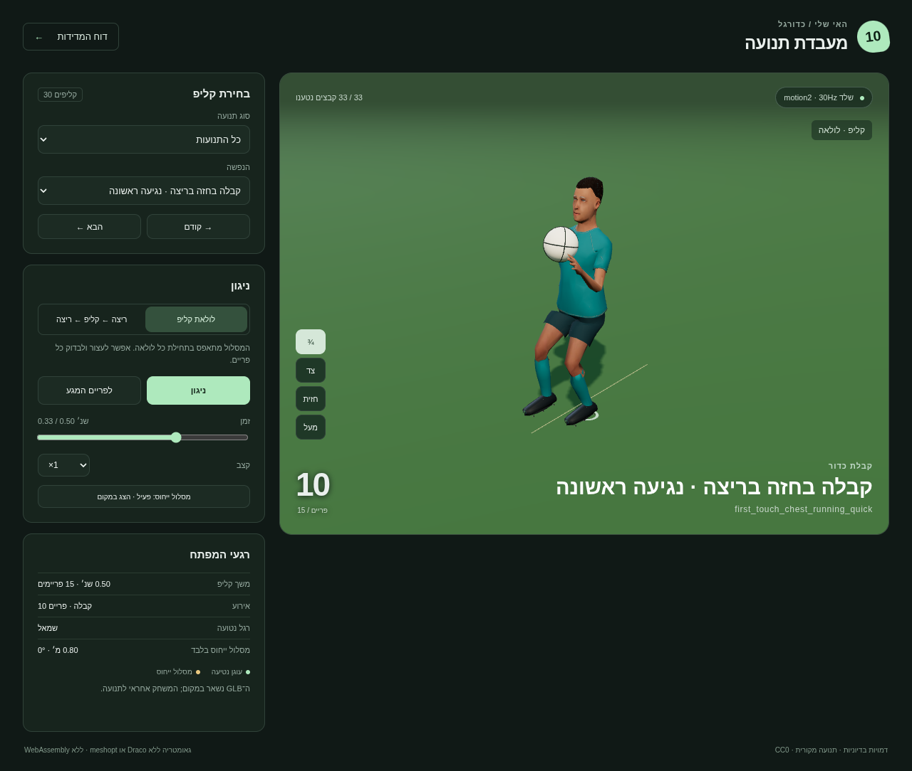
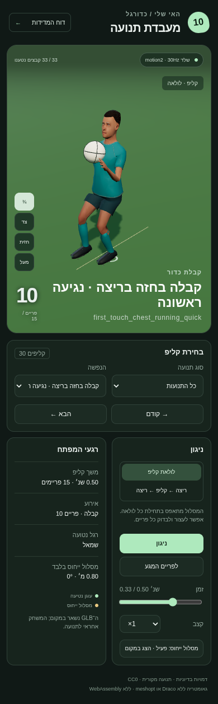

# דוח כדורגל v10

30 קליפים מקוריים ומתוקנים, שלד motion2 בן 18 עצמות,30Hz, בקבצים חדשים בלבד. תוצאת הבדיקה המספרית: **30/30**. כל 33 קובצי ה־ GLB, כולל 3 ייחוסים, נבדקו במאמת Khronos: **0 שגיאות**.

## התוצאה

| דרישה | מדידה |
|---|---|
| נטיעה עד 2 ס״מ | מרב מרכז/קדמת/עקב סוליה ב־ 120Hz: 1.133 ס״מ; שגיאת עוגן 1.106 ס״מ |
| קצב 30Hz, שגיאה עד 5% | שגיאת שעון הדגימות המרבית: 0.000620%; משך ה־ GLB נבדק מול משך הפעולה |
| חיתוכים | 45°:0.400 שנ׳;90°:0.467;135°:0.533;180°:0.600; שני הכיוונים בכל זווית |
| קבלה ראשונה קצרה |8 גרסאות של 0.500 שנ׳, אירוע receive בפריים 10 =0.333 שנ׳, ללא חזרה לעמידה |
| כתף ומרפק בעמידה | שלוש עמידות:12° החוצה,40° כפיפת מרפק, בשני הצדדים |
| run | מרפקים 100.0–100.0 / 100.0–100.0°; מרב תנועת האגן 2.434 ס״מ ≤2.5 |
| גבולות מקומיים מדויקים | מרב מפרק 0.000000046 מ׳; מרב סיבוב 0.000001708° |
| Root נקי | rootMotion:false; Root זהות; ללא ערוץ תרגום Root וללא מסלול בתוך GLB |
| טעינה ללא codec | כל 33 הקבצים ניתנים לטעינה ב־ GLTFLoader ללא decoder; ה־ CSP חוסם WebAssembly |

אין נתון קצב מתוך בקר המשחק: השגיאה כאן מודדת את שעון ה־ 30Hz והאורך המופק, לא קצב פריימים בטלפון ולא התאמת צעדים לכל מהירות בקר אפשרית. ריצת הייחוס היא 4.5 מ׳/ש׳, מחזור 0.6 שנ׳ ושני צעדים במחזור; מסלולי החיתוך מכילים האטה מתוכננת.

## מדידות לכל קליפ

הזוויות הן טווח מינימום–מקסימום בשמאל / ימין, מהגאומטריה של העצמות ב־ FK. ״גבול כניסה / יציאה״ הוא מרב הפרש מפרק גולמי מול v9, בס״מ. בעמידות וב־ run המתוקנים ההפרש מכוון; בקבלות quick היציאה ממשיכה את הנגיעה ולכן אינה התאמה ישירה ל־ idle/run.

| קליפ | אורך שנ׳ | פריים ואירוע | נטיעה ס״מ | שגיאת קצב % | כתף ° ש/י | מרפק ° ש/י | גבול כניסה / יציאה ס״מ | בדיקה |
|---|---:|---|---:|---:|---|---|---|---|
| [cut_45_left](runtime/clips/cut_45_left.glb) | 0.400 | 4 · plant | 0.115 | 0.000039 | 0.4–64.1 / 1.4–55.5 | 100.0–134.9 / 100.0–114.0 | 0.000 / 0.000 | PASS |
| [cut_45_right](runtime/clips/cut_45_right.glb) | 0.400 | 3 · plant | 1.133 | 0.000039 | 0.4–64.1 / 1.4–55.5 | 100.0–134.9 / 100.0–114.0 | 0.000 / 0.000 | PASS |
| [cut_90_left](runtime/clips/cut_90_left.glb) | 0.467 | 4 · plant | 0.115 | 0.000039 | 0.4–64.1 / 1.4–64.1 | 100.0–134.9 / 100.0–117.5 | 0.000 / 0.000 | PASS |
| [cut_90_right](runtime/clips/cut_90_right.glb) | 0.467 | 3 · plant | 1.105 | 0.000039 | 0.4–64.1 / 1.4–64.1 | 100.0–134.9 / 100.0–117.5 | 0.000 / 0.000 | PASS |
| [cut_135_left](runtime/clips/cut_135_left.glb) | 0.533 | 4 · plant | 0.115 | 0.000083 | 0.4–64.1 / 1.4–64.1 | 100.0–134.9 / 100.0–123.6 | 0.000 / 0.000 | PASS |
| [cut_135_right](runtime/clips/cut_135_right.glb) | 0.533 | 3 · plant | 1.094 | 0.000083 | 0.4–64.1 / 1.4–64.1 | 100.0–134.9 / 100.0–123.6 | 0.000 / 0.000 | PASS |
| [cut_180_left](runtime/clips/cut_180_left.glb) | 0.600 | 4 · plant | 0.115 | 0.000095 | 0.4–64.1 / 0.4–64.1 | 100.0–134.9 / 100.0–114.2 | 0.000 / 0.000 | PASS |
| [cut_180_right](runtime/clips/cut_180_right.glb) | 0.600 | 3 · plant | 1.089 | 0.000095 | 0.4–64.1 / 0.4–64.1 | 100.0–134.9 / 100.0–114.2 | 0.000 / 0.000 | PASS |
| [first_touch_chest_standing_quick](runtime/clips/first_touch_chest_standing_quick.glb) | 0.500 | 10 · receive | 0.001 | 0.000039 | 12.0–25.7 / 12.0–24.6 | 40.0–95.8 / 40.0–92.0 | 0.000 / 20.226 | PASS |
| [first_touch_chest_running_quick](runtime/clips/first_touch_chest_running_quick.glb) | 0.500 | 10 · receive | 0.303 | 0.000039 | 0.4–64.1 / 0.4–64.1 | 100.0–134.9 / 100.0–114.0 | 0.000 / 42.027 | PASS |
| [first_touch_thigh_standing_quick](runtime/clips/first_touch_thigh_standing_quick.glb) | 0.500 | 10 · receive | 0.005 | 0.000039 | 12.0–25.7 / 12.0–24.6 | 40.0–95.8 / 40.0–92.0 | 0.000 / 36.495 | PASS |
| [first_touch_thigh_running_quick](runtime/clips/first_touch_thigh_running_quick.glb) | 0.500 | 10 · receive | 0.224 | 0.000039 | 0.4–64.1 / 0.4–64.1 | 100.0–134.9 / 100.0–114.0 | 0.000 / 42.027 | PASS |
| [first_touch_inside_standing_quick](runtime/clips/first_touch_inside_standing_quick.glb) | 0.500 | 10 · receive | 0.012 | 0.000039 | 12.0–25.7 / 12.0–24.6 | 40.0–95.8 / 40.0–92.0 | 0.000 / 40.663 | PASS |
| [first_touch_inside_running_quick](runtime/clips/first_touch_inside_running_quick.glb) | 0.500 | 10 · receive | 0.303 | 0.000039 | 0.4–64.1 / 0.4–64.1 | 100.0–134.9 / 100.0–114.0 | 0.000 / 42.027 | PASS |
| [first_touch_outside_standing_quick](runtime/clips/first_touch_outside_standing_quick.glb) | 0.500 | 10 · receive | 0.001 | 0.000039 | 12.0–25.7 / 12.0–24.6 | 40.0–95.8 / 40.0–92.0 | 0.000 / 24.769 | PASS |
| [first_touch_outside_running_quick](runtime/clips/first_touch_outside_running_quick.glb) | 0.500 | 10 · receive | 0.303 | 0.000039 | 0.4–64.1 / 0.4–64.1 | 100.0–134.9 / 100.0–114.0 | 0.000 / 42.027 | PASS |
| [goalkeeper_hand_roll](runtime/clips/goalkeeper_hand_roll.glb) | 1.200 | 20 · release | 0.006 | 0.000262 | 0.3–25.7 / 0.1–25.1 | 83.5–152.6 / 0.7–92.0 | 0.000 / 0.000 | PASS |
| [goalkeeper_short_foot_pass](runtime/clips/goalkeeper_short_foot_pass.glb) | 1.000 | 16 · contact | 0.041 | 0.000095 | 7.5–25.7 / 8.4–24.6 | 40.0–95.8 / 40.0–92.0 | 0.000 / 0.000 | PASS |
| [goalkeeper_long_goal_kick](runtime/clips/goalkeeper_long_goal_kick.glb) | 1.400 | 22 · contact | 0.063 | 0.000262 | 5.4–25.7 / 6.1–24.6 | 40.0–95.8 / 40.0–92.0 | 0.000 / 0.000 | PASS |
| [brake_reaccelerate](runtime/clips/brake_reaccelerate.glb) | 1.600 | 21 · brake | 0.205 | 0.000262 | 0.4–64.1 / 0.4–64.1 | 100.0–134.9 / 100.0–114.0 | 0.000 / 0.000 | PASS |
| [ball_spin_left](runtime/clips/ball_spin_left.glb) | 1.200 | 18 · contact | 0.115 | 0.000262 | 0.4–64.1 / 0.4–64.1 | 100.0–134.9 / 100.0–114.2 | 0.000 / 0.000 | PASS |
| [shield_pressure_left](runtime/clips/shield_pressure_left.glb) | 1.200 | 18 · contact | 0.058 | 0.000262 | 16.3–48.0 / 12.0–24.6 | 65.0–95.8 / 40.0–92.0 | 0.000 / 0.000 | PASS |
| [close_jockey_left](runtime/clips/close_jockey_left.glb) | 1.200 | 18 · jockey | 0.151 | 0.000262 | 24.5–25.7 / 24.1–25.3 | 65.0–95.8 / 65.0–92.0 | 0.000 / 0.000 | PASS |
| [ball_spin_right](runtime/clips/ball_spin_right.glb) | 1.200 | 18 · contact | 0.115 | 0.000262 | 0.4–64.1 / 0.4–64.1 | 100.0–134.9 / 100.0–114.2 | 0.000 / 0.000 | PASS |
| [shield_pressure_right](runtime/clips/shield_pressure_right.glb) | 1.200 | 18 · contact | 0.059 | 0.000262 | 12.0–25.7 / 16.3–48.0 | 40.0–95.8 / 65.0–92.0 | 0.000 / 0.000 | PASS |
| [close_jockey_right](runtime/clips/close_jockey_right.glb) | 1.200 | 18 · jockey | 0.161 | 0.000262 | 24.5–25.7 / 24.1–25.3 | 65.0–95.8 / 65.0–92.0 | 0.000 / 0.000 | PASS |
| [idle_relaxed](runtime/clips/idle_relaxed.glb) | 2.400 | — | 0.071 | 0.000620 | 12.0–12.0 / 12.0–12.0 | 40.0–40.0 / 40.0–40.0 | 14.982 / 14.982 | PASS |
| [idle_scan](runtime/clips/idle_scan.glb) | 3.200 | — | 0.028 | 0.000620 | 12.0–12.0 / 12.0–12.0 | 40.0–40.0 / 40.0–40.0 | 14.577 / 14.577 | PASS |
| [idle_weight_shift](runtime/clips/idle_weight_shift.glb) | 2.800 | — | 0.039 | 0.000620 | 12.0–12.0 / 12.0–12.0 | 40.0–40.0 / 40.0–40.0 | 13.918 / 13.918 | PASS |
| [run](runtime/clips/run.glb) | 0.600 | 0 · plant | 0.145 | 0.000095 | 0.4–64.1 / 0.4–64.1 | 100.0–100.0 / 100.0–100.0 | 8.008 / 8.008 | PASS |

## שיטת בדיקה ורציפות

[verification/check.mjs](verification/check.mjs) קורא את ה־ float32 מתוך ה־ GLB באמצעות קורא בלתי תלוי במפיק, מבצע slerp ו־ FK ב־ 120Hz, מודד מרכז סוליה, קדמה ועקב, ובודק גם עוגן תלת־ממדי, אירוע מול עצם, מרכז כדור מול רדיוס, רצפה, נורמות קווטרניונים,18 עצמות וחסימת codec. לא נעשה IK בריצה או בבדיקה שמסתיר שגיאות נכס. 1.133 ס״מ הוא המדד עם מסלול הייחוס החיצוני פעם אחת; מדד התנועה המקומית של הרגל במצב in-place נשמר בנפרד ב־[metrics.json](verification/metrics.json).

פוזות הייחוס פוענחו מערוצי v9 בקומיט `5d516207d66cdf91af062b93142e04c6dcbae131`, עם SHA-256 למקור ולתוצר. אין תלות בענף v9 בזמן ריצה. הפעולות הרגילות שומרות שני פריימים ראשונים ואחרונים לפי פאזה מפורשת. נבדקים גם הפרשי מהירות מפרקים בגבול. חיתוך ימני וחיתוך שמאלי נכנסים שניהם ב־ run פאזה 0, ולא בשיקוף שמחליף רגליים.

בקבלות quick ובקליפי הבסיס המתוקנים אין טענה להתאמה גולמית מלאה ל־ v9: ההפרש הגולמי הגדול ביותר בכל הקליפים הוא 42.027 ס״מ / 60.165°. דף התצוגה מממש את blendSeconds המפורשים; [browser.json](verification/browser.json) מודד בנפרד את הפוזה המוצגת משני צדי כל גבול בשרשרת ריצה→קליפ→ריצה ובגשרים לעמידה.

שלבי הקבלה, השחרור והמגע נבדקים מול המשטח המונפש של הדמות, מעבר לבדיקת עצם בלבד. כל 15 מסלולי הכדור נאפו ונבדקו מול משולשי הרשת ב־ 120Hz, לרבות תנועת ההמשך לאחר הקבלה והאחיזה לפני גלגול השוער. מרב חדירת הכדור בדגימות: 0.0000 מ״מ; שגיאת הרדיוס באירוע: 0.0000 מ״מ. מגעי פנים/חוץ רגל מוגבלים למשטח הנעל ולצד המתאים, ולא לאזור השוק. פרטי הכיול והמרחקים ב־[contact-surfaces.json](verification/contact-surfaces.json). הכיול משנה סמנים ומסלול כדור בלבד, בלי שינוי פוזות, וללא solver בזמן ריצה.

## דפדפן ותמונות

ראיות סבב הדפדפן הסופי נשמרו ב־[browser.json](verification/browser.json): 33 קבצים נטענו עם טקסטורות, 30 קליפים נוגנו בשני המצבים; קפיצת גבול מוצגת מרבית 0.000000788 מ׳. כל קובץ GLB והקטלוג ננעלו ב־ SHA-256 כדי למנוע ערבוב גרסאות ראיות.

## מקורות, מגבלות והמשך חיבור

כל קובץ מופיע ב־[LICENSES.md](LICENSES.md). הגאומטריה הבדיונית מבוססת על נכסי v8 הקיימים (MakeHuman hm08 ונכסי מערכת CC0). לא הועתקו מותגים או אנשים אמיתיים. המקור הפתוח three.js MIT הקיים משמש כתלות; שום vendor חדש לא נכלל בתיקייה.

מאמת Khronos מדווח 5 אזהרות tangent-space בכל GLB, אחת לכל primitive, שמקורן ב־ normal maps ובגאומטריית v8 שנשמרו. אין שגיאות; ה־ renderer יוצר את הבסיס הדרוש. הפירוט המלא ב־[validator.json](verification/validator.json).

הכניסה המדויקת שומרת גם שגיאת אינטרפולציית סוליה שקיימת בייחוס v9. ב־ 120Hz קצה סוליה יורד עד 7.13 מ״מ מתחת למישור בתחילת ריצת הייחוס; בקבלות ריצה נמדדה ירידה של עד 10.48 מ״מ בין מפתחות 30Hz. בפריימים החדשים תוקן מרווח התנופה; נשארת ירידה עד 4.62 מ״מ סמוך לנחיתה בחיתוך 45°. אלה מדידות נקודות סוליה, בנפרד מסף ההחלקה 2 ס״מ; אין טענה לאפס חדירת סוליה בכל תת־פריים. הראיות לכל קליפ ב־[ground-clearance.json](verification/ground-clearance.json). ספי הקבלה הם מדדי הנכס ותצוגתו; בדיקה חוזרת בבקר המשחק נדרשת לאחר החיבור של Claude. אין שינוי בקוד המשחק ואין טענה ששיפור המשחק כבר נמדד.

שני נתיבי האבחון שהמשתמש צירף (soccer-motion-diagnosis/REPORT.md ו־ soccer-run-v9/REPORT.md) לא נמצאו ב־ main בעת משיכת המקור ב־ 07/11/2026. יעדי 26°→12°,88°→40°,3.5→2.5 ס״מ ו־ 90–110° יושמו לפי המדידות שסופקו בהודעה; המדידות החדשות כאן מחושבות מהנכסים שנמסרו.

שחזור, שימוש ופרטי הפאזה: [README.md](README.md). קוד המקור,release.json,release.mjs,תגי?v=,CLAUDE.md,ops והבדיקות הקיימות נשארו ללא שינוי.
