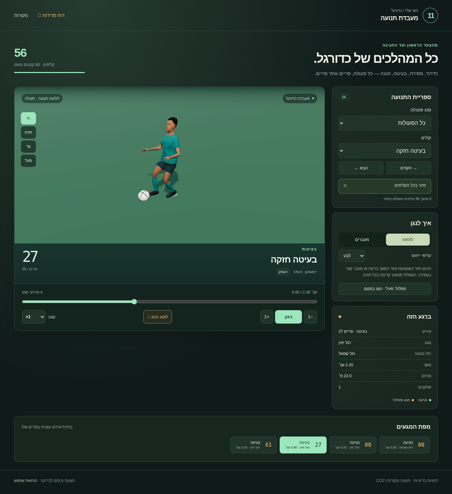
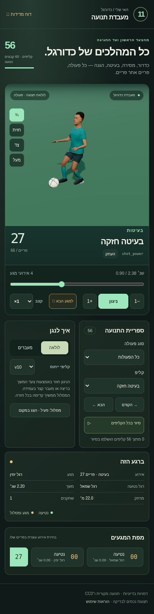
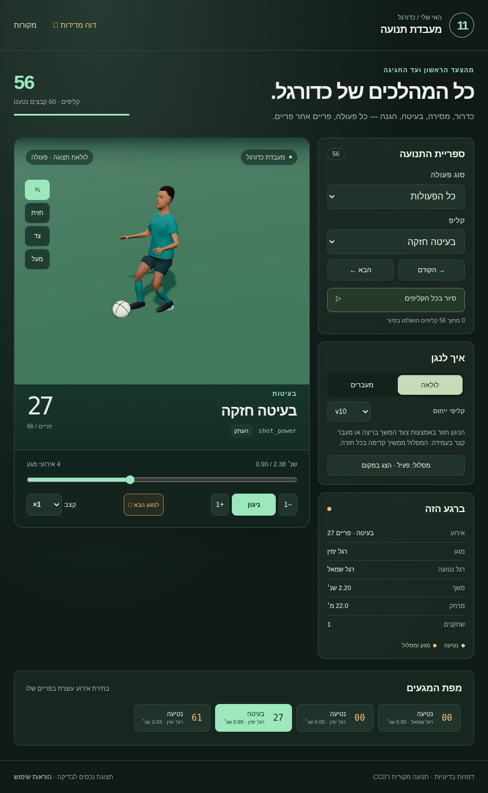

# דוח כדורגל v11

56 קליפים, 4 קליפי ייחוס, שלד motion2 בן 18 עצמות ו־30Hz. התוצרים נמסרים בקבצים חדשים תחת <code>soccer-motion-v11/</code> בלבד. מצב שערי המסירה: **PASS**. נבדקו הנכסים שמזהה הקטלוג שלהם הוא <code>bb534e839771a59ee17349ca6fee9949fce801dddfabc20df696f9920aa14fa6</code>.

הראיות המספריות, מאמת glTF, בדיקות המשטח והדפדפן עברו עבור הנכסים הנוכחיים.

## מדידות מרכזיות

| דרישה | מדידה בפועל | מצב |
|---|---|---|
| החלקת נטיעה עד 2 ס״מ | מרב כולל פעולות וסגירות סקירה 0.636 ס״מ. חלונות נטיעה מוצהרים, מרכז/קדמה/עקב ב־120Hz: 0.135 ס״מ; שגיאת עוגן 0.926 ס״מ; החלקה בחלונות קרקע שהוסקו מהנכס 0.541 ס״מ | PASS |
| שגיאת קצב עד 5% | שעון מקור 0.000620%; כדרור, צעדים/נגיעות/מהירות 0.000000% | PASS |
| גובה סוליה מזערי | -9.159 מ״מ; חדירה מרבית 9.159 מ״מ; סף הבדיקה 10.000 מ״מ | נפרד מסף ההחלקה |
| רציפות גולמית מול v10 | מרב הפרש מפרק 0.000 ס״מ; הפרש מהירות 0.000 מ׳/ש׳ | מדידה נפרדת מה־blend |
| רציפות גולמית מול v9 | מרב הפרש מפרק 14.982 ס״מ | הבדלי גרסאות נשמרים במדידה |
| רציפות מעבר מוצג מול שתי הגרסאות | מרב קפיצת פוזה 0.000002042 מ׳ | PASS |
| לולאת תצוגה | משך סגירה 0.180–0.533 שנ׳; החלקת נטיעה בסגירה 0.636 ס״מ; קפיצת פוזה 0.002 מ״מ; קפיצת כדור 0.001 מ״מ | לולאת סקירה בלבד |
| אירוע מגע ומשטח מונפש | שגיאת רדיוס מרבית 0.000 מ״מ | PASS |
| החלקת כדרור בין מגעים | שינוי מהירות בין דגימות 120Hz: עד 0.565 מ׳/ש׳; מרכזי מגע ופוזות לא השתנו | PASS |
| מסלול כדור מול הרשת | חדירה מרבית בדגימות 0.002 מ״מ; מרווח החטאה מזערי 0.116 מ׳ | PASS |
| Root נקי | <code>rootMotion:false</code>, Root זהות וללא ערוץ תרגום Root | PASS |
| כל ה־GLB ללא codec | 60/60 נטענו; חסימת WebAssembly בפועל: כן | PASS |
| Khronos glTF validator | 0 שגיאות, 300 אזהרות; 60/60 קבצים | PASS |

הקצב המספרי הוא תזמון הנכס ותדירות הצעדים והנגיעות לאורך מסלול הייחוס. הוא אינו מדידת FPS בטלפון או התאמה אוטומטית לכל מהירות של בקר המשחק.

## כיסוי הפעולות

| קטגוריה | קליפים | נכסים |
|---|---:|---|
| כדרור ושליטה | 9 | [dribble_slow](runtime/clips/dribble_slow.glb), [dribble_medium](runtime/clips/dribble_medium.glb), [dribble_sprint](runtime/clips/dribble_sprint.glb), [dribble_turn_left](runtime/clips/dribble_turn_left.glb), [dribble_feint_left](runtime/clips/dribble_feint_left.glb), [shield_left](runtime/clips/shield_left.glb), [dribble_turn_right](runtime/clips/dribble_turn_right.glb), [dribble_feint_right](runtime/clips/dribble_feint_right.glb), [shield_right](runtime/clips/shield_right.glb) |
| מסירות | 12 | [pass_ground_000](runtime/clips/pass_ground_000.glb), [pass_ground_045](runtime/clips/pass_ground_045.glb), [pass_ground_090](runtime/clips/pass_ground_090.glb), [pass_ground_135](runtime/clips/pass_ground_135.glb), [pass_ground_180](runtime/clips/pass_ground_180.glb), [pass_ground_225](runtime/clips/pass_ground_225.glb), [pass_ground_270](runtime/clips/pass_ground_270.glb), [pass_ground_315](runtime/clips/pass_ground_315.glb), [pass_lofted](runtime/clips/pass_lofted.glb), [pass_cross_left](runtime/clips/pass_cross_left.glb), [pass_cross_right](runtime/clips/pass_cross_right.glb), [pass_through](runtime/clips/pass_through.glb) |
| בעיטות | 5 | [shot_power](runtime/clips/shot_power.glb), [shot_curled](runtime/clips/shot_curled.glb), [shot_chip](runtime/clips/shot_chip.glb), [shot_volley](runtime/clips/shot_volley.glb), [first_touch_chest](runtime/clips/first_touch_chest.glb) |
| תיקולים והגנה | 6 | [tackle_standing_clean](runtime/clips/tackle_standing_clean.glb), [tackle_slide_clean](runtime/clips/tackle_slide_clean.glb), [tackle_standing_miss](runtime/clips/tackle_standing_miss.glb), [tackle_slide_miss](runtime/clips/tackle_slide_miss.glb), [interception](runtime/clips/interception.glb), [collision_light](runtime/clips/collision_light.glb) |
| נגיחות | 4 | [header_standing](runtime/clips/header_standing.glb), [header_jumping](runtime/clips/header_jumping.glb), [header_defensive](runtime/clips/header_defensive.glb), [header_attacking](runtime/clips/header_attacking.glb) |
| כדורים נייחים | 5 | [set_throw_in](runtime/clips/set_throw_in.glb), [set_corner](runtime/clips/set_corner.glb), [set_free_kick](runtime/clips/set_free_kick.glb), [set_penalty](runtime/clips/set_penalty.glb), [set_wall](runtime/clips/set_wall.glb) |
| שוער | 13 | [keeper_catch_up](runtime/clips/keeper_catch_up.glb), [keeper_catch_up_left](runtime/clips/keeper_catch_up_left.glb), [keeper_catch_left](runtime/clips/keeper_catch_left.glb), [keeper_catch_down_left](runtime/clips/keeper_catch_down_left.glb), [keeper_catch_down](runtime/clips/keeper_catch_down.glb), [keeper_catch_down_right](runtime/clips/keeper_catch_down_right.glb), [keeper_catch_right](runtime/clips/keeper_catch_right.glb), [keeper_catch_up_right](runtime/clips/keeper_catch_up_right.glb), [keeper_parry](runtime/clips/keeper_parry.glb), [keeper_rush](runtime/clips/keeper_rush.glb), [keeper_dive_left](runtime/clips/keeper_dive_left.glb), [keeper_dive_right](runtime/clips/keeper_dive_right.glb), [keeper_after_goal](runtime/clips/keeper_after_goal.glb) |
| חגיגות | 2 | [celebrate_player](runtime/clips/celebrate_player.glb), [celebrate_team](runtime/clips/celebrate_team.glb) |

| דרישת כיסוי | מצב | קליפים שנמצאו |
|---|---|---|
| dribble_slow | PASS | dribble_slow |
| dribble_medium | PASS | dribble_medium |
| dribble_sprint | PASS | dribble_sprint |
| ball_turn_left | PASS | dribble_turn_left |
| ball_turn_right | PASS | dribble_turn_right |
| feint_left | PASS | dribble_feint_left |
| feint_right | PASS | dribble_feint_right |
| shield_left | PASS | shield_left |
| shield_right | PASS | shield_right |
| lofted_pass | PASS | pass_lofted |
| cross | PASS | pass_cross_left, pass_cross_right |
| through_pass | PASS | pass_through |
| power_shot | PASS | shot_power |
| curled_shot | PASS | shot_curled |
| lob_shot | PASS | shot_chip |
| volley | PASS | shot_volley |
| chest_first_time | PASS | first_touch_chest |
| standing_tackle_clean | PASS | tackle_standing_clean |
| standing_tackle_miss | PASS | tackle_standing_miss |
| slide_tackle_clean | PASS | tackle_slide_clean |
| slide_tackle_miss | PASS | tackle_slide_miss |
| interception | PASS | interception |
| light_collision | PASS | collision_light |
| standing_header | PASS | header_standing |
| jump_header | PASS | header_jumping |
| defensive_header | PASS | header_defensive |
| attacking_header | PASS | header_attacking |
| throw_in | PASS | set_throw_in |
| corner | PASS | set_corner |
| free_kick | PASS | set_free_kick |
| penalty | PASS | set_penalty |
| wall_set | PASS | set_wall |
| keeper_parry | PASS | keeper_parry |
| keeper_rush | PASS | keeper_rush |
| keeper_dive | PASS | keeper_dive_left, keeper_dive_right |
| keeper_after_goal | PASS | keeper_after_goal |
| individual_celebration | PASS | celebrate_player |
| team_celebration | PASS | celebrate_team |
| ground_pass_eight_directions | PASS | pass_ground_000: 0.00° (Δ 0.00°), pass_ground_045: 45.00° (Δ 0.00°), pass_ground_090: 90.00° (Δ 0.00°), pass_ground_135: 135.00° (Δ 0.00°), pass_ground_180: 180.00° (Δ 0.00°), pass_ground_225: 225.00° (Δ 0.00°), pass_ground_270: 270.00° (Δ 0.00°), pass_ground_315: 315.00° (Δ 0.00°) |
| keeper_catch_eight_directions | PASS | keeper_catch_up: 1.28° (Δ 1.28°), keeper_catch_up_left: 27.96° (Δ 17.04°), keeper_catch_left: 81.48° (Δ 8.52°), keeper_catch_down_left: 155.37° (Δ 20.37°), keeper_catch_down: 179.32° (Δ 0.68°), keeper_catch_down_right: 205.80° (Δ 19.20°), keeper_catch_right: 279.17° (Δ 9.17°), keeper_catch_up_right: 331.51° (Δ 16.51°) |
| team_has_multiple_participants | PASS | {"offset":[0,0,0],"yaw":0,"phase":0}, {"offset":[0.8,0,-0.25],"yaw":-12,"phase":0}, {"offset":[-0.8,0,-0.25],"yaw":12,"phase":0} |

## טבלת מדידות לכל קליפ

גבולות הכניסה והיציאה הם הפרשי מפרק גולמיים מול אותו ייחוס, בס״מ, לפני blend. עמודת הנטיעה היא המרב בחלונות המוצהרים, במגעי קרקע שטוחים שהוסקו מהנכס ובסגירת הסקירה; גלישה מכוונת בתיקול מסומנת בנפרד. עמודת הקצב היא השגיאה המרבית של שעון הדגימות ושל מדדי הכדרור הרלוונטיים. מרחק הוא מסלול הכדור המוצהר באירוע, במטרים. באירוע שאינו נוגע בכדור מופיע סוג המגע האמיתי. עמודת המאמת מציגה שגיאות / אזהרות.

| קליפ | משך שנ׳ | פריים · אירוע · עצם | מרחק מ׳ | נטיעה ס״מ | קצב % | v9 כניסה / יציאה ס״מ | v10 כניסה / יציאה ס״מ | מאמת | מצב |
|---|---:|---|---:|---:|---:|---:|---:|---:|---|
| [dribble_slow](runtime/clips/dribble_slow.glb) | 3.600 | 8 · touch · LeftFoot 20 · touch · RightFoot 32 · touch · LeftFoot 44 · touch · RightFoot 56 · touch · LeftFoot 68 · touch · RightFoot 80 · touch · LeftFoot 92 · touch · RightFoot | — | 0.636 | 0.00062 | 8.008 / 13.803 | 0.000 / 0.000 | 0 / 5 | PASS |
| [dribble_medium](runtime/clips/dribble_medium.glb) | 3.400 | 8 · touch · LeftFoot 17 · touch · RightFoot 26 · touch · LeftFoot 35 · touch · RightFoot 44 · touch · LeftFoot 53 · touch · RightFoot 62 · touch · LeftFoot 71 · touch · RightFoot 80 · touch · LeftFoot 89 · touch · RightFoot | — | 0.636 | 0.00062 | 8.008 / 13.803 | 0.000 / 0.000 | 0 / 5 | PASS |
| [dribble_sprint](runtime/clips/dribble_sprint.glb) | 3.200 | 8 · touch · LeftFoot 15 · touch · RightFoot 22 · touch · LeftFoot 29 · touch · RightFoot 36 · touch · LeftFoot 43 · touch · RightFoot 50 · touch · LeftFoot 57 · touch · RightFoot 64 · touch · LeftFoot 71 · touch · RightFoot 78 · touch · LeftFoot 85 · touch · RightFoot | — | 0.636 | 0.00062 | 8.008 / 13.803 | 0.000 / 0.000 | 0 / 5 | PASS |
| [dribble_turn_left](runtime/clips/dribble_turn_left.glb) | 2.800 | 8 · touch · LeftFoot 20 · touch · RightFoot 32 · touch · LeftFoot 44 · touch · RightFoot 56 · touch · LeftFoot 68 · touch · RightFoot | — | 0.636 | 0.00062 | 8.008 / 13.803 | 0.000 / 0.000 | 0 / 5 | PASS |
| [dribble_feint_left](runtime/clips/dribble_feint_left.glb) | 2.000 | 30 · touch · RightFoot | 0.12 | 0.031 | 0.00026 | 14.982 / 14.955 | 0.000 / 0.000 | 0 / 5 | PASS |
| [shield_left](runtime/clips/shield_left.glb) | 2.200 | 33 · touch · RightFoot | 0.12 | 0.028 | 0.00062 | 14.982 / 14.955 | 0.000 / 0.000 | 0 / 5 | PASS |
| [dribble_turn_right](runtime/clips/dribble_turn_right.glb) | 2.800 | 8 · touch · LeftFoot 20 · touch · RightFoot 32 · touch · LeftFoot 44 · touch · RightFoot 56 · touch · LeftFoot 68 · touch · RightFoot | — | 0.636 | 0.00062 | 8.008 / 13.803 | 0.000 / 0.000 | 0 / 5 | PASS |
| [dribble_feint_right](runtime/clips/dribble_feint_right.glb) | 2.000 | 30 · touch · RightFoot | 0.12 | 0.027 | 0.00026 | 14.982 / 14.955 | 0.000 / 0.000 | 0 / 5 | PASS |
| [shield_right](runtime/clips/shield_right.glb) | 2.200 | 33 · touch · RightFoot | 0.12 | 0.025 | 0.00062 | 14.982 / 14.955 | 0.000 / 0.000 | 0 / 5 | PASS |
| [pass_ground_000](runtime/clips/pass_ground_000.glb) | 1.800 | 24 · kick · RightFoot | 6.00 | 0.025 | 0.00026 | 14.982 / 14.955 | 0.000 / 0.000 | 0 / 5 | PASS |
| [pass_ground_045](runtime/clips/pass_ground_045.glb) | 1.800 | 24 · kick · RightFoot | 6.00 | 0.036 | 0.00026 | 14.982 / 14.955 | 0.000 / 0.000 | 0 / 5 | PASS |
| [pass_ground_090](runtime/clips/pass_ground_090.glb) | 1.800 | 24 · kick · RightFoot | 6.00 | 0.042 | 0.00026 | 14.982 / 14.955 | 0.000 / 0.000 | 0 / 5 | PASS |
| [pass_ground_135](runtime/clips/pass_ground_135.glb) | 1.800 | 24 · kick · RightFoot | 6.00 | 0.042 | 0.00026 | 14.982 / 14.955 | 0.000 / 0.000 | 0 / 5 | PASS |
| [pass_ground_180](runtime/clips/pass_ground_180.glb) | 1.800 | 24 · kick · RightFoot | 6.00 | 0.042 | 0.00026 | 14.982 / 14.955 | 0.000 / 0.000 | 0 / 5 | PASS |
| [pass_ground_225](runtime/clips/pass_ground_225.glb) | 1.800 | 24 · kick · RightFoot | 6.00 | 0.039 | 0.00026 | 14.982 / 14.955 | 0.000 / 0.000 | 0 / 5 | PASS |
| [pass_ground_270](runtime/clips/pass_ground_270.glb) | 1.800 | 24 · kick · RightFoot | 6.00 | 0.039 | 0.00026 | 14.982 / 14.955 | 0.000 / 0.000 | 0 / 5 | PASS |
| [pass_ground_315](runtime/clips/pass_ground_315.glb) | 1.800 | 24 · kick · RightFoot | 6.00 | 0.032 | 0.00026 | 14.982 / 14.955 | 0.000 / 0.000 | 0 / 5 | PASS |
| [pass_lofted](runtime/clips/pass_lofted.glb) | 2.200 | 27 · kick · RightFoot | 12.00 | 0.026 | 0.00062 | 14.982 / 14.955 | 0.000 / 0.000 | 0 / 5 | PASS |
| [pass_cross_left](runtime/clips/pass_cross_left.glb) | 2.400 | 29 · kick · RightFoot | 18.00 | 0.023 | 0.00062 | 14.982 / 14.955 | 0.000 / 0.000 | 0 / 5 | PASS |
| [pass_cross_right](runtime/clips/pass_cross_right.glb) | 2.400 | 29 · kick · RightFoot | 18.00 | 0.030 | 0.00062 | 14.982 / 14.955 | 0.000 / 0.000 | 0 / 5 | PASS |
| [pass_through](runtime/clips/pass_through.glb) | 2.000 | 24 · kick · RightFoot | 15.00 | 0.027 | 0.00026 | 14.982 / 14.955 | 0.000 / 0.000 | 0 / 5 | PASS |
| [shot_power](runtime/clips/shot_power.glb) | 2.200 | 27 · kick · RightFoot | 22.00 | 0.026 | 0.00062 | 14.982 / 14.955 | 0.000 / 0.000 | 0 / 5 | PASS |
| [shot_curled](runtime/clips/shot_curled.glb) | 2.200 | 27 · kick · RightFoot | 19.00 | 0.024 | 0.00062 | 14.982 / 14.955 | 0.000 / 0.000 | 0 / 5 | PASS |
| [shot_chip](runtime/clips/shot_chip.glb) | 2.200 | 27 · kick · RightFoot | 13.00 | 0.026 | 0.00062 | 14.982 / 14.955 | 0.000 / 0.000 | 0 / 5 | PASS |
| [shot_volley](runtime/clips/shot_volley.glb) | 2.200 | 30 · kick · RightFoot | 18.00 | 0.026 | 0.00062 | 14.982 / 14.955 | 0.000 / 0.000 | 0 / 5 | PASS |
| [first_touch_chest](runtime/clips/first_touch_chest.glb) | 1.800 | 24 · receive · Chest | 1.10 | 0.008 | 0.00026 | 14.982 / 14.955 | 0.000 / 0.000 | 0 / 5 | PASS |
| [tackle_standing_clean](runtime/clips/tackle_standing_clean.glb) | 2.000 | 27 · kick · RightFoot | 3.20 | 0.030 | 0.00026 | 14.982 / 14.955 | 0.000 / 0.000 | 0 / 5 | PASS |
| [tackle_slide_clean](runtime/clips/tackle_slide_clean.glb) | 3.000 | 39 · kick · RightFoot | 4.40 | 0.045 | 0.00062 | 14.982 / 14.955 | 0.000 / 0.000 | 0 / 5 | PASS |
| [tackle_standing_miss](runtime/clips/tackle_standing_miss.glb) | 2.000 | 27 · miss · RightFoot 0 · plant · LeftFoot 0 · plant · RightFoot 55 · plant · RightFoot | 1.32 | 0.030 | 0.00026 | 14.982 / 14.955 | 0.000 / 0.000 | 0 / 5 | PASS |
| [tackle_slide_miss](runtime/clips/tackle_slide_miss.glb) | 3.000 | 39 · miss · RightFoot 0 · plant · LeftFoot 0 · plant · RightFoot 85 · plant · LeftFoot 85 · plant · RightFoot | 2.04 | 0.045 | 0.00062 | 14.982 / 14.955 | 0.000 / 0.000 | 0 / 5 | PASS |
| [interception](runtime/clips/interception.glb) | 2.000 | 27 · kick · RightFoot | 3.00 | 0.025 | 0.00026 | 14.982 / 14.955 | 0.000 / 0.000 | 0 / 5 | PASS |
| [collision_light](runtime/clips/collision_light.glb) | 2.000 | 26 · body_contact · Chest 0 · plant · LeftFoot 0 · plant · RightFoot | — | 0.021 | 0.00026 | 14.982 / 14.955 | 0.000 / 0.000 | 0 / 5 | PASS |
| [header_standing](runtime/clips/header_standing.glb) | 2.400 | 33 · header · Head | 8.00 | 0.009 | 0.00062 | 14.982 / 14.955 | 0.000 / 0.000 | 0 / 5 | PASS |
| [header_jumping](runtime/clips/header_jumping.glb) | 2.400 | 33 · header · Head | 10.00 | 0.011 | 0.00062 | 14.982 / 14.955 | 0.000 / 0.000 | 0 / 5 | PASS |
| [header_defensive](runtime/clips/header_defensive.glb) | 2.400 | 33 · header · Head | 15.00 | 0.011 | 0.00062 | 14.982 / 14.955 | 0.000 / 0.000 | 0 / 5 | PASS |
| [header_attacking](runtime/clips/header_attacking.glb) | 2.400 | 33 · header · Head | 12.00 | 0.011 | 0.00062 | 14.982 / 14.955 | 0.000 / 0.000 | 0 / 5 | PASS |
| [set_throw_in](runtime/clips/set_throw_in.glb) | 2.400 | 34 · release · RightHand 34 · release · LeftHand | 12.00 | 0.009 | 0.00062 | 14.982 / 14.955 | 0.000 / 0.000 | 0 / 5 | PASS |
| [set_corner](runtime/clips/set_corner.glb) | 2.400 | 30 · kick · RightFoot | 20.00 | 0.030 | 0.00062 | 14.982 / 14.955 | 0.000 / 0.000 | 0 / 5 | PASS |
| [set_free_kick](runtime/clips/set_free_kick.glb) | 2.400 | 30 · kick · RightFoot | 22.00 | 0.026 | 0.00062 | 14.982 / 14.955 | 0.000 / 0.000 | 0 / 5 | PASS |
| [set_penalty](runtime/clips/set_penalty.glb) | 2.200 | 28 · kick · RightFoot | 11.00 | 0.028 | 0.00062 | 14.982 / 14.955 | 0.000 / 0.000 | 0 / 5 | PASS |
| [set_wall](runtime/clips/set_wall.glb) | 2.400 | 41 · landing · LeftFoot 0 · plant · LeftFoot 0 · plant · RightFoot 41 · plant · LeftFoot 41 · plant · RightFoot | — | 0.011 | 0.00062 | 14.982 / 14.955 | 0.000 / 0.000 | 0 / 5 | PASS |
| [keeper_catch_up](runtime/clips/keeper_catch_up.glb) | 2.400 | 33 · catch · RightHand 33 · catch · LeftHand | 0.27 | 0.009 | 0.00062 | 14.982 / 14.955 | 0.000 / 0.000 | 0 / 5 | PASS |
| [keeper_catch_up_left](runtime/clips/keeper_catch_up_left.glb) | 2.400 | 33 · catch · RightHand 33 · catch · LeftHand | 0.42 | 0.009 | 0.00062 | 14.982 / 14.955 | 0.000 / 0.000 | 0 / 5 | PASS |
| [keeper_catch_left](runtime/clips/keeper_catch_left.glb) | 2.400 | 33 · catch · RightHand 33 · catch · LeftHand | 0.51 | 0.009 | 0.00062 | 14.982 / 14.955 | 0.000 / 0.000 | 0 / 5 | PASS |
| [keeper_catch_down_left](runtime/clips/keeper_catch_down_left.glb) | 2.400 | 33 · catch · RightHand 33 · catch · LeftHand | 0.38 | 0.012 | 0.00062 | 14.982 / 14.955 | 0.000 / 0.000 | 0 / 5 | PASS |
| [keeper_catch_down](runtime/clips/keeper_catch_down.glb) | 2.400 | 33 · catch · RightHand 33 · catch · LeftHand | 0.24 | 0.012 | 0.00062 | 14.982 / 14.955 | 0.000 / 0.000 | 0 / 5 | PASS |
| [keeper_catch_down_right](runtime/clips/keeper_catch_down_right.glb) | 2.400 | 33 · catch · RightHand 33 · catch · LeftHand | 0.20 | 0.012 | 0.00062 | 14.982 / 14.955 | 0.000 / 0.000 | 0 / 5 | PASS |
| [keeper_catch_right](runtime/clips/keeper_catch_right.glb) | 2.400 | 33 · catch · RightHand 33 · catch · LeftHand | 0.27 | 0.009 | 0.00062 | 14.982 / 14.955 | 0.000 / 0.000 | 0 / 5 | PASS |
| [keeper_catch_up_right](runtime/clips/keeper_catch_up_right.glb) | 2.400 | 33 · catch · RightHand 33 · catch · LeftHand | 0.21 | 0.009 | 0.00062 | 14.982 / 14.955 | 0.000 / 0.000 | 0 / 5 | PASS |
| [keeper_parry](runtime/clips/keeper_parry.glb) | 2.400 | 33 · parry · RightHand | 8.00 | 0.009 | 0.00062 | 14.982 / 14.955 | 0.000 / 0.000 | 0 / 5 | PASS |
| [keeper_rush](runtime/clips/keeper_rush.glb) | 2.800 | 42 · catch · RightHand 42 · catch · LeftHand | 0.38 | 0.094 | 0.00062 | 14.982 / 14.955 | 0.000 / 0.000 | 0 / 5 | PASS |
| [keeper_dive_left](runtime/clips/keeper_dive_left.glb) | 3.000 | 39 · catch · RightHand 39 · catch · LeftHand | 1.57 | 0.080 | 0.00062 | 14.982 / 14.955 | 0.000 / 0.000 | 0 / 5 | PASS |
| [keeper_dive_right](runtime/clips/keeper_dive_right.glb) | 3.000 | 39 · catch · RightHand 39 · catch · LeftHand | 1.27 | 0.086 | 0.00062 | 14.982 / 14.955 | 0.000 / 0.000 | 0 / 5 | PASS |
| [keeper_after_goal](runtime/clips/keeper_after_goal.glb) | 3.000 | 85 · landing · LeftFoot 0 · plant · LeftFoot 0 · plant · RightFoot | — | 0.007 | 0.00062 | 14.982 / 14.955 | 0.000 / 0.000 | 0 / 5 | PASS |
| [celebrate_player](runtime/clips/celebrate_player.glb) | 3.000 | 47 · landing · LeftFoot 0 · plant · LeftFoot 0 · plant · RightFoot 47 · plant · LeftFoot 47 · plant · RightFoot | — | 0.011 | 0.00062 | 14.982 / 14.955 | 0.000 / 0.000 | 0 / 5 | PASS |
| [celebrate_team](runtime/clips/celebrate_team.glb) | 3.200 | 50 · landing · LeftFoot 0 · plant · LeftFoot 0 · plant · RightFoot 50 · plant · LeftFoot 50 · plant · RightFoot | — | 0.011 | 0.00062 | 14.982 / 14.955 | 0.000 / 0.000 | 0 / 5 | PASS |

## קצב כדרור

| קליפ | צעדים Hz יעד / נמדד | נגיעות Hz יעד / נמדד | מהירות מ׳/ש׳ יעד / חציון מרכזי | ממוצע כל המסלול מ׳/ש׳ | חלון קצב שנ׳ | שגיאה מרבית % | נגיעה בכל צעד |
|---|---:|---:|---:|---:|---:|---:|---|
| dribble_slow | 2.500 / 2.500 | 2.500 / 2.500 | 2.200 / 2.200 | 2.383 | 0.267–3.067 | 0.00000 | כן |
| dribble_medium | 3.333 / 3.333 | 3.333 / 3.333 | 4.200 / 4.200 | 4.225 | 0.267–2.967 | 0.00000 | כן |
| dribble_sprint | 4.286 / 4.286 | 4.286 / 4.286 | 6.200 / 6.200 | 6.048 | 0.267–2.833 | 0.00000 | כן |
| dribble_turn_left | 2.500 / 2.500 | 2.500 / 2.500 | 1.650 / 1.650 | 1.942 | 0.267–2.267 | 0.00000 | כן |
| dribble_turn_right | 2.500 / 2.500 | 2.500 / 2.500 | 1.650 / 1.650 | 1.942 | 0.267–2.267 | 0.00000 | כן |

המדידה משווה את לוח מגעי הכדור והצעדים ליעדים שהוכרזו. שגיאת המהירות מחושבת מחציון המהירות בחלון המרכזי המפורש של הכדרור; הממוצע של כל המסלול כולל את חיבורי הכניסה והיציאה ל־run, ומוצג בנפרד ללא טענה שהוא שווה ליעד המרכזי. <code>everyStepHasTouch</code> נבדק בנפרד מבדיקת מרווחי זמן של 30Hz. פרטי המדידה והספים לכל קליפ: [metrics.json](verification/metrics.json).

## שיטת הבדיקה ורציפות

[check.mjs](verification/check.mjs) קורא ערוצי float32 מה־GLB שנמסר באמצעות [reader.mjs](verification/reader.mjs), ומחשב slerp ו־FK ב־120Hz. נבדקים מרכז הסוליה, הקדמה והעקב לאורך חלונות התמיכה, עם מסלול הייחוס החיצוני פעם אחת. המדידה אינה מפעילה IK לתיקון הנכס. בקפיצות נמדד משך מעוף מתוך שתי הסוליות: מרב 0.508 שנ׳ (סף 0.75 שנ׳); מרב עליית האגן ביחס לכניסה 0.305 מ׳. מגע התנגשות גוף נבדק מול סמני העצמות של שתי הדמויות; בדיקת רשת מונפשת מתייחסת למגעי הכדור בלבד. בדיקות האירועים משוות זמן ופריים, עצם, נקודת מגע, רדיוס כדור ומרחק מסלול. שגיאות כיסוי, מגע, מבנה או נטיעה גורמות לכישלון מפורש.

ל־v9 ול־v10 יש פוזות בסיס שונות. המדידה הגולמית בשתי הגרסאות נשמרת ב־<code>entry</code> ו־<code>exit</code>, כולל הפרשי סיבוב ומהירות. נגן התצוגה משתמש ב־blend מפורש כאשר הוא מחבר את הפעולה לייחוס שנבחר. רציפות ה־blend נבדקת מהפוזה המוצגת משני צדדי הגבול; היא אינה מוחקת את הפרשי הפוזה הגולמיים מהדוח.

| קליפ | קפיצת פוזה v9 מ׳ | קפיצת פוזה v10 מ׳ | שינוי מהירות מפרק v9 / v10 מ׳/ש׳ | שינוי מהירות מסלול v9 / v10 מ׳/ש׳ | מעבר C0 |
|---|---:|---:|---:|---:|---|
| dribble_slow | 0.000001365 | 0.000001333 | 3.804 / 3.784 | 0.328 / 0.000 | PASS |
| dribble_medium | 0.000001531 | 0.000001531 | 3.804 / 3.784 | 0.043 / 0.000 | PASS |
| dribble_sprint | 0.000001844 | 0.000001428 | 3.804 / 3.784 | 0.243 / 0.000 | PASS |
| dribble_turn_left | 0.000001365 | 0.000001333 | 3.804 / 3.784 | 0.407 / 0.000 | PASS |
| dribble_feint_left | 0.000000057 | 0.000000002 | 0.120 / 0.000 | 0.000 / 0.000 | PASS |
| shield_left | 0.000000072 | 0.000000002 | 0.155 / 0.000 | 0.000 / 0.000 | PASS |
| dribble_turn_right | 0.000001365 | 0.000001333 | 3.804 / 3.784 | 0.407 / 0.000 | PASS |
| dribble_feint_right | 0.000000057 | 0.000000002 | 0.120 / 0.000 | 0.000 / 0.000 | PASS |
| shield_right | 0.000000072 | 0.000000002 | 0.161 / 0.000 | 0.000 / 0.000 | PASS |
| pass_ground_000 | 0.000000158 | 0.000000002 | 0.163 / 0.000 | 0.000 / 0.000 | PASS |
| pass_ground_045 | 0.000000157 | 0.000000002 | 0.168 / 0.000 | 0.000 / 0.000 | PASS |
| pass_ground_090 | 0.000000157 | 0.000000002 | 0.174 / 0.000 | 0.000 / 0.000 | PASS |
| pass_ground_135 | 0.000000168 | 0.000000002 | 0.179 / 0.000 | 0.000 / 0.000 | PASS |
| pass_ground_180 | 0.000000168 | 0.000000002 | 0.190 / 0.000 | 0.000 / 0.000 | PASS |
| pass_ground_225 | 0.000000167 | 0.000000002 | 0.191 / 0.000 | 0.000 / 0.000 | PASS |
| pass_ground_270 | 0.000000158 | 0.000000002 | 0.162 / 0.000 | 0.000 / 0.000 | PASS |
| pass_ground_315 | 0.000000158 | 0.000000002 | 0.162 / 0.000 | 0.000 / 0.000 | PASS |
| pass_lofted | 0.000000142 | 0.000000002 | 0.231 / 0.000 | 0.000 / 0.000 | PASS |
| pass_cross_left | 0.000000129 | 0.000000003 | 0.289 / 0.000 | 0.000 / 0.000 | PASS |
| pass_cross_right | 0.000000129 | 0.000000003 | 0.292 / 0.000 | 0.000 / 0.000 | PASS |
| pass_through | 0.000000173 | 0.000000002 | 0.120 / 0.000 | 0.000 / 0.000 | PASS |
| shot_power | 0.000000142 | 0.000000002 | 0.231 / 0.000 | 0.000 / 0.000 | PASS |
| shot_curled | 0.000000142 | 0.000000002 | 0.231 / 0.000 | 0.000 / 0.000 | PASS |
| shot_chip | 0.000000142 | 0.000000002 | 0.231 / 0.000 | 0.000 / 0.000 | PASS |
| shot_volley | 0.000000121 | 0.000000002 | 0.767 / 0.000 | 0.000 / 0.000 | PASS |
| first_touch_chest | 0.000000019 | 0.000000002 | 0.120 / 0.000 | 0.000 / 0.000 | PASS |
| tackle_standing_clean | 0.000000054 | 0.000000002 | 0.554 / 0.000 | 0.000 / 0.000 | PASS |
| tackle_slide_clean | 0.000000036 | 0.000000002 | 0.425 / 0.000 | 0.293 / 0.000 | PASS |
| tackle_standing_miss | 0.000000054 | 0.000000002 | 0.554 / 0.000 | 0.000 / 0.000 | PASS |
| tackle_slide_miss | 0.000000036 | 0.000000002 | 0.425 / 0.000 | 0.293 / 0.000 | PASS |
| interception | 0.000000130 | 0.000000002 | 0.291 / 0.000 | 0.000 / 0.000 | PASS |
| collision_light | 0.000000010 | 0.000000002 | 0.128 / 0.000 | 0.000 / 0.000 | PASS |
| header_standing | 0.000000016 | 0.000000003 | 0.192 / 0.000 | 0.000 / 0.000 | PASS |
| header_jumping | 0.000000016 | 0.000000003 | 0.134 / 0.000 | 0.000 / 0.000 | PASS |
| header_defensive | 0.000000016 | 0.000000003 | 0.134 / 0.000 | 0.000 / 0.000 | PASS |
| header_attacking | 0.000000016 | 0.000000003 | 0.134 / 0.000 | 0.000 / 0.000 | PASS |
| set_throw_in | 0.000002042 | 0.000000003 | 16.634 / 0.000 | 0.000 / 0.000 | PASS |
| set_corner | 0.000000118 | 0.000000003 | 0.342 / 0.000 | 0.000 / 0.000 | PASS |
| set_free_kick | 0.000000118 | 0.000000003 | 0.341 / 0.000 | 0.000 / 0.000 | PASS |
| set_penalty | 0.000000129 | 0.000000002 | 0.291 / 0.000 | 0.000 / 0.000 | PASS |
| set_wall | 0.000000007 | 0.000000003 | 0.134 / 0.000 | 0.000 / 0.000 | PASS |
| keeper_catch_up | 0.000000093 | 0.000000003 | 0.120 / 0.000 | 0.000 / 0.000 | PASS |
| keeper_catch_up_left | 0.000000109 | 0.000000003 | 0.120 / 0.000 | 0.000 / 0.000 | PASS |
| keeper_catch_left | 0.000000073 | 0.000000003 | 0.120 / 0.000 | 0.000 / 0.000 | PASS |
| keeper_catch_down_left | 0.000000089 | 0.000000003 | 0.120 / 0.000 | 0.000 / 0.000 | PASS |
| keeper_catch_down | 0.000000068 | 0.000000003 | 0.120 / 0.000 | 0.000 / 0.000 | PASS |
| keeper_catch_down_right | 0.000000089 | 0.000000003 | 0.120 / 0.000 | 0.000 / 0.000 | PASS |
| keeper_catch_right | 0.000000073 | 0.000000003 | 0.120 / 0.000 | 0.000 / 0.000 | PASS |
| keeper_catch_up_right | 0.000000109 | 0.000000003 | 0.120 / 0.000 | 0.000 / 0.000 | PASS |
| keeper_parry | 0.000000109 | 0.000000003 | 0.120 / 0.000 | 0.000 / 0.000 | PASS |
| keeper_rush | 0.000000719 | 0.000000002 | 6.722 / 0.000 | 0.181 / 0.000 | PASS |
| keeper_dive_left | 0.000000097 | 0.000000002 | 0.625 / 0.000 | 0.074 / 0.000 | PASS |
| keeper_dive_right | 0.000000097 | 0.000000002 | 0.631 / 0.000 | 0.074 / 0.000 | PASS |
| keeper_after_goal | 0.000000042 | 0.000000002 | 0.120 / 0.000 | 0.000 / 0.000 | PASS |
| celebrate_player | 0.000000061 | 0.000000002 | 0.120 / 0.000 | 0.000 / 0.000 | PASS |
| celebrate_team | 0.000000053 | 0.000000002 | 0.120 / 0.000 | 0.000 / 0.000 | PASS |

מהירויות המעבר הן אבחון הפרש מהירות חד־צדדי באמצעות הפרשים סופיים ב־120Hz; הן אינן מדד תאוצה, רציפות C1 או ציון טבעיות. הסף הדפדפני של 1 מ״מ חל על קפיצת הפוזה C0 בלבד, והמספרים של שינויי המהירות נשמרים ללא סף טבעיות שלא הוגדר.

## רצפה ולולאת סקירה

כל 56 הקליפים שבהם <code>loop:false</code> הם פעולות מקור חד־פעמיות. נגן הסקירה ממשיך את קליפי התנועה באמצעות יתרת מחזור הריצה המקורי של v10 (0.533 שנ׳), ואת הפעולות מעמידה באמצעות מעבר פוזה קצר (0.180 שנ׳); הכדור ממשיך להופיע בהמשך הריצה. ההמשכים צוברים מיקום וסיבוב בין מחזורים, כדי שהתנועה לא תחזור לאחור. אין כאן טענה למחזור טבעי של קליפ ה־GLB עצמו. פער הסוף–התחלה המקורי נמדד בנפרד בטבלה הבאה, ואינו מוסתר על ידי ערבוב התצוגה. בחיבור למשחק יש לסיים את הפעולה או להגדיר מעבר מתאים, ולא להניח שאפשר לחזור על הנכס כמחזור הליכה.

גובה הסוליה מחושב ממרכז, קדמה ועקב ב־120Hz ביחס למישור הקרקע. ערך שלילי הוא חדירה מדודה, בנפרד מהחלקה אופקית. פער סיבוב במחזור הוא מרב הפרש סיבוב מפרק מקומי בין סוף הנכס לתחילתו.

| קליפ | גובה סוליה מזערי מ״מ | פער מחזור מקור ס״מ | פער סיבוב מחזור מקור ° | סוג / משך סגירה שנ׳ | קפיצת פוזת סקירה מ״מ | נטיעה בסגירה ס״מ | קפיצת כדור בסגירה מ״מ |
|---|---:|---:|---:|---|---:|---:|---:|
| dribble_slow | -6.321 | 30.000 | 36.999 | native-v10-run-continuation / 0.533 | 0.001 | 0.636 | 0.001 |
| dribble_medium | -6.321 | 30.000 | 36.999 | native-v10-run-continuation / 0.533 | 0.002 | 0.636 | 0.001 |
| dribble_sprint | -9.159 | 30.000 | 36.999 | native-v10-run-continuation / 0.533 | 0.001 | 0.636 | 0.001 |
| dribble_turn_left | -6.321 | 30.000 | 36.999 | native-v10-run-continuation / 0.533 | 0.001 | 0.636 | 0.001 |
| dribble_feint_left | -1.139 | 0.063 | 0.260 | idle-pose-replay / 0.180 | 0.000 | 0.000 | 0.000 |
| shield_left | -1.097 | 0.063 | 0.260 | idle-pose-replay / 0.180 | 0.000 | 0.000 | 0.000 |
| dribble_turn_right | -6.321 | 30.000 | 36.999 | native-v10-run-continuation / 0.533 | 0.001 | 0.636 | 0.001 |
| dribble_feint_right | -1.136 | 0.063 | 0.260 | idle-pose-replay / 0.180 | 0.000 | 0.000 | 0.000 |
| shield_right | -1.094 | 0.063 | 0.260 | idle-pose-replay / 0.180 | 0.000 | 0.000 | 0.000 |
| pass_ground_000 | -1.908 | 0.063 | 0.260 | idle-pose-replay / 0.180 | 0.000 | 0.000 | 0.000 |
| pass_ground_045 | -1.907 | 0.063 | 0.260 | idle-pose-replay / 0.180 | 0.000 | 0.000 | 0.000 |
| pass_ground_090 | -1.908 | 0.063 | 0.260 | idle-pose-replay / 0.180 | 0.000 | 0.000 | 0.000 |
| pass_ground_135 | -1.908 | 0.063 | 0.260 | idle-pose-replay / 0.180 | 0.000 | 0.000 | 0.000 |
| pass_ground_180 | -1.908 | 0.063 | 0.260 | idle-pose-replay / 0.180 | 0.000 | 0.000 | 0.000 |
| pass_ground_225 | -1.918 | 0.063 | 0.260 | idle-pose-replay / 0.180 | 0.000 | 0.000 | 0.000 |
| pass_ground_270 | -1.918 | 0.063 | 0.260 | idle-pose-replay / 0.180 | 0.000 | 0.000 | 0.000 |
| pass_ground_315 | -1.915 | 0.063 | 0.260 | idle-pose-replay / 0.180 | 0.000 | 0.000 | 0.000 |
| pass_lofted | -1.859 | 0.063 | 0.260 | idle-pose-replay / 0.180 | 0.000 | 0.000 | 0.000 |
| pass_cross_left | -1.843 | 0.063 | 0.260 | idle-pose-replay / 0.180 | 0.000 | 0.000 | 0.000 |
| pass_cross_right | -1.844 | 0.063 | 0.260 | idle-pose-replay / 0.180 | 0.000 | 0.000 | 0.000 |
| pass_through | -1.879 | 0.063 | 0.260 | idle-pose-replay / 0.180 | 0.000 | 0.000 | 0.000 |
| shot_power | -1.859 | 0.063 | 0.260 | idle-pose-replay / 0.180 | 0.000 | 0.000 | 0.000 |
| shot_curled | -1.859 | 0.063 | 0.260 | idle-pose-replay / 0.180 | 0.000 | 0.000 | 0.000 |
| shot_chip | -1.859 | 0.063 | 0.260 | idle-pose-replay / 0.180 | 0.000 | 0.000 | 0.000 |
| shot_volley | -1.859 | 0.063 | 0.260 | idle-pose-replay / 0.180 | 0.000 | 0.000 | 0.000 |
| first_touch_chest | -0.597 | 0.063 | 0.260 | idle-pose-replay / 0.180 | 0.000 | 0.000 | 0.000 |
| tackle_standing_clean | -2.149 | 0.063 | 0.260 | idle-pose-replay / 0.180 | 0.000 | 0.000 | 0.000 |
| tackle_slide_clean | -0.735 | 0.063 | 0.260 | idle-pose-replay / 0.180 | 0.000 | 0.000 | 0.000 |
| tackle_standing_miss | -2.149 | 0.063 | 0.260 | idle-pose-replay / 0.180 | 0.000 | 0.000 | 0.000 |
| tackle_slide_miss | -0.735 | 0.063 | 0.260 | idle-pose-replay / 0.180 | 0.000 | 0.000 | 0.000 |
| interception | -1.879 | 0.063 | 0.260 | idle-pose-replay / 0.180 | 0.000 | 0.000 | 0.000 |
| collision_light | -0.597 | 0.063 | 0.260 | idle-pose-replay / 0.180 | 0.000 | 0.000 | 0.000 |
| header_standing | -0.637 | 0.063 | 0.260 | idle-pose-replay / 0.180 | 0.000 | 0.000 | 0.000 |
| header_jumping | -0.791 | 0.063 | 0.260 | idle-pose-replay / 0.180 | 0.000 | 0.000 | 0.000 |
| header_defensive | -0.791 | 0.063 | 0.260 | idle-pose-replay / 0.180 | 0.000 | 0.000 | 0.000 |
| header_attacking | -0.791 | 0.063 | 0.260 | idle-pose-replay / 0.180 | 0.000 | 0.000 | 0.000 |
| set_throw_in | -0.637 | 0.063 | 0.260 | idle-pose-replay / 0.180 | 0.000 | 0.000 | 0.000 |
| set_corner | -1.844 | 0.063 | 0.260 | idle-pose-replay / 0.180 | 0.000 | 0.000 | 0.000 |
| set_free_kick | -1.844 | 0.063 | 0.260 | idle-pose-replay / 0.180 | 0.000 | 0.000 | 0.000 |
| set_penalty | -1.859 | 0.063 | 0.260 | idle-pose-replay / 0.180 | 0.000 | 0.000 | 0.000 |
| set_wall | -0.791 | 0.063 | 0.260 | idle-pose-replay / 0.180 | 0.000 | 0.000 | 0.000 |
| keeper_catch_up | -0.637 | 0.063 | 0.260 | idle-pose-replay / 0.180 | 0.000 | 0.000 | 0.000 |
| keeper_catch_up_left | -0.637 | 0.063 | 0.260 | idle-pose-replay / 0.180 | 0.000 | 0.000 | 0.000 |
| keeper_catch_left | -0.637 | 0.063 | 0.260 | idle-pose-replay / 0.180 | 0.000 | 0.000 | 0.000 |
| keeper_catch_down_left | -0.851 | 0.063 | 0.260 | idle-pose-replay / 0.180 | 0.000 | 0.000 | 0.000 |
| keeper_catch_down | -0.851 | 0.063 | 0.260 | idle-pose-replay / 0.180 | 0.000 | 0.000 | 0.000 |
| keeper_catch_down_right | -0.851 | 0.063 | 0.260 | idle-pose-replay / 0.180 | 0.000 | 0.000 | 0.000 |
| keeper_catch_right | -0.637 | 0.063 | 0.260 | idle-pose-replay / 0.180 | 0.000 | 0.000 | 0.000 |
| keeper_catch_up_right | -0.637 | 0.063 | 0.260 | idle-pose-replay / 0.180 | 0.000 | 0.000 | 0.000 |
| keeper_parry | -0.637 | 0.063 | 0.260 | idle-pose-replay / 0.180 | 0.000 | 0.000 | 0.000 |
| keeper_rush | -2.818 | 0.063 | 0.260 | idle-pose-replay / 0.180 | 0.000 | 0.000 | 0.000 |
| keeper_dive_left | -4.538 | 0.063 | 0.260 | idle-pose-replay / 0.180 | 0.000 | 0.000 | 0.000 |
| keeper_dive_right | -4.502 | 0.063 | 0.260 | idle-pose-replay / 0.180 | 0.000 | 0.000 | 0.000 |
| keeper_after_goal | -0.530 | 0.063 | 0.260 | idle-pose-replay / 0.180 | 0.000 | 0.000 | 0.000 |
| celebrate_player | -0.791 | 0.063 | 0.260 | idle-pose-replay / 0.180 | 0.000 | 0.000 | 0.000 |
| celebrate_team | -0.791 | 0.063 | 0.260 | idle-pose-replay / 0.180 | 0.000 | 0.000 | 0.000 |

[contact-surfaces.json](verification/contact-surfaces.json) מודד מגעים ומסלולי כדור מול הרשת המונפשת, בנפרד מבדיקת נקודת העצם. הכיול משנה סמנים ומסלול כדור; מצב שמירת פוזות המקור: PASS. ראיות הכיול ב־[contact-calibration.json](verification/contact-calibration.json). לאחר הכיול הוחלקו מסלולי הכדרור בין המגעים, עם שמירה מלאה על מרכזי המגע ופוזות הגוף; שרשרת ה־SHA-256 ותוצאות החלקת המסלול ב־[path-smoothing.json](verification/path-smoothing.json). מספר דגימות מסלול ומרווחי החטאה נשמרים לכל קליפ; מגע כדור אינו מומצא בהחטאות או בחגיגות.

## טעינה ודפדפן

[browser.json](verification/browser.json) מתעד טעינה ללא decoder, פענוח טקסטורות, הפעלת כל קליפ בלולאה ובמעברים מול v9 ומול v10, ונסיון יצירת WebAssembly תחת ה־CSP. נטענו 60 קבצים ונבדקו 56 קליפים; שגיאות דף: 0; בקשות שנכשלו: 0. אלה בדיקות Chromium בסביבת העבודה, ללא טענת ביצועים במכשיר קצה.

פירוט המאמת ב־[validator.json](verification/validator.json). קודי האזהרה שנמצאו: `MESH_PRIMITIVE_GENERATED_TANGENT_SPACE`. אזהרה אינה מוצגת כשגיאה, וכשל אינו מוצג כהצלחה.

## מקור, שחזור והמשך חיבור

הדמויות בדיוניות והנכסים החדשים מוקדשים ל־CC0-1.0; המקור והרישיון לכל קובץ ב־[LICENSES.md](LICENSES.md), ומזהי התוכן ב־[files.json](verification/files.json). הגאומטריה מגיעה מהעותקים הלא דחוסים של v10; שורש המקור הוא נכסי MakeHuman CC0 של v8. פוזות הייחוס v9 מגיעות מקומיט <code>5d516207d66cdf91af062b93142e04c6dcbae131</code>, דרך האפייה הלא דחוסה של v10. פרטי מקורות, commits ו־SHA-256: [provenance.json](verification/provenance.json).

הנגן והמתמטיקה משתמשים בתלות three.js MIT שכבר קיימת במאגר; אין vendor חדש בחבילה. לא נעשה שימוש בפענוח Draco או meshopt בזמן הריצה. שחזור והוראות צפייה: [README.md](README.md).

זו חבילת נכסים שממתינה לחיבור ולבדיקת תחושת המשחק. לא שונו קוד משחק, <code>release.json</code>, <code>release.mjs</code>, תגי גרסה, <code>CLAUDE.md</code>, ‏<code>ops</code> או בדיקות קיימות. אין מדידה של משחק מלא, השפעה על AI, FPS בטלפון או שיפור שכבר הגיע למשחק. יש למדוד שוב לאחר החיבור לבקר ולכדור בפועל.
