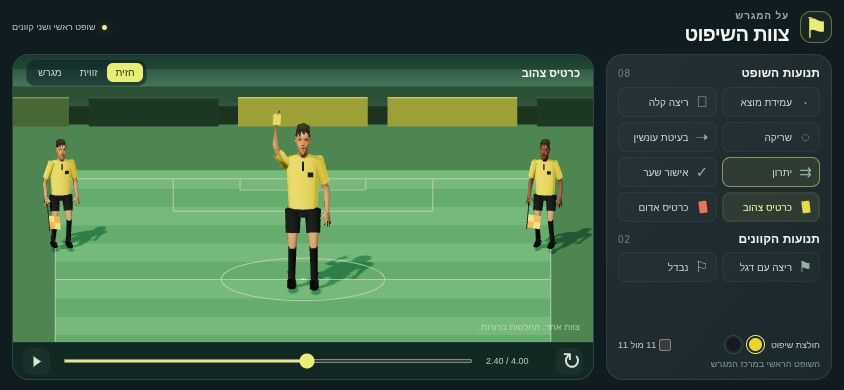

# שופט כדורגל 11 על 11 · soccer-referee-v1

חבילת הנכסים הושלמה בענף **codex/soccer-referee-v1**. נוצרה תיקייה חדשה אחת בלבד: `workout/island/design/soccer-referee-v1/`. כל עשרת הקליפים עברו את motion-qa-v1 בציון **93.7–100**, מעל הדרישה 88. אין שינוי בקבצים קיימים או בקוד המשחק.

[תצוגה אינטראקטיבית](preview.html) · [manifest](manifest.json) · [דוח QA](qa/report.html) · [רישיונות](LICENSES.md)



## הנכסים

| דמות | משולשים, כולל אביזרים | גודל GLB בבתים | קליפים מוטמעים |
|---|---:|---:|---:|
| referee | 1,227 | 579,788 | 8 |
| assistant-left | 1,187 | 359,392 | 3 |
| assistant-right | 1,187 | 348,796 | 3 |

בכל דמות skin עם בדיוק 18 העצמות הקנוניות, אותם שמות/הורים/תרגומי מנוחה ו־inverse bind matrices, משקלים מנורמלים ואטלס מוטמע יחיד 512×512. הגוף והפנים מבוססים על השופט הבדיוני הקיים ב־soccer-v6; הלבוש הרציף, הכרטיסים, המשרוקית, הדגלונים והתנועות הותאמו לחבילה החסכונית. לכל נכס SHA-256 במניפסט.

YellowCard ו־RedCard הם אובייקטים נפרדים, ילדים של RightHand; tracks מסוג STEP חושפים את הכרטיס המתאים בלבד ומאפסים אותו במעבר לקליפ אחר. Whistle נפרד באותו צומת; Flag נפרד אצל שני הקוונים, עם מוט ודגל צהוב־כתום משובץ. החלפת חולצה לצהוב/שחור משנה את החומר shirt בתצוגה.

## קליפים וציוני תנועה

כל הנתונים נאפו ב־30Hz; מספר הפריימים כולל את שני קצות הקליפ. שמונת הקליפים הראשונים שייכים לשופט. שני הקוונים מקבלים idle ושתי הפעולות האחרונות.

| פעולה | מזהה | משך בשניות | פריימים | ציון QA |
|---|---|---:|---:|---:|
| עמידה | `idle` | 2.4 | 73 | 100 |
| ריצה קלה | `jog` | 1 | 31 | 94.3 |
| שריקה | `whistle` | 3 | 91 | 96.8 |
| הצבעה לנקודה | `point_penalty` | 3.4 | 103 | 98.8 |
| יתרון | `advantage` | 3.4 | 103 | 98.4 |
| כרטיס צהוב | `yellow_card` | 4 | 121 | 96.6 |
| כרטיס אדום | `red_card` | 4 | 121 | 96.6 |
| סימון שער | `goal_signal` | 3.6 | 109 | 98 |
| ריצה לאורך הקו | `assistant_run` | 1 | 31 | 93.7 |
| סימון נבדל | `assistant_offside` | 3.6 | 109 | 96.8 |

כלי המדידה המקורי מקומיט [5eb4f093](https://github.com/roynaor-work/Bakasun/tree/5eb4f093bc22523ee417a7f2345c3b813bffba24/workout/island/design/motion-qa-v1) חולץ ל־tmp והופעל ללא שינוי בנוסחאות, בספים או במשקלות. מתאם מחליף רק את רשימת הקלט. קורא ה־GLB המקורי דגם ב־120Hz את הערוצים שנמסרו, כולל זמני תמיכה ואירועים. חתימות שמונת קובצי הכלי נבדקו לפני ואחרי. מקור הקלט המדויק מזוהה בחתימות הקבצים; commit הבסיס אינו מוצג כקומיט שמכיל את הנכסים החדשים.

הכיסוי של כל המדדים החלים הוא 100%, ללא מדדים אדומים. בשני קליפי הריצה רציפות מול idle צהובה: תנוחת ריצה דורשת blend בזמן חיבור למשחק. נתוני התמיכה והמסלול החיצוני מפורשים: jog ב־1 מ׳/שנייה, assistant_run ב־1.15 מ׳/שנייה. המסלול הוחל פעם אחת בלבד בבדיקה. אין כדור בפעולות שיפוט ולכן מדד מגע בכדור אינו חל. ציון הכלי הוא מדד הנדסי, ולא ביקורת תפיסתית חיצונית.

## אימות

- בדיקה עצמאית: **57,927 בדיקות**, ללא כישלונות; שלד, bind, משקלים, דגימות קווטרניונים, 30Hz, התאמה בין הקליפים העצמאיים למודלים, גוף מול רצפה ומשמעות המחוות. כל קודקודי העור נבדקו ב־CPU בכל פריים של 30Hz; מרווח הרצפה המינימלי 2 מ״מ. [נתונים](verification/assets.json).
- Khronos glTF Validator: **16 GLB**, אפס שגיאות ואפס אזהרות, כולל המודלים, קובצי הבסיס והקליפים העצמאיים. [נתונים](verification/gltf.json).
- Chromium: **70 דגימות**, **17 צילומים**; 844×390 ובדיקה נוספת ב־390×844, כל הפעולות, מגע, גרירה בזמן, ניגון/השהיה, החזרת הזמן לאחור, צבעי חולצה, 22 שחקנים ברקע והעדפת תנועה מופחתת. אין שגיאות דף או בקשות חיצוניות. [נתונים וחתימות](verification/browser.json).
- בדיקות הריפו: **4018 בדיקות שונות אומתו, 0 כשלים שנותרו, 64 דולגו**. בהרצת npm test הראשונית עברו 4,017 בדיקות; בדיקת הדפדפן הקיימת של רועיקי נכשלה בשיגור Chromium שלא הותקן במטמון Playwright, והשאירה שרת פתוח. התהליך התקוע הופסק, והקובץ שנכשל הורץ מחדש עם Chromium המערכתי דרך ISLAND_PLAYWRIGHT: כל חמש הבדיקות עברו, כולל הבדיקה החסרה. אין שינוי בקבצי הבדיקות או בקוד קיים. [תוצאות שתי ההרצות](verification/repo-tests.json) · [פלט מסכם](verification/repo-tests.txt).
- [בדיקת ההיקף](verification/scope.json): בסיס `19d9cdc5e3718236df5a2fc4d8b8c26c72007575`, קבצים חדשים בתיקייה המבוקשת בלבד; אפס קבצים קיימים שונו.

## צפייה וחיבור

1. משורש הריפו מריצים `python3 -m http.server 8765` ופותחים [את התצוגה המקומית](http://localhost:8765/workout/island/design/soccer-referee-v1/preview.html).
2. בוחרים מחווה, מנסים השהיה וגרירה בזמן, ומחליפים צבע חולצה. בריצת הקוונים יש תזוזה חיצונית לאורך קו החוץ; ההדגמה נעצרת בסוף המחזור, והפעלה מחדש מתחילה מסלול חדש בלי קפיצה אוטומטית.
3. לחיבור טוענים models/referee.glb ושני models/assistant-*.glb. משתמשים בקליפים המוטמעים; clips/ מכיל עותק עצמאי זהה לכל פעולה לצורכי בדיקה ושימוש נפרד. Root נשאר זהות, המשחק מספק מיקום וכיוון. Hips.translation הוא ערך מקומי מוחלט; אין להוסיף שוב את ערך המנוחה. הפעולות מסמנות החלטה שכבר התקבלה במשחק; זמן הקליפ אינו משנה תוצאה או חוקים.

זו חבילת נכסים עצמאית לצפייה ולחיבור בהמשך. ביצועי טלפון פיזי ואינטגרציה במשחק 11 על 11 לא נמדדו במסגרת התיקייה החדשה.

## שחזור

Node 24+, Blender 4.3.2 עם NumPy/Pillow, ותלויות source/package.json לצילומים ולבדיקת Khronos. build-model.py קורא את מקורות soccer-v6 הקיימים בלבד; קובצי הבסיס כבר כלולים, ולכן לבניית האנימציות מחדש אין צורך ב־Blender. הרצת QA הראשונה עשויה למשוך את קומיט הכלי המוצמד מ־GitHub.

```sh
blender --background --factory-startup --python workout/island/design/soccer-referee-v1/source/build-model.py
node workout/island/design/soccer-referee-v1/source/bake.mjs
node workout/island/design/soccer-referee-v1/source/run-qa.mjs
node workout/island/design/soccer-referee-v1/source/validate.mjs
node workout/island/design/soccer-referee-v1/source/check-gltf.mjs
node workout/island/design/soccer-referee-v1/source/capture.mjs
npm test
```

תלויות כלי הבנייה יכולות להיות מותקנות מחוץ לריפו; GLTF_VALIDATOR_MODULE ו־PLAYWRIGHT_MODULE מאפשרים לציין נתיב התקנה. התצוגה עצמה משתמשת בקובצי Three הקיימים בריפו, ללא npm או CDN.
