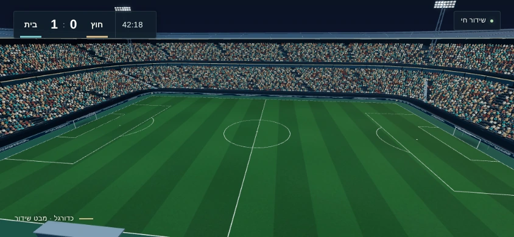

# אצטדיון כדורגל ושידור v8

אצטדיון ערב סגור מכל הצדדים, בתקציב של **33,234 משולשים** ברמת הפירוט הגבוהה, כולל כל מופעי הקהל, השמיים, השערים, ההילות והצללים. 6,766 משולשים נשארים מתוך תקרת 40,000 לתוספות שאינן שחקנים שהמארח משאיר בזמן החיבור.

[הוראות חיבור וקוד טעינה קצר](INTEGRATION.md) · [דוח בדיקות וציונים](REPORT.md) · [סקירת הסבב הסופי](iterations/13/REVIEW.md) · [מקורות ורישיונות](LICENSES.md)



| רמה | גאומטריה סטטית | קהל | שמיים והילות | סך משולשים | GLB בבתים |
|---|---:|---:|---:|---:|---:|
| LOD0 | 22,776 | 10,448 | 10 | **33,234** | 123,432 |
| LOD1 | 10,264 | 3,400 | 10 | **13,674** | 78,920 |
| LOD2 | 4,156 | 1,110 | 10 | **5,276** | 52,512 |

`runtime/` מכילה בדיוק את 25 קובצי הטעינה המקומיים: שלושה GLB דחוסים, תשעה מרקמי WebP, three.js r160, טוענים ומפענח Draco, מצלמות, קהל וממשק שידור. גודלה כ־1.62MB. הרישיונות נמצאים בנפרד ב־`LICENSES/` ויש לשמרם בהפצה.

הקהל מורכב מכרטיסים מאוירים במופעים, עם 16 וריאציות ושונות תנוחה וצבע. ברמות המרוחקות מתווספת טקסטורת מסה על משטחי היציע הקיימים, כדי לשמור על יציע מלא. הכרטיסים מחולקים לפי מרחק אמיתי לאורך ההיקף, מעוגנים למדרגות בפועל ופונים למצלמה. רק רמת LOD אחת מצוירת. המעטפת, הפינות ומסך הרוח נשארים רציפים; הגג הקרוב מוסתר אוטומטית כשמצלמת המשחק עוברת מעל היציע.

לצפייה מקומית, מתוך תיקייה זו:

```sh
node source/serve.mjs 8765 --game-csp
```

פתחו [תצוגה מקומית](http://127.0.0.1:8765/preview.html), עברו בין שידור רחב, קרוב ופתיחה, סובבו מצלמה ומסך ובדקו את הפירוט. התוצאה הרצויה: מגרש קריא, היקף סגור, מסגרת שידור שאינה נחתכת וטעינה ללא הפרת CSP.

```sh
node --test
```

בדיקת Node סופרת פאות מתוך פענוח Draco אמיתי, מוסיפה כל מופע קהל וכל משולש ריצה נוסף, ומוודאת את תקרות המשולשים, הגדלים והמרקמים. אומת ב־Node ‏24.19.0, גם בעותק נקי מחוץ לריפו. אין צורך להתקין npm לבדיקה או למשחק.

שלושה עשר סבבי בנייה, רינדור, בדיקה ותיקון תועדו. רק [12](iterations/12/REVIEW.md) ו־[13](iterations/13/REVIEW.md) נשמרו במלואם; [הקודמים נשמרו כשורת טקסט לכל סבב](iterations/HISTORY.md). מקור ההפקה וכלי השחזור נמצאים ב־`source/`; הם אינם נשלחים למשחק.

**בדיקת 30fps בטלפון פיזי עם השחקנים עדיין חסרה, ולכן פריט זה קיבל 6/10.** יתר פריטי הנכס והחיבור קיבלו 8–9. מדידות רינדור בסביבת Chromium תוכנתית מתעדות יציבות ומורכבות; אין להציג אותן כאימות ביצועים של טלפון.
