# גליץ ושוער v2 — דוח מסירה

ענף `codex/soccer-tackle-keeper-v2` מ־main `d759582c171600dd7c7df7906c2fb38ae7f8b88a`. כל התוצרים קבצים חדשים בתיקייה זו. [תצוגת תנועה](preview.html) · [חוזה צריכה](README.md) · [קטלוג](runtime/catalog.json) · [רישיון](LICENSES.md).

## תוצאה

19 קליפים, 559 דגימות מקור ב־30Hz, 18 עצמות קנוניות. Root קבוע ללא translation או rotation משתנים; ירידות וניתורים חזותיים ב־Hips. אין Draco, meshopt או תלות WASM. גליץ 1.0 שנ׳, קימה 0.6; stumble_light חצי שנייה; נפילה קלה וקימה יחד 0.7; פאול 1.2; שתי קימות השוער 0.8 כל אחת.

| קליפ | שניות | פריימים | QA בהקשר הרצף | גיליון |
|---|---:|---:|---:|---|
| slide_tackle | 1.00 | 31 | 93.8 | [8 פריימים](sheets/slide_tackle.png) |
| getup_fast | 0.60 | 19 | 89.7 | [8 פריימים](sheets/getup_fast.png) |
| stumble_light | 0.50 | 16 | 96 | [8 פריימים](sheets/stumble_light.png) |
| fall_soft | 0.30 | 10 | 89.8 | [8 פריימים](sheets/fall_soft.png) |
| getup_soft | 0.40 | 13 | 88.5 | [8 פריימים](sheets/getup_soft.png) |
| fall_foul | 1.20 | 37 | 94.8 | [8 פריימים](sheets/fall_foul.png) |
| getup_foul | 0.80 | 25 | 88.8 | [8 פריימים](sheets/getup_foul.png) |
| dive_left | 1.10 | 34 | 90 | [8 פריימים](sheets/dive_left.png) |
| dive_low_left | 1.00 | 31 | 89.6 | [8 פריימים](sheets/dive_low_left.png) |
| dive_high_left | 1.30 | 40 | 90.7 | [8 פריימים](sheets/dive_high_left.png) |
| getup_keeper_left | 0.80 | 25 | 92.6 | [8 פריימים](sheets/getup_keeper_left.png) |
| dive_right | 1.10 | 34 | 90 | [8 פריימים](sheets/dive_right.png) |
| dive_low_right | 1.00 | 31 | 89.7 | [8 פריימים](sheets/dive_low_right.png) |
| dive_high_right | 1.30 | 40 | 90.7 | [8 פריימים](sheets/dive_high_right.png) |
| getup_keeper_right | 0.80 | 25 | 92.6 | [8 פריימים](sheets/getup_keeper_right.png) |
| catch_chest | 1.10 | 34 | 94.1 | [8 פריימים](sheets/catch_chest.png) |
| catch_high | 1.30 | 40 | 91.6 | [8 פריימים](sheets/catch_high.png) |
| punch | 1.30 | 40 | 93.6 | [8 פריימים](sheets/punch.png) |
| save_with_foot | 1.10 | 34 | 94.5 | [8 פריימים](sheets/save_with_foot.png) |

כל 19 הקליפים עברו 88: טווח 88.5–96, כיסוי מדדים רלוונטיים 100%, ללא אדום. 18 מדדים צהובים נשארו, כולם posePops של פעולה קצרה; הרשימה והראיות ב־[הדוח המלא](qa/raw-contextual.json). אין שינוי ספים כדי להשיג את הציון.

## תחום מדידת QA

כלי QA מקומיט `5eb4f093bc22523ee417a7f2345c3b813bffba24` בענף codex/motion-qa-v1, שאינו נמצא ב־main של הבסיס. הופעל ה־CLI המקורי מתוך /tmp עם inventory חדש בלבד. חתימות כל קובצי הכלי, המתאם והקלטים וכן הפקודה המדויקת ב־[summary.json](qa/summary.json). 14 רצפי פעולה וקימה נמדדו ב־CLI מול idle: ציון מינימלי 88.4, ללא אדום. לכל קליפ מפוצל בוצעה גם קריאת analyzeClip המקורית עם רפרנס כניסה/יציאה מהקליפ השכן האמיתי. סוף נפילה נמדד מול תחילת קימה; אינו מוצג כאילו חזר ל־idle. [דוח CLI](qa/report.html) · [JSON](qa/report.json) · [קליפים מפוצלים](qa/raw-contextual.json).

מדד מגע הכדור מודד נקודת effector מוצהרת מול מסלול הדגמה מכויל. אינו מאמת מגע עור מלא, אחיזה בשתי ידיים או פיזיקת המשחק. תנועת Root ומהירות התקדמות אינן מומצאות; bodySliding אינו רלוונטי לפעולות האלה. הציון אבחוני, ואינו ביקורת אנושית אוטומטית של סגנון.

## מעטפת, מפרקים ומעברים

[מדידה עצמאית](verification/measurements.json) של כל קודקודי הדמות: 5899 לשדה ו־5868 לשוער בכפפות פתוחות ו־6255 לכפפה הסגורה. 1099 דגימות קליפ מול מעטפת, ללא חדירת רצפה; 13 תפרי פעולה־קימה עברו C0/C1; 320 גשרים מול idle/run בשמונה פאזות לשני הכיוונים עברו רציפות, ערכים סופיים ורצפה. קנה המידה ואורכי הגפיים קבועים, hinge ברך בכיוון תקין, quaternion מנורמלים וכל ערוץ משתנה שומר 30Hz.

מרווח הנעל/בגד נאפה לתוך הנתונים לפי מעטפת המודל, עם שמונה תתי־דגימות בין פריימי מקור; בתצוגת הקליפים אין IK או תיקון רצפה שיכול להסתיר את הפגם. גשרי ריצה כוללים קשת אגן C1 של 6.5 ס״מ עם אפס היסט ונגזרת בקצוות. נעילת רגל בעולם לאחר תנועת השחקן נשארת לשלב החיבור.

## תצוגה ושמונת הפריימים

הגיליונות צולמו מה־GLB הסופי על mesh/skin מלא דרך AnimationMixer. כל גיליון דוגם 0..duration בשמונה מרווחים שווים, משמאל לימין ואז לשורה התחתונה. השוער מוצג בצהוב ועם כפפה ימנית סגורה ל־punch.

### slide_tackle

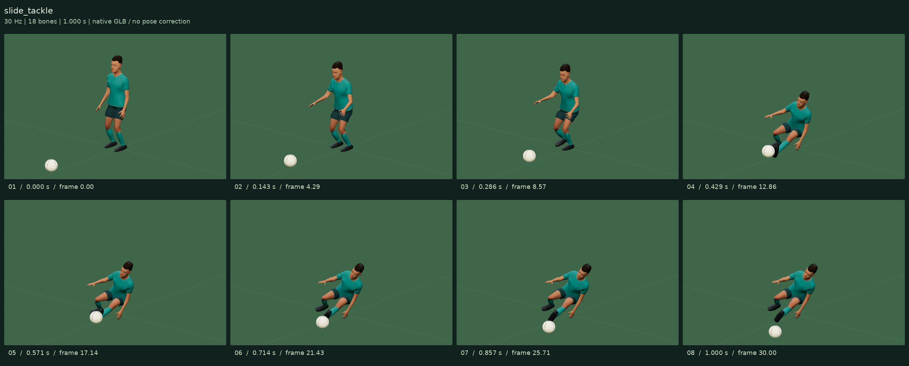

### getup_fast

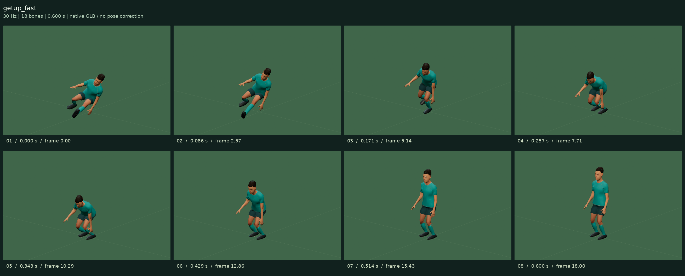

### stumble_light

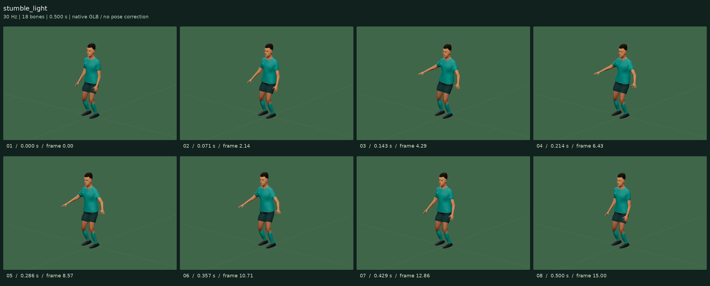

### fall_soft

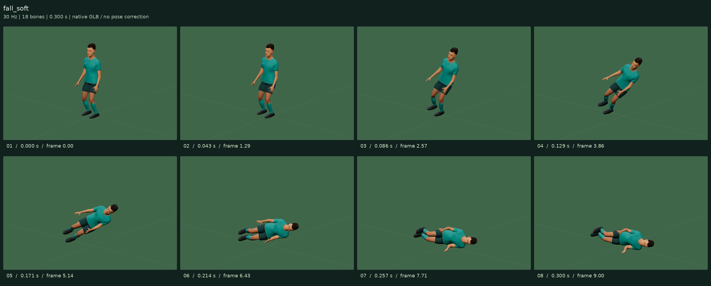

### getup_soft

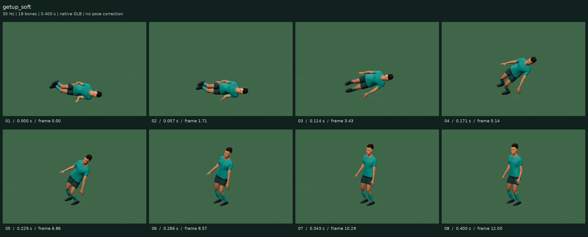

### fall_foul

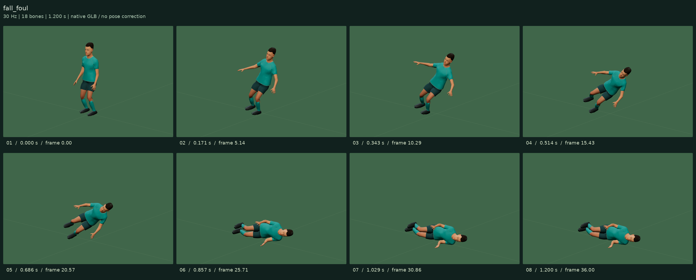

### getup_foul

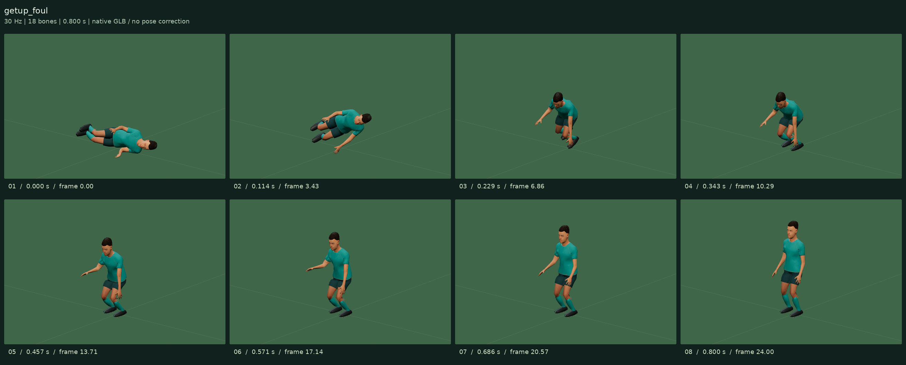

### dive_left

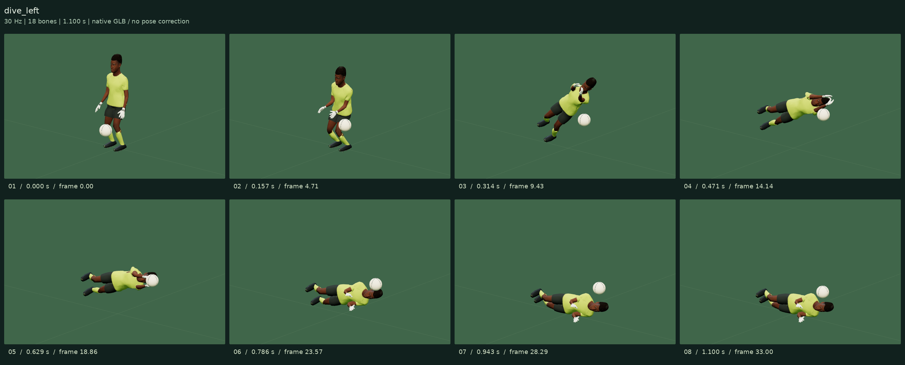

### dive_low_left

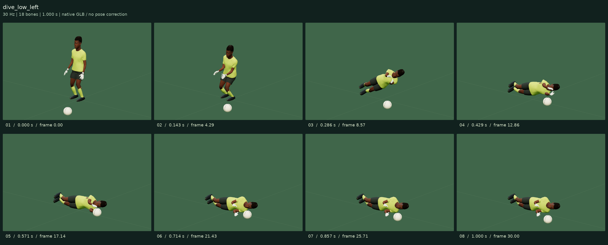

### dive_high_left

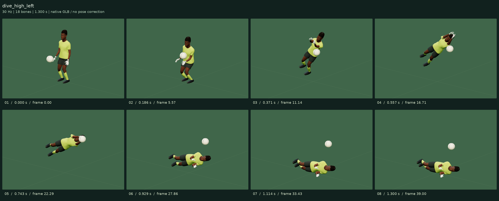

### getup_keeper_left

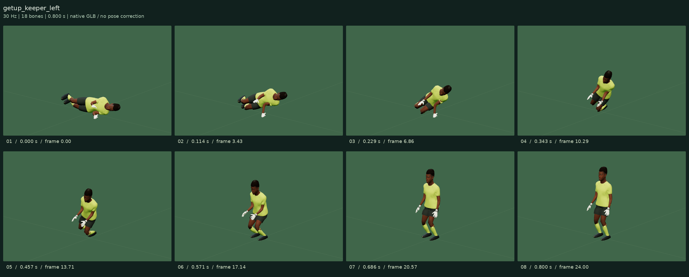

### dive_right

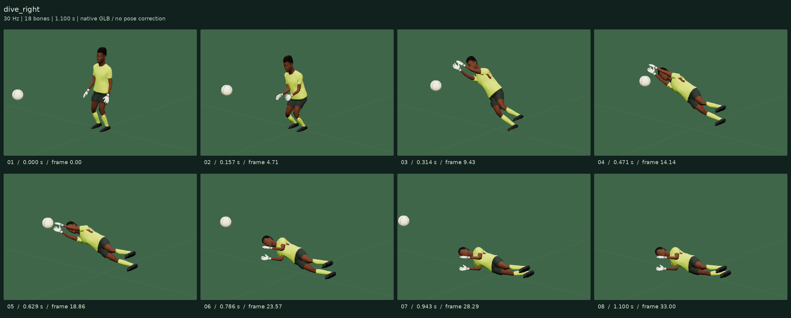

### dive_low_right

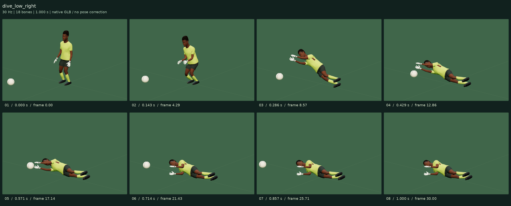

### dive_high_right

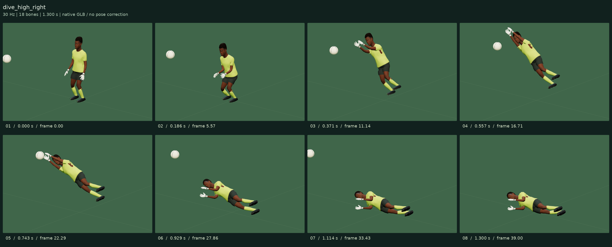

### getup_keeper_right

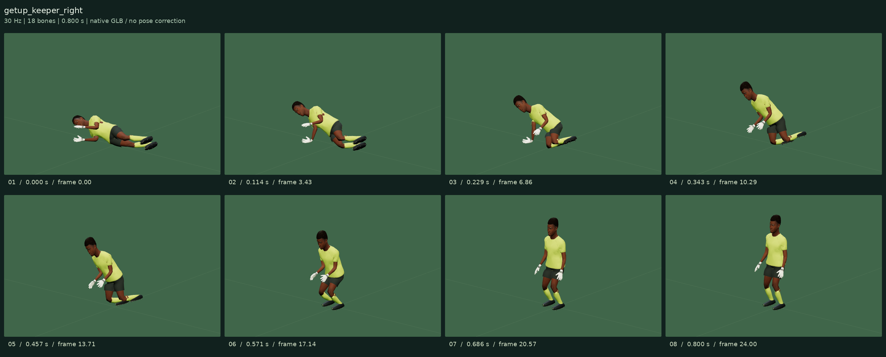

### catch_chest

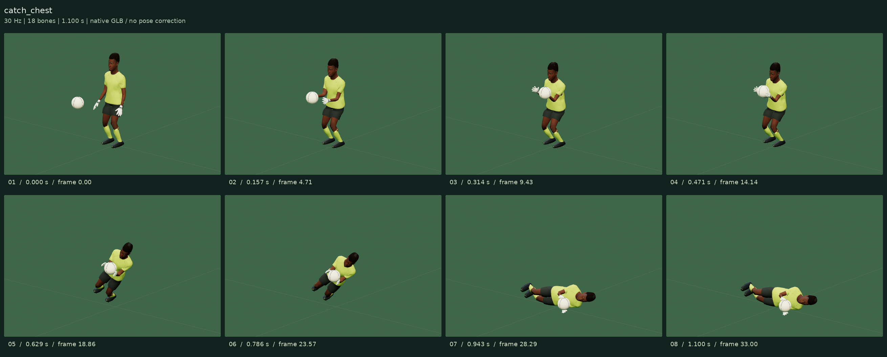

### catch_high

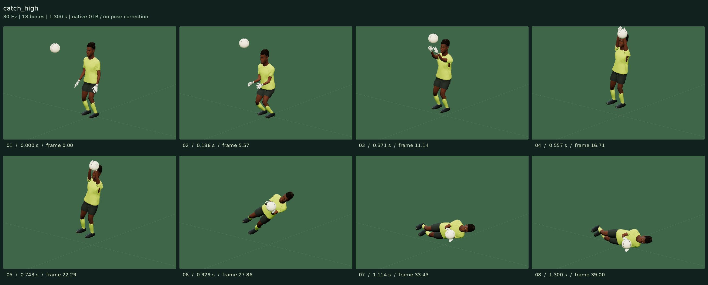

### punch

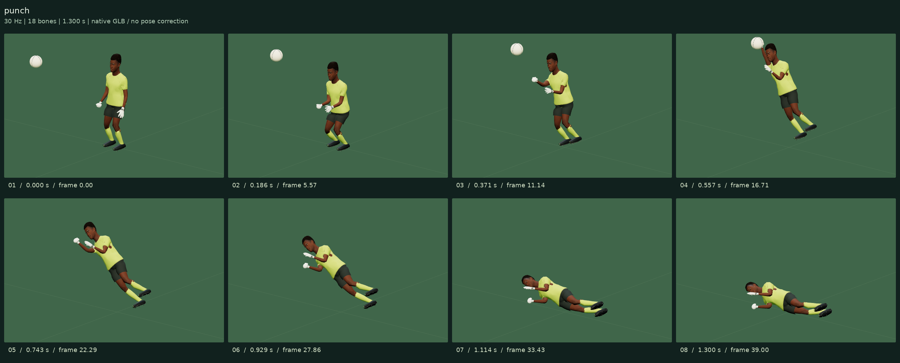

### save_with_foot

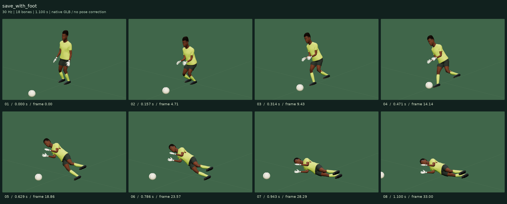

Chromium עבר ב־844×390 וב־390×844: 342 בדיקות פוזה, 18 עצמות סופיות בכל דגימה, ללא שגיאות JavaScript/HTTP, ללא גלילה אופקית וללא בקשות חיצוניות או Draco/WASM; WebAssembly נחסם בזמן הצילום. [תוצאות](verification/browser.json).

## תזמון וחיבור

`contact` בגליץ ב־0.5 שנ׳ הוא סמן תצוגה בלבד. תקיפת הכדור ופאול מוכרעים בסימולציה. תגובה ללא פאול: stumble_light ממשיך לתנועה; בחלופת נפילה קלה התנועה הפעילה 0.7 שנ׳. כדי שהנפגע יקום 0.1 שנ׳ אחרי המחליק, catalog.interaction מפרט החזקה בפוזת הצד לפני getup_soft; בדוגמה הכוללת מגע ב־0.5, המחליק מוכן ב־1.6 והנפגע ב־1.7. זהו חוזה חיבור, לא שינוי למשחק.

כל הנכסים מקוריים או CC0; המקורות והחתימות ב־[provenance.json](verification/provenance.json). בדיקות המאגר הקיימות: 3905 עברו, 1 נכשלו. הכשלים והפלט מתועדים ב־[repository-checks.json](verification/repository-checks.json); קוד ובדיקות קיימים נשארו ללא שינוי.

לא נערכו קבצים קיימים, release.json, תגי גרסה, CLAUDE.md, ops או בדיקות. זו חבילת נכסים לסקירה ב־PR טיוטה, ללא חיבור או פריסה למשחק וללא בדיקה בטלפון פיזי.
