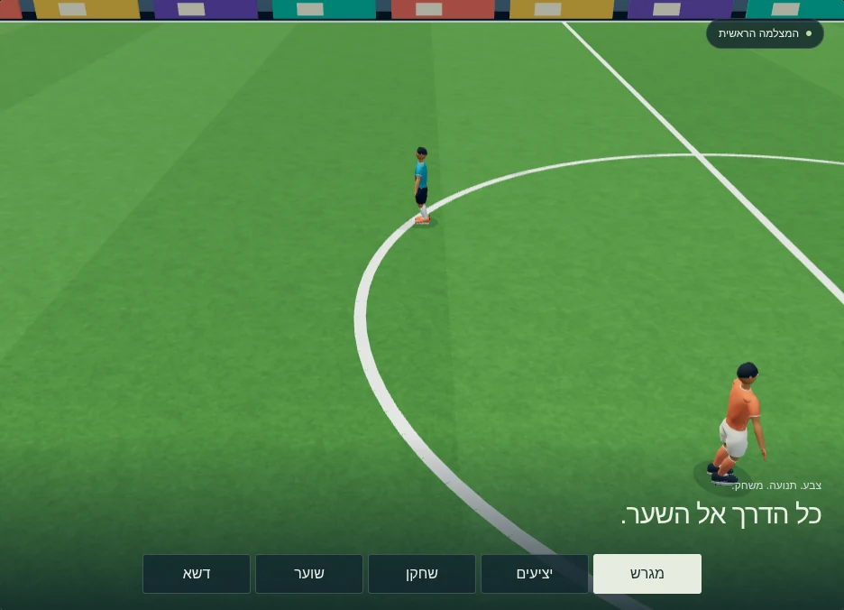
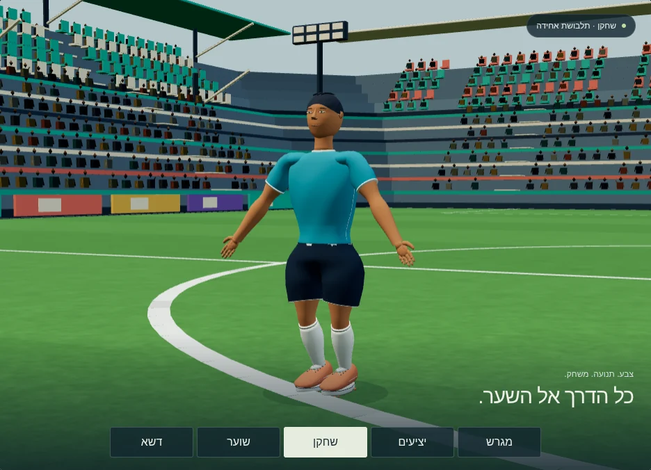

# כדורגל v4 · דמויות, דשא ויציעים

חבילת נכסים ותצוגה נפרדת. כל הקבצים חדשים תחת `workout/island/design/soccer-v4/`; קוד המשחק, נכסים קודמים, `release.json` ותגי גרסה לא נערכו. בסיס העבודה: `045b60e4d0212755ff63d007fbed2cdaf13e7d93`.



| קובץ | תכולה | משקל bytes |
| --- | --- | ---: |
| [soccer-player.glb](soccer-player.glb) | שחקן מפורט, תלבושת אחידה, 20 עצמות ו־6 קליפים מוטמעים | 177,372 |
| [goalkeeper.glb](goalkeeper.glb) | שוער עם כפפות, 20 עצמות ו־10 קליפים מוטמעים | 258,528 |
| [soccer-stadium.glb](soccer-stadium.glb) | יציעים בשתי קומות, 2,524 צופים, שערים, רשתות, דשא, albedo ו־normal מוטמעים | 905,744 |
| **סך טעינת GLB** | שלושה קבצים עצמאיים עם Draco | **1,341,644** |

המרקמים הנפרדים ב־`textures/` הם עותקי מקור לעריכה ולשילוב חלופי; אין צורך לטעון אותם בנוסף לאצטדיון. צילומי התצוגה, כלי הבנייה והתיעוד אינם כלולים בתקציב הטעינה. [manifest.json](manifest.json) כולל גדלים, SHA-256, פלטות, מצלמות, סמני תנועה ומקורות.

## צפייה ובדיקה

1. הפעילו משורש המאגר:

   ```sh
   python3 -m http.server 8765
   ```

2. פתחו [את דף התצוגה המקומי](http://localhost:8765/workout/island/design/soccer-v4/preview.html). עברו בין מגרש, יציעים, שחקן, שוער ודשא. בחרו פעולה, הפעילו ניגון, השהו וגררו את סרגל הזמן. כפתורי בית וחוץ מחליפים צבעי בגד בלבד.
3. בדקו במידות 844×390 ו־390×844: אין גלילה אופקית; כל כפתור בגודל 44px לפחות; הדשא מציג פסים רחבים ושינויי גוון עדינים, בלי ריבועים או מוטיב גדול שחוזר. גרירה מסובבת את המבט וגלילה מקרבת. כפתור האיפוס מחזיר למצלמה שנבחרה.

כל המשאבים מקומיים במאגר, כולל Three.js ומפענח Draco. הדף צריך שרת HTTP; הוא אינו מיועד ל־`file://`. אין שירות חיצוני, סמל מסחרי, שם קבוצה או מספר על הדמויות.

## דשא ומצלמה

המגרש הוא 68×105 מ׳. מפת הצבע ומפת הנורמל הן 512×512 ומתארות אריח קטן של 4×4 מ׳, עם גבעולים קצרים ורעש רב־קני־מידה. הן נוצרו ישירות מנתונים דטרמיניסטיים, בלי שיקוף רבעים או כתמי צילום. UV חוזר 17×26.25 פעמים; ה־normal הוא נתון לינארי במוסכמת OpenGL, וה־GLB מכיל tangent מפורש.

**פסי הכיסוח והשונות הרחבה אינם נמצאים באריח.** צבעי קודקודים ייחודיים מכסים את המגרש כולו: 14 פסים ברוחב 7.5 מ׳, שינויי גוון שאינם מחזוריים, ושחיקה עדינה באזורי השער. לכן פסי הכיסוח נשארים בגודל נכון והאריח אינו משכפל כתמים גדולים. המיקרו־מרקם עצמו חוזר בכוונה.

המצלמה הראשית בתצוגה משתמשת בשדה הראייה, ההגבהה והמרחק של `minigames.soccer.view.camera` בקובץ ההגדרות הקיים: 42°, הגבהה 28° ומרחק 15 מ׳ לרוחב; הגבהה 40° ומרחק 21 מ׳ לאורך. היא מסובבת כך שציר אורך המגרש הוא `+Z`. מיקום המעקב כאן קבוע לצורך בדיקה. זו בדיקה עם זוויות המשחק, והנכסים עדיין אינם משולבים במשחק החי. [מבט דשא קרוב](previews/turf.webp) · [היציעים](previews/stadium.webp).

## דמויות, צבעים ושלד

הגאומטריה המפורטת נלקחה מ־`characters2`, והאצטדיון מ־`models2`, ברישיון CC0. נשמרו הפנים, השיער, האצבעות, פרטי הבד והנעליים. אין תמונות או דוגמאות על הדמויות: חומר PBR אחד, `COLOR_0`, וצבעים אחידים לתלבושת. פלטות בית, חוץ ושוער נמצאות ב־manifest.

שמות העצמות, תנוחת הקישור ו־inverse bind matrices נשמרו לפי `../characters/rig.json`. היחידה מטר; מעלה `+Y`; חזית `+Z`. הגובה המקורי של השלד נשמר כדי לא לשבור את חוזה התנועות. `displayScale` ב־manifest מביא את גובה הדמות החזותית ל־1.80 מ׳ באמצעות קנה מידה אחיד של קבוצת הדמות; אין למתוח עצמות בנפרד.

להחלפת צבע משתמשים במאפיין `_KIT_REGION` של ה־GLB, שנטען ב־Three כ־`geometry.attributes._kit_region`, וב־`mesh.userData.kitRegionNames`. `0` משמר את צבע הקודקוד; האזורים האחרים ממופים לפלטה. מזהי האזורים נשמרים גם כש־Draco משנה את סדר הקודקודים. ממירים צבעי hex מ־sRGB ללינארי, משנים `COLOR_0`, ומסמנים `needsUpdate=true`. כאשר לכל מופע צבע משלו, משכפלים את הגאומטריה לפני השינוי. מימוש עובד נמצא ב־`tint()` ב־[preview.js](preview.js).



## קליפים מוטמעים

| שם | משך בשניות | לולאה | שימוש |
| --- | ---: | --- | --- |
| `idle` | 1.80 | כן | עמידה ונשימה |
| `run` | 0.72 | כן | ריצה |
| `sprint` | 0.56 | כן | קצב מהיר יותר ונטיית גוף קדימה |
| `kick` | 0.68 | לא | בעיטה; מגע חזותי ב־0.24 שנ׳ |
| `pass` | 0.86 | לא | מסירה; מגע חזותי ב־0.3268 שנ׳ |
| `throw_in` | 1.82 | לא | הכנה, שחרור ומעקב של הוצאת חוץ |
| `keeper_throw` | 1.18 | לא | הוצאת שוער ביד; בשוער בלבד |
| `keeper_punt` | 1.65 | לא | הוצאת שוער ברגל; בשוער בלבד |
| `keeper_dive_left` / `keeper_dive_right` | 1.45 | לא | זינוקים לשני הצדדים; בשוער בלבד |

הקליפים מופיעים ב־`gltf.animations` ועובדים ב־`THREE.AnimationMixer` רגיל; אין צורך ב־Retargeter בזמן הניגון. האפייה דגמה את מתאם השלד ופתרון מגעי הרגליים הקיימים ב־30Hz, כולל גבולות מקטעים וסמני פעולה מדויקים. ספרינט נגזר מהריצה הקיימת עם מחזור קצר יותר ונטיית עמוד שדרה. הוצאת החוץ מחברת שלושה מקטעים רציפים מהחבילה הקיימת. אין טענה שמדובר ב־motion capture.

כל הקליפים הם **in-place**: אין תזוזת Root אופקית, והמשחק אחראי לתנועה בעולם. אנימציות חד־פעמיות צריכות `LoopOnce` ו־`clampWhenFinished=true`; הלולאות צריכות `LoopRepeat`. לערבוב משתמשים ב־crossfade חיובי, למשל 0.18 שנ׳. `extras.events` בכל אנימציה וה־manifest מספקים `atSeconds` ומופע מנורמל `time`; אלה סמני תצוגה בלבד. הם אינם קובעים פיזיקת כדור, בעלות, שער או תוצאה. כדור אינו מוטמע בדמויות; שילוב האחיזה והפיזיקה נעשה במתאם המשחק.

## אימות וגבולות

[VALIDATION.md](VALIDATION.md) מרכז את הבדיקות והמדידות. [מקורות ורישיונות](LICENSES.md). נוסח משימה 1 לא צורף להקשר; תנאי הבסיס שאומצו כאן הם חוזי הנכסים הקיימים: GLB עם Draco, עד 300,000 bytes לדמות כולל קליפים, עד 2,000,000 bytes לטעינת הנכסים, מרקמים עד 512px, תצוגת אורך ורוחב, ומקורות הניתנים לשחזור.

זו מסירה לשילוב בידי מפתח המשחק. סצנת התצוגה המלאה כוללת כ־328 אלף משולשים עם שמונה דמויות; היא חורגת מתקציב 130 אלף המשולשים שמוגדר כרגע במשחק. לפני חיבור לטלפונים נדרשת בחירת LOD או הפחתת צפיפות קהל וגאומטריה. ביצועי טלפון פיזי, חיבור למשחק ותנאי משימה 1 שלא נמסרו לא אומתו.

## שחזור

נדרשים Python עם NumPy, Pillow ו־Playwright, Chromium ב־`/usr/bin/chromium`, ו־Node 22 ומעלה. התלויות מותקנות בתיקייה זמנית, בלי לשנות את `package.json` של המאגר:

```sh
npm install --prefix /tmp/soccer-v4-tools --cache /tmp/soccer-v4-npm-cache @gltf-transform/core@4.5.1 @gltf-transform/extensions@4.5.1 @gltf-transform/functions@4.5.1 draco3dgltf@1.5.9 gltf-validator@2.0.0-dev.3.10
python3 workout/island/design/soccer-v4/source/textures.py
python3 workout/island/design/soccer-v4/source/bake.py
node workout/island/design/soccer-v4/source/build.mjs
node workout/island/design/soccer-v4/source/validate.mjs
python3 workout/island/design/soccer-v4/source/check-browser.py
python3 workout/island/design/soccer-v4/source/audit.py
```

הכלים כותבים רק בתיקייה זו וב־`/tmp/soccer-v4-*`. אין להפעיל מחוללי מקור של חבילות קודמות כדי לשחזר את v4.
