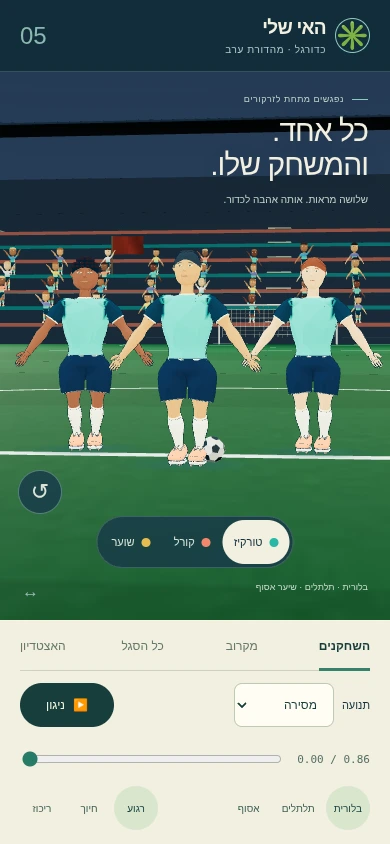

# כדורגל v5 · מהדורה מצוירת

מסלול א׳ שנבחר: שלושה מראות פנים ושיער בשתי ערכות צבע, שוער עם כפפות, הבעות רגוע/חיוך/ריכוז, קהל מגוון, דגלים ותאורת ערב. כל דמות היא GLB עצמאי עם שלד קנוני בן 18 עצמות וחמישה קליפים מוטמעים: `run`, `sprint`, `kick`, `pass`, `slide`.

זו חבילת נכסים למימוש. התצוגה מציגה את הקבצים הסופיים ואינה משנה את משחק הכדורגל. צילום ובדיקת ביצועים בטלפון פיזי עדיין ממתינים; הצילומים המצורפים הם הדמיית טלפון בדפדפן.



[דוח גדלים, משולשים ואימות](VALIDATION.md) · [רשימת הנכסים המכאנית](manifest.json) · [מקורות ורישיון CC0](LICENSES.md) · [כל חמש התנועות](previews/motion-sheet.webp)

## צפייה מקומית

1. הפעילו שרת משורש המאגר:

   ```sh
   python3 -m http.server 8765 --bind 0.0.0.0
   ```

2. פתחו את [התצוגה המקומית](http://localhost:8765/workout/island/design/soccer-v5/preview.html). בטלפון הנמצא באותה רשת יש להשתמש בכתובת ה־LAN של המחשב במקום `localhost`.
3. בחרו מדים ומראה, עברו ל״מקרוב״ ול״כל הסגל״, נגנו את חמש התנועות והזיזו את ציר הזמן. התוצאה הרצויה: שלוש תסרוקות מובחנות, הבעות משתנות, כפפות בשוער, ותנועה ללא שקיעה נראית ברצפה. גרירה מסובבת, גלילה/צביטה מקרבות; כפתור החץ מאפס את המצלמה. גם מקשי החצים ו־Home פועלים כשהקנבס ממוקד.

לאחר מיזוג ופריסת GitHub Pages יהיה אפשר לפתוח את [כתובת התצוגה באתר](https://roynaor-work.github.io/Bakasun/workout/island/design/soccer-v5/preview.html). הקישור תלוי בפריסה של הענף; אינו ראיה שהגרסה כבר פורסמה.

## מסירה למימוש

- `models/{teal,coral}-{quiff,curls,knot}.glb`: אותם שלושה מראות בשתי ערכות. `models/goalkeeper.glb`: שוער בצבע ענבר. כל קובץ כולל גאומטריה, צבעי קודקודים, skin ושתי מטרות morph בשם `smile` ו־`focus`; שתיהן באפס נותנות הבעה רגועה.
- `models/stadium-evening.glb`: מגרש 68×105 מ׳, סימונים, שערים, יציעים ותאורת ערב. מרקם דשא 1024×1024 מוטמע; אין אריחים חוזרים על המגרש.
- `models/crowd.glb`: 224 צופים, בארבע מחוות ובמגוון צבעי עור ולבוש, בגאומטריה סטטית ובקריאת ציור אחת. המיקום כבר מותאם ליציעי האצטדיון.
- `models/flags.glb`: שמונה דגלי קהל וקליפ `flag_wave` מחזורי. ארבעת דגלי הפינה נמצאים גם במעטפת האצטדיון.
- `models/ball.glb`: כדור בקוטר 0.22 מ׳.

כל GLB קטן מ־1,500,000 bytes ודורש מפענח `KHR_draco_mesh_compression`. יש להשתמש במפענח המקומי הקיים ב־`design/viewer/draco/`. היחידות מטרים, `+Y` למעלה, `+Z` קדימה. הדמויות משתמשות באורכי השלד הקיים; תצוגת האצטדיון מציבה אותן בקנה מידה 1.35 ביחס למגרש.

השלד ב־[rig.json](rig.json) תואם בשמות, בסדר ובהורות ל־18 העצמות ב־`motion2/soccer.json`. שתי עצמות העזר בכתפיים הוסרו וטרנספורמציות הזרועות חושבו מול החזה, עם שמירת מטריצות ה־inverse bind. צירי המנוחה מכוילים לגוף הקיים. לניגון הקליפים המוטמעים משתמשים ב־`AnimationMixer` רגיל; תנועות JSON נוספות מחייבות את כיול הבסיסים שב־`viewer/retarget-map.json`.

הריצה והספרינט מיועדים ל־`LoopRepeat`; בעיטה, מסירה וגלישה ל־`LoopOnce` עם `clampWhenFinished`. הקליפים הם במקום: סימולציית המשחק קובעת מיקום, כיוון, מהירות ומגעי כדור. סמני האנימציה ב־`extras` מיועדים לתצוגה ואינם פוסקים פגיעה או ניקוד. הקליפ `slide` מסתיים בתנוחת גלישה; אנימציית קימה/מעבר אינה כלולה בחמשת הקליפים המבוקשים.

החומרים ב־GLB הם PBR תקניים. [toon.js](toon.js) מספק טיפול אופציונלי ב־three.js: הצללה מצוירת וקווי מתאר על אותה גאומטריה, שלד ויעדי morph. פרטי עפעפיים, שפתיים ואף אינם מקבלים קליפת מתאר נוספת. ה־viewer מפריד בין שכבת התאורה של השחקנים לבין זרקורי האצטדיון, כדי לשמור על צבעי המדים.

## בנייה ואימות חוזרים

התקינו את תלויות Node מחוץ למאגר, ואת תלויות Python מתוך `source/requirements.txt`. נדרש Chromium מקומי; `PLAYWRIGHT_EXECUTABLE_PATH` בוחר נתיב חלופי.

```sh
npm install --prefix /tmp/soccer-v5-tools @gltf-transform/core@4.5.1 @gltf-transform/extensions@4.5.1 @gltf-transform/functions@4.5.1 draco3dgltf@1.5.9 gltf-validator@2.0.0-dev.3.10 meshoptimizer@0.24.0
python3 workout/island/design/soccer-v5/source/characters.py
python3 workout/island/design/soccer-v5/source/turf.py
node workout/island/design/soccer-v5/source/build.mjs
node workout/island/design/soccer-v5/source/environment.mjs
node workout/island/design/soccer-v5/source/validate.mjs
python3 workout/island/design/soccer-v5/source/capture.py
npm test
node workout/island/design/soccer-v5/source/report.mjs
```

`characters.py` כותב חומרי ביניים ל־`/tmp/soccer-v5-raw`; יתר תוצרי הבנייה נמצאים בתיקייה זו. בניית הדמויות קודמת לבניית הסביבה, שמוסיפה את רשומות הסביבה ל־manifest. הדוחות קשורים בחותמות לקבצים שנבדקו; לאחר שינוי יש להריץ שוב אימות וצילום. `repository-tests.json` מתעד את הרצת `npm test` שסופקה בחבילה, ויש לעדכן אותו לפי תוצאה אמיתית בהרצה חדשה.
