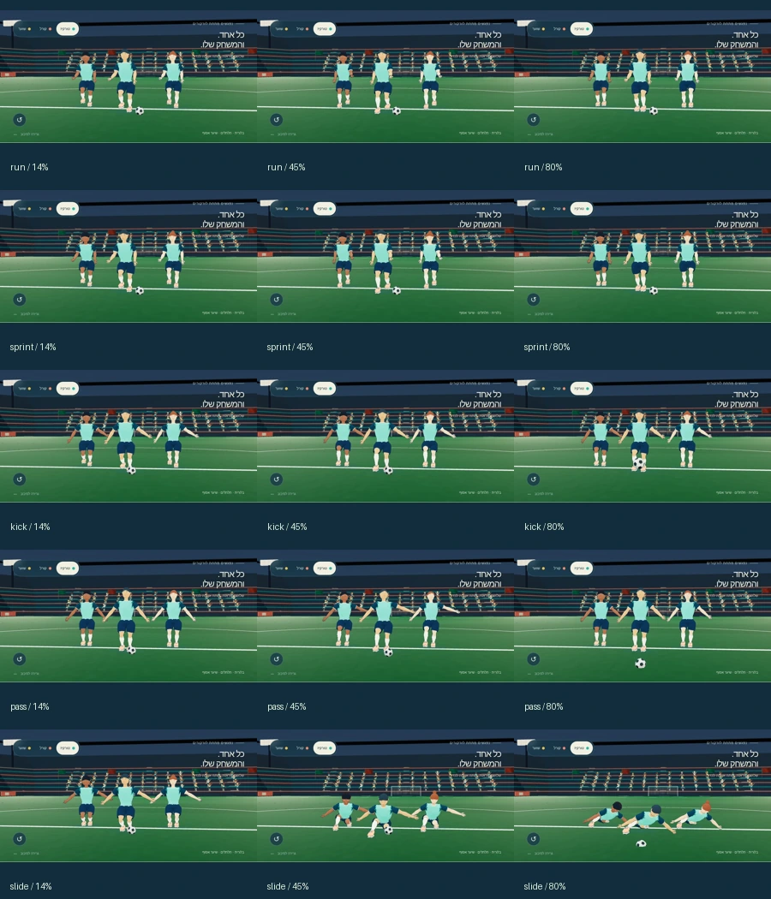

# אימות ומסירה · כדורגל v5

תאריך: 04.11.2026. נבחר מסלול א׳. נכסי המסירה והדפדפן עברו את הבדיקות שלהלן. בדיקת טלפון פיזי וצילום ממנו עדיין ממתינים; אין טענה למדידת FPS או GPU בטלפון.

## גדלים ומשולשים

| GLB | bytes | משולשים | עצמות | קליפים |
| --- | ---: | ---: | ---: | ---: |
| [models/teal-quiff.glb](models/teal-quiff.glb) | 453,528 | 12,564 | 18 | 5 |
| [models/teal-curls.glb](models/teal-curls.glb) | 493,248 | 14,297 | 18 | 5 |
| [models/teal-knot.glb](models/teal-knot.glb) | 457,692 | 12,757 | 18 | 5 |
| [models/coral-quiff.glb](models/coral-quiff.glb) | 453,536 | 12,564 | 18 | 5 |
| [models/coral-curls.glb](models/coral-curls.glb) | 493,272 | 14,297 | 18 | 5 |
| [models/coral-knot.glb](models/coral-knot.glb) | 457,704 | 12,757 | 18 | 5 |
| [models/goalkeeper.glb](models/goalkeeper.glb) | 454,500 | 12,616 | 18 | 5 |
| [models/stadium-evening.glb](models/stadium-evening.glb) | 159,528 | 9,464 | — | 0 |
| [models/crowd.glb](models/crowd.glb) | 692,764 | 169,904 | — | 0 |
| [models/flags.glb](models/flags.glb) | 23,244 | 896 | — | 1 |
| [models/ball.glb](models/ball.glb) | 2,712 | 116 | — | 0 |

סך 11 קובצי GLB: **4,141,728 bytes**. הגדול ביותר: **692,764 bytes**, מתחת לתקרת 1.5MB לקובץ. המספרים מתייחסים לגאומטריה בנכס; קליפות המתאר בתצוגה מוסיפות משולשים בזמן רינדור. הקהל הוא החלק הגדול ביותר בגאומטריית הסביבה; אפשר להסתירו או להחליפו במרחק בעת החיבור למשחק.

## אימות הנכסים הסופיים

- Khronos glTF Validator: אפס שגיאות ו־0 אזהרות בכל 11 הקבצים. המפענח העצמאי בדק גם את זרמי Draco; ה־Validator עצמו מציין את Draco כהרחבה שאינו מאמת.
- שבע הדמויות: בדיוק 18 עצמות, סדר והורות קנוניים, מטריצות inverse bind תקינות ומשקלים מנורמלים. אין משאבים חיצוניים ב־GLB. מרקם המגרש המוטמע: 1024×1024.
- בדיוק חמש אנימציות נעות בכל דמות; זמנים עולים, quaternion-ים מנורמלים וקצוות מחזוריים תואמים בריצה ובספרינט. עוגני התמיכה נאפו באותה מערכת ייחוס כמו Root במקום.
- 49 דגימות עצמאיות לכל קליפ × חמישה קליפים × שבע דמויות = 1,715 בדיקות רצפה מה־GLB המפוענח. ערך Y נמוך ביותר: **-0.000581 מ׳**, בתוך סבולת 5 מ״מ. זו בדיקת משטח שטוח והבעה רגועה, ולא פיזיקת משחק.
- שלוש גאומטריות פנים/שיער שונות; שתי ערכות שומרות על אותה גאומטריה. שני יעדי הבעה פעילים, שמות smile/focus, עם תזוזות מוגבלות לקודקודי הראש.

המספרים, חותמות SHA-256 ותוצאות הבדיקות המפורטות נמצאים ב־[assets.json](verification/assets.json).

## דפדפן ומובייל

Chromium עם WebGL בתוכנה, CSP של דף התצוגה וללא בקשות חיצוניות. נבדקו 390×844, 844×390, 360×800, 1440×1000; אין גלילה אופקית או פקדים החורגים מהמסך. כל פקדי הפעולה בגודל 44×44px לפחות. טעינת מרקם הדשא נבדקה במפורש כדי ש־ready לא יסתיר כשל תמונה.

בחירת תנועות וגרירת ציר הזמן מפעילות בפועל את כל השלדים; נבדקו ניגון/השהיה, מדים, מראות, הבעות, תקריב, סגל, אצטדיון וסיבוב מצלמה במקלדת. אפס שגיאות קונסול, JavaScript, CSP ובקשות נכשלות. 31 צילומי מסך/גיליונות נשמרו עם חותמות ב־[browser.json](verification/browser.json).

[אורך](previews/players-teal-390x844.webp) · [רוחב וסגל](previews/roster-844x390.webp) · [קורל](previews/players-coral-390x844.webp) · [שוער](previews/players-keeper-390x844.webp) · [אצטדיון](previews/stadium-844x390.webp)

## בדיקות מאגר

בדיקות המאגר עברו: 3170 הצליחו, 0 נכשלו, 47 דולגו. הפקודה והספירות נמצאות ב־[repository-tests.json](verification/repository-tests.json).

## בדיקת הטלפון שנותרה

1. לפתוח את התצוגה בטלפון אמיתי דרך שרת LAN, או לאחר מיזוג ופריסת Pages, לפי [README](README.md#צפייה-מקומית).
2. לבדוק לאורך ולרוחב את כל חמש התנועות, החלפת מדים, תקריב והבעות; לסובב ולצבוט את המבט.
3. לצלם את התצוגה ולרשום דגם מכשיר, דפדפן והתרשמות מחלקות/חימום. התוצאה הרצויה: פנים קריאות, רגליים מעל המגרש, היענות למגע וטעינה תקינה.

הבדיקה לא בוצעה כאן, משום שסביבת העבודה מספקת Chromium מרוחק ואינה מחוברת לטלפון פיזי.
