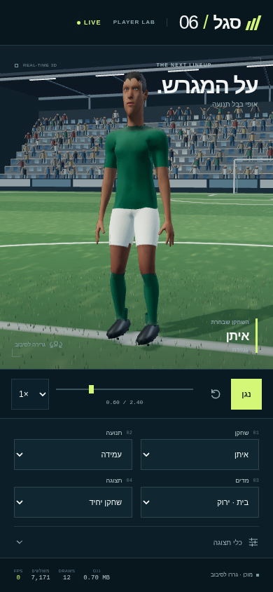
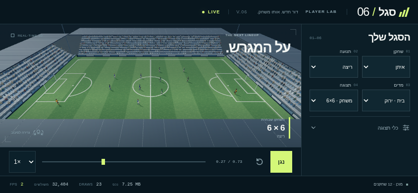

# מסירת דמויות כדורגל v6 · 04/11/2026

נוצרו שישה שחקני שדה בדיוניים עם פנים, גווני עור ותסרוקות שונים, שוער עם כפפות ושופט. לשחקני השדה שתי ערכות צבע: ירוק ושנהב, וכחול ושנהב; נעלי פקקים, שרוכים וגרביים. החומרים כוללים צבע עור, אריג ותפרים במפת normal, ‏ORM ו־hair cards עם alpha mask. אין סמלי מועדון, נותני חסות או דמות של שחקן אמיתי.

[פתיחת התצוגה האינטראקטיבית](preview.html) · [הוראות הפעלה](README.md) · [מקורות ונכסים](ASSETS.md) · [חוזה התנועה](MOTION.md)

## גאומטריה וגדלים

28 קובצי Draco GLB, שלד קנוני זהה של 18 עצמות, חומר אחד ו־UV atlas אחד לכל זהות/ערכה עם שלושה ערוצי PBR בגודל 1024. עמודת MB היא הקובץ הגדול של אותה זהות; MB עשרוני = 1,000,000 בתים.

| זהות | LOD0: משולשים מרביים | LOD1: משולשים מרביים | GLB מרבי, MB |
| --- | ---: | ---: | ---: |
| איתן · `player-01` | 7,171 | 2,699 | 0.700284 |
| גיא · `player-02` | 7,175 | 2,696 | 0.730368 |
| ליאם · `player-03` | 7,183 | 2,707 | 0.706764 |
| נבו · `player-04` | 7,166 | 2,692 | 0.715576 |
| רון · `player-05` | 7,177 | 2,713 | 0.723344 |
| עומר · `player-06` | 7,174 | 2,697 | 0.716616 |
| שוער · `goalkeeper` | 7,175 | 2,695 | 0.772368 |
| שופט · `referee` | 7,175 | 2,712 | 0.787924 |

כל LOD0 עד 8,000 וכל LOD1 עד 3,000 משולשים. כל GLB קטן מ־1.5MB; המרבי הוא `assets/referee-lod0.glb`, בגודל **0.787924 MB**. כל קובצי GLB יחד: **19.431036 MB**. נתוני התנועה: **0.731050 MB**; מעטפת הרצפה: **0.826020 MB**.

קובצי המקור הגדולים: `source/makehuman/base.obj` — **1.749303 MB**; `hair/afro01/afro_diffuse.png` — **1.401024 MB**; `hair/short01/short01_diffuse.png` — **1.047680 MB** (שני האחרונים תחת `source/makehuman/`). אלה מקורות עריכה; מגבלת 1.5MB נבדקה על כל GLB. כל 38 טקסטורות PNG של הנכסים והמקורות עד 1024; צילומי התצוגה נשמרו בגודלם המלא.

## תנועה ואימות

20 קליפים ב־30fps, עם 670 פוזות מלאות: עמידה, ריצה, ספרינט, האטה, פניות חדות לשני הצדדים, בעיטה ישרה ומסובבת, שתי מסירות, נגיחה, כדרור, גלישה, נפילה וקימה, חגיגה, היכון שוער, שני זינוקים ותפיסה. התנועות עוצבו וחושבו; אין טענה להקלטת mocap. הצופה מדגים ערבוב של 0.22 שנייה מהפוזה המוצגת, עם המשך מהירות ותיקון רצפה לאחר הערבוב.

- [אימות נכסים](verification/assets.json): כל 28 הקבצים עברו Khronos עם **0 שגיאות**, גם מכווצים וגם אחרי פענוח Draco. נבדקו תקציבים, מפות, inverse bind, משקלי skin, הורות ומנח 18 העצמות. נשארת אזהרה אחת בכל קובץ: בסיס tangent למפת normal מחושב בזמן ריצה; הטעינה נבדקה ב־three.js r160 המקומי.
- [אימות תנועה](motion/validation.json): זמני 30Hz אחידים, quaternions מנורמלים, Root זהות, סגירת לולאות ותמיכות. `hipsOffsetMeters` מוזז באגן; מסלול reference root הוא מידע לבדיקה ואינו מוזיז את הדמות.
- [מעטפת רצפה](motion/floor-clearance.json): כל 28 הנכסים × 20 קליפים, **261,206,140 קודקודי־פריים** ב־120Hz. מעטפת 60Hz נבדקה גם בנקודות הביניים ושומרת לפחות **2 מ״מ** מעל הרצפה. לפני תיקון: חדירה מרבית 61.690 מ״מ; תיקון הגובה המרבי הוא **63.730 מ״מ**. הצופה משתמש במעטפת רק כשחתימת התנועה תואמת, וסורק גאומטריה מעוותת בזמן מעברים.
- [אימות דפדפן וצילומים](verification/browser.json): טעינה דרך GLTFLoader/Draco המקומיים, כל הקליפים, כל הנכסים, שתי רמות LOD, ערכות, עצירה, ניגון, seek, איפוס, שלד, רשת ומעברים שנקטעים. מצב 6×6 משתמש ב־12 שחקני LOD1, **32,404 משולשי דמויות ו־23 קריאות ציור**. הסביבה כוללת כ־89K משולשים, 1,061 צופים ו־6,000 עלי דשא באינסטנסינג.
- [בדיקות הריפו הקיימות](verification/regression.json): בהרצה הראשונית 262 מתוך 266 קובצי בדיקה עברו; ארבעה כשלו בשל הרשאות תהליך/רשת מקומית או נתיב Chromium. ארבעתם עברו בהרצה חוזרת עם סביבת ההפעלה המתאימה, ללא שינוי בבדיקות. בדיקת CSP האופציונלית נשארה מדולגת לפי ברירת המחדל שלה.

## צילומי תצוגה בגודל מלא

נשמרו PNG בגודל **390×844** ו־**844×390**, ותקריבי ראש וגוף לכל שמונה הדמויות בשני LODs. התמונות צולמו מהנכסים הסופיים דרך הצופה המקומי.

[שחקן 390×844](previews/hero-390x844.png) · [שחקן 844×390](previews/hero-844x390.png) · [6×6 לאורך](previews/match-390x844.png) · [6×6 לרוחב](previews/match-844x390.png)

[כל הסגל: LOD0 גוף](previews/roster-lod0-full.png) · [LOD0 פנים](previews/roster-lod0-head.png) · [LOD1 גוף](previews/roster-lod1-full.png) · [LOD1 פנים](previews/roster-lod1-head.png)

## גבולות המסירה

החוזה הטכני והתקציבים עברו, אך **איכות הפנים, קווי השיער ושולי הבגד בתקריבים עדיין מתחת לרף הרפרנס המבוקש**. הצילומים מציגים את התוצאה בפועל; החבילה נמסרת כטיוטה לביקורת חזותית ולא כהצהרה שהושגה אותה רמת גימור.

30fps הוא יעד רינדור, עם מגבלת קצב של 30 בצופה; **לא בוצעה מדידת טלפון פיזי**. הדוח והצילומים נעשו ב־Chromium עם SwiftShader, ולכן מד ה־FPS שבתמונות אינו מדד לביצועי טלפון. הנכסים חסכוניים בפוליגונים; אין ריג הבעות, סימולציית בד או שיער פיזיקלי. תיקון הגובה הוא עזר תצוגה ואינו מערכת התנגשות או נעילת רגליים במנוע משחק.

כל קובצי המסירה חדשים תחת `workout/island/design/soccer-v6/characters/`. קוד המשחק, release, תגי גרסה, CLAUDE והבדיקות נשארו ללא שינוי. הענף הוא `codex/soccer-characters-v6-20261104`; המסירה מיועדת ל־PR כטיוטה מול main, ללא מיזוג.
