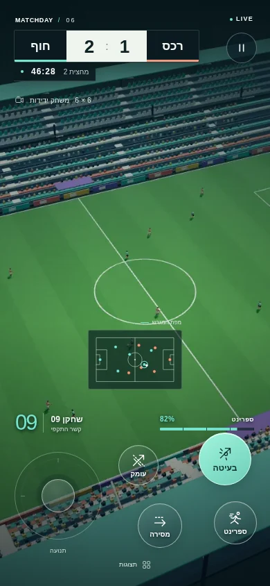
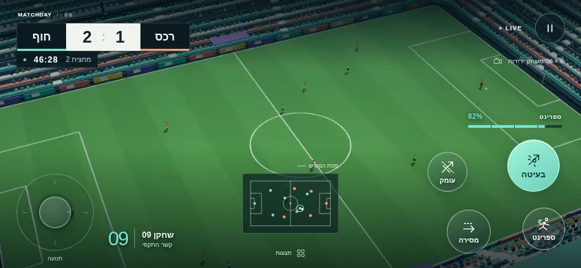

# דוח מסירה · כדורגל HUD v6

נוצרה חבילת ממשק שידור עצמאית: שבעה רכיבי SVG, ספרייט אייקונים, שתי ערכות צבע, דף תצוגה אינטראקטיבי, גלריית רכיבים ועשרה צילומים בגודל מלא. הממשק מציג תוצאה ושעון, החלפה, שער, חזרה מהירה, רדאר, ספרינט ופעולות עגולות. כל השמות והמספרים בתצוגה דמיוניים.

ענף: `codex/soccer-hud-v6-20261104`. בסיס: `26b18cd4331b5ca0ab394b9bc281963aea3914f9`. התווספו קבצים חדשים רק תחת `workout/island/design/soccer-v6/hud/`. קוד קיים, קובצי שחרור, תגי גרסה, קובצי הוראות ובדיקות לא נערכו.

## גדלים

MB מחושב כ־1,000,000 בתים. כל SVG/WebP בחבילה קטן מ־100,000 בתים. קובץ התמונה הגדול הוא 0.083398MB, במידות 1024×1024. חבילת ה־HUD לשילוב: 0.043389MB; טעינת דף התצוגה, כולל רקע ואייקון הדפדפן: 0.134398MB. הגלריה וצילומי המסירה אינם נטענים עם התצוגה.

| נכס | בתים | MB |
| --- | ---: | ---: |
| `action-buttons.svg` | 1,640 | 0.001640 |
| `goal.svg` | 1,347 | 0.001347 |
| `hud-symbols.svg` | 1,697 | 0.001697 |
| `pitch-backdrop.webp` | 83,398 | 0.083398 |
| `quick-replay.svg` | 1,338 | 0.001338 |
| `radar.svg` | 1,386 | 0.001386 |
| `scoreboard.svg` | 1,477 | 0.001477 |
| `sprint-meter.svg` | 689 | 0.000689 |
| `substitution.svg` | 1,766 | 0.001766 |

קבצים גדולים מ־0.020MB:

| קובץ | MB |
| --- | ---: |
| `assets/pitch-backdrop.webp` | 0.083398 |
| `previews/dusk-390x844.webp` | 0.039314 |
| `previews/live-390x844.webp` | 0.039112 |
| `previews/dusk-844x390.webp` | 0.036168 |
| `previews/substitution-844x390.webp` | 0.036096 |
| `previews/live-844x390.webp` | 0.035950 |
| `previews/replay-390x844.webp` | 0.034532 |
| `previews/goal-844x390.webp` | 0.032746 |
| `previews/substitution-390x844.webp` | 0.032662 |
| `previews/goal-390x844.webp` | 0.031278 |
| `previews/replay-844x390.webp` | 0.029832 |
| `hud.js` | 0.021127 |
| `hud.css` | 0.020565 |

המידות, המשקלים והגיבובים המדויקים: [asset-manifest.json](asset-manifest.json).

## משולשים ותקציב דפדפן

| רכיב בזמן ריצה | משולשי WebGL חדשים | draw calls חדשים |
| --- | ---: | ---: |
| HUD מבוסס DOM/SVG | 0 | 0 |
| רקע מגרש כ־WebP | 0 | 0 |
| רדאר: 6 בית + 6 חוץ וכדור | 0 | 0 |

אין בחבילה GLB, שלדים, אטלסים לשחקנים או מודלי LOD. מגבלות 8K/3K ו־Draco אינן נבחנות על מודלים חדשים במשימת HUD זו. רינדור הרקע נעשה מראש באמצעות נכסי soccer-v4 המפורטים, ורשם 432,550 משולשים ו־31 draw calls; הנתונים והמודלים האלה **אינם נטענים בתצוגה**. פירוט: [geometry-budget.json](verification/geometry-budget.json). ריסוט SVG מנוהל בידי הדפדפן ואינו גאומטריית Three.js.

אין ספריות או פונטים חיצוניים, אין build ואין לולאת WebGL. מעברי שער/החלפה קצרים, מד אנרגיה מתעדכן רק כשערכו משתנה, והחזרה המהירה מבטלת RAF בסיומה. אין טענה לתנועת mocap, קהל חי או צילום חוזר של המשחק בחבילה זו: הרקע קבוע וממשק החזרה מיועד לקבל את קטע המשחק מהמנוע.

## איך נבדק

- Chromium 151.0.7922.173, במידות 390×844 ו־844×390 ובקנה מידה 1:1. עשרה צילומים: חי, החלפה, שער, חזרה וערכת צבע נוספת בכל כיוון. פענוח WebP ו־SVG, מידות ומשקלים נבדקו.
- 25 בדיקות אינטראקציה עברו: כל הפעולות, שתי אצבעות לג׳ויסטיק ולספרינט, ביטול מגע, מקלדת, אובדן מיקוד, השהיה, ערכות צבע, סגירת החלפה, שער וחזרה עם דילוג/סיום אוטומטי, תנועה מופחתת, גלריה ו־safe-area מדומה. נבדק גם רוחב 320px.
- אין גלילה בשתי המידות המבוקשות. ברוחב 390px יש 24px בין קצה הג׳ויסטיק לכפתור הפעולה הקרוב; לרוחב המרווח 485px. יעדי הפעולה לפחות 44px. אין שגיאות דף או בקשות לרשת חיצונית. נוסף אימות שמסגרת השער אינה נוגעת בלוח התוצאות.
- האטת מעבד ×4, 150 דגימות לכל כיוון: p95 של 16.7ms לאורך ו־16.8ms לרוחב, ללא דגימה מעל 33.34ms. זו **הדמיית דפדפן שולחני בלבד**; 30fps יציב במכשיר פיזי ובמשחק המלא טרם אומתו.
- `node --check` עבר בשני מודולי JavaScript. נכסי SVG עברו פענוח XML ובדיקה שאין בהם script, foreignObject, מאזינים מוטמעים או קישורים למשאבים חיצוניים.
- `npm test`: 262 מתוך 266 קובצי בדיקה עברו. ארבעה נכשלו בהרשאות הסביבה (`EPERM`): שני `spawnSync` ושתי פתיחות שרת מקומי, בקבצים קיימים שלא נערכו. ריצת אבחון ממוקדת אישרה 16 בדיקות שעברו, ארבע חסימות הרשאה ודילוג אחד. לא שונו בדיקות כדי לעקוף זאת. [פירוט](verification/repository-checks.json).

[דוח דפדפן מפורט](verification/browser-report.json) · [הוראות צפייה, API וכל צילומי הגודל המלא](README.md) · [מקורות ורישוי](LICENSES.md).

