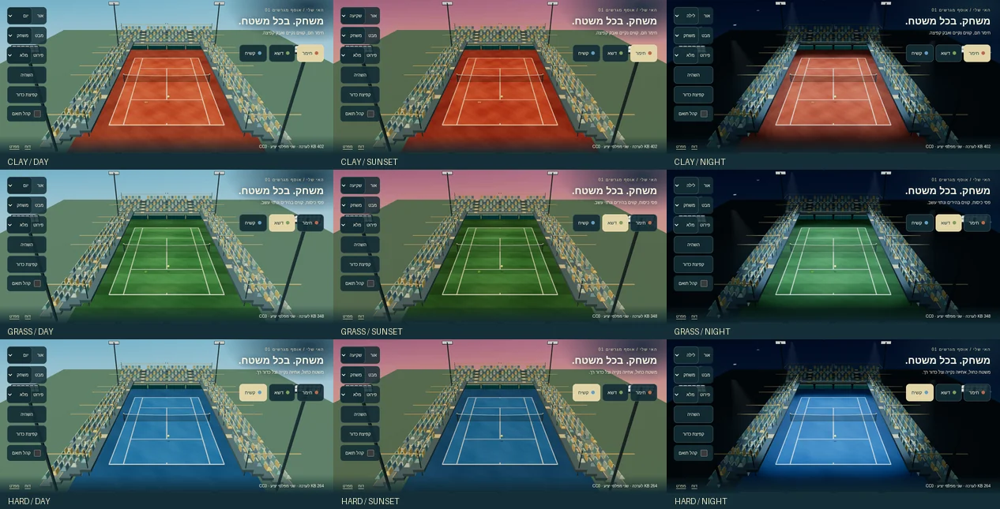

# מגרשי טניס v1

תאריך: 14 בנובמבר 2026. ענף: `codex/tennis-courts-v1`.
בסיס: `main`, קומיט `11fef2fb98eec4173381346caee94f2930f9cffa`.
מוכן כש: שלושה משטחים, כל הנכסים המבוקשים, עד 800,000 בתים לערכה, תצוגת 844×390, רישוי, אימות ודחיפה לענף החדש.

נוצרו **19 תמונות PNG ממשיות**: שלוש ערכות חימר, דשא וקשיח; לכל אחת אריח מחזורי וטקסטורת מגרש מלאה. הנכסים המשותפים כוללים קווים שקופים, רשת שקופה, צל כדור, אבק חימר, נתזי עשב, חזיתות לשני מפלסי יציע, ארבעה שלטים ללא טקסט, שמי יום/שקיעה/לילה, אלומת זרקור ופאנל מנורות. מתאם קטן מדגים אותם בסצנת תלת־ממד עם שני מפלסי יציע ושתי רמות פירוט. אין חיבור למשחק או שינוי בקובץ קיים.



## משקל וייצוא

KB הוא 1,000 בתים; התקרה היא **800,000 בתים לכל ערכה**. כל שורה סופרת מחדש את **כל** התמונות המשותפות, כולל שלושת השמיים ושני האפקטים גם כשהמשטח לא משתמש בהם. העמודה האחרונה מוסיפה את מתאם הריצה ואת שני קובצי המפרט במלואם. אין הסתמכות על קאש כדי לעמוד בתקרה.

<!-- BUDGET START -->
| ערכה | PNG כולל כל המשותפים | עם מתאם ושני אינדקסים | תקרה |
|---|---:|---:|---:|
| חימר | 401,473 | 433,203 | 800,000 |
| דשא | 347,915 | 379,645 | 800,000 |
| קשיח | 263,533 | 295,263 | 800,000 |
<!-- BUDGET END -->

כל 19 התמונות הייחודיות יחד שוקלות 846,285 בתים; זהו אוסף של שלוש ערכות, לא משקל ערכה בודדת. צילומי הביקורת, קוד המקור והתיעוד אינם נכסי משחק. ספריית three הקיימת והקהל האופציונלי אינם מועתקים או נספרים כטקסטורות חדשות.

| נכס | מידות | שימוש |
|---|---|---|
| `{clay,grass,hard}/surface-tile.png` | 256×256 | Repeat בשני הצירים; הקצה הראשון והאחרון זהים בפיקסלים |
| `{clay,grass,hard}/court.png` | 512×1024 | משטח מלא עם קווים אפויים, שוליים ופסי כיסוח בדשא; Clamp |
| `shared/court-lines.png` | 512×1024 | שכבת קווים עצמאית, שקופה; אין להניח שוב מעל `court.png` |
| `shared/net.png` | 1024×128 | רשת פתוחה עם סרט עליון; שקיפות ישרה |
| `shared/ball-shadow.png` | 128×128 | צל רך בעל alpha חלק |
| `shared/{clay-dust,grass-spray}.png` | 768×128 | שישה תאים 128×128, 0.1 שנייה לתא; התא האחרון שקוף |
| `shared/stand-{lower,upper}.png` | 512×128 | חזיתות לשני מפלסי יציע |
| `shared/blank-signs.png` | 512×128 | ארבעה פאנלים 128×128, שוליים שקופים, ללא אותיות וסמלים |
| `shared/sky-{day,sunset,night}.png` | 1024×512 | מחזורי בציר X; לילה עם כוכבים |
| `shared/floodlight-beam.png` | 256×512 | alpha רך, Additive; מופעל בלילה בלבד |
| `shared/floodlight-lamp.png` | 256×128 | פאנל מנורות שקוף |

ה־PNG האטומים משתמשים בפלטת RGB אדפטיבית עד 256 צבעים, ללא dither. ה־PNG השקופים נשמרים כ־RGBA כדי לשמור על הדרגתיות הצל והאבק. זו הפחתת צבעים בעת יצירה ואחריה אחסון PNG ללא אובדן נוסף; אין טענה שקובץ RGB לפני הפחתת צבעים נשמר ללא שינוי. כל הצבעים sRGB, וה־alpha ישר, לא premultiplied. המניפסט מציין לכל קובץ מידות, שימוש, wrap, משקל ו־SHA-256.

## תאימות לקהל ומידות

מבנה החבילה תואם ל־`tennis-crowd-3d-v1`: נכסי ריצה תחת `runtime/`, מחולל תחת `source/`, אינדקס `assets.json` עם `assets[]`, משקל ו־SHA-256, תצוגה, בדיקות, דוח ורישיון. בנוסף קיים `manifest.json` המבוקש, עם ערכות, תפקידים ותקציבים. זו התאמת מבנה; סכמה של מודלי GLB אינה מוצגת כסכמה של טקסטורות.

הצירים הם **מטרים, Y למעלה, Z קדימה**; הראשית במרכז המגרש על הקרקע. `seats` מחזיר בדיוק 600 רשומות יציבות `{id,x,y,z,yaw,row,col,tier}`: עשרה מקטעים, חמש שורות ו־12 מושבים. נשמרו כל הקואורדינטות, `fitZ`, מרווח 0.7 מ׳, עלייה 0.42 מ׳ ונסיגה 0.88 מ׳ מהמתאם המקורי. שני המפלסים הם השורות 0–1 והשורות 2–4, עם חזית וסימון נפרדים. מצב `low` משאיר את שני המפלסים ואת כל מיקומי המושבים ומסיר משענות ומעקות מפורטים.

המגרש המאויר הוא 8.23×18 מ׳ ליחידים, עם תיבות שירות במרחק ±4.5 מ׳ ונתיבי זוגות דקורטיביים ברוחב כולל 10.97 מ׳. זהו קנה המידה של תצוגת הקהל, ולא מגרש ITF באורך מלא. תצורת המשחק הנוכחית משתמשת ברוחב 8.20 מ׳; ההפרש הוא 1.5 ס״מ בכל צד ויש להתאים את המישור לרוחב המשחק בזמן החיבור. התוספת אינה משנה חוקי משחק או collision. תיקון זה לא הוחל על קוד קיים.

רוחב הרשת 11.3 מ׳; גובה הסרט 1.07 מ׳ ליד העמודים ו־0.914 מ׳ במרכז, עם שקיעה גאומטרית ולא רק שינוי בציור. שולי ה־PNG נמצאים על מישור 16×28 מ׳. שומרים על יחס המידות הזה כשמניחים את שכבת הקווים.

## צפייה וחיבור

מגישים את שורש המאגר:

```sh
python3 -m http.server 8765 --bind 127.0.0.1
```

1. פותחים [את התצוגה](http://127.0.0.1:8765/workout/island/design/tennis-courts-v1/preview.html) בחלון 844×390.
2. מחליפים חימר/דשא/קשיח, יום/שקיעה/לילה, מבט משחק/מגרש/יציע ופירוט מלא/קל.
3. לוחצים ״קפיצת כדור״ כדי לראות את האפקט המתאים; במשטח קשיח אין פליטת חימר או עשב. ״השהיה״ עוצרת את הזמן. במצב reduced motion התצוגה מתחילה מושהית.
4. מסמנים ״קהל תואם״ כדי לטעון את 600 האוהדים מהחבילה הקיימת ולבדוק התאמת ישיבה. אפשר לבטל את הסימון כדי לבדוק את המגרש לבדו.

```js
import {createCourt} from './runtime/court.mjs';

const court = await createCourt({T, surface: 'clay', time: 'sunset', lod: 'high'});
scene.add(court.root);
// באירוע קפיצה אמיתי מהמשחק:
court.impact(ball.x, ball.z);
// בכל פריים, גם כשמיקום הכדור משתנה ללא קפיצה:
court.update({seconds: elapsed, ballPosition: [ball.x, ball.y, ball.z], camera});
// seats תואם לממשק חבילת הקהל; הקהל אינו תלות של createCourt.
const fans = await createCrowd({T, GLTFLoader, seats: court.seats, base: crowdPackageURL});
scene.add(fans.root);
// בעת החלפת סצנה:
fans.dispose();
court.dispose();
```

`createCourt` טוען רק את טקסטורת המגרש הנבחרת ואת התמונות המשותפות הדרושות למצב. האריחים ושכבת הקווים נמסרים גם בנפרד למימוש אחר. המעבר בין ערכות נעשה בבניית מתאם חדש וב־dispose לקודם. המתאם משחרר גאומטריה, חומרים וטקסטורות גם לאחר כשל חלקי בטעינה. כולל תאורה משלו: בחיבור לסצנה קיימת יש להתאים את התאורה של הסצנה ולא לצרף שתי מערכות אור חזקות במקביל.

אין צללים דינמיים ממפת shadow: צל הכדור משתמש ב־PNG ומשנה גודל ואטימות לפי הגובה. בלילה יש ארבעה SpotLight ללא shadow maps וארבע אלומות שקופות; בשאר המצבים אין אלומות. שלטי המגרש נשארים ריקים. ההדגמה משתמשת בפאנל הראשון; יתר הפאנלים זמינים באטלס.

## אימות ותוצאות

<!-- VALIDATION START -->
- `verify.py` עבר: 19 PNG נפתחים, מידות וחתימות תואמות, alpha תקין, גבולות האריחים והשמיים זהים, האפקטים דועכים לשקיפות, ותקציב כל ערכה עומד בתקרה. כל התמונות המשותפות נספרו בכל ערכה.
- בנייה חוזרת הפיקה את אותם 19 SHA-256 ואת אותו `manifest.json` ברמת הבייט; התוצאה ב־`verification/rebuild.json`.
- Chromium 151 / Playwright: כל **18 השילובים** של 3 משטחים × 3 מצבי אור × 2 רמות פירוט נבדקו ב־844×390 באמצעות בקרי התצוגה בפועל. בפירוט מלא: 57–67 קריאות ציור ו־17,036–17,056 משולשים. בפירוט קל: 56–66 קריאות ו־9,236–9,256 משולשים. כדור ההדגמה נכלל בספירה; נתוני הקהל האופציונלי מפורטים בנפרד. התוצאות המלאות ב־`verification/browser.json`.
- אומתו שלושת מבטי המצלמה, פעולה במקלדת, קפיצה במצב מושהה, 390×844 ללא גלילה אופקית, ויעדי פעולה בגובה לפחות 44px. reduced motion מתחיל בהשהיה. כשל יזום בטעינת PNG מציג שגיאה קריאה ללא מצב ״מוכן״.
- חבילת הקהל המקורית נטענה עם כל 600 האוהדים; כל 600 הקואורדינטות הושוו לחוזה הפריסה המקורי. צילום התאימות נמצא ב־`verification/crowd-compatible.webp`.
- לאחר 12 החלפות משטח נוספות, מספרי הגאומטריות והטקסטורות ב־GPU נשארו יציבים. אפס שגיאות console/JavaScript, אפס תגובות HTTP שנכשלו בתצוגה התקינה ואפס בקשות לשירות חיצוני.
- שני מודולי JavaScript עברו `node --check`; בדיקת היקף מאשרת אפס קבצים קיימים ששונו. נבדקו חזותית גיליון תשעת המצבים, קשיח בלילה, תצוגת גובה והקהל במבט צד.
- `npm test` הסתיים בהצלחה: **4,136 עברו, 64 דולגו, אפס נכשלו**, מתוך 4,200 בדיקות מדווחות, ב־268 שניות. Playwright לא מצא את קובץ Chromium הצפוי בהפעלה הראשונה; ההרצה הראשונית הופסקה אחרי כשל ההפעלה. לאחר הפניית `PLAYWRIGHT_BROWSERS_PATH` בתיקייה זמנית אל `/usr/bin/chromium` שכבר מותקן, הסוויטה כולה הורצה מחדש ועברה. לא שונה קובץ בדיקה. פירוט ב־`verification/repository.json`.
<!-- VALIDATION END -->

בדיקת הקהל היא בדיקת תאימות חזותית וחוזה קואורדינטות. הקהל המלא לבדו מוסיף 126,000 משולשים ו־12 קריאות ציור לפי החבילה המקורית; מצב זה אינו עומד בתקציב המשחק הישן של 90,000 משולשים לכל הסצנה. יש לבחור LOD מהחבילה הקיימת כשמחברים. אין כאן טענת FPS בטלפון פיזי, מדידת GPU חומרתי או הרצת משחק מלאה.

בדיקות לשחזור, עם שרת מקומי פעיל עבור בדיקת הדפדפן:

```sh
python3 workout/island/design/tennis-courts-v1/source/build.py
python3 workout/island/design/tennis-courts-v1/verify.py
python3 workout/island/design/tennis-courts-v1/browser-check.py
```

אין שינויים ב־`ops/CONTROL.md`, ב־CLAUDE, בלוגיקת המשחק, בנכסי הריצה הקיימים, בבדיקות קיימות או בתגי גרסה. רישום הסשן וקריטריון הסיום נמצאים בדוח זה, בהתאם לבקשת המשתמש לשנות רק את התיקייה החדשה. המקורות והרישיונות מפורטים ב־[LICENSES.md](LICENSES.md).
