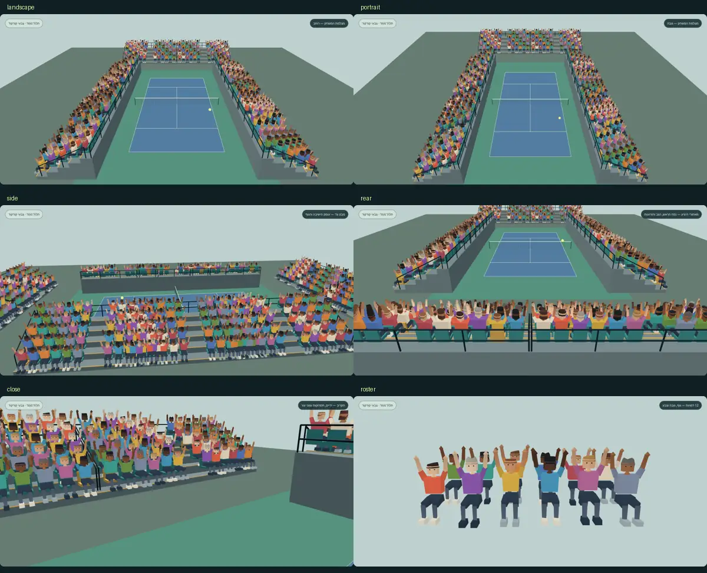

# קהל טניס תלת־ממדי v1

תאריך: 12 בנובמבר 2026. ענף: `codex/tennis-crowd-3d-v1`.
בסיס: `main`, קומיט `51f4faab518c695672efaf6323a8b72f239a2b84`.

החבילה מחליפה את מראה האוהד השטוח בגוף תלת־ממדי יושב: 12 GLB עצמאיים, 210 משולשים כל אחד, morph להרמת שתי הידיים, שונות במבנה הגוף, בגובה, בתסרוקות ובצבעים. היא כוללת מתאם שמדגים 600 מופעים ב־12 InstancedMesh, מעקב ראש אחר הכדור וקפיצה בחגיגה. כל הקבצים החדשים נמצאים בתיקייה זו בלבד; אין חיבור או שינוי בקוד המשחק.

## תצוגה ובדיקה

מגישים את שורש המאגר, ואז פותחים את `workout/island/design/tennis-crowd-3d-v1/preview.html`.

```sh
python3 -m http.server 8765
```

1. פותחים [את התצוגה המקומית](http://127.0.0.1:8765/workout/island/design/tennis-crowd-3d-v1/preview.html).
2. מחליפים בין מצלמות המשחק, צד, מאחור ותקריב. מבט ״12 דמויות״ הוא קטלוג נפרד של 12 מופעים בלבד; בכל מבטי היציע יש 600. המונים מתארים את תקציב היציע המלא.
3. לוחצים ״חגיגה״ או משאירים חגיגה מחזורית. הראש עוקב אחר הכדור גם במנוחה; הזרועות משתנות ברציפות, והגוף קופץ עד 7.5 ס״מ במערכת המודל.
4. מפעילים ״השוואה: האטלס הקיים״ כדי לראות את אותו היציע עם מישורים. כפתור המדידה מריץ שתי דגימות מכל מצב ומציג את הנתונים הגולמיים.



## תקציב

| פריט | מדידה |
|---|---:|
| וריאציות GLB | 12 |
| משולשים לכל דמות, גם בחגיגה | 210 |
| מופעים בכל מבט יציע | 600; 50 מכל וריאציה |
| סך משולשי הקהל | 126,000 מתוך 132,000 |
| קריאות ציור לקהל | 12 |
| נפח כל 12 ה־GLB, בתים גולמיים | 211,228 / 211.228 KB |
| טקסטורות במודלים | 0 |
| חומרים / primitives לכל GLB | 1 / 1 |
| דחיסת Draco או meshopt | אין |
| WebAssembly, דקודרים או בקשות CDN | אין |
| תקציב כל התיקייה, כולל מקור, דוח ותמונה | עד 400,000 בתים; מאומת ב־`verify.py` |

KB בדוח הוא 1,000 בתים. הספירה כוללת את כל הגופים והפנים שלהם, גם אלו המוסתרים ביציע; אין הקלה במספר המופעים או בספירת המשולשים בזמן המדידה. קטלוג 12 הדמויות מוסתר בכל מבטי היציע. היציעים והכיסאות הקיימים אינם חלק מ־126,000 משולשי הקהל; ספירת הסצנה המלאה נמדדת בנפרד.

זהו תקציב הקהל שהתבקש. `render.maxTriangles` של הטניס בבסיס הנוכחי הוא 90,000 לכל הסצנה, ולכן שילוב עתידי של כל 600 האוהדים דורש החלטה מפורשת על תקציב המשחק או LOD. החבילה אינה משנה את התקציב הקיים או את בקר האיכות. לדוגמה, העברת רשימת 300 מושבים למתאם מורידה את הקהל ל־63,000 משולשים; מצב זה אינו משמש בהדגמת ה־600 או במדידות המדווחות.

## מבנה ויצירה

הגוף כולל ירכיים אופקיות, שוקיים יורדות, נעליים, אגן, גוף עליון, צוואר, ראש בעל עומק, כיסוי שיער, אף ועיניים גאומטריים. 12 פלטות חולצה/עור/שיער שונות; ארבע תצורות גובה גוף עליון, רוחבי גוף שונים וארבע תצורות כתר/שיער, כולל צדדים ארוכים יותר. המופעים מקבלים שונות מתונה נוספת בקנה המידה. בחירת הווריאציה מעורבבת בכל שורה, כך שאין עמודות חוזרות של אותו צבע.

צבעי הקודקוד הם RGBA8 מנורמלים במרחב ליניארי. המחולל ממיר את פלטת sRGB, אופה אור כיווני רך והכהיה מתחת לזרועות ולאגן. `KHR_materials_unlit` שומר את המראה ללא טקסטורה, תאורה בזמן ריצה או נורמלים. מעטפת, שיער ומפרקים הם נפח סגור; אין לוחות עם תמונת אדם.

כל GLB נמצא ישירות ב־`runtime/` ואינו דחוס. לכן אין צורך בעותקי fallback נוספים: אלה קובצי הריצה עצמם, בלי Draco, meshopt, קובצי buffers חיצוניים, textures או WASM. המחולל משתמש בספרייה התקנית של Python בלבד וניתן לשחזרו:

```sh
python3 workout/island/design/tennis-crowd-3d-v1/source/build.py
```

## חיבור עתידי, ללא שינוי קבצים קיימים בחבילה זו

המתאם `runtime/crowd.mjs` מייצא `createCrowd({T, GLTFLoader, seats, base})`. `seats` הוא מערך של 1–600 רשומות `{id,x,y,z,yaw}` עם מספרי `id` יציבים וערכים סופיים. הצירים במודל: Y למעלה, Z קדימה; מטרים; כפות הרגליים בגובה 0, מושב האגן בגובה 0.50. כיוון האוהד הוא לכיוון המגרש, ללא סיבוב הגוף אל המצלמה.

```js
const fans = await createCrowd({T, GLTFLoader, seats, base: packageURL});
scene.add(fans.root);
fans.update({
  seconds: elapsed,
  celebration: cheerAmount, // 0–1, ברציפות
  ballPosition: [ball.x, ball.y, ball.z]
});
// בסיום הסצנה:
fans.dispose();
```

`packageURL` מצביע לשורש חבילה זו, לא לתיקיית runtime. מערכת הקואורדינטות של המושבים והכדור זהה למערכת המקומית של `fans.root`; שומרים את root ללא טרנספורמציה או ממירים את מיקום הכדור אליה. מטריצות המופעים מועלות פעם אחת בלבד. בכל פריים משתנים שלושה uniforms משותפים; אין בניית גאומטריה, skinning, AnimationMixer או העלאת 600 מטריצות.

לכל GLB יש morph יחסי בשם `arms-up` וקליפ תקני `celebrate`: משקל 0 בשנייה 0, משקל 1 בשנייה 1, וחזרה ל־0 בשנייה 2. צופה glTF רגיל יכול להפעיל אותו באמצעות AnimationMixer, או להציב `morphTargetInfluences[0]` ישירות. ב־three r160 משקלי morph רגילים משותפים לכל InstancedMesh; המתאם קורא את אותו delta למאפיין `cheerDelta`, ומיישם מעבר עם פאזה לכל מופע ב־vertex shader. לא נדרשת תמיכה חדשה של three ב־setMorphAt.

אין שלד: מפת הראש היא attribute תקני מותאם אישית `_HEAD` (SCALAR float, 0 לגוף / 1 לראש, לשיער, לאף ולעיניים). GLTFLoader חושף אותו בשם `_head`. נקודת הסיבוב נמצאת ב־`node.extras.headPivot`, ונטענת ב־`mesh.userData.headPivot`. מסובבים רק את הקודקודים המסומנים. הזווית מוגבלת ל־±0.87 רדיאן, כ־50°, כדי להימנע מסיבוב צוואר בלתי סביר. המעקב מדגים כיוון, ללא סימולציית צוואר/אינרציה. סימון הראש אינו משתנה ב־morph הזרועות.

## התאמה ליציע ולמצלמות

תיקיית `design/tennis-stadium-v1` אינה קיימת ב־main הבסיסי. נכסי הריצה קיימים ב־`assets/tennis-stadium-v1`; התצוגה מפנה ל־stand-10m.glb הקיים ואינה מעתיקה אותו. היא משתמשת בפריסת `tennis-v12-stadium.mjs`: עשרה יציעים, 5 שורות × 12 מושבים, ריווח 0.7 מ׳, עלייה 0.42 מ׳ ונסיגה 0.88 מ׳, עם התאמת fitZ למגרש שאורכו 18 מ׳. נשמרים מיקומי היציעים והמרווחים של המתאם הקיים.

| מצלמה | מיקום | יעד | FOV |
|---|---|---|---:|
| משחק רוחב, מהגדרות main | `[0,12.8,25]` | `[0,0.4,-0.7]` | 40.3° |
| משחק גובה, מהגדרות main | `[0,18,25]` | `[0,0.4,-0.7]` | 40.3° |
| צד, בדיקת נפח נוספת | `[24,10,3]` | `[-3,1,0]` | 40.3° |
| מאחורי היציע, בדיקה נוספת | `[0,8,28]` | `[0,1,13.7]` | 40.3° |
| תקריב | `[2.7,3,7.5]` | `[-1,1.4,12.8]` | 40.3° |

נכסי המגרש והשחקנים המלאים אינם נדרשים לתצוגת נכסים זו; המגרש כאן גאומטרי ופשוט. השוואת האטלס משתמשת באטלס הקיים, במידות המישור `.88×1.76`, בתאים, בהצללה, בתנועת החגיגה ובנטייה חלקית לכיוון מצלמת המשחק. היא משחזרת את שכבת הקהל הקיימת באותה סצנה, ואינה הרצת המשחק המלא.

## מדידת תוכנה לפני / אחרי

| מצב | FPS: מדידה 1 / 2 | FPS משוקלל | חציון פריים 1 / 2 (ms) | p95 פריים 1 / 2 (ms) | משולשי סצנה | קריאות סצנה |
|---|---:|---:|---:|---:|---:|---:|
| לפני: האטלס הקיים | 5.18 / 5.30 | 5.24 | 194.4 / 192.3 | 367.9 / 355.9 | 22,340 | 62 |
| אחרי: קהל תלת־ממדי | 3.22 / 3.26 | 3.24 | 301.7 / 301.1 | 637.7 / 588.4 | 147,140 | 73 |

במדידה הזו FPS ירד בכ־38.3% לעומת האטלס. תוספת הנפח עולה בעיבוד 124,800 משולשים וב־11 קריאות ציור; זו אינה הבטחה לשיפור ביצועים. החציונים של זמן submit היו 0.7 / 0.4 ms לאטלס ו־0.8 / 0.6 ms לתלת־ממד. קריאות הציור של הסצנה כוללות גם רשת מגרש פשוטה שנבנתה לצורך התצוגה, ואינן מספר הקריאות במשחק המלא.

הבדיקה רצה ב־Chromium 151 עם ANGLE / SwiftShader (Vulkan), ללא GPU חומרתי, DPR=1, מצלמת המשחק לרוחב וקנבס בגודל 1370×660. נשארת אותה גאומטריית יציע/מגרש בשני המצבים. סדר המדידה: אטלס → תלת־ממד → תלת־ממד → אטלס; לכל סבב 30 פריימים לחימום ו־120 למדידה, כשהחגיגה פעילה בערך 0.75. המודלים והאטלס כבר נטענו, כך שזו מדידת ציור ולא מדידת רשת.

FPS מחושב מממוצע הפרשי requestAnimationFrame, לא מההופכי של זמן שליחת פקודות. מדידת submit היא זמן CPU של update+render, ואינה זמן GPU. רצפת ה־vsync והעומס המשותף של סביבת הענן עשויים להשפיע. הנתונים הגולמיים, גרסת הדפדפן, שם המעבד הגרפי, p95 ומספרי הציור נמצאים ב־`verification.json`. אין להסיק מכאן ביצועי טלפון או ביצועי משחק מלא.

## אימות

- 12/12 GLB נטענים ב־GLTFLoader תחת CSP ללא `wasm-unsafe-eval`, ללא דקודרים או בקשות חיצוניות. נבדק בפועל ש־`WebAssembly.compile` חסום.
- 12/12 קבצים עברו Khronos glTF Validator: אפס שגיאות ואפס אזהרות. הנתונים ב־verification.json.
- לכל מודל נבדקו mesh יחיד, 210 משולשים, צבעים מנורמלים, מפת ראש, קואורדינטות סופיות ואנימציית morph תקנית במשקלים 0, 0.5 ו־1.
- כל ששת מבטי התצוגה נרנדרים בידיים למטה ולמעלה; נבדקו בקרי המצלמה, השוואת האטלס, כפתור החגיגה ותצוגת 390×844. בדיקת הפריסה הצרה אינה בדיקת מכשיר פיזי.
- `verify.py` פותח כל קובץ בחבילה, בודק hash ונפח כל GLB, מבנה GLB, רישיון לכל קובץ, תקציב משולשים ותקציב כל התיקייה.
- לא שונו בדיקות קיימות. קובצי הבדיקה החדשים הם חלק מחבילת הסקירה בלבד.

```sh
python3 workout/island/design/tennis-crowd-3d-v1/verify.py
python3 workout/island/design/tennis-crowd-3d-v1/browser-check.py
```

בדיקת הדפדפן דורשת שרת מקומי פעיל ו־Playwright, Pillow ו־Chromium בסביבת הכלים. צילום התצוגה והמדידה ניתנים לשחזור מחדש; אינם רפרנס חיצוני. להוסיף ל־`verify.py` ארגומנט `http://127.0.0.1:8765` כדי לטעון גם את כל הקבצים דרך HTTP ולהשוות כל בייט לעותק המקומי. בבדיקה הסופית נטענו כך כל 25 הקבצים, לרבות הדוח, הרישיונות והצילום שנוצרו אחרי בדיקת המודלים.

בדיקות המאגר הכלליות אינן חלק מאימות זה: העותק צומצם ב־sparse checkout, ו־`npm test` גילה 0 בדיקות. לכן אין כאן טענה שהסוויטה הכללית עברה. בדיקות מבנה החבילה, 12 טעינות GLTFLoader ובדיקות הדפדפן המפורטות לעיל כן הורצו בפועל.

## טבלת קבצים

<!-- FILES START -->
| קובץ | בתים | משולשים |
|---|---:|---:|
| `LICENSES.md` | 5,249 | — |
| `REPORT.md` | 15,011 | — |
| `assets.json` | 4,506 | — |
| `browser-check.py` | 6,547 | — |
| `load-check.mjs` | 2,625 | — |
| `preview.css` | 2,485 | — |
| `preview.html` | 2,666 | — |
| `preview.mjs` | 13,355 | — |
| `preview.webp` | 84,104 | — |
| `runtime/crowd.mjs` | 4,433 | — |
| `runtime/fan-01.glb` | 17,604 | 210 |
| `runtime/fan-02.glb` | 17,592 | 210 |
| `runtime/fan-03.glb` | 17,596 | 210 |
| `runtime/fan-04.glb` | 17,620 | 210 |
| `runtime/fan-05.glb` | 17,604 | 210 |
| `runtime/fan-06.glb` | 17,592 | 210 |
| `runtime/fan-07.glb` | 17,592 | 210 |
| `runtime/fan-08.glb` | 17,620 | 210 |
| `runtime/fan-09.glb` | 17,604 | 210 |
| `runtime/fan-10.glb` | 17,592 | 210 |
| `runtime/fan-11.glb` | 17,596 | 210 |
| `runtime/fan-12.glb` | 17,616 | 210 |
| `source/build.py` | 10,683 | — |
| `verification.json` | 12,018 | — |
| `verify.py` | 3,229 | — |

**סך כל 25 קובצי החבילה: 378,139 בתים**; מתחת ל־400,000, כולל התמונה, קוד המקור, הבדיקות והתיעוד.
<!-- FILES END -->

מקור ורישיון מפורטים לכל קובץ ב־[LICENSES.md](LICENSES.md). התלויות הקיימות אינן מועתקות לחבילה או נספרות בתקציב ההורדה של המודלים. שום קוד קיים, release, תג גרסה, CLAUDE.md, ops או בדיקה קיימת לא נערכו.
