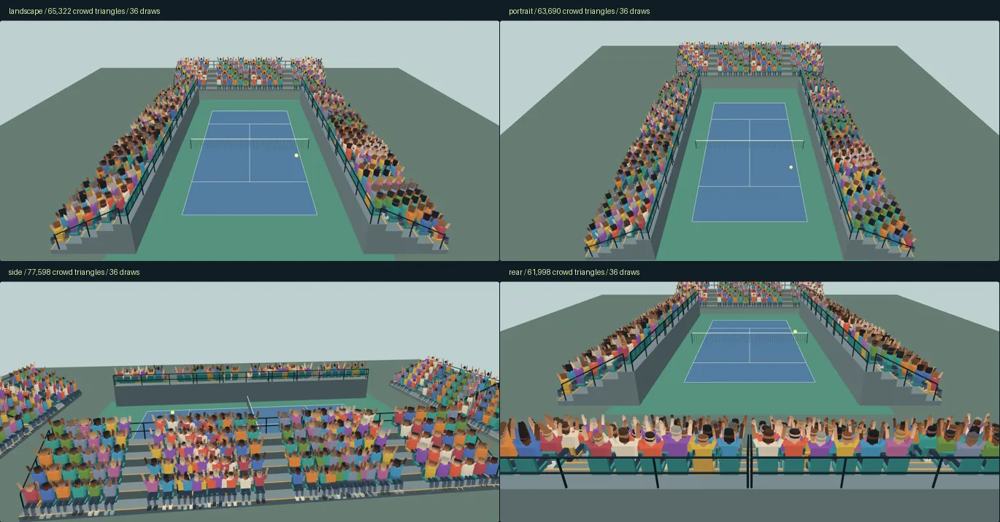
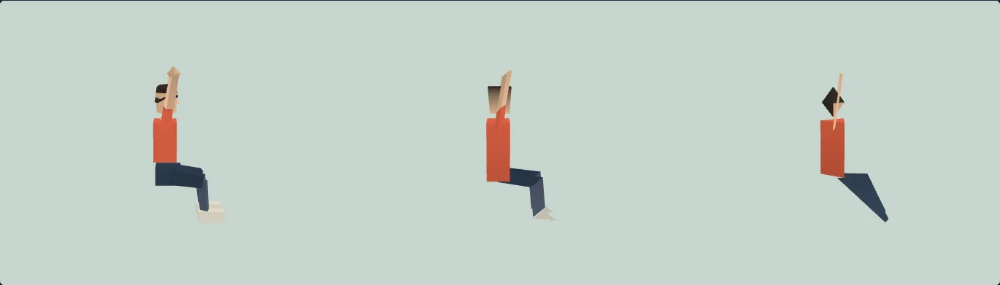

# קהל טניס — LOD v1

12 בנובמבר 2026. ענף `codex/tennis-crowd-lod-v1`, מתוך `codex/tennis-crowd-3d-v1`, קומיט `950f6650bc2dd4b2216c66228ceceb7476949b9b` של PR #409.

36 קובצי GLB: שלוש רמות לכל 12 הווריאציות. 600 האוהדים נשמרים, 50 מכל וריאציה, והספירה כוללת את מלוא הגאומטריה של שתי הרמות בזמן מעבר. במצלמות הקבועות הקהל יורד מ־126,000 ל־61,998–77,598 משולשים. כל התוספות נמצאות תחת `lod/`; החבילה אינה מחברת את הנכסים למשחק.

## תצוגה

מגישים את שורש המאגר:

```sh
python3 -m http.server 8765
```

1. פותחים את [preview.html](http://127.0.0.1:8765/workout/island/design/tennis-crowd-3d-v1/lod/preview.html).
2. במצב ״אחרי״ עוברים בין מצלמות המשחק, צד ומאחור. כל מבט מכיל את אותם 600 מושבים; המונים כוללים גם חפיפה. מחוון תנועת המצלמה עובר ברציפות למבט נוסף.
3. בוחרים אחת מ־12 הווריאציות בגלריה. LOD0, LOD1 ו־LOD2 מוצגים יחד באותו קנה מידה. מסובבים 0–360° ומרימים ידיים כדי לבדוק גם צד וגב.
4. מחליפים ל״לפני״ כדי לראות את LOD0 המקורי בכל המושבים. כפתור המדידה מריץ ABBA במצלמה שנבחרה ומוסיף תוצאה מקומית לטבלה; התוצאות המצורפות נשארות מסומנות בנפרד. ניתן להוריד את הנתונים החדשים כ־JSON.

התוצאה הרצויה: 600 אוהדים בכל מבט, עד 80,000 משולשי קהל במצב LOD, שלוש רמות לכל וריאציה וטבלת משולשים / קריאות / FPS.



## המודלים

| רמה | משולשים לווריאציה | כל 12 המודלים, בתים | מבנה |
|---|---:|---:|---|
| LOD0 | 210 / עד 220 | 211,228 | עותקים זהים בבייטים ל־#409 |
| LOD1 | 90 / עד 90 | 106,372 | גוף, ראש, צוואר וגפיים בעלי נפח; חיבורי מרפק/ברך משותפים; ללא גאומטריית עיניים נפרדת; שלוש פאות נעל ללא סוליה תחתונה |
| LOD2 | 24 / עד 24 | 47,988 | ספרייט תלת־ממדי מעוצב: גוף טריז וראש אוקטהדרלי בעלי נפח, גפיים דו־צדדיות ללא טקסטורה |
| הכול | 36 GLB | 365,588 | ללא דחיסה, Draco, meshopt, דקודר, WASM או buffers חיצוניים |

LOD1 ו־LOD2 יורשים את פלטת החולצה, העור והשיער, רוחב הגוף, גובה הגוף וארבע משפחות גובה השיער. העיניים והפרטים הקטנים מופשטים ברמות הרחוקות. LOD2 מיועד למרחק: הוא אינו שווה חזותית ל־LOD0 בתקריב, והגפיים הדו־צדדיות שלו דקות יותר בזווית צד חדה. כך נשמרת צללית אנושית במסגרת 24 משולשים.

לכל קובץ primitive וחומר יחידים, צבעי RGBA8 ליניאריים ו־`KHR_materials_unlit`. לכל הרמות morph יחסי `arms-up`, קליפ glTF תקני `celebrate`, מפת ראש `_HEAD` ואותו `headPivot` של הווריאציה המקורית. שלוש הרמות משתמשות באותה פאזה, סקאלה, זווית ראש וקפיצה לכל מושב, כך שמעבר אינו מאפס אנימציה. LOD2 מוגדר `doubleSided` בתוך ה־GLB; בגאומטריה שלו יש בדיוק 24 משולשים והציור האטום נעשה במעבר יחיד.

כל קובץ, נפחו ו־SHA-256 שלו מפורטים ב־[assets.json](assets.json). [variants.webp](variants.webp) מציג את כל 12 הווריאציות בשלוש הרמות.



## מרחקים, התפלגות ומעברים

[lod-config.json](lod-config.json) הוא קובץ ההגדרות: 19 מטר למעבר LOD0→LOD1 ו־31 מטר למעבר LOD1→LOD2. המדידה היא מרחק אוקלידי מהמצלמה למיקום המושב, במערכת המקומית של קבוצת הקהל. ה־FOV הוא 40.3°; מצלמות הרוחב והגובה תואמות להגדרות המשחק בענף המקור. צד ומאחור הן מצלמות הביקורת של #409.

| מעבר | התחלה | מרכז | סוף | רוחב החפיפה |
|---|---:|---:|---:|---:|
| 0→1 | 17.1 מ׳ | 19 מ׳ | 20.9 מ׳ | 3.8 מ׳ = 20% |
| 1→2 | 27.9 מ׳ | 31 מ׳ | 34.1 מ׳ | 6.2 מ׳ = 20% |

בכל חפיפה המשקלים עוברים ב־smoothstep. מסכות screen-door משלימות משתמשות באותה דגימת רעש ובאותו זרע לכל מושב: כל רמה מקבלת תחום שונה באותו מספר רעש. החומרים אטומים וכותבים עומק; אין alpha blending או מיון שקיפויות. בתחילת/סוף החפיפה המשקל הוא בדיוק 0/1, ורמה שמשקלה 0 אינה נשלחת לציור. נשמרת חפיפה מרבית של שתי רמות למושב.

התפלגות ״פעילים״ סופרת את שתי הרמות של אוהד במעבר, ולכן יכולה להסתכם ביותר מ־600. עמודת ״דומיננטיים״ בוחרת את הרמה שמשקלה הגדול ביותר וסכומה תמיד 600. התקציב מחושב מעמודת הפעילים, ללא הפחתה לפי המשקל או לפי הסתרה ביציע.

<!-- DISTRIBUTION START -->
| מצלמה | דומיננטיים 0 / 1 / 2 | פעילים 0 / 1 / 2 | בחפיפה | משולשי קהל | מקדם מרחק |
|---|---:|---:|---:|---:|---:|
| משחק · רוחב | 125 / 205 / 270 | 149 / 296 / 308 | 153 | 65,322 | 1.000000 |
| משחק · גובה | 62 / 235 / 303 | 112 / 345 / 380 | 237 | 63,690 | 1.000000 |
| צד | 80 / 202 / 318 | 150 / 413 / 372 | 335 | 77,598 | 1.000000 |
| מאחור | 122 / 186 / 292 | 146 / 261 / 327 | 134 | 61,998 | 1.000000 |
| תקריב | 105 / 285 / 210 | 146 / 343 / 258 | 147 | 67,722 | 0.524366 |
<!-- DISTRIBUTION END -->

### שמירת תקציב בתנועת מצלמה

שינויי מרחק של מצלמה קרובה יכולים לגרום לרבים לעבור יחד ל־LOD0. המתאם מחשב מקדם מרחק משותף ורציף שמקטין את שני הספים ואת רוחבי החפיפה יחד, בלי להסיר אנשים או וריאציות. בהרחבת הספים, כל מושב מקבל עתודה מונוטונית של 24 → 114 → 300 משולשים: LOD2, שני שכנים רחוקים, שני שכנים קרובים. העתודה נשארת גם אחרי יציאה מחפיפה, ולכן היא תמיד לפחות העלות הנשלחת בפועל. בחירת סף באמצעות סדר מרחקי המושבים שומרת עתודה של עד 80,000 ומונעת מדרגות של מקדם האיכות.

במצלמות המשחק, הצד והגב המקדם הוא 1. בתקריב הביקורת הוא כ־0.524: ספים של כ־9.96 ו־16.26 מטר, עם אותה חפיפה של 20%. הנתונים המלאים, כולל העתודה, נמצאים בהגדרות וב־[distribution.json](distribution.json).

ב־[policy-verification.json](policy-verification.json) מתועדים שלושה מסלולים של 301 דגימות כל אחד ועוד 300 מיקומי מצלמה שנוצרו בזרע קבוע. בכל דגימה נותרו 600 אוהדים והתקציב נשמר. משקלי המעבר רציפים בגבולות הספים. אין בכך הבטחה ששינוי טופולוגיה לעולם לא ייתפס בעין: screen-door עלול להיראות כגרעיניות בזמן מעבר, וטלפורט של מצלמה יכול לשנות איכות מיד. בתנועה רגילה אין החלפה קשיחה לפי סף; המחוון בתצוגה מאפשר לבחון זאת.

## לפני / אחרי — מדידה בפועל

״לפני״ כאן הוא הקהל התלת־ממדי המקורי של #409, 126,000 משולשים ו־12 קריאות. ״אחרי״ הוא המתאם החדש, כולל כל רמות החפיפה. שני המצבים משתמשים בדיוק באותה סצנת יציע ומגרש של #409, באותה פריסת 600 מושבים ובאותה תנועת כדור וחגיגה. אין כיסוי של חלק מהקהל ואין סינון מופעים מוסתרים לצורך הקטנת הספירה.

<!-- MEASUREMENTS START -->
| מצלמה | מצב | משולשי קהל | קריאות קהל | משולשי סצנה | קריאות סצנה | FPS משוקלל | FPS בסבבים 1 / 2 |
|---|---|---:|---:|---:|---:|---:|---:|
| משחק · רוחב | לפני | 126,000 | 12 | 147,140 | 73 | 4.44 | 3.94 / 5.09 |
| משחק · רוחב | אחרי | 65,322 | 36 | 86,462 | 97 | 6.47 | 6.34 / 6.61 |
| משחק · גובה | לפני | 126,000 | 12 | 147,140 | 73 | 5.22 | 5.40 / 5.05 |
| משחק · גובה | אחרי | 63,690 | 36 | 84,830 | 97 | 6.89 | 6.87 / 6.91 |
| צד | לפני | 126,000 | 12 | 147,140 | 73 | 5.14 | 5.12 / 5.16 |
| צד | אחרי | 77,598 | 36 | 98,738 | 97 | 5.79 | 5.74 / 5.83 |
| מאחור | לפני | 126,000 | 12 | 147,140 | 73 | 4.87 | 4.87 / 4.87 |
| מאחור | אחרי | 61,998 | 36 | 83,138 | 97 | 5.69 | 5.62 / 5.77 |

Chromium 151.0.7922.173; ANGLE / SwiftShader (Vulkan), ללא GPU חומרתי; קנבס 1370×660, DPR=1. בכל מצלמה: לפני → אחרי → אחרי → לפני; 30 פריימים לחימום ו־120 הפרשי RAF למדידה בכל סבב, חגיגה 0.75. FPS משוקלל הוא סך הפריימים חלקי סך הזמן בשני הסבבים של אותו מצב. 16 סבבים ו־1,920 הפרשי פריימים בסך הכול. הגרסה, שם המעבד הגרפי, כל הפרשי הפריימים, חציון ו־p95 לכל סבב נשמרים ב־[measurements.json](measurements.json).

| מצלמה | הפחתת משולשי קהל | שינוי FPS |
|---|---:|---:|
| משחק · רוחב | 48.2% | +45.7% |
| משחק · גובה | 49.5% | +32.0% |
| צד | 38.4% | +12.6% |
| מאחור | 50.8% | +16.9% |
<!-- MEASUREMENTS END -->

קריאות הציור של הקהל עולות מ־12 ל־36: עד קריאה אחת לכל זוג וריאציה/רמה. המספרים בטבלה נמדדו גם דרך `renderer.info.render`, ולא רק חושבו מהמודלים. הסצנה מכילה עוד 21,140 משולשים ו־61 קריאות, ובהם היציע ורשת המגרש של תצוגת הביקורת. הקטלוג אינו חלק מסצנת המדידה והרנדרר שלו עומד בזמן המדידה.

**התקציב שנאכף הוא עד 80K לקהל.** סצנת הביקורת כולה היא 86,462 ברוחב, 84,830 בגובה, 98,738 בצד ו־83,138 מאחור. לכן תצוגת הצד חורגת מ־90K אם מפרשים את `render.maxTriangles` הקיים כמגבלה לכל הסצנה. קובץ ההגדרות מציין בנפרד את מגבלת הקהל ואת ערך 90K של המשחק; אין כאן שינוי בבקר האיכות או הבטחה לעמידת המשחק המלא בתקציבו. בחיבור יש לכלול גם שחקנים, מגרש ושאר הנכסים בחשבון התקציב הכולל.

זו מדידת RAF במעבד תוכנה, עם vsync ועומס סביבת הענן. זמן submit המופיע בנתונים הוא זמן CPU של update+render, ולא זמן GPU. המדידה אינה בדיקת טלפון או המשחק המלא. תוצאות #409 ההיסטוריות, 3.24 FPS לקהל תלת־ממדי ו־5.24 לאטלס, נמדדו בהרצה אחרת; אינן קו הבסיס של טבלת ההשוואה החדשה. אין בטבלה זו השוואת FPS חדשה לאטלס.

## חיבור עתידי

`runtime/crowd-lod.mjs` מייצא `createLODCrowd`. זהו מתאם לדוגמה נפרד, ללא עריכה של קוד המשחק:

```js
const fans = await createLODCrowd({T, GLTFLoader, seats, base: lodPackageURL});
scene.add(fans.root);
fans.update({
  seconds: elapsed,
  celebration: cheerAmount,
  ballPosition: [ball.x, ball.y, ball.z],
  cameraPosition: [camera.x, camera.y, camera.z]
});
// בסיום:
fans.dispose();
```

`base` חייב להיות URL של תיקיית `lod/`. `seats` כולל עד 600 רשומות `{id,x,y,z,yaw}`; אפשר לציין גם `variant` בטווח 0–11. ברירת המחדל היא אותו ערבוב וריאציות של #409. מזהים חייבים להיות ייחודיים. צירי המודל: Y למעלה, Z קדימה, מטרים, רצפה 0 ומושב 0.50.

המצלמה, הכדור והמושבים נמסרים במערכת המקומית של `fans.root`. כשה־root מוזז/מסובב/מוגדל, יש להמיר אליו גם את המצלמה והכדור. השארת root בטרנספורמציה זהות, כפי שנעשה בתצוגה, משתמשת ישירות בקואורדינטות הסצנה.

במצלמה קבועה מתעדכנים רק שלושה uniforms משותפים. כשמיקום המצלמה משתנה, המתאם מחשב חלוקה מחדש ומעלה מטריצות ותחומי מסכה של המופעים. אין יצירת גאומטריה בזמן פריים, skinning, פענוח או תלות ב־AnimationMixer לציור הקהל. `fans.metrics` מדווח משולשים שנשלחים בפועל, עתודת תקציב, מספר מופעים בכל רמה, חפיפות ומקדם מרחק. `dispose()` משחרר את כל משאבי המודלים וה־batches.

## אימות ושחזור

- 36/36 GLB עברו Khronos glTF Validator עם אפס שגיאות ואפס אזהרות; התוצאה ב־[gltf-validation.json](gltf-validation.json).
- כל 36 נטענו ב־GLTFLoader; נבדקו ספירות משולשים, מפת הראש, נקודת הציר, morph במשקלים 0, 0.25, 0.5, 0.75 ו־1, והקליפ התקני ב־AnimationMixer.
- 12 קובצי LOD0 הושוו בייט־לבייט לקבצים המקוריים. SHA-256 ונפחים של כל 36 הקבצים הושוו למניפסט.
- 72 מצבי גלריה: 12 וריאציות × צד/קדימה/מאחור × ידיים למטה/למעלה; 10 מצבי יציע מלא; תצוגת 390×844 ללא גלילה אופקית; בקרי מצלמה, וריאציה, ידיים ומצב לפני/אחרי.
- נבדקה חסימה בפועל של קומפילציית WASM תחת ה־CSP. אין בקשות חיצוניות, שגיאות דפדפן או טעינות שנכשלו. העדויות ב־[verification.json](verification.json).
- אין שינוי ב־release.json, בתגי גרסה, ב־ops, בבדיקות או בקובץ קיים כלשהו. כל ה־diff ביחס לענף המקור הוא תוספות תחת `lod/`.
- כל 60 קובצי התוספת נקראו גם ב־HTTP והושוו בייט־לבייט לעותקים המקומיים.
- `npm test`: מתוך 3,762 בדיקות, 3,697 עברו, 64 דולגו ואחת נכשלה מפני שקובץ Chromium headless shell ש־Playwright מחפש אינו מותקן. הבדיקה היא `tests/workout-royiki.test.mjs:91`, ללא תלות ב־LOD. אותו קובץ הורץ שוב עם `ISLAND_PLAYWRIGHT` שמפנה למתאם זמני של `/usr/bin/chromium`: כל 5 הבדיקות עברו, כולל בדיקת הדפדפן. לא שונה קובץ בדיקה, עזר או תצורה במאגר; הרצת `npm test` המקורית נשארת מתועדת ככישלון סביבתי, ולא כסוויטה שעברה במלואה.

```sh
python3 workout/island/design/tennis-crowd-3d-v1/lod/source/build.py
node workout/island/design/tennis-crowd-3d-v1/lod/source/record-policy.mjs
python3 workout/island/design/tennis-crowd-3d-v1/lod/source/measure.py
```

כלי המדידה דורש שרת שורש פעיל ו־Playwright, Pillow ו־Chromium בסביבת הפיתוח. הוא שומר מחדש מדידות וצילומים; תוצאות FPS עשויות להשתנות בין הרצות. המאמת הרשמי מותקן מחוץ למאגר ונקרא כך:

```sh
node workout/island/design/tennis-crowd-3d-v1/lod/source/validate-glb.mjs /tmp/tennis-lod-tools/node_modules/gltf-validator
```

ליצירה ולרישוי מפורטים ראו [LICENSES.md](LICENSES.md). לא הופעלו שירותי יצירת תמונה או מודל חיצוניים.

מאמת המעטפת המקורי `../verify.py` נשאר ללא שינוי. הרצתו נעצרת ב־`missing license: lod/LICENSES.md`: הוא דורש רשימת קבצים מדויקת ברישיון המקורי ומגבלת 400,000 בתים לכל עץ התיקייה של #409, כולל תתי־ספריות; לכן אינו מתאים למעטפת המורחבת שמכילה כעת גם `lod/`. רישיון התוספת נמצא ב־`lod/LICENSES.md`. אימות תוספת ה־LOD נעשה בכלים ובעדויות שבתיקייה זו, בלי לשנות את מאמת המקור או את תקציבו.
