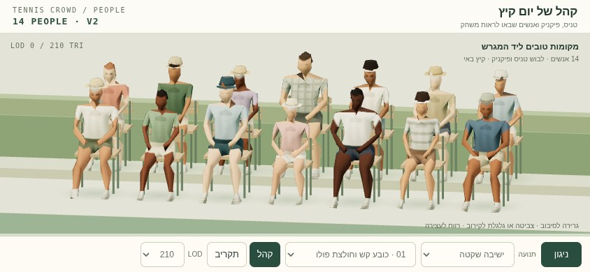

# קהל טניס — אנשים v2

נמסרו 14 דגמי GLB מקוריים נגזרים מבסיס אנטומי של MakeHuman, עם פרופורציות אנושיות, גילי 16–74, גבהים 1.56–1.91 מ׳ וגוני עור מגוונים. לבוש קיץ מאופק: פולו, פשתן, פסים, חולצה משובצת, מכנסיים קצרים, נעלי קיץ, כובעי שמש ומצחיות. שש דמויות כוללות משקפי שמש באטלס.

הענף: `codex/tennis-crowd-people-v2`. בסיס המאגר: `f5f2b40814fc0e2186daed1ac100a8d806dd3a7d`. כל קובצי המסירה חדשים ובתיקייה זו בלבד. קריטריון הסיום: 14 GLB, שלושה LOD מדויקים, חמש לולאות, Khronos נקי, תצוגת 844×390 וחבילה מלאה עד 5,000,000 bytes.

| דרישה | תוצאה שנמדדה |
|---|---|
| דמויות | 14 קובצי GLB שונים; ה־SHA-256 ב־manifest |
| LOD0 / LOD1 / LOD2 | **210 / 90 / 24 משולשים לדמות**, כולל שיער וכובע; 324 משולשים מאוחסנים בסך הכול בכל GLB |
| קליפים | חמש לולאות בכל GLB; כל אחת מניעה את שלושת השלדים |
| שלד | 17 מפרקים לכל LOD; שלוש סצנות ליבה עצמאיות בכל GLB |
| טקסטורה | אטלס אלבדו יחיד 256×256, מוטבע; PBR, ללא מתכת |
| Khronos Validator | **14/14: אפס שגיאות, אפס אזהרות, אפס הודעות מידע** |
| משקל כל ה־GLB | 3,171,392 bytes |
| משקל כל תיקיית המסירה | **4,827,582 bytes / 4.828 MB**, כולל מקור, ספרייה מקומית, דוחות וצילומים |
| תצוגה | Chromium 151.0.7922.173, 844×390; נבדקה גם 390×844 |

## עיון בתוצאה



1. משורש המאגר מריצים שרת מקומי לתיקייה זו:

   ```sh
   python3 -m http.server 8765 --directory workout/island/design/tennis-crowd-people-v2
   ```

2. פותחים [preview.html המקומי](http://127.0.0.1:8765/preview.html), בחלון 844×390. התוצאה הצפויה היא 14 אנשים יושבים לצד המגרש, ללא הורדות מ־CDN.
3. בוחרים דמות לתקריב, תנועה ורמת LOD. גרירה מסובבת, גלגלת או צביטה מקרבת; רווח או כפתור ההשהיה עוצרים את התנועה. `prefers-reduced-motion` פותח את הדף במצב מושהה.

קובצי ה־GLB נטענים בפועל מן המסירה; אין דמויות חלופיות המציירות את התוצאה בתצוגה. כל ספריות הצפייה מקומיות. פתיחה דרך HTTP מקומי נתמכת ונבדקה; `file://` עשוי להיחסם בשל טעינת GLB ו־JSON.

## דגמים

| קובץ ב־models | גיל עיצובי | גובה במ׳ | לבוש | bytes |
|---|---:|---:|---|---:|
| fan-01 | 67 | 1.77 | כובע קש וחולצת פולו | 227,388 |
| fan-02 | 32 | 1.68 | חולצת פשתן מרווה | 225,252 |
| fan-03 | 24 | 1.86 | מצחייה כחולה | 225,348 |
| fan-04 | 74 | 1.56 | כובע שמש וסריג קיץ | 227,908 |
| fan-05 | 41 | 1.81 | חולצת טניס לבנה | 221,940 |
| fan-06 | 19 | 1.72 | חולצת פסים קיצית | 228,344 |
| fan-07 | 57 | 1.73 | כובע דייג ופולו כחול | 226,064 |
| fan-08 | 44 | 1.64 | חולצת קורל ופשתן | 228,180 |
| fan-09 | 16 | 1.70 | חולצה ירוקה ומצחייה | 227,140 |
| fan-10 | 61 | 1.60 | כובע רחב וחולצת לבנדר | 225,256 |
| fan-11 | 36 | 1.91 | חולצת פיקניק משובצת | 228,220 |
| fan-12 | 27 | 1.75 | מצחיית טניס ושמנת | 226,484 |
| fan-13 | 70 | 1.69 | כובע טבעי ופולו חול | 226,560 |
| fan-14 | 52 | 1.66 | כובע דייג וטי שירט תכלת | 227,308 |

הגיל, הגובה והגוונים מתארים דמויות בדיוניות. שונות בגובה, ברוחב הכתפיים והאגן, במבנה הגוף, בשיער וביציבה נשמרת בגאומטריה; העיניים, קמטי הגיל, גווני העור, משקפי השמש ופרטי הבד נמצאים באטלס.

## תנועות

| שם קליפ | משך | התנהגות |
|---|---:|---|
| `seated_idle` | 4.0 שנ׳ | ישיבה, כפות ידיים בחיק, נשימה קטנה ותנועת ראש עדינה |
| `polite_applause` | 3.2 שנ׳ | שתי מחיאות כפיים מאופקות מול החזה; אצבעות כלפי מעלה |
| `cheer` | 4.0 שנ׳ | הרמת הידיים בהתלהבות וחזרה רגועה לחיק |
| `track_ball` | 5.0 שנ׳ | סיבוב צוואר וראש לשני הצדדים, כמעקב אחרי חילופי כדור |
| `stand_up` | 6.0 שנ׳ | ישיבה, רכינה, קימה, שהייה בעמידה וחזרה לישיבה לסגירת הלולאה |

כל הקליפים נדגמו בכ־12Hz עם interpolation לינארי של מיקומים ו־SLERP לסיבובים בזמן ניגון. ערכי תחילת הלולאה וסופה זהים. כפות הרגליים נשארות נטועות באמצעות IK שנאפה ל־keyframes; אין צורך בפותר IK בזמן המשחק. שינוי הגובה והמיקום המקומי של האגן בעת קימה הוא חלק מן הקליפ. אין תנועה של הדמות לאורך המגרש.

## חוזה שילוב

יחידות במטרים, `+Y` למעלה, `+Z` כיוון הפנים. שלוש הסצנות הן `gltf.scenes[0..2]`, עם 210/90/24 משולשים בהתאמה. סצנת ברירת המחדל היא LOD0. לכל סצנה שלד עצמאי, עם שמות `L0_Hips`, `L1_Hips`, `L2_Hips` וכן הלאה. קליפ אחד כולל ערוצים לשלוש הסצנות ומשתף ביניהן את נתוני המפתח הבינאריים.

דוגמת טעינה ב־Three.js, לאחר טעינת GLTFLoader:

```js
const gltf = await loader.loadAsync('models/fan-01.glb');
const person = new THREE.Group();
person.add(...gltf.scenes);
function setLOD(level) {
  gltf.scenes.forEach((scene, i) => { scene.visible = i === level; });
}
setLOD(0);
const mixer = new THREE.AnimationMixer(person);
mixer.clipAction(gltf.animations.find(c => c.name === 'seated_idle'))
  .setLoop(THREE.LoopRepeat, Infinity).play();
scene.add(person);
// בזמן הריצה: mixer.update(deltaSeconds);
```

יש לבחור LOD אחד להצגה. מרחקי התחלה מומלצים: LOD0 עד 12 מ׳, LOD1 מ־12 מ׳ ו־LOD2 מ־28 מ׳; יש לכייל לפי גודל הדמות בפיקסלים. LOD2 הוא צללית עם ראש בנפח וגפיים מונפשות, ומתאים לדמויות זעירות בריחוק. אין שימוש בהרחבת LOD ייחודית למנוע, ב־Draco או ב־Meshopt.

`seatHeightMeters` ו־`seatCenter` בכל רשומת manifest מציינים מקום ישיבה המתאים לגובה הדמות. הכיסא, הקרקע, התאורה וצל המגע שייכים לתצוגה המקדימה; תקציב המשולשים של הדמות כולל רק את גופה ואת לבושה ואביזריה.

## אימות

- [verification/assets.json](verification/assets.json): ספירה מפענוח ה־GLB הסופי, חתימות, משקלים, טקסטורה, סצנות, עצמות, נורמלים, משקלי skin, שטחי משולשים, סגירת כל 70 הלולאות, מחיאת כפיים, סיבוב ראש וקימה. כל דוחות Khronos המלאים נמצאים לצדו.
- סטיית מרכז מפרק כף רגל מרבית בין דגימות קליפ: 0.000000191 מ׳. זו בדיקת מפרקים; אינה טענה לבדיקת התנגשות מלאה של אצבעות ונעליים.
- [verification/browser.json](verification/browser.json): **840 דגימות פוזה**, 14 דמויות × 3 רמות × 5 קליפים × 4 זמנים. נבדקו קודקודי גוף אחרי skinning; כולם סופיים ובתחום גוף סביר. ערך Y הנמוך ביותר שנמדד הוא 0.016354 מ׳.
- אפס שגיאות JavaScript, אזהרות קונסול, כשלי HTTP או בקשות חיצוניות בתצוגה התקינה. נבדקו בחירת כל 14 הדמויות, החלפת LOD ותנועה, עצירה וחידוש, רווח במקלדת, מסך אנכי, reduced motion והודעת שגיאה כאשר GLB חסר.
- בדיקות המאגר (`npm test`): **3,278 עברו, 0 נכשלו, 56 דולגו** לאחר הגדרת Chromium המקומי בסביבת הבדיקה הפרטים ב־[verification/repository-tests.json](verification/repository-tests.json).
- [manifest.json](manifest.json) כולל SHA-256 ומשקל לכל קובץ מסירה, למעט חתימה עצמית של המניפסט; `delivery.totalBytes` כולל גם אותו. תקרת 5MB נאכפת על כל התיקייה, ללא הסתמכות על gzip או Git LFS.

צילומים נוספים: [מחיאות כפיים](verification/applause-844x390.jpg), [עמידה](verification/standing-844x390.jpg), [LOD2 בבדיקת פירוט](verification/lod2-844x390.jpg).

## יצירה ושחזור

הבסיס האנטומי נקרא מעותק CC0 מצורף, בלי התקנה או הפעלה של MakeHuman. Blender 4.3.2 מלביש ומפשט את משטח הגוף, סוגר פרטי פנים ואצבעות זעירים, מסיר איים מנותקים ומייצר LOD. היצואן מצרף אביזרים, אטלס, שלד ותנועות וכותב GLB ליבה ישירות. פרטי המקור והרישוי ב־[LICENSES.md](LICENSES.md).

כלי הבנייה מותקנים בתיקייה זמנית; אין התקנה בשורש המאגר:

```sh
mkdir -p /tmp/tennis-people-tools
cp workout/island/design/tennis-crowd-people-v2/source/package*.json /tmp/tennis-people-tools/
npm ci --prefix /tmp/tennis-people-tools --cache /tmp/tennis-people-npm --no-audit --no-fund
python3 -m venv /tmp/tennis-people-python
/tmp/tennis-people-python/bin/pip install -r workout/island/design/tennis-crowd-people-v2/source/requirements.txt
blender -b -t 2 --python workout/island/design/tennis-crowd-people-v2/source/build-geometry.py
/tmp/tennis-people-python/bin/python workout/island/design/tennis-crowd-people-v2/source/build.py
node workout/island/design/tennis-crowd-people-v2/source/verify.mjs
/tmp/tennis-people-python/bin/python workout/island/design/tennis-crowd-people-v2/source/check-browser.py
/tmp/tennis-people-python/bin/python workout/island/design/tennis-crowd-people-v2/source/finalize.py
```

Chromium נדרש ב־`/usr/bin/chromium`. ספריית זמן הריצה המוכנה מצורפת. לבנייה מחדש שלה:

```sh
NODE_PATH=/tmp/tennis-people-tools/node_modules /tmp/tennis-people-tools/node_modules/.bin/esbuild workout/island/design/tennis-crowd-people-v2/source/viewer-entry.js --bundle --minify --legal-comments=eof --format=iife --global-name=CrowdThree --outfile=workout/island/design/tennis-crowd-people-v2/vendor/three-r160.js
```

## גבולות המסירה

העיצוב מכוון לקהל בעל אנטומיה ופרופורציות אנושיות בתקציב נמוך. בתקריב נראות פאות הרשת והפשטת כפות הידיים; אלה דמויות קהל דלות פוליגונים. LOD2 מיועד למרחק שבו פרטי פנים ואביזרים אינם קריאים. גיל מבוגר מוצג בשיער, בפרטי אטלס וביציבה. חמש התנועות הן keyframes מקוריים; הפנים אינן כוללות שלד הבעות.

המדידה הגרפית בוצעה ב־SwiftShader: `ANGLE (Google, Vulkan 1.3.0 (SwiftShader Device (Subzero) (0x0000C0DE)), SwiftShader driver)`. בדיקת טלפון פיזי ומדידת FPS במכשיר לא בוצעו. החבילה מיועדת לעיון ולשילוב בהמשך; קובצי המשחק הקיימים אינם חלק משינוי זה.
