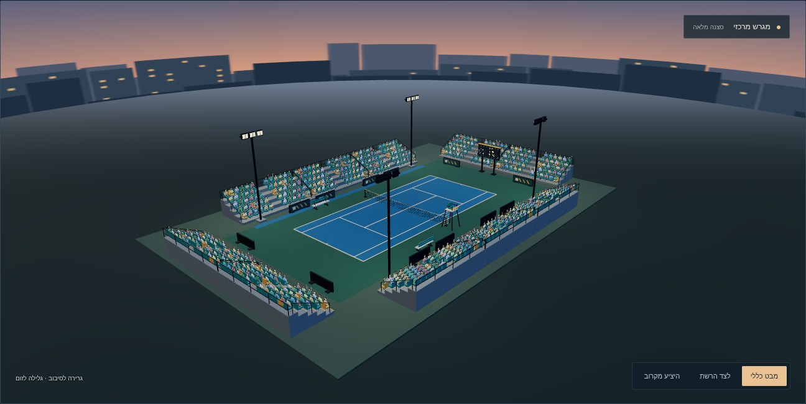

# אצטדיון טניס — חבילת ערב v1



החבילה כוללת שמונה דגמים מקוריים, חמישה מרקמים, מקור לשחזור, סצנה אחת עם עשרה מקטעי יציע ו־600 אוהדים, ותצוגה אינטראקטיבית בעברית. כל הנכסים המקוריים מוקדשים ל־CC0; מקור ורישיון לכל קובץ ב־[LICENSES.md](LICENSES.md).

הבסיס הוא `main` בהתחייבות `bd4d3600692b14be8881d2ba50a2b96485f3119e`. כל התוספות נמצאות בתיקייה זו בלבד. אין שינויים בקוד קיים, בבדיקות קיימות, בגרסה, במטמון או בתפעול. החבילה אינה מחוברת למשחק החי.

## מדידות ותקציבים

כל הנפחים הם בבתים עשרוניים; KB = 1,000 בתים. רשימת **כל** קובצי החבילה והסכום המדויק, כולל המקור, הבדיקות, התיעוד והצילום, נמצאת ב־[inventory.json](inventory.json) ובטבלת הקבצים בתצוגה. הבדיקה מאמתת את הסכום מול הדיסק, כולל גודל קובץ הרשימה עצמו.

| מדד | תוצאה | תקציב |
|---|---:|---:|
| סצנה מלאה, כולל כל המופעים והסביבה | **24,860 משולשים** | 25,000 |
| מקטע יציע | 2,040 משולשים | 3,000 |
| פריט נלווה מרבי | 664 משולשים | 1,500 |
| GLB מרבי | 143,572 בתים | 300,000 |
| 13 נכסי ריצה יחד | 1,191,087 בתים | כלולים בתקציב החבילה |
| חבילה מלאה | ראו `inventory.json` — פחות מ־1.5 MB | 4,000,000 בתים |
| קהל | 600 מופעים; 1,200 משולשים; אצווה אחת | כלול בסצנה |
| שמיים/עיר | 1,024×512 | 1,024×512 |

| קובץ | בתים | משולשים | מופעים בסצנה |
|---|---:|---:|---:|
| `runtime/stand-10m.glb` | 143,572 | 2,040 | 10 |
| `runtime/ad-board.glb` | 9,776 | 66 | 12 |
| `runtime/umpire-chair.glb` | 45,496 | 664 | 1 |
| `runtime/net-post.glb` | 14,024 | 156 | 2 |
| `runtime/player-bench.glb` | 17,364 | 196 | 2 |
| `runtime/scoreboard.glb` | 10,024 | 74 | 1 |
| `runtime/floodlight.glb` | 15,248 | 168 | 4 |
| `runtime/net.glb` | 19,996 | 240 | 1 |
| `runtime/court-blue-green.png` | 265,949 | מישור בן 2 | 1 |
| `runtime/crowd-atlas.png` | 631,749 | 2 לאוהד | 600 |
| `runtime/evening-city.png` | 5,763 | גליל פתוח בן 96 | 1 |
| `runtime/hardcourt-tile.png` | 10,798 | מישור בן 2 | 1 |
| `runtime/score-display.png` | 1,328 | כלול בלוח | 1 |

חישוב הסצנה: דגמים מוצבים 23,546 + קהל 1,200 + מגרש 2 + בסיס 12 + אריח הדגמה 2 + קרקע 2 + רקע 96 = **24,860**. זו ספירת כל הגאומטריה, גם מחוץ לפריים. ספירת המנוע לאחר חיתוך שדה הראייה זמינה גם ב־`window.stadiumPreview.visibleTriangles`; קריאות הציור ב־`drawCalls`. אין מעברי צל נוספים. נשאר מרווח של 140 משולשים; הוספת דגמים לסצנה דורשת חישוב מחדש.

במבט הכללי של בדיקת הדפדפן נמדדו גם בפועל **24,860 משולשים ו־144 קריאות ציור** במעבר הראשי. אצוות הקהל היא קריאת ציור אחת; יתר הקריאות כוללות את החומרים בכל מופעי הדגמים. המדידה אינה כוללת את ממשק ה־HTML שמסביב לסצנה.

## מידות ושימוש בדגמים

כל GLB הוא glTF 2.0, יחידה אחת = מטר, Y למעלה. פרטי גבולות מדויקים, מספרי משולשים, מקור, רישיון וחתימות SHA-256 נמצאים ב־[assets.json](assets.json). כל החומרים הם PBR רגילים; הזוהר במנורה ובלוח הוא emissive סטנדרטי.

מקטע היציע משתרע מ־X=-5 עד X=5; מחברים עותקים בצעד של 10 מטר. חזית היציע פונה ל־Z שלילי, והעומק לכיוון Z חיובי. חמש שורות עולות כל אחת ב־0.42 מטר, עם רווח עומק 0.88 מטר. בכל שורה 12 מושבים ומעבר מרכזי. גובה כולל 2.99 מטר; גבולות עומק 0.03–4.44 מטר. `scene.json` מכיל את כל ההצבות, הסיבובים ומפרט הקהל.

לוחות המגרש משתמשים בצורות גאומטריות בלבד. לוח התוצאות מציג משתתפים בדיוניים A/B, עם אותיות ומספרים שנוצרו במילון פיקסלים מקורי. פני הלוחות, המנורות, הכיסא והספסל פונים ל־Z שלילי. ברשת, קצה לבן בגובה 0.914 מטר במרכז ו־1.07 מטר בצדדים; גוף הרשת דו־צדדי בתצוגה.

## אטלס הקהל

`crowd-atlas.png` הוא PNG שקוף RGBA בגודל 1024×512: שמונה עמודות ושתי שורות, 16 תאים של **128×256**. כל אוהד מופיע בזוג תאים עוקבים: ידיים למטה ואז ידיים למעלה. הסדר הוא מלמעלה למטה ומשמאל לימין:

| שורת תמונה | התאים 0–7 |
|---|---|
| 0 | אוהד 0 למטה/למעלה, אוהד 1 למטה/למעלה, אוהד 2 למטה/למעלה, אוהד 3 למטה/למעלה |
| 1 | אוהד 4 למטה/למעלה, אוהד 5 למטה/למעלה, אוהד 6 למטה/למעלה, אוהד 7 למטה/למעלה |

הנוסחה היא `index = variant * 2 + pose`, כאשר `pose` הוא 0 או 1. צורת המיפוי תואמת למימוש `buildCrowd` הקיים ב־`minigames/hoops-view.mjs`: תכונות מופע `cell` ו־`shade`, בחירת תנוחה בשיידר, `InstancedMesh` יחיד ו־`alphaTest: 0.5`. הקובץ שהתבקש, `workout/island/js/char3d.js`, אינו קיים ב־main שנבדק; אין טענה שנבדקה קריאה ישירה לפונקציה החסרה.

דוגמת השילוב המלאה נמצאת ב־`preview.mjs`. המישור בגודל 0.88×1.76 מטר, עם מוצא בבסיס. האוהדים יושבים, ופונים למגרש דרך טרנספורמציה של מקטע היציע בתוספת סיבוב π. אין billboard שמתעדכן לכל אוהד בכל פריים. מכבים mipmaps לאטלס ומשתמשים ב־LinearFilter, עם שוליים שקופים ומיפוי פנימי של פיקסל למניעת דליפה בין תאים. שתי התנוחות שומרות על מיקום הרגליים והגוף. כפתור העידוד מאפשר לבדוק כל תנוחה בנפרד.

## מרקמים ותאורה

- `court-blue-green.png`: ‏512×1024, מפת מגרש מלאה על משטח 18.29×36.57 מטר; כחול בשטח המשחק וירוק בשוליים. קווי זוגות 10.97×23.77 מטר, קווי יחידים ברוחב 8.23 מטר וקווי הגשה במרחק 6.4 מטר מהרשת. קווי התמונה הם בקירוב 5–7 ס״מ עקב רזולוציית הפיקסלים.
- `hardcourt-tile.png`: ‏128×128, אריח גרגר כחול לשטחים החוזרים על עצמם. לשני מרקמי המשטח יש התאמה מדויקת בין זוגות שפות נגדיות; הבדיקה משווה את הפיקסלים. חזרה על מפת המגרש משכפלת מגרש מלא; עבור שטח רציף ללא קווים משתמשים באריח הגרגר.
- `evening-city.png`: ‏1024×512, שמיים מדורגים ועיר בדיונית בשכבות. שפות אופקיות זהות מאפשרות סגירת גליל. זהו רקע LDR, ואינו מפת תאורה HDR.

התצוגה משתמשת באור כיוון חם, אור שמיים קר, מילוי חלש וארבעה מקורות חמים באזור המנורות. הקהל כבר מוצל בתמונת המקור ומקבל גוון נוסף לכל מופע. סגנון הערב מושג ללא postprocessing או מפענחים. התאורה אינה סימולציה פוטומטרית; אין מפות צל בזמן אמת.

## תאימות CSP

**כל שמונת קובצי ה־GLB כבר נמצאים ב־`runtime/` וללא דחיסה.** אין Draco, meshopt, KTX2, הרחבות glTF נדרשות, workers או קוד WebAssembly. לפיכך אין צורך בעותק חלופי או במפענח. רק לוח התוצאות מפנה לקובץ תמונה חיצוני יחסי, `score-display.png`, הכלול בתיקייה.

לתצוגה יש CSP מקומי: סקריפטים וסגנונות מאותו מקור בלבד, בלי `unsafe-eval` או `wasm-unsafe-eval`. הבדיקה בדפדפן טוענת את כל הנכסים ומוודאת שניסיון להדר מודול WebAssembly ריק נכשל עם CompileError. שימוש ב־WebGL אינו דורש WebAssembly.

## הרצה ובדיקות

1. הגישו את שורש המאגר בשרת HTTP. התצוגה משתמשת ב־three.js וב־GLTFLoader המקומיים הקיימים ב־`workout/island/vendor/`; אין תלות ב־CDN. פתיחת HTML דרך `file://` אינה נתמכת.

```sh
python -m http.server 8765
```

2. פתחו את [התצוגה](http://localhost:8765/workout/island/design/tennis-stadium-v1/preview.html). התוצאה הרצויה: מגרש, כל שמונת סוגי הדגמים, קהל וערב בסצנה אחת; מונה טעינה 13/13 ומונה 24,860 משולשים. בדקו זוויות צילום, עידוד ורשת משולשים.

3. מתוך תיקיית החבילה הריצו את בדיקת Python. נדרשים Python 3, ‏Pillow ו־Node.js לצורך בדיקת תחביר קובצי JavaScript.

```sh
python verify.py
```

4. עם Playwright ו־Chromium מותקנים ושרת HTTP פועל, הריצו את בדיקת הדפדפן. אפשר להגדיר `CHROMIUM_PATH` ו־`TENNIS_PREVIEW_URL` כדי להתאים סביבה מקומית. אין צורך לשנות את תלויות הפרויקט.

```sh
node browser-check.mjs
```

נבדק ב־Chromium עם SwiftShader: כל 13 נכסי הריצה נטענו, 600 מופעים באצווה אחת, אפס שגיאות JavaScript/שיידרים/HTTP, חסימת WASM תקינה. נבדקו תצוגת 1440×1120 ונייד 390×844 ללא גלישה אופקית, שלוש זוויות צילום, שני מצבי ידיים ורשת משולשים. טעינה עד מצב מוכן נמדדה בכ־0.9 שניות בשרת מקומי עם cache קר של עמוד חדש; זו אינה מדידת ביצועים במכשיר טלפון או ברשת סלולרית.

`verify.py` פותח **כל קובץ בחבילה**, מפענח את כל התמונות, קורא את נתוני המשולשים מכל GLB, בודק גבולות מאגרים, אינדקסים, נורמלים, משולשים שאינם מנוונים, UV, תמונת לוח התוצאות, חתימות, גדלים, תקציבים, כל 16 תאי האטלס, זוגות התנוחות, חיבורי המרקם ורישוי לכל קובץ. בנוסף נבדקת ספירת הסצנה כולה כנגד 25,000. בדיקת הדפדפן טוענת את ה־GLB דרך GLTFLoader ואת כל המרקמים דרך TextureLoader בפועל.

## שחזור

מתוך תיקיית החבילה, עם Blender 4.3 ו־Python/Pillow זמינים:

```sh
blender -b -t 2 -P source/fans.py
python source/build.py
python source/inventory.py
python verify.py
```

מקור הדמויות הוא סקריפט Blender, ללא קובץ blend כבד בחבילה. עותק עבודה זמני נוצר ב־`/tmp/tennis-stadium-fans.blend`; התוצר היחיד שנדרש להפעלה הוא האטלס. רינדור Cycles תלוי בגרסת Blender ובחומרה, ולכן שחזור האטלס עשוי לשנות פיקסלים, חתימות ונפח; יש ליצור מחדש את המניפסט והרשימה לאחר כל שינוי. `preview.jpg` הוא צילום סקירה ואינו נטען למנוע התלת־ממדי.
