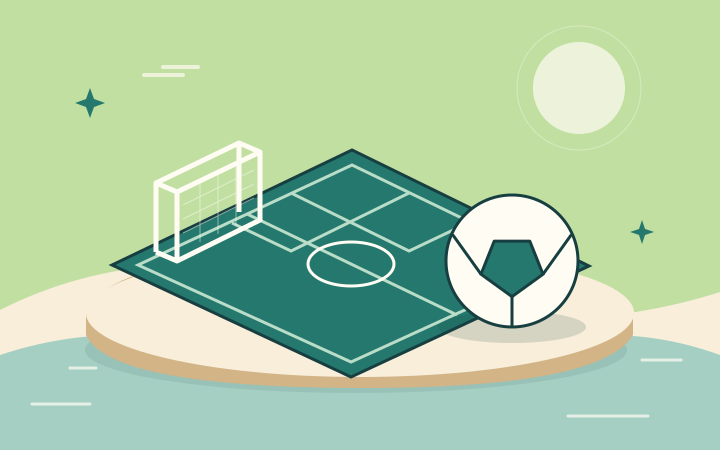

# האי · ערכת ממשק v2

[דף התצוגה](index.html) · [קובץ המפתח](manifest.json) · [צבעים ומידות](tokens.json) · [דוח אימות](VALIDATION.md) · [רישיון](LICENSE.txt)

ערכת נכסים מקורית, ללא מותגים, לתשעת משחקי האי. קו משותף: ים, חול ואלמוג; צורות מעוגלות, קו אייקון בעובי 3 ביחידות מקור וגופני מערכת. האיורים מבוססים על חפצי המשחק והסביבה. הם איורי תפריט, ולא צילומים מהמשחקים.

## צפייה

1. פותחים את [index.html](index.html) בדפדפן. אפשר ישירות מהדיסק; אין התקנה, build או חיבור לרשת.
2. בוחרים ״תצוגת פתיחה״ בכרטיס משחק. ״מתחילים״ מעביר למסך תוצאה **לדוגמה**; ״שוב״ חוזר לפתיחה. Escape או כפתור הסגירה סוגרים ומחזירים מיקוד לכרטיס.
3. בודקים את הכפתורים, מורידים אייקונים, בוחרים 0–3 כוכבים ומפעילים את ההנפשה הקצרה. בפריסת טלפון הכרטיסים עוברים לטור אחד. בהעדפת תנועה מופחתת כל הרכיבים מופיעים מיד.

הדוגמאות עצמאיות ואינן מתחילות משחק, משנות שמירות או מחשבות פרסים. טקסט ותוצאות ב־HTML; אף SVG אינו מכיל טקסט, גופן, סקריפט או תמונת raster. ללא JavaScript האיורים, הדוגמאות והקישורים לקבצים נשארים זמינים.

## תוכן החבילה

| קבוצה | כמות | מידת מקור | שימוש מומלץ |
|---|---:|---|---|
| `icons/games/` | 9 | 64×64 | סמלי משחק 32–64px |
| `icons/menu/` | 36 | 64×64 | אייקונים 24–32px ביעדי מגע של 48px לפחות |
| `intro/` | 9 | 720×450 | איור כרטיס פתיחה ביחס 8:5, `object-fit: contain` |
| `buttons/` | 12 | 288×64 או 64×64 | ראשי, משני ואייקון; רגיל, hover, לחיצה ולא זמין |
| `rewards/` | 7 | משתנה | גביע, שני מצבי כוכב וארבע רצועות דירוג 0–3 |
| `surfaces/` | 2 | משתנה | אי למסך התפריט ומסגרת תוצאה |

**75 קובצי SVG**, כולם קטנים מ־100,000 בייטים. משקלים ו־SHA-256 לכל נכס נמצאים ב־manifest. קובצי WebP בתיקיית verification הם צילומי אימות של דף התצוגה.

| מזהה משחק קיים | נכסי הפתיחה והאייקון |
|---|---|
| `soccer` | ליגת האי |
| `tennis` | טניס באי |
| `streetSlam` | ליגת האי בכדורסל |
| `alpineRush` | מרוץ סנובורד — לוח אחד, בהתאם למשחק הקיים |
| `islandRacing` | מרוצי האי |
| `navalDuel` | קרב ספינות |
| `fireRescue` | כיבוי שריפה |
| `alienDefense` | הגנה מפני חייזרים |
| `boarDefense` | אי החזירים — הגנת החווה |

הכיסוי נגזר מ־`data/extensions.json`, מ־`data/featureFlags.json` ומ־`data/config.json` הקיימים. `practiceContract` הוא דוגמת חוזה הרחבה תחת `exampleContent=false`, ולכן אינו משחק בספרייה הפעילה. בדיקת הכיסוי תתריע אם יתווסף משחק פעיל.

## שילוב

טוענים את [ui-kit.css](ui-kit.css), ועוטפים את הרכיבים ב־`class="island-kit" dir="rtl"`. כל הסלקטורים נתחמים לעטיפה או לקידומת `ik-`; אין תלות בספרייה. כתובות הנכסים ב־CSS יחסיות לקובץ העיצוב, כך שאפשר להעתיק את התיקייה בשלמותה. יש להתאים את `src` בדוגמה לכתובת התיקייה במוצר.

```html
<link rel="stylesheet" href="ui-kit.css">
<section class="island-kit" dir="rtl">
  
  <h2>ליגת האי</h2>
  <p>הקבוצה שלכם. הדרך לאליפות.</p>
  <button type="button" class="ik-button ik-primary">
    
    מתחילים
  </button>
</section>
```

- **כפתורים:** הנכסים הם משטחי רקע ללא מלל. `border-image` עם חיתוך 22px שומר על הפינות בכפתור רחב; אין למתוח את כל ה־SVG ב־`background-size:100% 100%`. מצבי `:hover`, `:active`, `:disabled` כבר ב־CSS; hover מופעל רק במכשיר שתומך בכך. להשתמש ב־`disabled` אמיתי. ה־CSS צובע את אייקון הפעולה הראשית ללבן.
- **תוצאה:** `ik-result` משתמש במסגרת עם חיתוך 32px. כותרת, ניקוד, תוויות וכפתורים ב־DOM. `bdi dir="ltr"` למספרים. יש להציג את התוצאה ומספר הכוכבים שהמשחק מספק; הערכה אינה מגדירה ספי ניקוד או זכייה. גם 0 כוכבים הוא מצב מפורש.
- **נגישות:** גופן גוף 16px; תוויות פעולה 14px לפחות; יעד מגע 48px לפחות, ובכפתורי הערכה 64px. לאייקון דקורטיבי `alt=""`; לכפתור אייקון `aria-label` מפורש. לדירוג מקובץ תווית כגון ״2 מתוך 3 כוכבים״ על `role="img"`; התמונות הפנימיות דקורטיביות. כוכב ריק נבדל במילוי ובקו, לא רק בגוון.
- **RTL:** חזרה מצביעה ימינה, המשך שמאלה. הקבצים מותאמים לעברית מראש; אין לשקף אותם שוב. בהסבה ל־LTR משקפים רק את `back` ו־`next`. איורים, סמלי משחק וכוכבים אינם משתקפים. סדר פעולות נשלט ב־DOM וב־CSS.
- **כניסה:** `ik-enter` לפאנל: 240ms ותזוזה של 12px; `ik-card-enter` לכרטיס: 220ms והשהיה של 35ms לפי `--ik-order`, עד 280ms; `ik-stars-enter` על קבוצת הכוכבים: 280ms והשהיה של 70ms בין הכוכבים. כל הנפשה רצה פעם אחת. ב־`prefers-reduced-motion: reduce` אין הנפשות או מעברים. לפני שימוש ב־CSS יש להציב את המחלקות על רכיבים בתוך `.island-kit`.
- **טעינה:** מידות מפורשות מונעות תזוזת פריסה. איור הפתיחה הנוכחי נטען מיד; קטלוג ארוך יכול להשתמש ב־`loading="lazy"`. אין למתוח SVG מעבר ליחס שלו. למסך תפריט עם רקע כהה יש להניח את האייקונים הכהים על משטח נייר/חול בהיר.

## מקור ורישיון

כל האייקונים, האיורים, משטחי הכפתורים, הקוד והתיעוד בתיקייה נוצרו במיוחד לחבילה זו. אין העתקה של נכסי משחק מסחרי, סמלי קבוצות, דמויות או גופנים. קוד המקור הווקטורי ב־[tools/build.py](tools/build.py); פריסת התצוגה ב־[tools/preview.template.html](tools/preview.template.html). כולם נמסרים תחת [CC0-1.0](LICENSE.txt). צילומי האימות מציגים רק את החבילה המקורית.

## יצירה ובדיקה

משורש המאגר:

```sh
python3 workout/island/design/ui-kit-v2/tools/build.py
python3 workout/island/design/ui-kit-v2/tools/validate.py
python3 workout/island/design/ui-kit-v2/tools/check_browser.py
```

יצירת הנכסים והבדיקה הסטטית דורשות Python 3 בלבד. בדיקת הדפדפן דורשת Playwright, Chromium ו־Pillow לצילומי WebP. היא פותחת שרת מקומי זמני בעצמה; אין גישה לשירות חיצוני. קובצי אימות נכתבים ל־`verification/`. אין צורך להריץ כלי יצירה כדי לצפות בחבילה.

החבילה מיועדת למסירת עיצוב ולשילוב נפרד. היא אינה מיובאת במשחקים הקיימים. אין כאן שינוי ב־release, ב־service worker או בלוגיקת המשחקים.
