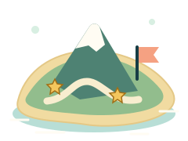

# שילוב ישיר במשחקי האי

העתיקו את `runtime/` בשלמותה ליד קובצי המשחק. נתיבי הדוגמאות מניחים ש־HTML נמצא לצד התיקייה; אם שיניתם מיקום, עדכנו את נתיבי ה־CSS, ה־SVG וה־ES modules יחד. אין צורך ב־npm, ב־bundler או בשינוי תג גרסה. ההדגמה משתמשת רק בקבצים מקומיים, ויש להגיש אותה ב־HTTP ולא ב־`file://` כדי לאפשר ES modules ו־SVG sprite.

## 1. מעטפת ומשטח משחק

```html
<!doctype html>
<html lang="he" dir="rtl">
<meta charset="utf-8">
<meta name="viewport" content="width=device-width,initial-scale=1,viewport-fit=cover">
<link rel="stylesheet" href="runtime/island-ui.css">
<body class="iu-kit">
  <main class="iu-stage" id="game" aria-label="משחק באי">
    <!-- קנבס המנוע, HUD ובקרים ממוקמים כאן -->
  </main>
</body>
</html>
```

ההורה צריך לספק גובה ורוחב מוגדרים. לדוגמה, בקובץ CSS של המארח:

```css
html, body { margin: 0; width: 100%; height: 100%; }
#game { width: 100%; height: 100dvh; }
/* החלפת גופן מקומי אפשרית; אין גופן חיצוני חובה. */
.iu-kit { --iu-font: system-ui, sans-serif; }
```

הערכה מחילה סגנונות רק תחת `iu-kit`. `iu-stage` יוצר שכבות מקומיות; הקנבס ברקע, HUD ב־2, בקרים ב־3, טוסט ב־5, ו־dialog ב־top layer של הדפדפן. אל תשימו `transform: scale(...)` על משטח הקלט: הקואורדינטות במתאם הן CSS pixels ללא טרנספורמציה. אפשר להשתמש בו בתוך קונטיינר מדוד, גם עם מסגרת; המתאם מודד את תוכן המשטח ומחסר את המסגרת ממיקום האצבע.

## 2. ג׳ויסטיק צף — תמיד בשמאל הפיזי

מוסיפים לתוך `#game`:

```html
<div class="iu-controls">
  <div class="iu-target iu-stick-zone" data-iu-target="joystick"
       tabindex="0" role="group" aria-label="ג׳ויסטיק תנועה"
       aria-describedby="move-help"
       aria-keyshortcuts="ArrowUp ArrowDown ArrowLeft ArrowRight">
    <div class="iu-stick" aria-hidden="true">
      <div class="iu-stick__knob">
        <svg class="iu-icon"><use href="runtime/icons.svg#move"/></svg>
      </div>
    </div>
    <span class="iu-stick-zone__label" aria-hidden="true">תנועה</span>
  </div>
</div>
<p id="move-help" class="iu-sr-only">
  נוגעים וגוררים באזור השמאלי. במקלדת משתמשים בחצים. משחררים כדי לעצור.
</p>
```

הוסיפו את הפעולות וההשהיה מאותו סעיף הבא לאותה מעטפת `iu-controls`. אין להשתמש ב־`inset-inline-start` עבור הבקרים: RTL אינו מחליף צדדים. אזור ההפעלה הוא המלבן התחתון בשמאל; כל הבסיס הצף נתחם לתוכו. האזור שקוף למנוע מלבד Pointer Events של הבקר.

## 3. פעולות ימין וכפתור השהיה

```html
<button type="button" class="iu-target iu-action iu-action--primary"
        data-iu-target="primary" data-iu-action="jump" aria-label="קפיצה">
  <span class="iu-action__face">
    <svg class="iu-icon" aria-hidden="true"><use href="runtime/icons.svg#jump"/></svg>
    <span>קפיצה</span>
  </span>
</button>
<button type="button" class="iu-target iu-action iu-action--secondary"
        data-iu-target="secondary" data-iu-action="swap" aria-label="החלפה">
  <span class="iu-action__face">
    <svg class="iu-icon" aria-hidden="true"><use href="runtime/icons.svg#swap"/></svg>
    <span>החלפה</span>
  </span>
</button>
<button type="button" class="iu-target iu-action iu-action--accent iu-action--tertiary"
        data-iu-target="tertiary" data-iu-action="boost" aria-label="האצה">
  <span class="iu-action__face">
    <svg class="iu-icon" aria-hidden="true"><use href="runtime/icons.svg#spark"/></svg>
    <span>האצה</span>
  </span>
</button>
<button type="button" class="iu-target iu-action iu-pause"
        data-iu-target="pause" aria-label="השהיית המשחק">
  <svg class="iu-icon" aria-hidden="true"><use href="runtime/icons.svg#pause"/></svg>
</button>
```

השבתה היא `disabled` אמיתי, ולא רק צבע. בזמן טעינה שנו תווית ו־`aria-label` לסיבה קצרה, למשל ״האצה נטענת״; המנוע מחזיר זמינות. נגיעה מוקטנת רק בתוך `iu-action__face`, בלי לשנות את שטח המגע. מותר להשמיט פעולה לא רלוונטית; אין למקם פעולה רביעית במרווח שבין החצאים.

ללא מתאם הפריסה, CSS לבדו מספק שלושה כפתורים בטור בימין הפיזי. `applyTouchMap` מסדר אותם באשכול כאשר יש די מקום. סגנון inline לצבע או לגופן אינו מבטל את fallback הפריסה; רק `data-iu-positioned`, שנכתב על ידי המפה, מחליף אותו.

## 4. HUD — תוצאה, זמן וחיים

```html
<div class="iu-hud" role="group" aria-label="מצב המשחק">
  <div class="iu-stat iu-stat--score">
    <svg class="iu-icon" aria-hidden="true"><use href="runtime/icons.svg#star"/></svg>
    <span class="iu-stat__text">
      <span class="iu-stat__label">נקודות</span>
      <output class="iu-stat__value iu-number" id="score">240</output>
    </span>
  </div>
  <div class="iu-stat">
    <svg class="iu-icon" aria-hidden="true"><use href="runtime/icons.svg#timer"/></svg>
    <span class="iu-stat__text">
      <span class="iu-stat__label">זמן</span>
      <span class="iu-stat__value iu-number" id="time">01:24</span>
    </span>
  </div>
  <div class="iu-stat iu-stat--lives" aria-label="עוד שני חיים מתוך שלושה">
    <span class="iu-stat__text">
      <span class="iu-stat__label">חיים</span>
      <span class="iu-lives" aria-hidden="true">
        <svg class="iu-icon"><use href="runtime/icons.svg#heart"/></svg>
        <svg class="iu-icon"><use href="runtime/icons.svg#heart"/></svg>
        <svg class="iu-icon" data-empty><use href="runtime/icons.svg#heart"/></svg>
      </span>
    </span>
  </div>
</div>
```

עדכנו טקסט באמצעות `textContent` ו־`aria-label` מנתוני המנוע. אל תעדכנו live region בכל tick של השעון; הודיעו בקצרה רק על אירוע משמעותי. במשחק ללא שעון אפשר להסיר את כרטיס הזמן. תוצאת שתי קבוצות יכולה להיות `2 : 1` בתוך `iu-number`, עם תווית נגישה הכוללת את שמות הקבוצות הבדיוניים.

לתוצאה גדולה השתמשו בתצוגה קצרה, כאשר המספר המדויק נשאר בתווית הנגישה. פורמט K/M/B/T הוא פורמט התצוגה הקצר של הדפדפן; במסך התוצאה אפשר להציג את המספר המלא.

```js
import { presentScore } from './runtime/format.mjs';
const value = presentScore(1234567);
document.querySelector('#score').textContent = value.text;
document.querySelector('#score').closest('.iu-stat').setAttribute('aria-label', value.label);
```

## 5. מסך פתיחה

`dialog` נמצא תחת `iu-kit`, כ־sibling של משטח המשחק. כך השבתת הבקרים אינה משביתה גם את החלון.

```html
<dialog class="iu-dialog" id="intro" aria-labelledby="intro-title">
  
  <div class="iu-eyebrow">משחקי האי · מסלול הכוכבים</div>
  <h2 id="intro-title">יוצאים להרפתקה?</h2>
  <p>חמישה כוכבים מחכים לאורך השביל.<br>אפשר לנסות בקצב שלך.</p>
  <ul class="iu-instructions">
    <li><svg class="iu-icon" aria-hidden="true"><use href="runtime/icons.svg#move"/></svg>
      <strong>זזים בשמאל</strong><br>נוגעים וגוררים</li>
    <li><svg class="iu-icon" aria-hidden="true"><use href="runtime/icons.svg#jump"/></svg>
      <strong>קופצים בימין</strong><br>לוחצים על קפיצה</li>
  </ul>
  <div class="iu-dialog__actions">
    <button type="button" class="iu-button" id="begin" autofocus>
      <svg class="iu-icon" aria-hidden="true"><use href="runtime/icons.svg#play"/></svg>מתחילים
    </button>
  </div>
</dialog>
```

## 6. מסך סיום

```html
<dialog class="iu-dialog" id="result" aria-labelledby="result-title">
  
  <div class="iu-eyebrow">המסלול הושלם</div>
  <h2 id="result-title">איזו דרך עשית</h2>
  <p>עוד הרפתקה נוספה לאי שלך.</p>
  <div class="iu-rating" role="img" aria-label="שלושה כוכבים מתוך שלושה">
    <svg class="iu-icon" aria-hidden="true"><use href="runtime/icons.svg#star"/></svg>
    <svg class="iu-icon" aria-hidden="true"><use href="runtime/icons.svg#star"/></svg>
    <svg class="iu-icon" aria-hidden="true"><use href="runtime/icons.svg#star"/></svg>
  </div>
  <div class="iu-dialog__stats">
    <div class="iu-stat"><span class="iu-stat__text"><span class="iu-stat__label">נקודות</span>
      <b class="iu-stat__value iu-number">240</b></span></div>
    <div class="iu-stat"><span class="iu-stat__text"><span class="iu-stat__label">זמן</span>
      <b class="iu-stat__value iu-number">01:24</b></span></div>
  </div>
  <div class="iu-dialog__actions">
    <button type="button" class="iu-button" autofocus>עוד סיבוב</button>
    <button type="button" class="iu-button iu-button--secondary">בחזרה לאי</button>
  </div>
</dialog>
```

נתוני הדוגמה מוחלפים בתוצאה מאומתת של המנוע. אפשר להסיר דירוג אם המשחק אינו מדרג. בסיום ללא הצלחה השתמשו למשל ב״ננסה עוד דרך?״ וב״אפשר לנסות שוב בקצב שלך״; אין להציג גביע כאילו המשחק הושלם.

## 7. השהיה / הודעה שדורשת בחירה

```html
<dialog class="iu-dialog" id="pause" aria-labelledby="pause-title">
  <div class="iu-eyebrow">רגע לנשום</div>
  <h2 id="pause-title">נחים קצת?</h2>
  <p>ממשיכים כשמתאים לך.</p>
  <div class="iu-dialog__actions">
    <button type="button" class="iu-button" id="resume" autofocus>ממשיכים</button>
    <button type="button" class="iu-button iu-button--secondary">בחזרה לאי</button>
  </div>
</dialog>
```

## 8. הודעות מידע, המתנה ותקלה

```html
<div class="iu-message">
  <svg class="iu-icon" aria-hidden="true"><use href="runtime/icons.svg#info"/></svg>
  <span>אפשר לעצור בכל רגע.</span>
</div>
<div class="iu-message iu-message--warning">
  <svg class="iu-icon" aria-hidden="true"><use href="runtime/icons.svg#warning"/></svg>
  <span>עוד מעט ננסה שוב.</span>
</div>
<div class="iu-message iu-message--error" role="alert">
  <svg class="iu-icon" aria-hidden="true"><use href="runtime/icons.svg#error"/></svg>
  <span>הטעינה נעצרה. אפשר לנסות שוב.</span>
</div>
```

משתמשים ב־`role="alert"` רק בתקלה דחופה שנוספה כעת, ולא בכל הודעת מידע. אם צריך ניסיון חוזר, הוסיפו כפתור `iu-button iu-button--secondary` מחוץ לטוסט. הודעה חשובה נשארת עד טיפול; היא אינה נעלמת אחרי כמה שניות.

## 9. טוסט

בתוך משטח המשחק, אחרי הבקרים:

```html
<div class="iu-message iu-toast" id="toast" role="status"
     aria-live="polite" aria-atomic="true" hidden>
  <svg class="iu-icon" aria-hidden="true"><use href="runtime/icons.svg#check"/></svg>
  <span>ההגדרות נשמרו.</span>
</div>
```

הטוסט מעל אזור המשחק, ללא תפיסת מגע וללא הזזת פוקוס. מציגים 3 שניות, או זמן ארוך יותר אם המשתמש זקוק לכך; אין להכניס לכאן פעולה חיונית. הדוגמה בהדגמה מחליפה את תוכן ההודעה ומחדשת את הטיימר במקום לערום הודעות שמכסות את הבקרים.

## 10. חיבור אופציונלי לקלט ולחלונות

```js
import { mountControls } from './runtime/controls.mjs';
import { connectDialog } from './runtime/dialog.mjs';

const stage = document.querySelector('#game');
const controls = mountControls(stage, {
  onMove({ x, y, active }) {
    // העבירו כוונת תנועה למנוע: x ימינה, y למטה, טווח מעגל יחידה.
  },
  onAction({ id, phase }) {
    // start: התחלה / טעינה; release: שחרור חוקי; cancel: ביטול ללא ביצוע.
    // לפעולת הקשה רגילה בצעו רק ב-release, כדי לא להכפיל פעולה.
  },
  onPause() { pause.open(); },
});
const pause = connectDialog(document.querySelector('#pause'), {
  controls,
  fallbackFocus: stage.querySelector('[data-iu-target="pause"]'),
});
document.querySelector('#resume').addEventListener('click', () => pause.close());

// יציאה מהמשחק: הסירו מאזינים ו-observers.
function dispose() { pause.destroy(); controls.destroy(); }
```

המנוע אחראי גם להקפאת הסימולציה והשעון בפתיחת חלון, ולהמשך רק לאחר סגירה. `connectDialog` מטפל בבקרים ובפוקוס; הוא אינו משנה את חוקי המשחק. חלון פתיחה/סיום מחובר באותו אופן. מתאם המגע מבטל פעולה מוחזקת בשינוי גודל, בהסתרה, באובדן פוקוס, ב־pointercancel ובהשבתה. אין למפות `cancel` לפעולת שחרור שמבצעת זריקה.

אפשר לשלב **CSS ו־SVG בלבד** ולהשתמש במנגנון הקלט הקיים. במקרה כזה החילו את המפה הטהורה על אותם hosts כדי לשמור על חוזה המגע:

```js
import { touchMap, applyTouchMap } from './runtime/layout.mjs';
const map = touchMap(stage.clientWidth, stage.clientHeight, {
  top: 0, right: 0, bottom: 0, left: 0, // הערכים האמיתיים מה-safe-area של המארח
});
applyTouchMap(stage, map);
// האזינו ל-resize של הקונטיינר, בטלו קלט ואז חשבו שוב.
```

יש לקרוא את `--iu-safe-top/right/bottom/left` מסגנון משטח המשחק או לספק אותם מהמארח. המתאם האופציונלי עושה זאת כבר. לא מכפילים safe-area גם ב־padding של ההורה וגם בתוך משטח מלא באותו מיקום.

## התאמה לכל המשחקים

תוויות מוצעות לאותה שלישיית רכיבים; מיפוי הפעולות ל־API הקיים נעשה בזמן החיבור. זמינות ומצב התקפה/הגנה מגיעים מהמנוע, ולא מהערכת העיצוב.

| משחק | ראשי | משני | שלישי |
|---|---|---|---|
| כדורגל | בעיטה | מסירה | ריצה |
| כדורסל | זריקה | מסירה | החלפה |
| סקי | קפיצה | תרגיל | האצה |
| טניס | חבטה | חבטה חזקה | הגשה |
| מירוצים | האצה | בלימה | איפוס מסלול |
| ספינות | ירי | מגן | האצה |
| חילוץ באש | חילוץ | מים | החלפה |
| הגנת האי | פעולה | מגן | החלפה |
| הגנה בחלל | ירי | מגן | האצה |

בהחלפת משחק שנו יחד טקסט גלוי, אייקון, `aria-label` ו־`data-iu-action`. אם פעולה אינה קיימת, הסירו אותה. שינוי מזהה פעולה תוך כדי החזקה מבטל את הפעולה הישנה; נגיעה חדשה משתמשת במזהה החדש.

28 אייקונים זמינים ב־sprite: move, pause, play, jump, spark, swap, heart, star, timer, check, info, close, retry, home, flag, map, trophy, kick, basketball, ski, racket, wheel, ship, water, shield, aim, warning, error. עבור אייקון נוסף אפשר לספק SVG מקורי באותם 24×24; אין להקטין מטרת מגע.

## בדיקת שילוב

```sh
node --test
node tools/browser-check.mjs
```

יש לשחזר בחיבור את 390×844, 844×390, 360×640, 412×915 ו־1024×768; לוודא שה־HUD האמיתי עדיין נכנס עם התוצאה המרבית, שההשהיה עוצרת את המנוע, וש־cancel אינו מבצע פעולה. תצלומי החבילה הם עיצוב ובקרי דוגמה; הם אינם הוכחה שהחיבור למנוע כבר בוצע.
