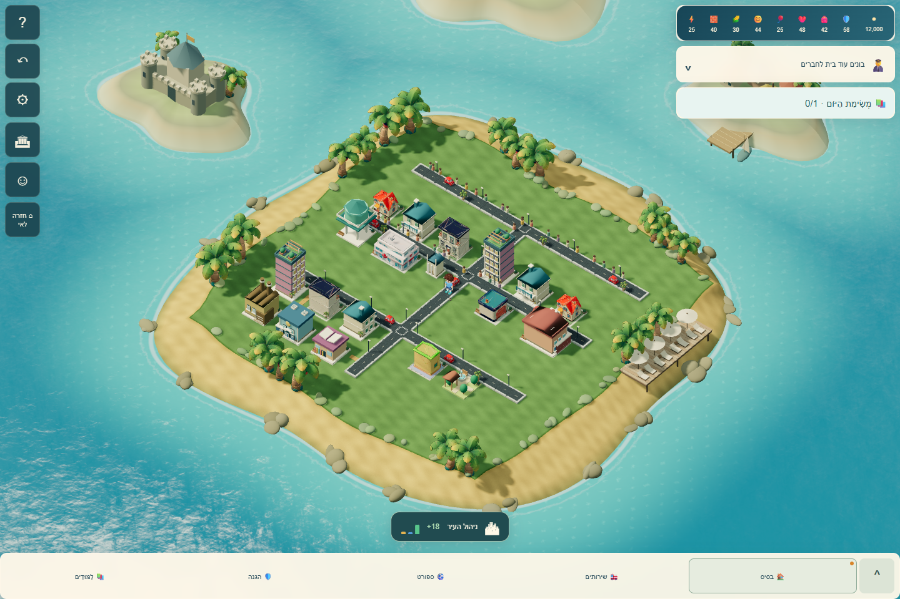
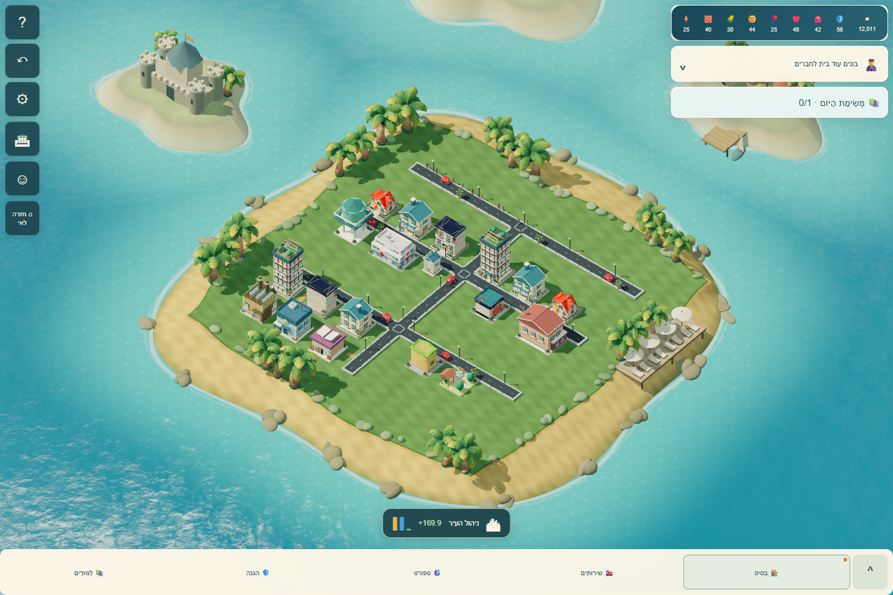

# שדרוג מראה העיר — 25/10/2026

גרסה: island-citydetail-20261025-1. בסיס: main, 5da26ba (אחרי #172).

## מה השתנה

- חזיתות מלאות מכל הצדדים למבנים שנוצרים בקוד, כולל מסגרות חלונות, אדנים, כניסות, כרכובים, מרפסות גן, עמודי עירייה ופרטי גגות למפעלים. כל פרט נשאר בתוך המגרש.
- גינות מגורים עם קירות אבן נמוכים ושער פנוי, גדר חיה ופרחים; רחבות למוסדות וסימוני חניה למסחר ולתעשייה. התוספות נכנסות לאותן שלוש קבוצות מופעים של הרחובות.
- שני דגמי הולכי הרגל המקוריים עם אנימציית Walking ושלדים עצמאיים: עד 12 באיכות גבוהה ו-4 באיכות נמוכה. נשמרים מסלולי המדרכות והגובה. הדגם הפשוט משמש בזמן טעינה או בכשל בלבד.
- תאורת שמיים אפויה פעם אחת להחזרי מתכת וזכוכית, צללים מדויקים יותר במסך מחשב וצללי מגע מעל משטח החלקה. כשל ביצירת תאורת השמיים משאיר את המשחק עם התאורה הישירה.

נכסי GLB, הגאומטריה, החומרים והטקסטורות המקוריים לא נערכו. סכימת השמירה, הכלכלה וההתקדמות נשמרו. תג הגרסה עודכן בכל ההפניות הפעילות כדי שמשתמש חוזר יקבל את השדרוג. רוב הקבצים בדיפ משתנים רק בעבור תג הגרסה.

## אימות

- 71 בדיקות ממוקדות עברו, כולל גבולות מגרש בכל הרמות, חשיפת חלונות מארבעה צדדים, רשת ההליכה, טעינה חלקית/מאוחרת ושחרור משאבים משותפים.
- החבילה המקומית המלאה: 2,585 בדיקות; 2,542 עברו, 38 דולגו, אותם 5 כשלים מקומיים שתועדו בבסיס Windows (squat, שני קטלוגי קול ושני hashes של מעבדות כדורגל/טניס). אין כשל חדש בחבילה.
- 16 בדיקות דפדפן עברו עם המנוע והתצוגה האמיתיים. נבדקו תנועה, טעינת המודלים, בחירת משבצות, תכנית בנייה, שמירת כל השמירה, rebuild ללא הצטברות גאומטריה, איכות נמוכה ו-dispose פעמיים.
- לחיצות עכבר אמיתיות בחרו מגרש ממוספר ובנו פעם אחת; מספר המבנים גדל מ-95 ל-96 והחיוב בפעולה עצמה היה 80 בדיוק.
- נבדקו מחשב 1440×960 וטלפונים 390×844, 844×390, 360×740 ללא גלישה אופקית.
- הביקורת העצמאית מצאה חריגות זעירות של פרטי כניסה; הן תוקנו ונבדקו שוב עם epsilon של 0.000001.
- כל השמירות והערים בבדיקות סינתטיות. Chromium פעל עם SwiftShader; צילומי המסך ומוני הציור אינם מדידת FPS בטלפון פיזי. אין טענה לשוויון מלא עם המשחק המסחרי SimCity.

## צילומים

אותה עיר בדיקה לפני ואחרי השדרוג:

## תאימות לאחר מיזוג עדכון העיר

השדרוג שולב עם main ב־fa65033 (כולל #173), ותג השחרור המאוחד הוא island-citydetail-20261025-2. נשמרו CityDepthView, סימוני הנזק/מים/ייצור ומקור הדוח במנוע, לצד הדמויות והתאורה החדשות. הוסר מסלול סימון הנזק הישן כדי למנוע שני מקורות מצב. 83 בדיקות ממוקדות עברו לאחר השילוב, וביקורת נפרדת אישרה את חיבורי העדכון ושחרור המשאבים. הצילומים והמספרים למעלה מתעדים את סבב השדרוג המקורי; בדיקות GitHub המעודכנות מופיעות בבקשת המיזוג.
