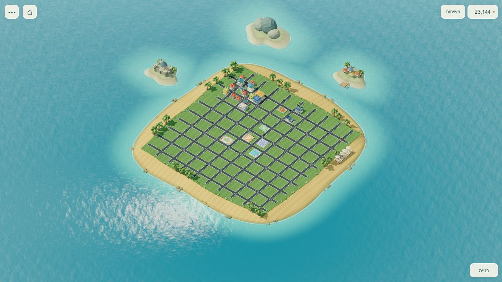

# מסך אי נקי — 26/10/2026

גרסה: `island-clean-ui-20261026-1`.

השינוי מבוסס על בקשת רועי לצמצם סימונים וכפתורים. תמונת ההערות הפרטית נקראה בדרייב ונשארה מחוץ לריפו. הצילום המצורף הוא של עיר בדיקה מלאכותית בלבד.

## התוצאה

- אין תגי מגרשים, שלטים, מספרים או אייקונים צפים על כל המפה. חלקות פנויות אינן מוסיפות שום ציור למבט הרגיל.
- בחירה יזומה מדגישה רק את המגרש שנבחר, בהצללה שקופה וקו דק על הקרקע. אין שלט מעליו. כל תאי השטח נשארו לחיצים, והבנייה נעשית באישור הקיים.
- במצב הרגיל יש חמישה כפתורים קטנים: כסף, משימות, בית, עוד פעולות ובנייה. צורת הכפתור קטנה, ואזור הלחיצה נשאר44px לפחות.
- מדדי העיר, משימת היום, המשחקונים, הקבוצה, עזרה, ביטול, עירייה, מראה הילד והגדרות ההורה נשארו נגישים בפתיחה יזומה. לוח המשימות היומי והמדדים אינם פרושים כברירת מחדל.
- סמלי עזר של מים ודרגות ייצור מוצגים רק עבור בניין שנבחר. התראת נזק דחופה, ארגזי נמל פיזיים ונתוני השירות נשמרו.
- חזרה לאי מנקה את ההדגשה; אין זום אוטומטי למשימה בעת טעינה. ברוחב הטלפון האי ממורכז בלי מקום ריק שהוקצה בעבר ללוח צד קבוע.

## בדיקה חיה

המשחק האמיתי הורץ בדפדפן, עם עיר בדיקה48×48 ובה22מבנים בנוסף לרשת הדרכים. נבדקו1280×720, 390×710 ו־844×390.

- בכל גודל נמצאו בדיוק חמישה כפתורים גלויים במצב הרגיל, כולם בגובה44px וללא גלילה אופקית. המספרים והשלטים של המגרשים אינם נוצרים.
- תפריט עוד פעולות מציג את חמש הפעולות הנוספות. Escape סוגר ומחזיר אליו מיקוד; לחיצה מחוץ לתפריט סוגרת אותו.
- כסף פותח את כל המדדים, המשאבים והכניסות למשחקונים ולקבוצה. משימות פותחות את המשימה הבאה ואת משימת היום; משימת היום נפתחה בהצלחה באותו מסלול לימוד.
- בבחירת בית דרך תפריט הבנייה בטלפון התקבל אישור למגרש הקבוע. הכסף ירד מ־22,610 ל־22,530 בדיוק; מספר המבנים עלה22→23, ולאחר האישור חזרו חמישה כפתורים, אפס שלטי מגרשים ואפס שכבות מגרשים.
- אישור נוסף נבדק במחשב. כל המגרשים והמיקומים הם מאותה תוכנית שמורה, ללא שינוי בכלכלה או בפורמט השמירה.

## בדיקות

58 בדיקות ממוקדות של הממשק המצומצם, מגרשים, שמירה וסמלי השירות עברו. הריצה המלאה המקומית שלפני ארבע בדיקות סמלי השירות החדשות כללה2,657בדיקות: 2,614עברו,38דולגו וחמשת כישלונות Windows הקיימים של נתיבים/סיומות שורה נשארו ללא שינוי. ארבע הבדיקות הנוספות עברו בנפרד ובבדיקה המשולבת. בדיקת GitHub המלאה על Linux נדרשת לפני המיזוג.

