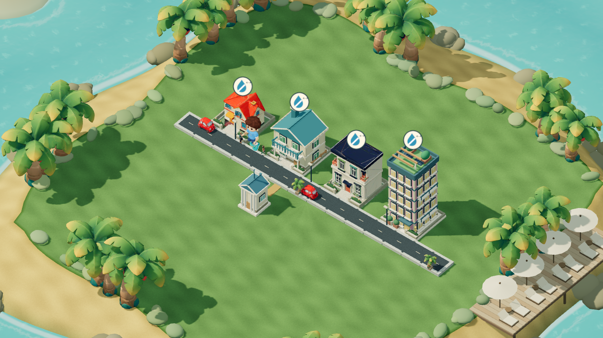

# תיקון קנה המידה של האנשים בעיר

גרסה: island-people-scale-20261026-1. בסיס: main אחרי #174 (b93ec63).

הילד המקורי בגובה כ-2.658 יחידות, ומודלי המבוגרים כ-1.7 יחידות. קנה המידה הקודם הציג את הילד בגובה כ-1.703 בעולם, לעומת כ-0.544 למבוגר. הילד היה גבוה פי 3.13 ממבוגר ואף גבוה מבית קטן (כ-1.385).

קנה המידה העירוני של הילד תוקן ל-0.16: גובה כ-0.425, כ-78% ממבוגר. המהירות הותאמה באופן יחסי כך שהצעדים לא יחליקו על הקרקע. הילד משתמש באותן נקודות מדרכה ובאותו גובה פני שטח של שאר האנשים. בהגעה לנקודת המסלול הגובה מסתיים בדיוק בגובה המשטח. דמויות הטעינה הפשוטות כווצו קלות כדי להתאים לגובה מודלי המבוגרים המקוריים.

תצוגת בחירת המראה ממשיכה להשתמש בדמות המקורית בגודל מלא. המודלים, הגאומטריה, המבנים, הגריד, גבולות האי וההתקדמות לא נערכו. תג הגרסה מתעדכן בכל ההפניות הפעילות; רוב הקבצים בדיפ הם שינוי תג בלבד.

אימות: חמש בדיקות חדשות מודדות את קודקודי דגמי המקור עם שלד ו-morph בפועל, את היחסים לילד/מבוגר/בית, את fallback, את גודל הצעד, גובה המדרכה, התצוגה המקדימה ושימור כל השמירה. 20 בדיקות ממוקדות עברו יחד עם בדיקות התושבים והעיר הקיימות; ביקורת עצמאית נוספת עברה.

במשחק האמיתי עם עיר סינתטית עברו שבע בדיקות בכל אחד משלושת גדלי התצוגה: מחשב 1265×710, טלפון 390×710 וטלפון 844×390. נבדקו גובה יחסי, הליכה על המדרכה, מהירות, תצוגת בחירת המראה ושמירת כל נתוני המשחק. החבילה המקומית: 2,602 בדיקות, 2,559 עברו, 38 דולגו וחמשת כשלי Windows המוכרים בלבד; אין כשל חדש.

הצילומים מציגים את אותה עיר, מצלמה ומיקום כדי להשוות את גודל הילד בלבד. נתוני הבדיקה סינתטיים.

לפני:

אחרי:

