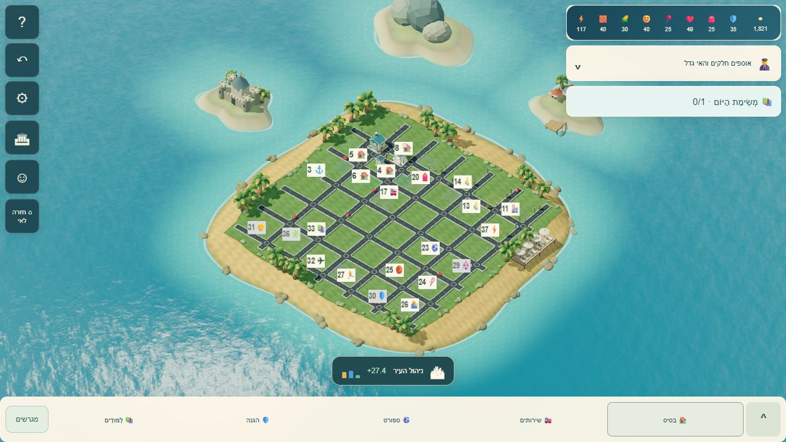
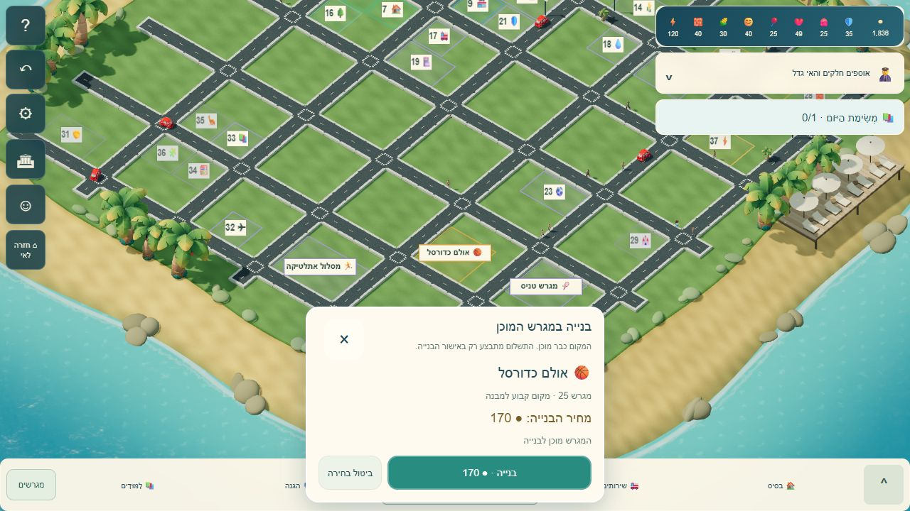

# אי גדול ומגרשי בנייה מוכנים — 26/10/2026

גרסה: `island-ready-plots-20261026-1`.

האי הרגיל במסך המשחק גדל מ־16×16 ל־32×32, ובהמשך ל־40×40 ו־48×48 באותם ספי התקדמות. בעיר חדשה יש 37 מגרשים קבועים: מגורים וחנויות ליד העירייה, אזור ספורט, תשתיות מים וחשמל, למידה ושמורות להמשך. כבישים מחוברים ניתנים ללא עלות בנייה או תחזוקה. תחנת החשמל מייצרת אנרגיה דרך הכלכלה הקיימת.

בחירה בתפריט או לחיצה על תג/שטח מגרש פותחות אישור עם מחיר. אישור בונה פעם אחת במקום שנשמר; ביטול אינו מחייב. מחסור בכסף ונעילות מוצגים עם הסבר. המיקום והמספר נשמרים לאחר בנייה, ביטול, רענון, הרחבה וייבוא. עיר ישנה נשמרת, כולל מבנים, שדרוגים, כסף והתקדמות. הפורמט הנוסף אופציונלי ונבדק בקפדנות בתוך שמירה18.

## בדיקה חיה

הבדיקות נעשו במשחק האמיתי המוגש מקומית בדפדפן, עם ערי בדיקה מלאכותיות בלבד. אין מידע של שחקן אמיתי בתמונות או בדוחות.

- אי חדש: 32×32, 37 מגרשים, ללא חיוב על ההכנה. כל חמשת מודלי העיר נטענו ללא שגיאה; סימוני המגרשים מוסיפים שלוש קריאות ציור.
- בניית כדורסל דרך התפריט הרגיל: נפתח אישור, המגרש נבחר ומוגדל במפה, ואישור מציב את האולם במיקום הקבוע.
- תחנת חשמל: 1,800 מטבעות לפני הבחירה, ללא חיוב על הבחירה; 1,660 לאחר אישור. אחרי רענון גם כל רשומות המבנים וגם תוכנית המגרשים נשארו זהות.
- לחיצה ישירה על תג הטניס במבט כללי פותחת את אישור הטניס. תוקנה קדימות הלחיצה כך שכביש או גג שמאחורי התג אינם נבחרים במקומו. בדיקת אירועי לחיצה מכסה גם כל תא בשטח המגרש.
- עיר ישנה16×16: בית ברמה2 ומגדל מים נשארו בדיוק במיקומם; 1,800 מטבעות ו־113 אנרגיה נשמרו, והאי גדל ל־32×32.
- טלפון390×710 ו־844×390: אין גלילה אופקית; כפתורי אישור וביטול בגובה48. המגרש המודגש נשאר גלוי מעל האישור או לצדו.
- תוויות במבט רחוק אינן חופפות. הסתרת תווית צפופה אינה מסתירה את שטח המגרש ואינה מונעת לחיצה עליו.

## בדיקות אוטומטיות

`node --test tests/*.mjs`: 2,651 בדיקות, 2,608 עברו, 38 דולגו ו־5 כישלונות Windows קיימים שתועדו גם לפני השינוי. הם נוגעים לנתיב קובץ של מעבדת המצלמה ולהבדלי סיומות שורה בקטלוגי קול/קובצי מעבדה. אין כישלון חדש מהאי.

57 בדיקות ממוקדות של המגרשים והגרסאות עברו. הן מכסות תכנון, קיבולת שמירה, חיבורי כבישים, פריסה על רוב האי, שמירות וייבוא, אישור יחיד, ביטול ושחזור, התרחבות ללא הזזת מגרשים, נעילות, מגבלות, הכנסה מתחנת חשמל ותחזוקת תשתיות בחינם. בדיקת GitHub המלאה על Linux תיבדק בבקשת המיזוג.

