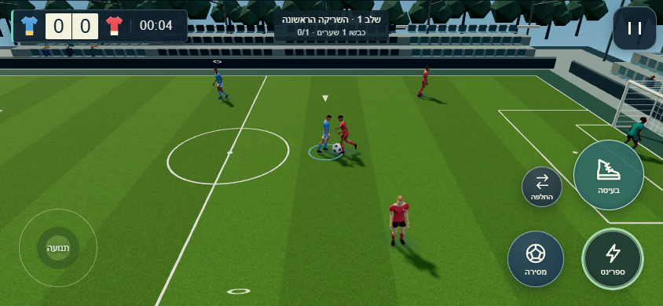
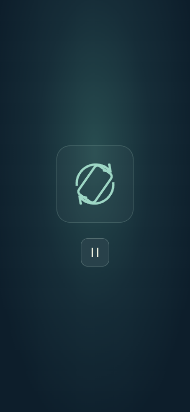

# כדורגל: שחקנים ריאליסטיים, תנועה ומשחק קבוצתי · 29.10.2026

שילוב על `main ef5ea8be0341a05f7eb300e9283c14c51db7ecdb` בענף `codex/soccer-athlete-integration`.
מקור מאושר: `soccer-integration.zip`, ‏8,829,990 בתים, SHA256 `b0f8b28a52e3140ee0fa4e62b6ba8994308418be431bb2ff9ccc94ea4eb898c5`.
ראש המקור המדווח `910ea28`; עץ 77 הקבצים שוחזר עצמאית ותואם `9b124bed98b7805bb4cc9d975eb62c074b0cc008`.
גרפיקת Codex v3 אינה כלולה. חותמת המטמון היא `island-soccer-athlete-20261029-1`; גרסת השמירה נשארה **18**.

## מיזוג וזהות מקור

שינויי v1 מ־`cafeadc` הוכנסו לפני טלאי כל הסבבים. התנגשות אחת בתגי ייבוא של `soccer-view.mjs` נפתרה; שלושה הקשרי כדורגל יושרו לתג המקור, ואז `git apply --check --ignore-whitespace` עבר והטלאי הוחל.
הדגם וכל עשרת מרקמיו נשמרו זהים בבתים. קוד המקור תואם לאחר נרמול סופי שורה ותגי `?v=`, למעט תיקון הלוחץ שאושר בנפרד. מעטפת package/serve של ההדגמה לא דרסה את מעטפת המאגר. ההגדרות, המילון והסגנונות המשותפים שומרים את עדכוני main; כל שינויי התצורה הם בתוך soccer.

רועי אישר תיקון ממוקד: שחקן לוחץ עוקף גוף של יריב לפי `players.radius*2`, בעוד שחקני הכיסוי שומרים את מרחק הסימון הטקטי. קודם לכן לוחץ נשאר תקוע מחוץ לטווח הכדור. באבחון נפרד 180 תרחישים עברו; במאגר עצמו כל בדיקות G3h חזרו לעבור. הגרפיקה, תנועת השחקנים והתקציבים לא שונו בעקבות התיקון.

באישור מפורש עודכנו חותמות בשש בדיקות קיימות (g2f/g2g/g2n/g3h/g5/g6d), והוכנו תרחישים בלתי לחוצים ב־soccer-teamplay וב־g3i. התנאים המקוריים של מסירה וקו פנוי נשמרו, וכיסוי outlet תחת לחץ נשאר נפרד. לא הועלו ספים, לא הוסרו בדיקות ולא נוספו דילוגים.
יתר שינויי קוד האי מחוץ לכדורגל הם תגי מטמון בלבד; שמונה קשתות מודול חדשות קיבלו את התג החדש. קוד משחקים אחרים לא השתנה.

## בדיקות

| בדיקה | main | ענף השילוב |
|---|---:|---:|
| כל בדיקות השורש, מקביליות 4 | 2,745: ‏2,706 עברו, 1 נכשל, 38 דולגו | 2,795: ‏2,756 עברו, 1 נכשל, 38 דולגו |
| כדורגל + G3h/G3i | — | 242/242 |
| בדיקות האי שבתיקייה | — | 199/199 |
| בדיקות חבילת המקור | — | 50/50 |
| טעינת בעיטה/מסירה, השהיה וחזרה | — | 2/2 |

הכשל היחיד בסוויטה הסופית זהה לכשל בבסיס: בדיקת מצלמה `synthetic low-standing skeleton goes from zero to five full squats, with a 504ms model gap` ב־`cam-lab-calibration.test.mjs`. סביבת Windows יוצרת נתיב fixture מוכפל. אין כאן טענה לסוויטה מקומית ירוקה; הבדיקה לא שונתה ולא דולגה.

הפקודה שהורצה באותם תנאים בשני העצים: `node --test --test-concurrency=4 tests/*.mjs`. נוספו 50 בדיקות חולפות ביחס ל־main, ללא כשל חדש. הורצו גם `node --test --test-concurrency=4 workout/island/tests/*.test.mjs` ופקודות המיקוד.

## דפדפן דרך האי

בדיקת הקבלה החדשה פותחת `workout/island/index.html`, נכנסת דרך ספריית המשחקים הנוכחית → בית הכדורגל → שלב 1. fixture התקדמות זמני ומאומת בונה מגרש דרך פקודת המנוע; הוא אינו משנה את שערי ההתקדמות בגרסת המוצר.
ב־844×390 וב־390×844 נטענים שמונה מודלי athlete, אפס גיבויים ו־13 אנימציות. באנכי מוצגת בקשת הסיבוב הקיימת והמשחק מוקפא; לאחר סיבוב ל־844×390 נבדקים המשחק והשליטה.
נבדקו תנועה מהמקלדת, השהיה וחזרה, יציאה וכניסה מחדש. תנוחות השחקנים, הכדור והשעון קבועים בהשהיה; שני PNG של קנבס המשחק זהים בבתים. החזרה מקדמת את המשחק. אפס שגיאות דפדפן; משולשים וקריאות ציור נמצאים בתקציבים הקיימים. זו בדיקת דפדפן מדומה, לא מדידת FPS בטלפון.




`workout/island/tests/g3b-browser.mjs` הורץ ללא שינוי בענף בשני הגדלים וב־main באופקי. הוא נכשל באותו selector ישן `.game-card[data-game=soccer]`: הספרייה כעת משתמשת ב־`.adventure-game-card`, ב־game-enter ובבית משחק נפרד. זהו כשל קיים בבדיקה, לפני הכניסה לכדורגל. בדיקת הקבלה המצורפת משתמשת במבנה האמיתי; אין להציג G3b כבדיקה שעברה.

## תקציבים ומניפסטים

| מדידה | בתים | סף |
|---|---:|---:|
| athlete.glb | 1,280,272 | 2,000,000 לקובץ |
| עשרת המרקמים יחד | 1,403,328 | הגדול ביותר 471,737 |
| משפחת השחקן, 11 קבצים | 2,683,600 | אין כפילות לשמונת השחקנים |
| נכסי שחקן + דשא + קול | 3,570,498 | חישוב נכסים סטטי |
| הורדה נוספת קרה דרך האי, כולל כותרות | 4,094,641 | 6,000,000 |
| כניסה חוזרת בשרת ללא מטמון | 3,225,841 | 6,000,000 |
| עיר, G8 main | 9,636,804 | 8,000,000 — נכשל בבסיס |
| עיר, G8 הענף | 9,732,353 | 8,000,000 — נכשל גם כאן |

חריגת העיר גדלה ב־95,549 בתים בגלל קוד הכדורגל שנטען ברישום התוספים. היא מתועדת ולא נפתרה באמצעות העלאת התקציב או שינוי משחקים אחרים. אין לטעון שכל תקציבי האי עוברים. מדידת המשחק עצמה נשארת בתוך 6 מגה.
`provenance.compacted.textures` מכיל את כל עשרת המרקמים והחתימות; GLB מכיל את הגאומטריה והאנימציות ו־URI יחסיים לתמונות. ASSETS.md עודכן. אין להוסיף משפחה זו למניפסט assets/models, שמוגבל לתיקיית models; תיקיית athlete והמרקמים מועתקים בפריסה הרקורסיבית הקיימת.

## שחזור וראיות

הגדר `PLAYWRIGHT_MODULE` ו־`CHROMIUM_PATH` להתקנה מקומית, ואז הרץ:

```text
node workout/island/verification/soccer-athlete/run-browser.mjs
```

ברירת המחדל מריצה את שני הגדלים. `SOCCER_QA_WIDTH=844` או `390` מאפשרים ריצה ממוקדת. הראיות הן [acceptance.json](../verification/soccer-athlete/acceptance.json) ו־[source-integrity.json](../verification/soccer-athlete/source-integrity.json).

לא נבדקו טלפון פיזי, מסך 120Hz פיזי, התחממות וסאונד נשמע. לא בוצע מיזוג. רועי הוא שממזג את בקשת השילוב.
