# כדורגל · תיקוני בדיקת טלפון · 31.10.2026

[codex/island-soccer-fixes-20261101](https://github.com/roynaor-work/Bakasun/pull/227) · קוד שנבדק: `857dde47c35efed2f62bf624dc4c0fb2c9c2cd2a` · בסיס: `824cc9b5bc3a9f457de8fe304e7ea174385a84ad`.

תוקנו קנה המידה וההגבהות, חוברו הוצאות ל־motion2 ולמגע הידיים והרגליים, הורחב המשחק לשישה מול שישה עם טקטיקה מהנכסים וחוברה השליטה המעוצבת. חוזי התוצאה והשמירה נשמרו.

| מסך | חציון p95 לפני, ms | חציון p95 אחרי, ms |
|---|---:|---:|
| 844×390 | 100 | 50.1 |
| 390×844 | 149.9 | 50.1 |

לא נמדדה נסיגה ב־p95 באיכות המקבילה שנמדדה. המדידה בכלי המקורי היא Chrome/SwiftShader בדסקטופ; היא אינה בדיקת טלפון פיזי. נתוני המקור כוללים את רמת האיכות ויחס הפיקסלים.

הטבלה מציגה חציון של p95 מכל אחת משלוש ריצות מלאות; זו אינה מדידה מאוחדת של כל הפריימים. כל שלושת הצמדים הסדרתיים שנקבעו מראש נשמרו, כולל ריצות איטיות יותר:

| מסך | ריצה | p95 לפני, ms | p95 אחרי, ms |
|---|---|---:|---:|
| 844×390 | 1 | [83.3](soccer-performance-trials--01--paired-before--report.json) | [50.1](soccer-performance-trials--01--paired-after--report.json) |
| 844×390 | 2 | [100](soccer-performance-trials--02--paired-before--report.json) | [99.9](soccer-performance-trials--02--paired-after--report.json) |
| 844×390 | 3 | [133.3](soccer-performance-trials--03--paired-before--report.json) | [50.1](soccer-performance-trials--03--paired-after--report.json) |
| 844×390 | הגרוע ביותר | 133.3 | 99.9 |
| 390×844 | 1 | [66.7](soccer-performance-trials--01--paired-before--report.json) | [50.1](soccer-performance-trials--01--paired-after--report.json) |
| 390×844 | 2 | [199.9](soccer-performance-trials--02--paired-before--report.json) | [116.6](soccer-performance-trials--02--paired-after--report.json) |
| 390×844 | 3 | [149.9](soccer-performance-trials--03--paired-before--report.json) | [50](soccer-performance-trials--03--paired-after--report.json) |
| 390×844 | הגרוע ביותר | 199.9 | 116.6 |

זמן הטעינה נמדד בנפרד כ־`assetReadyMs`, בחציון של שלוש ריצות. נמדדה נסיגה בחציון זמן מוכנות הנכסים; עמידה ב־p95 אינה פותרת את פער הטעינה הזה.

| מסך | חציון מוכנות לפני → אחרי, ms | הגרוע ביותר לפני → אחרי, ms |
|---|---:|---:|
| 844×390 | 2544 → 12752 | 3742 → 16888 |
| 390×844 | 2916 → 8425 | 3315 → 14033 |

CI: 3031 בדיקות, 2989 עברו, 0 נכשלו ו־42 דולגו. [הרצה מלאה](https://github.com/roynaor-work/Bakasun/actions/runs/41183289218/job/124484939251). בדיקות הדפדפן הורצו בפועל בשתי המידות תחת CSP המדויק של index.html, כולל `script-src 'self'`. [ראיית CSP מלאה](soccer-exact-index-csp-proof.json).

[ביקורת מקור](soccer-source-audit.json) · [תוצאות בדיקות](soccer-final-test-results.json) · [שלוש מדידות מלאות](soccer-performance-series.json) · [controls](soccer-final-controls--soccer-design-controls-browser.json) · [reopen](soccer-final-reopen--soccer-reopen-browser.json) · [restarts](soccer-final-restarts-calibrated--soccer-motion2-browser.json)

צילומי השליטה וההוצאות משתמשים במצבים מוכנים לצורך שחזור; תקריבי debug מסומנים. הכשל היזום בפתיחה חוזרת ובדיקת חסימת inline מופרדים ממשחק רגיל. אישור תחושת משחק וביצועים בטלפון פיזי עדיין נדרש; אין כאן אישור לתחושת FIFA.

לפני שחרור נדרשת העלאת גרסה מרכזית מתואמת ב־release.json, release.mjs ותגי `?v=`. הם לא נערכו בסבב הזה. הבקשה אינה ממוזגת אוטומטית.

## צילומים

844x390 · לפני · מצלמת המשחק הרגילה

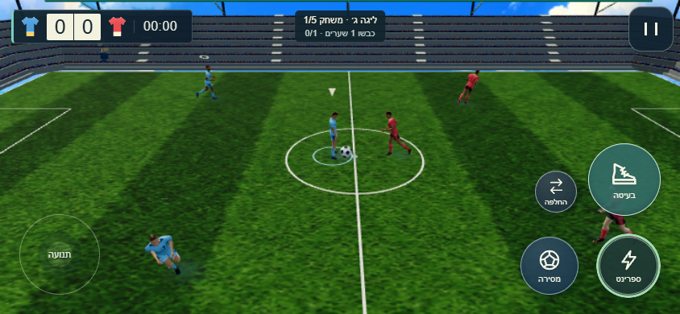

844x390 · אחרי · משחק טבעי, ברמת האיכות וביחס הפיקסלים של המדידה

844x390 · הגבהה בשתי אצבעות · תרחיש מגע במיקום משוחזר

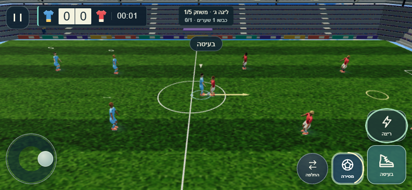

844x390 · חוץ ביד מעל הראש · תרחיש הוצאה משוחזר במצלמה הרגילה

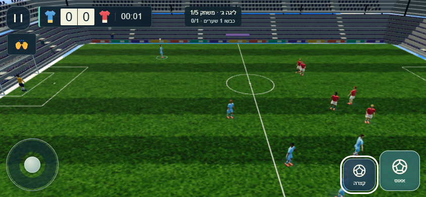

844x390 · קרן · תרחיש הוצאה משוחזר במצלמה הרגילה

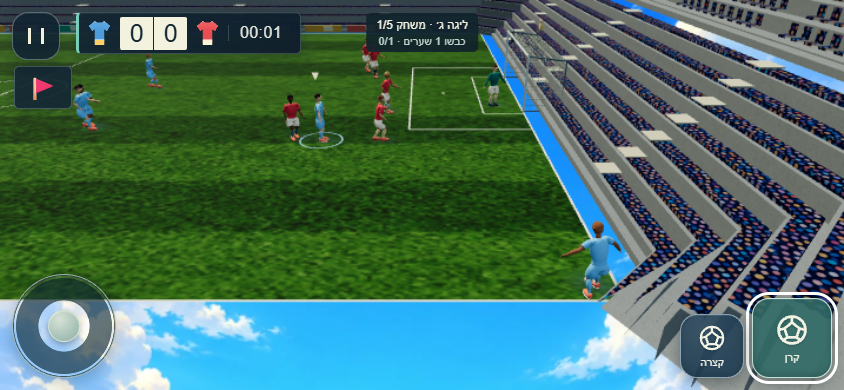

844x390 · בעיטת שער · תרחיש הוצאה משוחזר במצלמה הרגילה

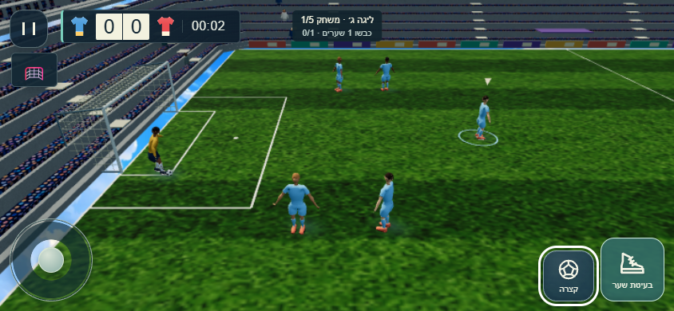

844x390 · מסירת שוער ביד · תרחיש הוצאה משוחזר במצלמה הרגילה

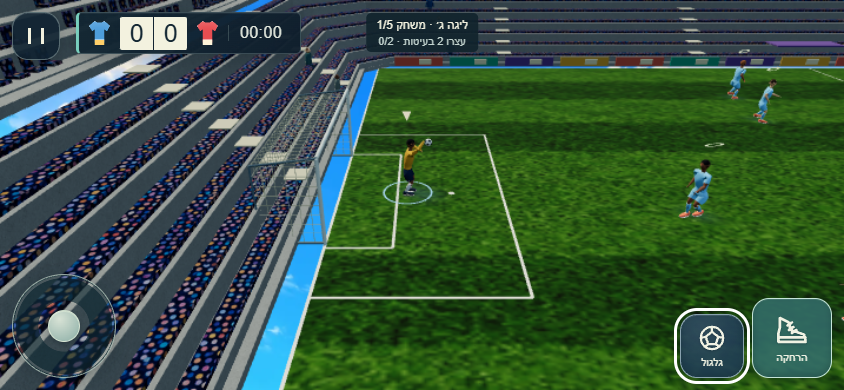

844x390 · בעיטת שוער מהיד · תרחיש הוצאה משוחזר במצלמה הרגילה

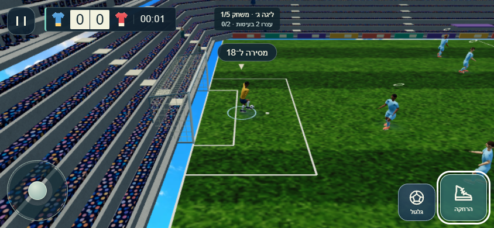

844x390 · חוץ · תקריב בדיקה במצלמת debug, אינו המבט הרגיל במשחק

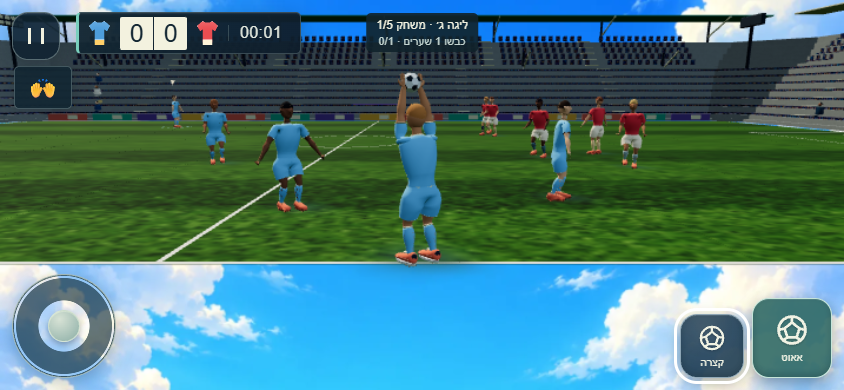

844x390 · פתיחה חוזרת תקינה לאחר כשל מפענח יזום

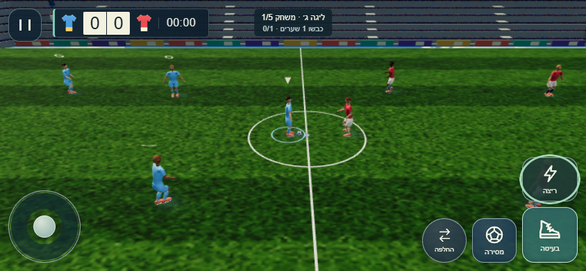

390x844 · לפני · מצלמת המשחק הרגילה

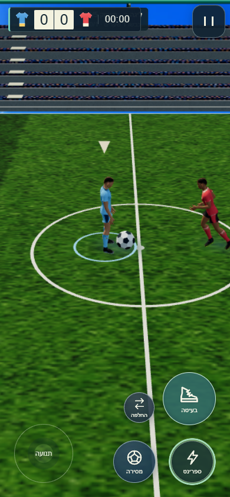

390x844 · אחרי · משחק טבעי, ברמת האיכות וביחס הפיקסלים של המדידה

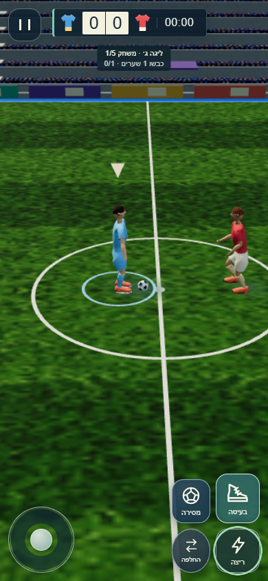

390x844 · הגבהה בשתי אצבעות · תרחיש מגע במיקום משוחזר

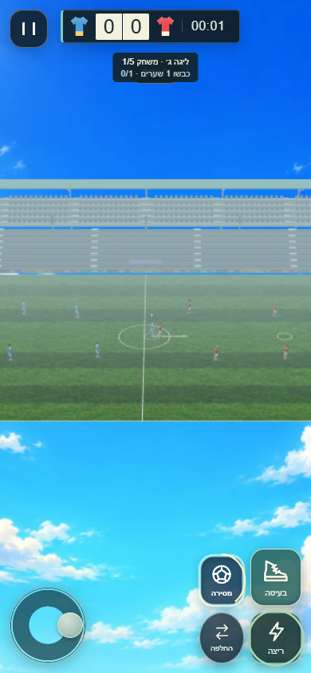

390x844 · חוץ ביד מעל הראש · תרחיש הוצאה משוחזר במצלמה הרגילה

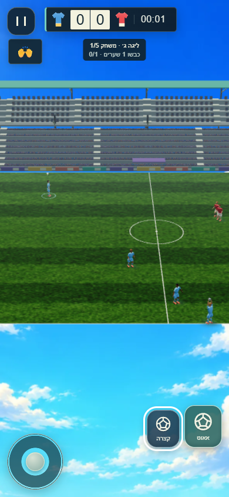

390x844 · קרן · תרחיש הוצאה משוחזר במצלמה הרגילה

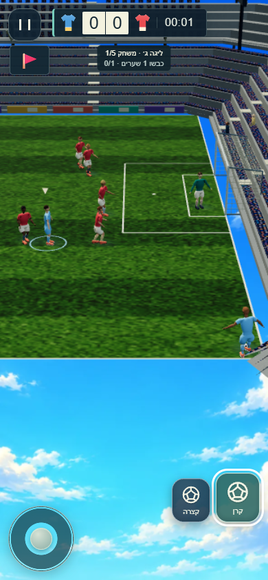

390x844 · בעיטת שער · תרחיש הוצאה משוחזר במצלמה הרגילה

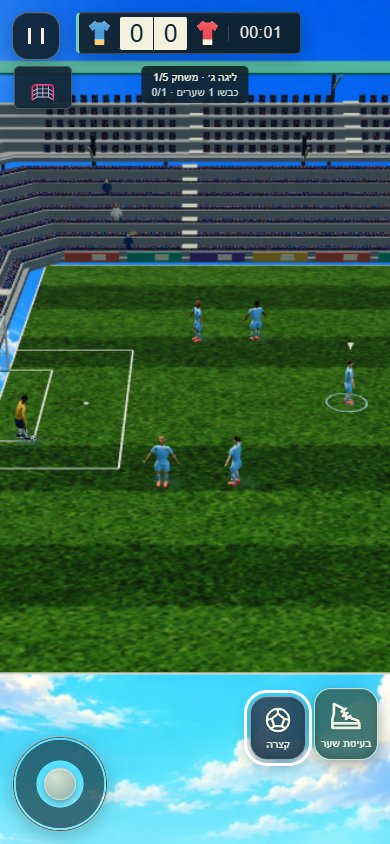

390x844 · מסירת שוער ביד · תרחיש הוצאה משוחזר במצלמה הרגילה

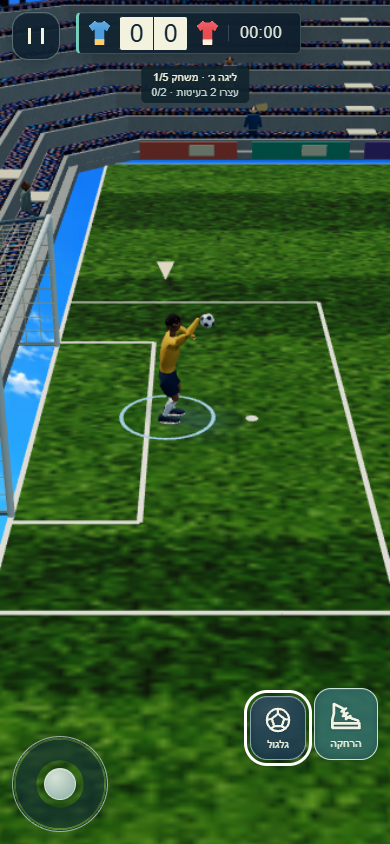

390x844 · בעיטת שוער מהיד · תרחיש הוצאה משוחזר במצלמה הרגילה

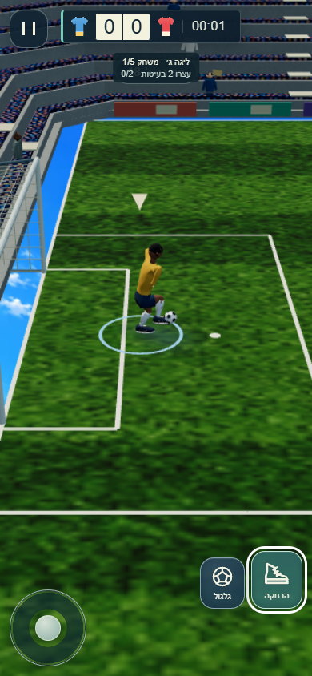

390x844 · חוץ · תקריב בדיקה במצלמת debug, אינו המבט הרגיל במשחק

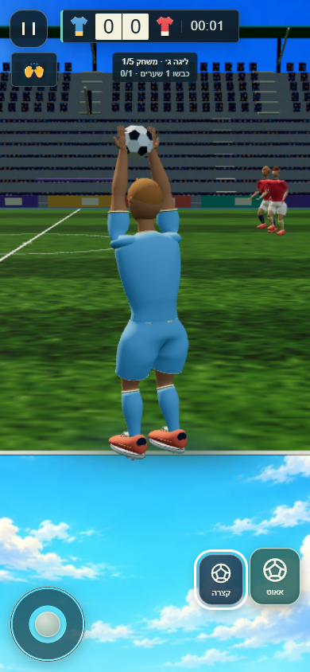

390x844 · פתיחה חוזרת תקינה לאחר כשל מפענח יזום

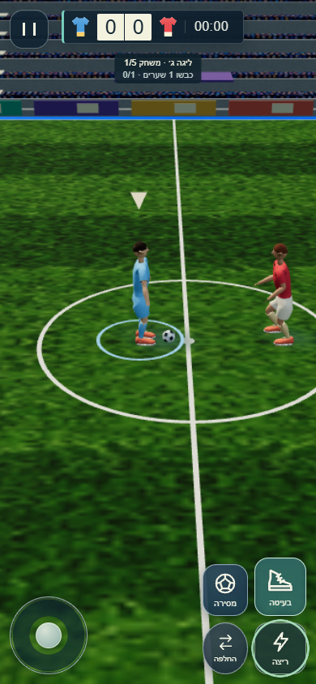
