# כדורגל · בדיקות שליטה ומשחק · 31.10.2026

קוד שנבדק: `67c649476ee72dfb482d1ea4adb0cd0609450123`. ענף: `codex/island-soccer-gameplay-20261031`.
הבסיס הזמני הוא ראש #212 (`23d79d50d756daec5bf756b084bce1d883638891`), באישור המשתמש, משום שהוא טרם מוזג אל main.
שלושה commits נפרדים לנושאי המשחק; commit ראיות זה מוסיף רק בדיקות מתועדות וצילומים.

| נושא | מה השתנה |
|---|---|
| תנועה | קווים, תמיכה, סימון ייחודי, מקבל יחיד למסירה וחזרה להגנה; הלוחץ מגיע גם לכדורים על גבולות המגרש. נושא כדור עוקף חסם שדה עומד בצד מחויב. |
| שליטה | דיוק בג׳ויסטיק, בחירה לפי מסלול וכיוון, מסירה מודעת לנתיב; גלישה עם מגע רציף, חלון פעיל והחלמה לפי סיכון. תקרת ספרינט, עוצמה וחוזי התוצאה/שמירה נשמרו. |
| הוצאות | הליכה והתארגנות לפני חוץ, קרן ובעיטת שער. חמישה קליפים חדשים מחוברים לדמות הבוגרת ולחלופת GLB. שחרור פיזי יחיד בזמן המגע, וכפתור מוחזק נצרך עד לשחרור האצבע. חץ ההכוונה מתחיל במוציא וטבעת הבחירה נשארת על המקבל. |

## ביצועים

כלי המקור `tools/perf-soccer.html` ללא שינוי; דפדפנים חדשים ברצף, Chrome/SwiftShader, DPR 1, seed 7, quality 0, חימום 3 שניות ומדידה 30 שניות בכל כיוון. זו מדידה בדסקטופ, לא בטלפון פיזי.

| מסך | p95 לפני | p95 אחרי | tick p95 לפני / אחרי | איכות לפני / אחרי |
|---|---:|---:|---:|---:|
| 844×390 | 66.7 ms | 66.7 ms | 0.6 / 0.7 ms | 3 / 3 |
| 390×844 | 50.1 ms | 50.1 ms | 0.5 / 0.7 ms | 3 / 3 |

**לא נמדדה נסיגה בפרופיל הזה.**
נתונים מלאים: [לפני](soccer-perf-before.json), [אחרי](soccer-perf-after.json).
בשני צדי מדידת הביצועים נרשמו בקשות 404 לאייקון האתר בלבד (favicon). בבדיקת משאבים נפרדת לא נמצאה טעינת משחק שנכשלה; לא נרשמו הפרות CSP במדידה.

## בדיקות

- [הרצת GitHub מלאה על Ubuntu / Node.js 22](https://github.com/roynaor-work/Bakasun/actions/runs/41160250509/job/124416030003): 3011 בדיקות; 2971 עברו, 0 נכשלו, 40 דולגו.
- ב־Windows זוהתה בנוסף בעיית נתיב קיימת בבדיקת מצלמה שאינה קשורה לכדורגל. היא שוחזרה גם בבסיס; קוד המצלמה והבדיקה לא נערכו.
- בדיקות השליטה והחידושים בדפדפן הורצו בפועל בשתי המידות. מדיניות CSP זהה ל־index.html, כולל `script-src 'self'`; inline נחסם בפועל ואחריו אפס שגיאות ואפס הפרות. ראיות: [שליטה](soccer-controls-browser.json), [חידושים](soccer-restarts-browser.json), [כוונת הוצאות](soccer-restart-aim-browser.json).
- בדיקות ותיקות שהניחו שחרור מיידי עודכנו לזמן המגע המבוקש: נשמרו מגבלות תנועה, מרחק, זמן החזקה וכיוון, ונוספו בעלות לפני מגע ושחרור יחיד. ספי ההתקפה, מרווחים, קושי וכיול בוטים לא הונמכו; כל 225 תרחישי G3h/G3i עברו.
- בדיקות הדפדפן החדשות מופעלות באמצעות `ISLAND_SOCCER_BROWSER=1` עם Chrome/Playwright מותקנים. הן דולגו רק בהרצת היחידות הרגילה והורצו בנפרד.

## צילומים

הוצאות הוכנו באמצעות מצב משחק לצורך שחזור. השוער נבדק ב־startSoccer האמיתי, תחת אותו CSP וממשק, בתפקיד שוער מפורש מפני שהליגה נפתחת בתפקיד שדה. תקריבים משתמשים במצלמת debug ומסומנים בנפרד.

| מצב | 844×390 | 390×844 |
|---|---|---|
| לפני, משחק טבעי | 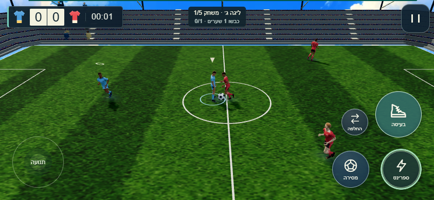 | 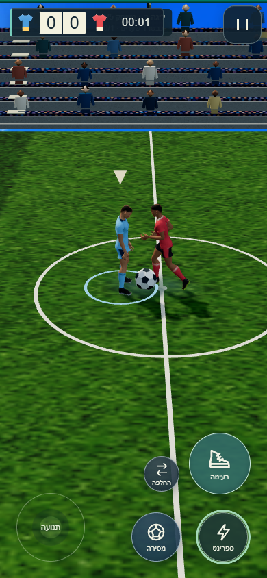 |
| אחרי, משחק טבעי | 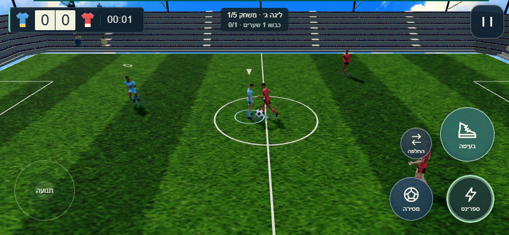 | 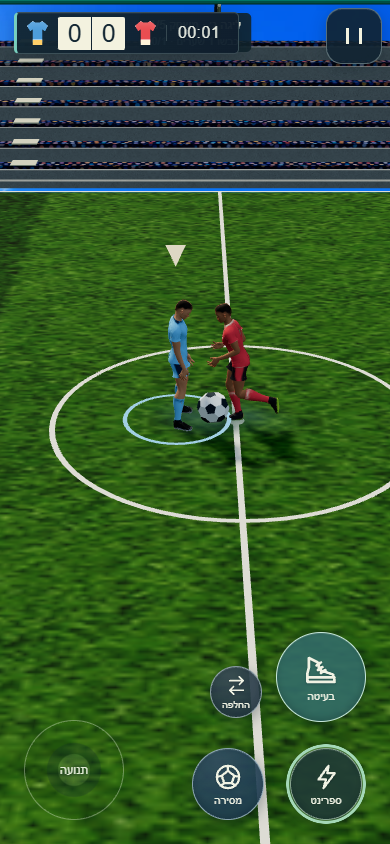 |
| חוץ, מצלמה רגילה | 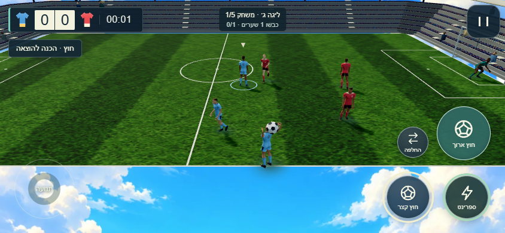 | 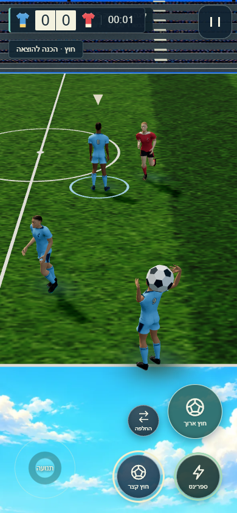 |
| קרן, מצלמה רגילה | 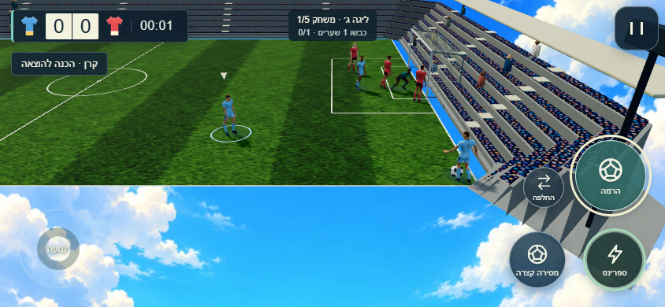 | 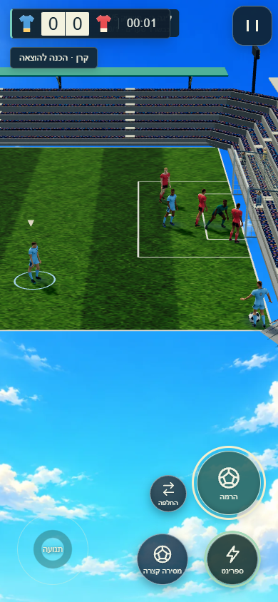 |
| בעיטת שער | 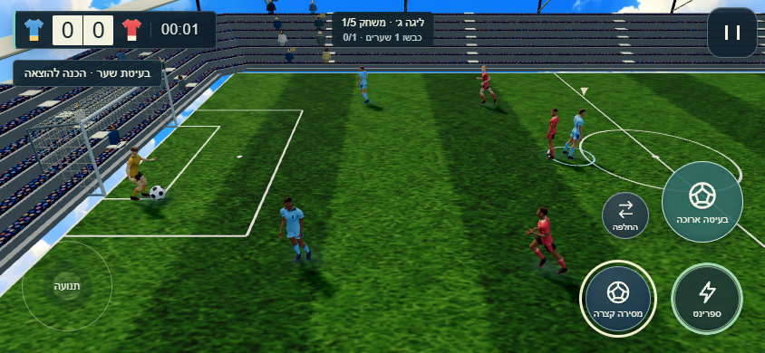 | 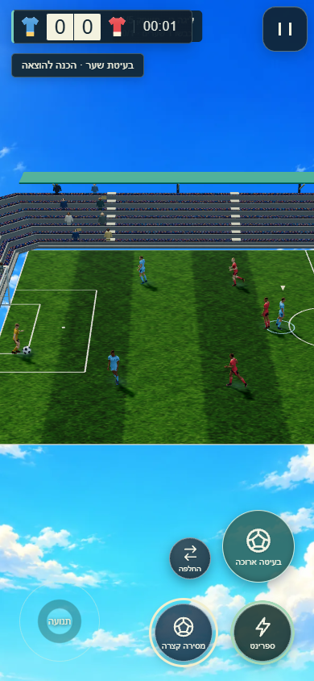 |
| זריקת שוער ביד | 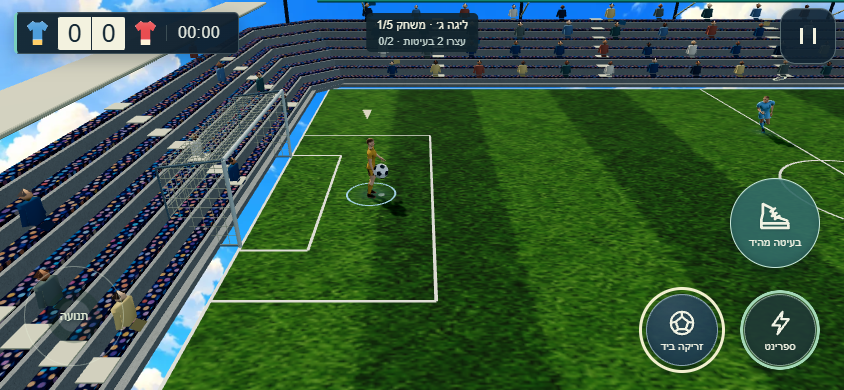 | 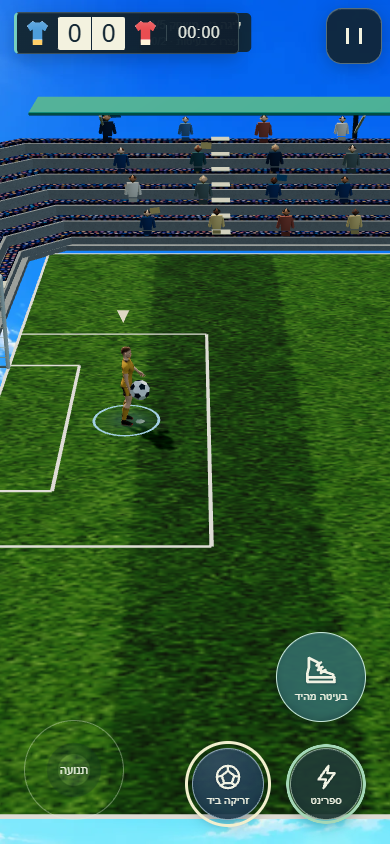 |
| בעיטת שוער מהיד | 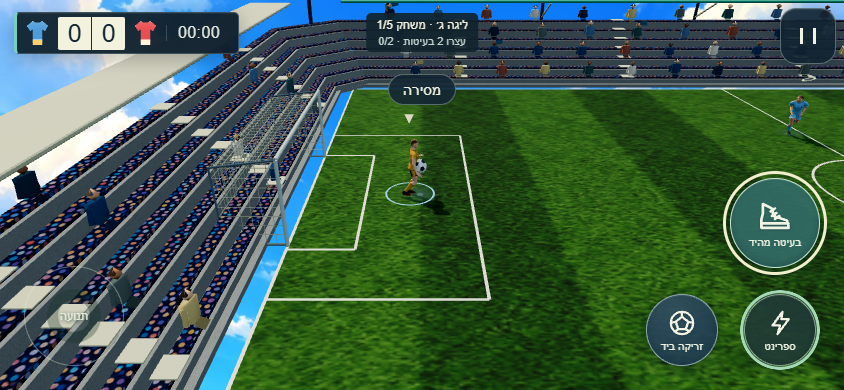 | 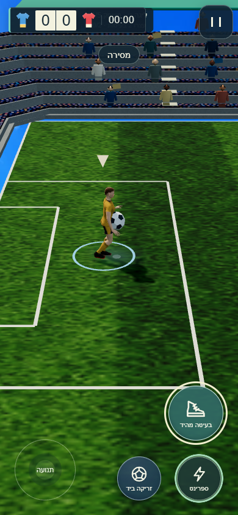 |
| תקריב בדיקה של חוץ | 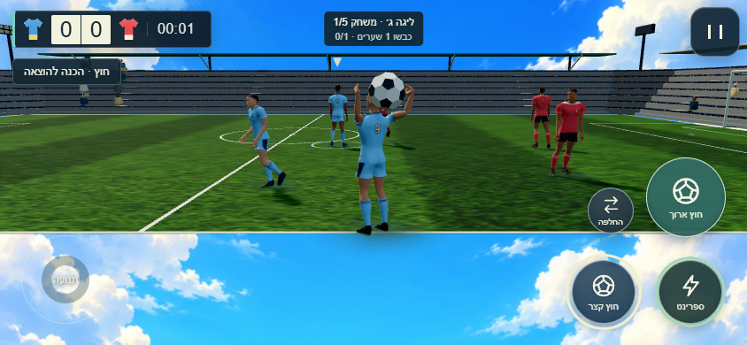 | 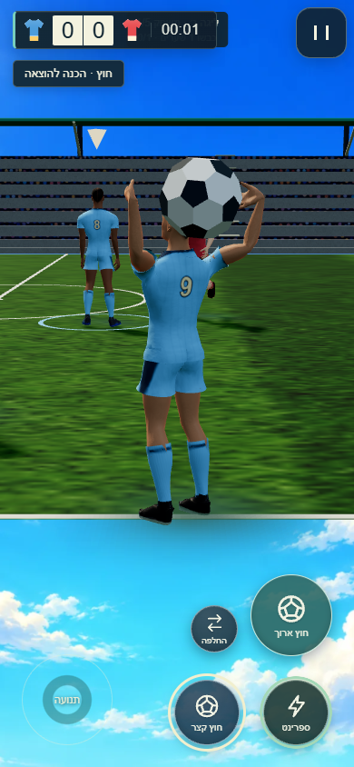 |
| הכוונה על המוציא | 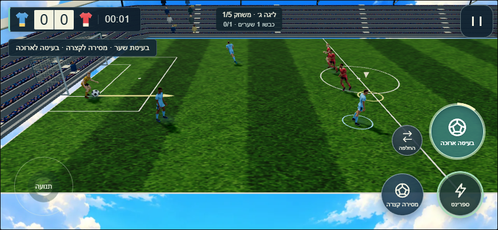 | 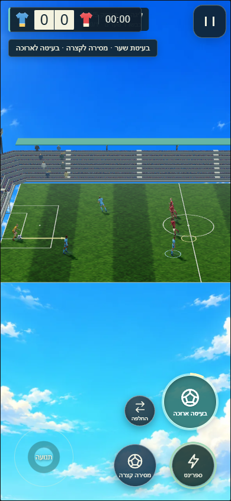 |

## לפני שחרור

1. להשלים את #212 ולבדוק את הבקשה מול main המעודכן; אין מיזוג אוטומטי בבקשה זו.
2. לבצע העלאת גרסה מרכזית מתואמת ב־release.json, release.mjs ותגי הייבוא `?v=`. הם לא נערכו בסבב הזה; אין שינוי לגרסת השמירה.
3. לבדוק תחושת משחק וביצועים בטלפון פיזי בשני הכיוונים. יעד התחושה בקירוב ל־FIFA עדיין מחייב אישור משחק אנושי ואינו תוצאה של צילום או של בדיקת יחידה.
