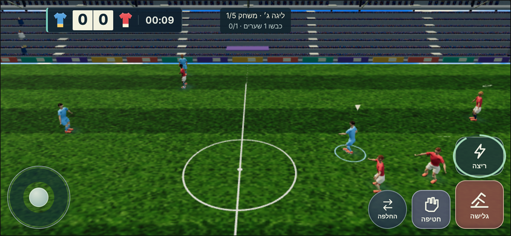
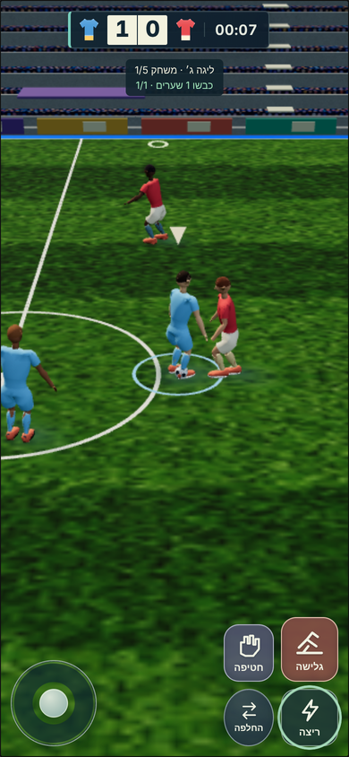
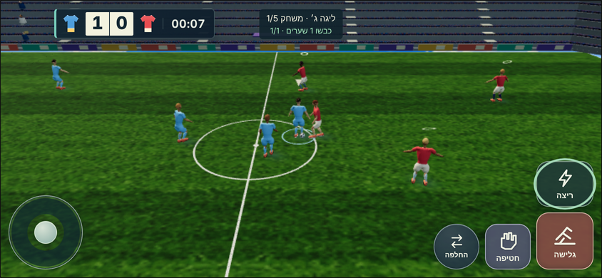
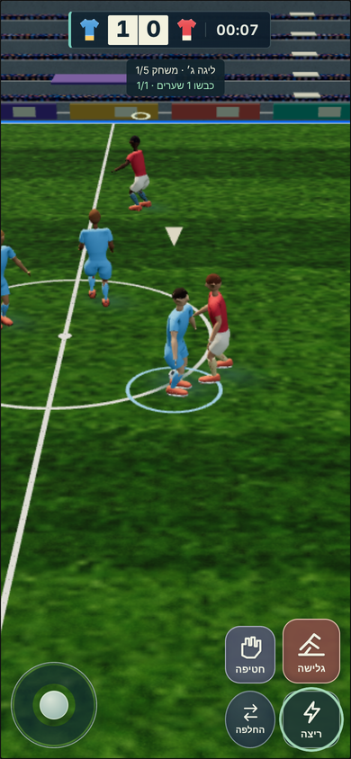
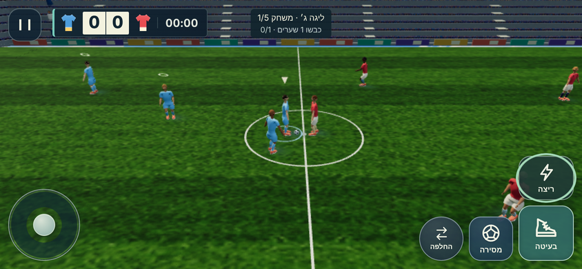
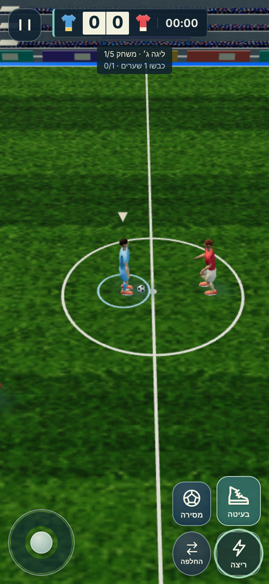
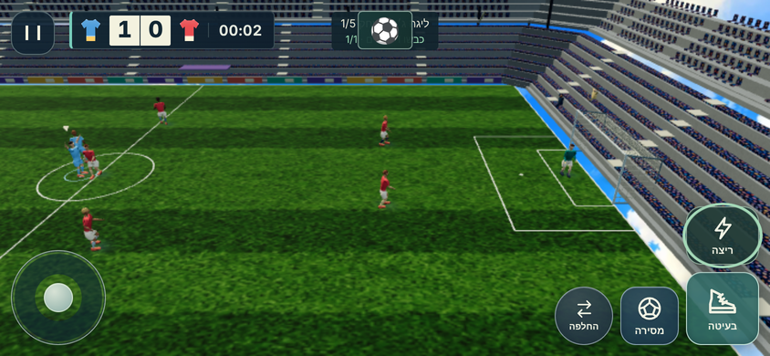
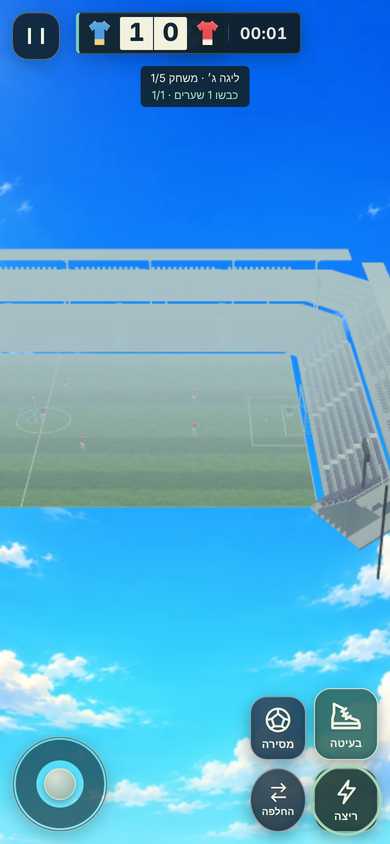
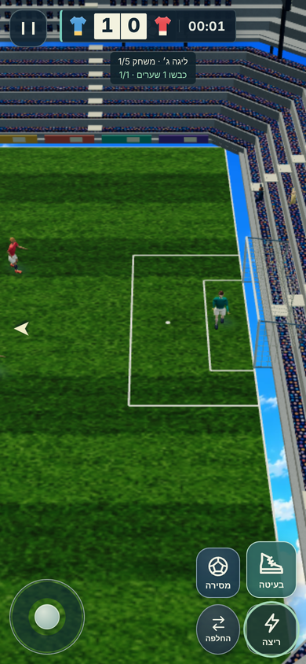

# כדורגל · סבב עומק v3 · 01.11.2026

ענף: `claude/soccer-v3` (שמונה commits מעל main אחרי #232). לא מוזג, לא נדחף ל-main, לא נפתחה בקשת מיזוג.
`release.json`, `release.mjs` ותגי `?v=` לא נערכו; העלאת גרסה אחת נדרשת בסוף על ידי הסשן הראשי. גרסת השמירה נשארת 18; חוזה התוצאה, איזון הקושי ומשחקים ללא קלט (G3h/G3i) לא השתנו.

## ביצועים

כלי המקור `tools/perf-soccer.html` ללא שינוי. Chrome/SwiftShader בדסקטופ, DPR 1, seed 7, quality 0 בפתיחה (הכלי יורד לרמה 3 בתוכנה), חימום 3 שניות ומדידה 30 שניות. זו אינה בדיקת טלפון פיזי.

| מסך | assetReadyMs לפני → אחרי | p95 לפריים לפני → אחרי (ms) | tick p95 לפני → אחרי | render p95 לפני → אחרי |
|---|---:|---:|---:|---:|
| 844×390 | 11,692 → 3,154 | 166.6 → 166.6 | 3.9 → 3.7 | 7.7 → 7.5 |
| 390×844 | 10,059 → 3,116 | 116.7 → 133.3 | 2.0 → 2.6 | 7.3 → 7.0 |

p95 לפריים ב-SwiftShader נשלט על ידי הרסטר בתוכנה ורועש בין ריצות (±20 ms); מספר המשולשים וקריאות הציור לא עלו. אין נסיגה ב-tick/render. נתוני המקור: [לפני](soccer-perf-before-main.json), [אחרי](soccer-perf-after-v3.json).

פרופיל הטעינה (סימוני `soccer:*` חדשים ב-performance.mark): לפני, המשחק רינדר את האצטדיון החלופי בכל פריים בזמן מסך הטעינה וקימפל את השיידרים שלו לחינם, מה שחנק את פענוח הנכסים; אפיית הרצפה של הדמויות עלתה 4.3 שניות לדמות ב-Node. אחרי: בלי רינדור עד שהנכסים מוכנים, אפייה על קודקודי קליפה (0.15 שניות לדמות, הבדל עד 2.4 מ"מ), דמויות מוכנות פעם אחת לדף, וחימום מתפריט הכדורגל.

## מה השתנה

| נושא | commit | מה |
|---|---|---|
| תנועה בלי כדור | 444efe9 | חלוץ על כתף המגן האחרון ופריצה מתוזמנת, קיצוני רחוק לרחבה / קרוב עוקף, קשר באלכסון מהצד הרחוק מהלחץ, הגנת שארית מחוברת, בלי התקהלות סביב הנושא, עד שני רצים; מקבל יוצא לכדור; ספרינט הצטרפות להתקפה. לקבוצה של הילד בלבד. |
| שליטה | b2a2d24 | בחירת שחקן לפי מסלול הכדור וכוונת המקל (גם כדור חופשי) כשהילד פעיל; גלישה בשלוש וריאציות (ישרה / רוחבית / מהירה) עם מגע סחוף, סיכון מאוחר/מאחור והתאוששות לפי תוצאה; מסירה אוטומטית שמעדיפה מסדרון פתוח; כדור קדימה בספרינט; קליפי motion2 של הגלישה בדמות. |
| הוצאות | 312e437 | חוץ עם הכדור בחזה עד הלחיצה ואז כל הרצף; השוער של הילד יוצא כמה צעדים, זורק לחבר פנוי בטווח או בועט רחוק. |
| טעינה | 94303e6 | ראו למעלה. |
| מראה | 54b5f06 | דשא עם דגימה עדינה ובלאי מגרש, רשת שער שמתנפחת אחרי גול, חולצות פחות גירניות. |
| מצלמה לאורך | da632d2 | הכדור במרכז, זווית 40°, התחלה ב-21 מ׳, שידור חוזר שנמשך אל היעד. רוחב ללא שינוי. |

מדדי צורה דטרמיניסטיים (`node workout/island/tools/soccer-shape-sim.mjs scenarios`, 175 תרחישים): אופציות קדימה לנושא 0.73 → 1.13, תמיכה קרובה 0.30 → 0.85, נוכחות ברחבה בשליש האחרון 0.69 → 0.93, מרווח יעדים מינימלי 2.4 מ׳, אפס יעדים צמודים לנושא.

## הורדה חד-פעמית למכשיר ודוח טעינה (01.11, אחרי המשוב של רועי מהטלפון)

מה רועי ראה בטלפון הוא האתר החי = main בגרסה `island-v2-20261101-1`, בלי הענף הזה. GitHub Pages שומר נכסים 10 דקות בלבד (`max-age=600`), ולכן כל פתיחה אחרי הפסקה הורידה מחדש את הדמויות, האצטדיון והתנועה; כישלון של בקשה אחת הפיל את כל המשחק לגרפיקה החלופית (אצטדיון מקוביות, דמויות אתלט/ילד) בלי שום הודעה.

| רכיב | קובץ | מה |
|---|---|---|
| מטמון במכשיר | `soccer-sw.js` (חדש, service worker קלאסי, `script-src 'self'`) | עונה מהמכשיר ל-47 נכסי הכדורגל בלבד (דמויות, תנועה, אצטדיון, טקסטורות, VFX, שמע, מפענח Draco). קוד האפליקציה ונתוני `?v=` ממשיכים לרשת. מטמון לפי גרסה (`island-soccer-<v>`), גרסה חדשה מוחקת את הישן. |
| רשימת הנכסים | `minigames/soccer-offline.mjs` (חדש) | 47 נתיבים + תבניות ההתאמה; הבדיקה מוודאת שכל קובץ קיים ושקוד/נתונים לא נתפסים. |
| כפתור בתפריט | `ui/soccer-card.mjs` | "הורדת נכסי המשחק למכשיר" עם התקדמות "12 מתוך 47"; נרשם כ-`island.soccer.assetsDownloaded`. הרישום של ה-worker קורה בכל כניסה לתפריט, כך שגם בלי לחיצה המשחק הראשון ממלא את המטמון והבא נטען מהמכשיר. |
| ניסיונות חוזרים | `soccer-design-character.mjs`, `soccer-design-scene.mjs` | `retrying` = 3 ניסיונות לכל GLB/JSON/טקסטורה לפני נפילה לגרפיקה החלופית. |
| דוח טעינה | `soccer-view.mjs` (`report()`), `soccer-session.mjs` (`saveLoadReport`) | מה נטען (דמויות design-glb-v2 / athlete / kid / blocks, אצטדיון design / fallback), משך, איכות, מסך, GPU, דפדפן, ולמה משהו נפל. נשמר ב-`island.soccer.lastLoadReport`, מוצג בתפריט הכדורגל עם כפתור העתקה. כשמשהו נפל: פס "הגרפיקה המלאה לא נטענה" 7 שניות במשחק. |

בדיקה בדפדפן (`island-soccer-v3-offline-browser`, תחת ה-CSP של `index.html`): ה-worker נרשם עם `?v=` של הגרסה, ההורדה מסיימת 47/47 בלי כישלונות, ובדף חדש באותו הקשר כל נכסי ה-design של המשחק מגיעים מה-worker עם `transferSize 0` (אפס רשת), הדמויות `design-glb-v2`, האצטדיון `design`, והדוח נכתב. אפס הפרות CSP, אפס שגיאות קונסול.

גודל הכדור: רדיוס 0.11 מ׳ (קוטר 22 ס״מ, כדור 5) מול דמות 1.8 מ׳ בכל מסלולי הגרפיקה (גם החלופיים נמתחים ל-1.8 מ׳), בדיוק היחס האמיתי; המסירה 12 מ׳/שנ׳ והבעיטה 17 מ׳/שנ׳ באותם מטרים. חוזה העיצוב (`normalizeSoccerBallGeometry`) אוסר הגדלה תלוית-מצלמה של הכדור. אם רועי רוצה כדור קריא יותר בטלפון (כמו במשחקי מובייל שמגדילים ×1.3), זו החלטה שצריכה לפתוח את החוזה, לא תיקון שקט.

## בדיקות

- `npm test`: 3,160 בדיקות, 3,117 עברו, 0 נכשלו, 43 דולגו (בדיקות הדפדפן דולגות בלי הדגל).
- `ISLAND_SOCCER_BROWSER=1` תחת ה-CSP המדויק של `index.html`: `island-soccer-motion2-browser` (5 תתי-בדיקות, שני הכיוונים, שדה ושוער) ו-`island-soccer-reopen-browser` עוברות. `island-soccer-design-controls-browser` נכשלת כאן ב-`page.setViewportSize: Protocol error (Browser.setWindowBounds)` גם על main ללא שינוי: מגבלה של ה-Chromium בקונטיינר (שינוי גודל חלון), לא של הקוד.
- צילומי הגול דרך המעטפת האמיתית (`?dev=1`, אותו CSP) עברו נקי: אפס הפרות CSP, אפס שגיאות קונסול.

## צילומים (390×844 ו-844×390, לפני = main, אחרי = v3)

| מצב | 844×390 | 390×844 |
|---|---|---|
| משחק טבעי לפני |  |  |
| משחק טבעי אחרי |  |  |
| משחק במעטפת אחרי |  |  |
| שער לפני |  |  |
| שער אחרי |  |  |

## מה לא נבדק

- טלפון פיזי: תחושת השליטה, משך הטעינה האמיתי, p95 על GPU אמיתי. המדידה כאן היא רסטר בתוכנה.
- הגלישות המעוצבות בתנועה (הקליפים מחוברים ונבדקו ביחידה; לא צולמו פריים-אחר-פריים).
- חימום הנכסים מהתפריט נבדק סטטית (קוד ובדיקת יחידה), לא במדידת טלפון.
