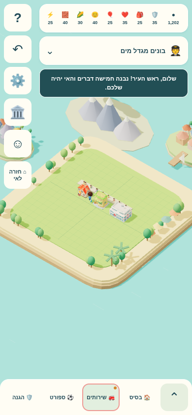
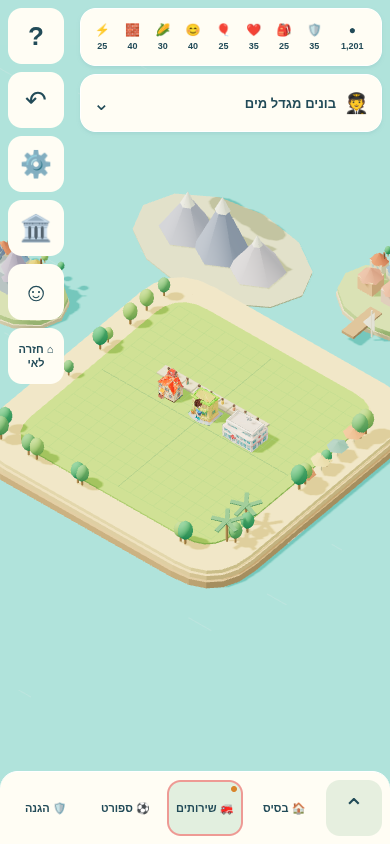
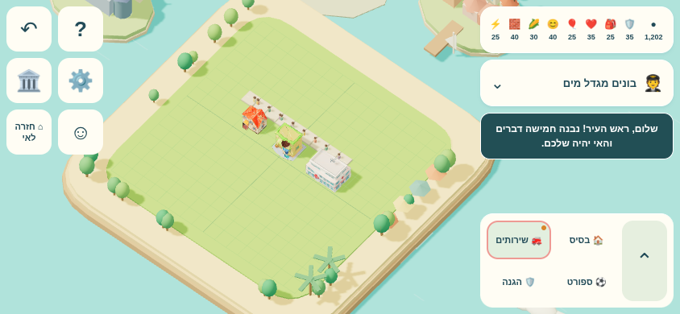
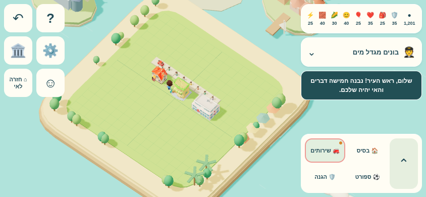
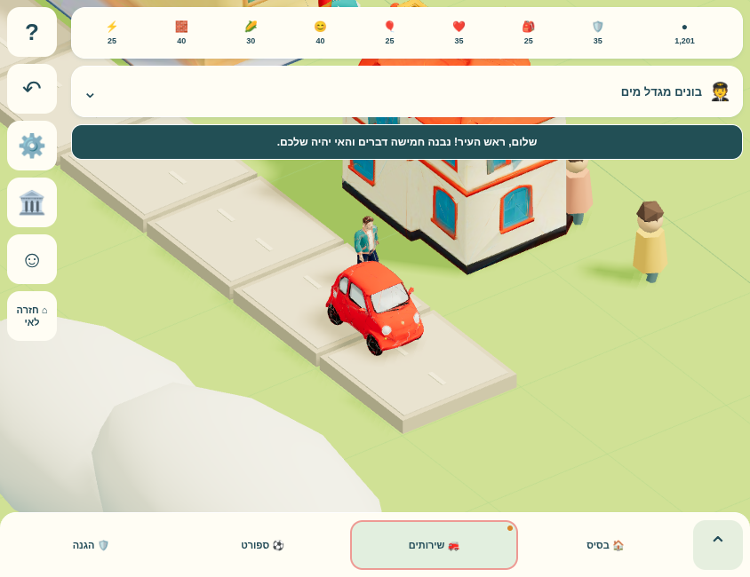

# TASK-017 — Meshy pilot

## Stage 0 (recorded before implementation)

- Base: latest fetched `origin/main`, `fa3b133880234a0d88d0226b61db011a0dfdb30b`.
- DATA_VERSION: `g2j-20261019-1`; save `CURRENT_VERSION`: **15**.
- `IslandView` preloads building model specs using `view/local-models.mjs` → local `vendor/GLTFLoader.js`. Its URL manager confines resources to `workout/island/`. `createBuilding` uses the loaded model, or its existing procedural geometry on failure. Instances share static geometry/materials; the cache owns their disposal.
- Connected city models: house level 1 `house-a-512.glb` (scale .77), shop `shop-corner-512.glb` (.97), hospital `hospital-512.glb` (its existing scale); higher house levels use code geometry.
- No city cars. `Citizens` in `view/avatar.mjs` draws procedural instanced bodies, heads, hair and swinging legs on `cityPaths`. The player separately uses `assets/kid-full.glb` with its run/stand mixer.
- No source module references `house-a-512-orig.glb`, `shop-corner-512-orig.glb`, or `shop-corner.glb`. They remain in place.
- Present: `palm-tree-512.glb` **299,172 bytes**; `firefighter-rigged-512.glb` **1,164,892 bytes**. Neither is connected by this pilot.

## Measurement protocol

Cold browser context, DPR 1, Chromium with ANGLE SwiftShader (software WebGL). Fixed random seed 17017. House L1 (4,6), shop (7,6), hospital (10,6), nine road cells x=3…11 / z=5. Normal `view.home()` camera, no zoom or camera changes. High quality and shadows held constant during measurement; the normal adaptive quality behavior remains enabled in the game. FPS uses real requestAnimationFrame delivery over two seconds, without a mocked clock. This environment is not a phone performance estimate.

`loadMs` is navigation loadEventEnd. `readyMs` includes asset readiness and the initial avatar UI interaction; it is recorded before the settling/sample interval. `downloadedBytes` sums encoded response bodies (navigation + resources); `transferBytes` additionally includes HTTP overhead. Screenshots and full resource lists are retained alongside the reports.


## Asset status

| Asset | City use | File in assets/models | Status | rotationY / scale |
| --- | --- | --- | --- | --- |
| Car | One parked car by the first house's path | car-a-512.glb | Connected | -90° / .38 |
| Adult man | One existing citizen replaced; 1-cell sidewalk shuttle | adult-man-rigged-512.glb | Connected | 0° / .32 |
| House L1 | Existing building | house-a-512.glb | Connected, unchanged | 0° / .77 |
| Shop | Existing building | shop-corner-512.glb | Connected, unchanged | 0° / .97 |
| Hospital | Existing building | hospital-512.glb | Connected, unchanged | 0° / 1.39 |
| Palm | No pilot use | palm-tree-512.glb | Deferred | — |
| Firefighter rig | No pilot use | firefighter-rigged-512.glb | Deferred | — |
| Original house | No source reference | house-a-512-orig.glb | Alternative, unused | — |
| Original shop | No source reference | shop-corner-512-orig.glb | Alternative, unused | — |
| Full shop | No source reference | shop-corner.glb | Alternative, unused | — |

Other uploaded models stay deferred. No GLBs, vendor files or codex-lab files changed.

## Calibration and fallback

- Car: authored -X nose → internal yaw -90° gives -Z, following the fire truck convention. The placement holder then aligns that forward direction with the chosen street segment. Uniform scale .38 gives length .720 and height .470, beside the existing .77-scale house (height 1.385). Lowest vertex is on the existing road top (GROUND + .1175), or the cosmetic path top (GROUND + .018). The pilot car is parked, so driving and cornering are not applicable.
- Adult: authored +Z front, internal yaw 0°, holder yaw `atan2(dx,dz)` follows both travel directions. Scale .32 gives authored height .544, visually fitted to the existing house doorway. Speed .3 city units/sec, route length 1 cell, 1.5 simulated seconds at each end. The existing view caps simulation delta to .05 seconds on slow frames, so real elapsed movement is slower under software rendering.
- Stop: Walking time **1/12 sec**, frame 2 at 24 fps, timeScale **0**. Sole offset .04563 model units × .32. Browser measurement gives both sole heights within **.00073 city units** of the sidewalk. The arm differs from the A-pose by .956 radians. No Idle or Running clip is played.
- `SkeletonUtils.clone` uses the Three.js r160 MIT clone utility retained in `view/skeleton-utils.mjs`; vendor remains byte-identical. Every walker has its own cloned bones, skeleton and AnimationMixer. A second instance is created only by the test, then disposed.
- Car failure: no car (the original city had none). Walker failure: the original procedural citizen count is retained. The two loads fail independently. Removed/moved houses update or hide the pilot. Closing during a pending load releases shared assets without late attachment.

## Measurements

| Viewport | Phase | Triangles | Draw calls | FPS | Load ms | Ready ms | Downloaded bytes |
| --- | --- | ---: | ---: | ---: | ---: | ---: | ---: |
| 390×844 | Before | 38,824 | 35 | 7.05 | 219.4 | 3020.4 | 3,981,819 |
| 844×390 | Before | 38,824 | 35 | 6.26 | 200.4 | 3583.8 | 3,964,525 |
| 390×844 | After | 48,600 | 37 | 3.44 | 279.8 | 2953.2 | 5,536,880 |
| 844×390 | After | 48,600 | 37 | 5.34 | 265.9 | 2407.0 | 5,519,586 |

The before/after camera matrices and frusta are identical per viewport. JSON contains complete resource-level byte counts. The measured triangle increase is 4,770 + 5,170 minus the replaced citizen's 164 triangles = **9,776**, with **2** additional draw calls. Two GLBs total **1,546,340 bytes**; the remaining increase is code/configuration and versioned module edges. No other model is newly requested.

The initial pre-implementation baseline is preserved in `initial/`. The comparison above repeats the baseline from an untouched archive of base commit fa3b133 on port 8766, followed sequentially by the final branch on port 8765, with the same measurement script and no other tests running. The deterministic seed, building list, quality, shadows, viewport and camera are identical. The normal performance downgrade is disabled only by the measurement harness (`view.started=Infinity`); gameplay retains it.

| Viewport | Before | After |
| --- | --- | --- |
| 390×844 |  |  |
| 844×390 |  |  |

Additional close camera (not used for the comparison):



## Validation and remaining limitations

- `node --test tests/*.mjs`: **1,647 passed, 0 failed, 38 existing skipped**, 1,685 total. New tests cover GLB contracts, skeleton independence, shared ownership, late disposal and absent animation fallback.
- Browser `task017-pilot-browser.mjs`: **8/8** cases (390×844 and 844×390 × normal / corrupt car / corrupt walker / corrupt both), **0 console errors, 0 out-of-folder requests**. Valid HTTP responses with intentionally corrupt bodies exercise loader/parse failures; 404/network-console diagnostics are not suppressed. Real foot movement is checked through the normal view loop; deterministic ticks additionally check both endpoint holds, return heading, cloned skeleton independence, separate mixers, real skinned sole contact, removal and restoration.
- The original whole-folder 15 MB guard already failed on main: **32,992,172** tracked bytes after the model uploads. It now measures the active runtime with all source-referenced models (about **9.16 MB**) against the **same 15 MB limit**. Evidence, browser test scripts and unused uploaded alternatives are excluded explicitly; the complete library still exceeds 15 MB. It is not claimed to fit the original whole-directory limit.
- DATA_VERSION bumped to `task017-20261017-1`, including pinned module/style edges. Save version stays **15**; this pilot adds no persistence fields or migrations.
- Remaining: software-WebGL FPS is low and regresses with the skinned model, especially portrait. A real phone/GPU performance check is needed before broader adoption. This pilot intentionally provides only one parked car and one walking adult; it does not establish a traffic, crowd, or collision system. No functional failures remain in the exercised cases.

## Reproduction

Serve the repository over HTTP (the existing default is localhost:8765), with Playwright available:

```sh
node --test tests/*.mjs
node workout/island/tests/task017-pilot-browser.mjs
node workout/island/tests/task017-measure.mjs
```

Set `PLAYWRIGHT_MODULE` and `CHROMIUM_PATH` if needed. For a baseline archive served on another port, run the measurement with `TASK017_PHASE=before` and `ISLAND_URL=http://127.0.0.1:8766/workout/island/?dev=1`. Browser scripts do not write save fixtures or GLBs. `browser.json`, `before.json`, `after.json` and `validation.json` retain structured evidence.
